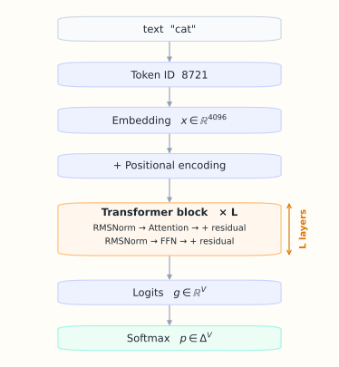
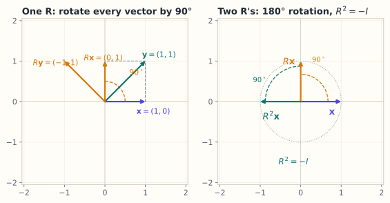

# 0.1 为什么大模型的母语是线性代数

> **本节位置**：模块 0 · 准备 ｜ **前置**：无 ｜ **预计**：25 分钟
>
> **一句话**：大模型是一台把向量反复变形、最后变成概率的机器，而矩阵是它的变形指令。

## 0. 场景引入

早上 9 点 40，一位后端工程师在改一个 Python 函数。她敲下回车，IDE 要在 **150 毫秒**内弹出补全建议，否则她根本不会低头去看。

这个补全服务背后是一个 70 亿参数的代码模型：隐藏维度 $D=4096$，32 层，上下文 2048 个 token。线上只有一张 **24 GB** 显存的卡。

问题立刻出现了：70 亿参数用 fp16 存，权重就是 $7\times10^9\times2\ \text{B}=14\ \text{GB}$；2048 token 的 KV Cache 再要 1.1 GB。剩下不到 9 GB，还能同时服务几个用户？

两个选项摆在桌上：把权重压到 int8（约 7 GB），并发翻倍但补全质量略降；或者维持 fp16、只接 4 路，高峰期排队。三个数——14 GB、1.07 GB、8.9 GB——决定了这个取舍，而它们全都来自矩阵的形状。算错就会在下午的高峰期 OOM，用户看到的是「补全暂不可用」，然后永远把它关掉。

要回答这个问题，你得先弄清楚三件事：一次前向到底有多少次矩阵乘法、参数量怎么从形状里数出来、为什么矩阵乘法是唯一能喂饱 GPU 的运算。

读完本节，你应该能回答三个问题：

1. 大模型一次前向，计算量主要花在哪一步？
2. 参数量 $12D^2L$ 是怎么从形状推出来的，它为什么直接决定显存？
3. 为什么「层与层之间必须插入非线性」不是可选项，而是深度的前提？

## 1. 直觉

### 1.1 流水线视角

把大模型想成一条**向量流水线**：



*图：一个 token 的旅程。文本先变成 token id，查表得到 embedding，加上位置编码后进入 L 层 Transformer；每一层里是 RMSNorm、Attention / FFN 与残差，最后经 logits 与 softmax 变成下一个词的概率。*

> 💡 **一句话直觉**：模型不直接处理「词」，它处理「词对应的向量」；每一层都在做「把向量乘一个矩阵，加一点东西，再弯一下」。

### 1.2 它在现实世界里对应什么

像一条**汽车装配线**：每个工位是一台固定尺寸的模具（一个矩阵），物料（向量）依次经过每个工位，被冲压、翻转，再送回主线叠加。模具的尺寸在生产开始前就定死了——这就是「形状」；一条 32 个工位的产线，吞吐量由最慢的工位决定，而不是工位数量。

量级：7B 模型每生成一个 token，要走大约 $2\times7\times10^9=1.4\times10^{10}$ FLOP 的矩阵乘（前向每个参数约 2 次浮点运算，按此估算）。若一张卡实跑到 1000 token/s，就是 $1.4\times10^{13}$ FLOP/s，比笔记本 CPU 高三个数量级。

这个类比在哪里失效？装配线上的工人可以改工艺、物料可以在工位停留；推理时矩阵是**冻结**的，而且每个 token 都要把 14 GB 权重从显存重新读一遍——**很多时候瓶颈不是「加工」，而是「搬运」**（第 10.3 节）。它还把「训练」藏起来了：真实模型要靠反向传播调整这些模具，那是微积分与优化的任务（M08）。但**推理**阶段，确实就是这条产线。

## 2. 定义

### 2.1 线性映射

设 $V$ 和 $W$ 是两个向量空间。映射 $T:V\to W$ 称为**线性映射（linear map）**，如果对任意向量 $\mathbf{x},\mathbf{y}\in V$ 和任意标量 $a,b$：

$$
T(a\mathbf{x}+b\mathbf{y}) = aT(\mathbf{x}) + bT(\mathbf{y})
$$

这句话读作：**先组合再变换 = 先变换再组合**。它包含两条性质：

- **可加性**：$T(\mathbf{x}+\mathbf{y})=T(\mathbf{x})+T(\mathbf{y})$；
- **齐次性**：$T(a\mathbf{x})=aT(\mathbf{x})$。

把「向量空间」与「线性映射」从具体坐标里抽出来、当作公理化对象来研究，最早的系统工作出自[皮亚诺](#ref-peano-1888) 1888 年的《几何演算》；在那之前，向量和变换几乎总是和具体的 $\mathbb{R}^n$ 绑在一起。

### 2.2 矩阵

给定 $V$ 的一组基和 $W$ 的一组基，线性映射 $T$ 可以被写成一个矩阵 $A$，使得

$$
T(\mathbf{x}) = A\mathbf{x}
$$

其中 $A$ 的形状是 $m\times n$（输入 $n$ 维，输出 $m$ 维）。**矩阵不是线性映射本身，而是线性映射在一组基下的「坐标表示」**——换一组基，矩阵会变，但映射不变（第 2.5 节）。

### 2.3 线性代数

线性代数研究三件事：

1. **向量空间**：向量住在哪里，维度是多少；
2. **线性映射**：向量如何被变换，能否撤销、分解；
3. **分解**：复杂矩阵能否写成简单矩阵的乘积（对角、三角、正交、低秩）。

## 3. 为什么这样定义

你可能会问：为什么偏偏要求「线性」？现实世界明明是非线性的。

三个原因：

**第一，线性映射可以被有限信息完全描述。** 只要知道基向量被送到哪里，整个映射就确定了。一个 $4096\times4096$ 的矩阵有 1677 万个自由度，看似很多，但它是**可计算、可存储、可并行**的。

**第二，线性映射的复合还是线性映射。** 两层线性层 $A$ 和 $B$ 叠在一起，等价于一个矩阵 $BA$。这既是深度网络可以「叠深」的数学基础，也是为什么**中间必须插入非线性**——否则 100 层线性层会坍缩成 1 层，深度毫无意义。

**第三，线性运算极其适合硬件。** 矩阵乘法可以拆成大量互不依赖的乘加，GPU 的成千上万个核心可以同时开工。今天大模型的算力账单，大部分付给了矩阵乘法（第 10.3 节）。

反过来，如果去掉线性性，映射就需要无限多的信息来描述，也没法用矩阵表示。**线性是一种「用有限描述无限」的妥协**——而深度学习用非线性函数（ReLU、GELU、softmax）把这个妥协补回来。

### 3.1 反事实：换一种定义会坏在哪

**反事实 A：允许任意映射。** 取 $\mathbf{x}=(1,0)$ 与 $2\mathbf{x}=(2,0)$，考虑平方映射 $T(\mathbf{x})=(x_1^2,x_2^2)$：

$$
T(1,0)=(1,0),\qquad T(2,0)=(4,0)
$$

若 $T$ 线性，必须有 $T(2\mathbf{x})=2T(\mathbf{x})=(2,0)$，可实际是 $(4,0)$——差一倍。所以**没有任何矩阵等于平方**。

这不只是「少一个函数」：矩阵用 $n^2$ 个参数刻画了整个 $\mathbb{R}^n$ 上的映射（$4096^2\approx1.7\times10^7$ 个数），而一张「查表」要覆盖连续的输入空间，表的大小是无穷大，装不进任何硬盘。

**反事实 B：保留矩阵乘法，但把所有非线性换成逐元素操作。** 取 $\mathbf{x}=(1,1)$、$A=\begin{bmatrix}1&1\\0&1\end{bmatrix}$，逐元素平方记作 $S$：

$$
S(A\mathbf{x})=S\begin{bmatrix}2\\1\end{bmatrix}=\begin{bmatrix}4\\1\end{bmatrix},
\qquad
A(S\mathbf{x})=A\begin{bmatrix}1\\1\end{bmatrix}=\begin{bmatrix}2\\1\end{bmatrix}
$$

同一组输入，两条路径给出完全不同的结果。逐元素操作对每一维用同一条曲线，可以随意与「重排维度」交换顺序，却**永远无法表达「第 1 维与第 2 维相加」**。把它当万能近似器，等于断言 4096 个特征互不相干：每个特征只能沿着自己那条曲线变化，学到的最多是「这一维大就继续大」。

结论荒谬得一眼可见：一个只做逐元素运算的 4096 维「网络」，等价于 4096 条互不相关的单变量函数，参数再多也拼不出一句语法。所以非线性必须夹在矩阵乘**之间**，而不是取代矩阵乘。

## 4. 性质与推导

### 4.1 线性映射由基的像唯一决定

设 $\mathbf{e}_1,\dots,\mathbf{e}_n$ 是 $V$ 的一组基。任意 $\mathbf{x}$ 可以写成

$$
\mathbf{x} = x_1\mathbf{e}_1+\cdots+x_n\mathbf{e}_n
$$

由线性性：

$$
T(\mathbf{x}) = x_1T(\mathbf{e}_1)+\cdots+x_nT(\mathbf{e}_n)
$$

所以只要知道 $T(\mathbf{e}_1),\dots,T(\mathbf{e}_n)$ 这 $n$ 个输出向量，就知道了整个 $T$。把这 $n$ 个输出向量按列排起来，就是矩阵 $A$。

**这就是「矩阵的列 = 基向量的像」的来历**（第 3.2 节会展开）。

### 4.2 复合就是矩阵乘法

设 $T(\mathbf{x})=A\mathbf{x}$，$S(\mathbf{y})=B\mathbf{y}$。先做 $T$ 再做 $S$：

$$
(S\circ T)(\mathbf{x}) = B(A\mathbf{x}) = (BA)\mathbf{x}
$$

读作：**复合映射对应矩阵乘积，顺序是「后做的在左边」**。这个「从右往左」的约定，是矩阵乘法不可交换的根源，也是阅读公式时最容易出错的地方。

矩阵乘法不是为「行乘列」而发明的，它一开始就是线性替换复合的简写。今天用的乘法、单位阵与逆矩阵记号，基本定型于[凯莱](#ref-cayley-1858) 1858 年的矩阵回忆录。

### 4.3 参数量粗估：$12D^2L$

设隐藏维度为 $D$，层数为 $L$。忽略偏置与 embedding：

- Attention 的 $W_Q,W_K,W_V,W_O$ 各是 $D\times D$，共 $4D^2$；
- FFN 通常是 $D\to4D\to D$，参数 $D\cdot4D+4D\cdot D=8D^2$；
- 每层合计 $12D^2$，$L$ 层约 $12D^2L$。

对 GPT-2 small：$D=768$，$L=12$，$12\times768^2\times12\approx8.49\times10^7$，加上词表 embedding $50257\times768\approx3.86\times10^7$，总计约 1.24 亿——与公开的 124M 参数量吻合。这不是巧合，而是形状决定的。

## 5. 例子

### 5.1 手算：一个 2D 旋转

考虑矩阵

$$
R=\begin{bmatrix}0&-1\\1&0\end{bmatrix}
$$

它对 $\mathbf{x}=(1,0)^\top$ 的作用是：

$$
R\mathbf{x}=\begin{bmatrix}0&-1\\1&0\end{bmatrix}\begin{bmatrix}1\\0\end{bmatrix}=\begin{bmatrix}0\\1\end{bmatrix}
$$

即把「向右」转成「向上」。对 $(1,1)^\top$：

$$
R\begin{bmatrix}1\\1\end{bmatrix}=\begin{bmatrix}-1\\1\end{bmatrix}
$$

验证线性性：$R(2\mathbf{x})=2R\mathbf{x}$，$R(\mathbf{x}+\mathbf{y})=R\mathbf{x}+R\mathbf{y}$。这个矩阵描述的是逆时针 90° 旋转——一个纯粹的线性变换。



*图：同一个 $R$ 作用在两个向量上，方向都逆时针转 90°；右图连续作用两次，方向再转 90°，合计 180°，即 $R^2=-I$。*

### 5.2 场景：一个 token 穿过一层

假设隐藏维度 $D=4$（真实模型是 4096，这里只为看清楚）。某个 token 的向量是

$$
\mathbf{x}=\begin{bmatrix}0.5\\-1.2\\0.3\\0.8\end{bmatrix}
$$

一个线性层 $W\in\mathbb{R}^{4\times4}$ 计算 $W\mathbf{x}+\mathbf{b}$：16 次乘法、12 次加法，得到新的 4 维向量。对 4096 维、4096 个 token、32 层，同样的操作要做 $4096\times4096\times4096\times32$ 次——这就是为什么大模型需要 GPU。

### 5.3 场景闭环：24 GB 单卡能接几个用户

回到开头那台机器，把账算完。

**输入**：$7\times10^9$ 个参数，fp16 每个 2 B，权重

$$
7\times10^9\times2\ \text{B}=14\ \text{GB}
$$

上下文 $T=2048$、$H=32$ 个头、$d_k=128$、32 层，KV Cache

$$
2\times32\times2048\times128\times2\ \text{B}\times32=1.07\ \text{GB}
$$

**计算**：单请求占 $14+1.07\approx15.1$ GB，24 GB 卡剩 8.9 GB；权重在并发间共享，每多一路只多一份 KV Cache，所以并发上限约 $\lfloor8.9/1.07\rfloor=8$ 路。

**输出**：调度器开 8 个槽位，第 9 个请求排队。

**成本**：decode 阶段每个 token 都要把 14 GB 权重读一遍。按 1.5 TB/s 显存带宽估算，读一遍 9.3 ms；batch 8 时这 9.3 ms 摊给 8 个用户，平均 1.2 ms/token。prefill 2048 token 约 $2\times7\times10^9\times2048=2.9\times10^{13}$ FLOP，按 300 TFLOP/s 估算约 96 ms——这是首 token 延迟的大头。

**失败条件**：

- **漏乘 2**：KV Cache 忘了 K 和 V 各一份，算成 0.54 GB，并发估成 16 路，第 9 个请求一到就 OOM。兜底：按实测显存预留 20% 余量，别卡着上限排。
- **上下文翻倍**：$T$ 从 2048 到 8192，KV Cache 涨到 4.3 GB，并发掉到 2 路。兜底：限制最大上下文，长请求单独排队。
- **dtype 混用**：拿 int8 的 7 GB 去算 fp16 的账，显存差一倍。兜底：按 dtype 显式换算，别凭印象。

## 6. 常见误区

1. **误区**：线性代数就是「算矩阵」，学它等于学计算技巧。
   **纠正**：计算是副产品。线性代数是一套**描述空间与变换的语言**；矩阵只是这种语言的「坐标写法」。同一个变换换一组基，矩阵完全不同。

2. **误区**：模型「理解」了语义，所以内部一定有类似人类的符号。
   **纠正**：模型内部是向量与矩阵。所谓「理解」，目前只能从行为与表示几何上观察，不能直接等同于人类概念（第 9.3、11.1 节）。

3. **误区**：维度越高越聪明。
   **纠正**：维度是**容量**，不是智能。能否学到有用结构，取决于数据、训练目标与优化；高维也可能大量冗余（第 2.6 节「秩」）。

4. **误区**：既然有非线性，线性代数就没那么重要。
   **纠正**：非线性是「点状」的（逐元素），绝大部分**参数与计算**仍在矩阵乘法里；而且分析非线性网络时，我们仍然在每一点做**局部线性化**（Jacobian，第 8.3 节）。

## 7. 概念网络

- 后续：[0.2 数学语言](02-数学语言-集合映射与求和.md) —— 先学会读符号。
- 后续：[0.3 张量](03-标量向量矩阵张量.md) —— 先把形状看懂。
- 后续：[M01 向量与几何](../01-向量与几何/README.md) —— 建立「方向、长度、相似」的直觉。
- 后续：M03 矩阵与线性映射 —— 系统学习矩阵作为映射。
- 后续：M11 大模型专题 —— 把这一节的流水线拆到每一层。

## 8. 通往大模型：一次 forward 的完整形状链

以 batch 大小 $B$、序列长度 $T$、隐藏维度 $D$ 为例（忽略 batch，单条序列时 $B=1$）：

| 步骤 | 运算 | 形状 |
|---|---|---|
| token id | 查表 | `[B, T]` |
| embedding | 查 embedding 表 $E\in\mathbb{R}^{V\times D}$ | `[B, T, D]` |
| QKV 投影 | $XW_Q$ 等 | `[B, T, D]` |
| 拆头 | reshape + transpose | `[B, H, T, d_k]` |
| 注意力打分 | $QK^\top/\sqrt{d_k}$ | `[B, H, T, T]` |
| softmax | 对最后一维 | `[B, H, T, T]` |
| 加权求和 | $PV$ | `[B, H, T, d_k]` |
| 合并头 + 输出投影 | reshape + $W_O$ | `[B, T, D]` |
| FFN | $D\to4D\to D$ | `[B, T, D]` |
| 输出层 | $XW_{\text{vocab}}$ | `[B, T, V]` |
| 采样 | softmax + 采样 | `[B, T]` → 下一个 token |

表里的 embedding 查表就是「词 → 稠密向量」：这张矩阵通常随机初始化、随训练更新。把词映射成稠密向量、并让语义相近的词在向量空间里靠近，成为标准做法始于 [Mikolov 等](#ref-mikolov-2013) 的 word2vec。

**可检验结论**：注意力的计算量随 $T^2$ 增长（$QK^\top$ 是 $T\times T$），这是长上下文昂贵的根本原因；而 KV Cache 缓存的是 $K,V$，形状 `[B, H, T, d_k]`（第 11.7 节）。

表中的 QKV 投影、缩放点积注意力与多头拆分，最初的完整描述见 [Vaswani 等](#ref-vaswani-2017)（2017）。

**如果这一步算错，用户会看到什么**：形状链上错一个轴——比如把 `[B,H,T,d_k]` 当成 `[B,T,H,d_k]` 直接打分——框架往往不报错，而是静默广播，输出「语法通顺但语义漂移」：同一段话里主语反复更换，像换了个作者。KV Cache 少缓存一层，生成到第 2、3 个 token 就开始重复上一个词；位置编码错位则短句正常、长文复读。这些都能肉眼观察，不是抽象风险。

```python
# 用 NumPy 验证形状链（不需要模型权重）
import numpy as np
B, T, D, H = 2, 5, 8, 2
d_k = D // H
X = np.random.randn(B, T, D)
Wq = np.random.randn(D, D)
Q = X @ Wq                      # [B, T, D]
Q = Q.reshape(B, T, H, d_k).transpose(0, 2, 1, 3)  # [B, H, T, d_k]
scores = Q @ Q.transpose(0, 1, 3, 2) / np.sqrt(d_k)  # [B, H, T, T]
print(scores.shape)             # (2, 2, 5, 5)
```

## 9. 练习

1. **概念**：判断下列函数是否线性，并说明原因：(a) $f(x)=3x$；(b) $f(x)=x+2$；(c) $f(x)=x^2$；(d) $f(\mathbf{x})=A\mathbf{x}$。
2. **计算**：设 $D=512$，$L=6$，用 $12D^2L$ 粗估参数量；再加上词表 $V=32000$ 的 embedding 参数，结果是多少？
3. **场景**：在你每天使用的某个 App 里，找出一处「向量 + 矩阵乘法」的影子（推荐、搜索、相机美颜均可），描述输入向量、矩阵和输出。
4. **开放**：如果所有线性层之间都不加非线性，一个 $L$ 层网络等价于几层？这对「深度」意味着什么？

<details>
<summary>参考答案</summary>

1. (a) 线性；(b) 仿射，不是线性（不过原点）；(c) 非线性；(d) 线性。
2. $12\times512^2\times6=18{,}874{,}368$；embedding $32000\times512=16{,}384{,}000$；合计约 3526 万。
3. 例如短视频推荐：用户兴趣向量 $\mathbf{u}\in\mathbb{R}^{64}$，物品 embedding 矩阵 $E\in\mathbb{R}^{N\times64}$，打分 $E\mathbf{u}$ 取 top-k。输入是用户行为聚合的向量，矩阵是物品库。
4. 等价于 1 层，因为 $W_L\cdots W_1$ 仍是一个矩阵。深度因此失去意义——这正是非线性激活存在的原因。

</details>

## 10. 一页速记

- 大模型推理 ≈ 向量流水线：embedding → 多层「矩阵乘 + 非线性 + 残差」→ logits → softmax。
- 线性映射：$T(a\mathbf{x}+b\mathbf{y})=aT(\mathbf{x})+bT(\mathbf{y})$；矩阵是它在基下的坐标表示。
- 复合 = 矩阵乘法，后做的在左边；因此矩阵乘法一般不可交换。
- 参数量粗估 $12D^2L$；计算量主要花在矩阵乘法上。
- 没有非线性，深层线性网络会坍缩成一层。
- **物理意义 / 现实对应**：一条装配线——矩阵是定死的模具，向量是流过的物料；真正的成本常常是「搬运」（显存带宽），而不是「加工」（FLOP）。

## 11. 参考文献与致谢

这一页的知识不是凭空来的。下面列出本页直接借用的原始工作与权威整理；正文中的人名、定理名已链接到对应条目。链接优先指向 DOI、arXiv 或可长期访问的原文存档。

- <a id="ref-vaswani-2017"></a>**Vaswani 等（2017）**：*Attention Is All You Need*。本页第 8 节那条 `[B,T,D] → [B,H,T,d_k] → [B,H,T,T]` 的形状链就是这篇论文的注意力层；缩放因子 $1/\sqrt{d_k}$ 与多头拆分也定义在这里。[arXiv:1706.03762](https://arxiv.org/abs/1706.03762)
- <a id="ref-cayley-1858"></a>**凯莱（Arthur Cayley, 1858）**：*A memoir on the theory of matrices*。把矩阵乘法定义为线性替换的复合，并固定了单位阵与逆矩阵的记号；本页「复合就是矩阵乘法」的源头。[Phil. Trans. R. Soc. 148](https://doi.org/10.1098/rstl.1858.0002)
- <a id="ref-peano-1888"></a>**皮亚诺（Giuseppe Peano, 1888）**：*Geometric Calculus: According to the Ausdehnungslehre of H. Grassmann*（原著 *Calcolo geometrico secondo l'Ausdehnungslehre di H. Grassmann*，1888）。第一次把向量空间与线性变换当作公理化对象处理，使「线性映射」不再依赖具体坐标。[英译注本（Birkhäuser, 2000）](https://doi.org/10.1007/978-1-4612-2132-6)
- <a id="ref-mikolov-2013"></a>**Mikolov 等（2013）**：*Efficient Estimation of Word Representations in Vector Space*。word2vec 的出处；本页流水线第 2 步「把 token id 查成稠密向量」的现代做法由此普及。[arXiv:1301.3781](https://arxiv.org/abs/1301.3781)

---

下一篇 → [0.2 数学语言：集合、映射与求和符号](02-数学语言-集合映射与求和.md)
