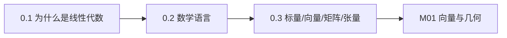

# M00 · 准备：数学语言

> **这一模块不教新定理，只教你「读懂数学」和「看懂形状」。**
> 如果跳过它，后面每一篇都会多花一倍时间。

## 为什么先学这个

线性代数教材默认你已经习惯这些符号：$\sum_{i=1}^n$、$x\in\mathbb{R}^n$、$f:\mathbb{R}^n\to\mathbb{R}^m$、$A^\top$。
但离开学校多年后，真正卡住人的往往不是概念，而是**符号**。

更现实的是：大模型代码里到处是形状 `[B, T, D]`、`[B, H, T, T]`。
读不懂形状，就看不懂 attention；看不懂 attention，就读不懂推理过程。

本模块解决三件事：

1. 知道线性代数在整个大模型里**站在哪**（0.1）；
2. 能逐字读出一条论文公式（0.2）；
3. 能对着一个张量说出每个轴是什么（0.3）。

## 概念地图

## 学习顺序

| 顺序 | 文档 | 时间 | 读完你应该能…… |
|---|---|---|---|
| 1 | [0.1 为什么大模型的母语是线性代数](01-为什么大模型的母语是线性代数.md) | 25 min | 用一句话说清 forward pass 里线性代数在哪 |
| 2 | [0.2 数学语言：集合、映射与求和符号](02-数学语言-集合映射与求和.md) | 35 min | 逐字读出一条含 $\sum$ 的公式 |
| 3 | [0.3 标量、向量、矩阵、张量：按轴理解](03-标量向量矩阵张量.md) | 30 min | 看到 `[B,T,D]` 能说出每个轴的含义 |

## 本模块的大模型钩子

- **0.1**：一次 Transformer forward 的完整形状链
- **0.2**：论文公式的读法、形状推导
- **0.3**：`[B,T,D] → [B,H,T,d_k]` 的变形

## 自测（读完再做）

1. 用「叠加原理」解释为什么 $f(x)=2x$ 是线性的，而 $f(x)=x+1$ 不是。
2. 把 $\sum_{i=1}^{3}\sum_{j=1}^{2} a_{ij}b_j$ 展开成 6 项。
3. 一个张量形状是 `[2, 5, 8]`，它有几个轴？第 2 个轴长度是多少？转置第 1、2 轴后形状是什么？
4. 一个 $D=4096$ 的线性层（$D\to D$）有多少参数？为什么大模型参数量可以用 $12D^2L$ 粗估？

自测答案

1. $f(ax+by)=2(ax+by)=a(2x)+b(2y)=af(x)+bf(y)$；$g(x)=x+1$ 时 $g(ax+by)=ax+by+1$，而 $ag(x)+bg(y)=ax+by+a+b$，多出 $a+b-1$。
2. $a_{11}b_1+a_{12}b_2+a_{21}b_1+a_{22}b_2+a_{31}b_1+a_{32}b_2$。
3. 3 个轴；第 2 个轴长度 5；交换第 1、2 轴后是 `[5, 2, 8]`。
4. $4096\times4096+4096\approx16.78$M。每层 attention 的四个投影约 $4D^2$，FFN 约 $8D^2$，合计 $12D^2$，乘层数 $L$。

---

下一篇 → [0.1 为什么大模型的母语是线性代数](01-为什么大模型的母语是线性代数.md)
