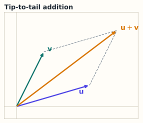

# 1.2 加法、数乘与线性组合

> **本节位置**：模块 1 · 向量与几何 ｜ **前置**：[1.1](01-向量是什么.md) ｜ **预计**：35 分钟
>
> **一句话**：线性组合就是「按配方把若干向量混在一起」；整个线性代数都在研究「哪些东西能被混出来」。

## 0. 场景引入

调一杯奶茶，你有三种「基础味道」：

- 茶味 $\mathbf{t}=(1,0,0)$
- 奶味 $\mathbf{m}=(0,1,0)$
- 糖味 $\mathbf{s}=(0,0,1)$

一杯「三分茶、五分奶、两分糖」的奶茶，味道是

$$
0.3\,\mathbf{t}+0.5\,\mathbf{m}+0.2\,\mathbf{s}=(0.3,0.5,0.2)
$$

这就是一个**线性组合**：每个基础向量乘一个系数，再全部加起来。

现在换一个问题：如果只允许用茶和奶，你能调出「有糖味」的奶茶吗？不能——因为糖味不在茶和奶张成的空间里。**「能混出什么」正是线性代数的核心问题。**

## 1. 直觉

### 1.1 加法：首尾相接

两个箭头相加，把第二个箭头的起点移到第一个箭头的终点，再从原点连到终点（平行四边形法则）。

*图：首尾相接。两条虚线补出平行四边形，另一条对角线也是 u+v。*

代数上更简单：对应分量相加。

### 1.2 数乘：拉伸或翻转

$c\mathbf{v}$ 把箭头沿原方向拉伸 $|c|$ 倍；$c<0$ 时方向翻转；$c=0$ 时得到零向量。

### 1.3 线性组合：配方

$$
\mathbf{w}=c_1\mathbf{v}_1+c_2\mathbf{v}_2+\cdots+c_k\mathbf{v}_k
$$

> 💡 **一句话直觉**：**线性组合 = 用一组「基向量」按系数配方，调出目标向量。**

这个类比在哪里失效？配方里的系数可以是负数，甚至任意实数；「负的茶味」没有物理意义，但在数学上完全合法，它让「减法」成为可能。

## 2. 定义

### 2.1 向量加法

对 $\mathbf{u},\mathbf{v}\in\mathbb{R}^n$：

$$
(\mathbf{u}+\mathbf{v})_i=u_i+v_i
$$

几何上遵循平行四边形法则；物理上是力的合成。

### 2.2 数乘

对 $c\in\mathbb{R}$：

$$
(c\mathbf{v})_i=cv_i
$$

几何上是沿 $\mathbf{v}$ 方向的伸缩（含翻转）。

### 2.3 线性组合

给定向量 $\mathbf{v}_1,\dots,\mathbf{v}_k\in\mathbb{R}^n$ 和标量 $c_1,\dots,c_k$，

$$
\mathbf{w}=c_1\mathbf{v}_1+\cdots+c_k\mathbf{v}_k
$$

称为它们的**线性组合（linear combination）**，$c_i$ 叫系数。

### 2.4 张成

所有可能的线性组合组成的集合叫**张成空间（span）**：

$$
\operatorname{span}\{\mathbf{v}_1,\dots,\mathbf{v}_k\}
=\left\{\sum_{i=1}^{k}c_i\mathbf{v}_i\ \middle|\ c_i\in\mathbb{R}\right\}
$$

它总是一个**子空间**（对加法和数乘封闭，第 2.2 节）。

### 2.5 仿射组合与凸组合（易混）

- **仿射组合**：系数之和为 1，$\sum c_i=1$；
- **凸组合**：系数非负且和为 1，$c_i\ge0,\ \sum c_i=1$。

线性组合不要求系数和为 1。这个区别在几何上很关键：仿射组合描述「直线/平面」，凸组合描述「线段/凸包」。

## 3. 为什么这样定义

如果只允许「加法」不允许「数乘」，你只能得到整数倍的组合；如果允许数乘但不允许加法，你只能得到一条射线。

两者结合，才得到**整个平面/空间**。更重要的原因：

1. **封闭性**：线性组合的结果仍在同一个空间里，这让「子空间」成为可能；
2. **可分解**：任何向量都能写成基向量的组合，于是「研究向量」变成「研究系数」（第 2.4 节）；
3. **可叠加**：如果系统是线性的，多个输入的效果可以分别计算再相加——这就是叠加原理，也是 residual connection 的数学基础。

## 4. 性质与推导

### 4.1 基本运算律

对任意 $\mathbf{u},\mathbf{v},\mathbf{w}$ 和 $a,b\in\mathbb{R}$：

| 性质 | 式子 |
|---|---|
| 交换律 | $\mathbf{u}+\mathbf{v}=\mathbf{v}+\mathbf{u}$ |
| 结合律 | $(\mathbf{u}+\mathbf{v})+\mathbf{w}=\mathbf{u}+(\mathbf{v}+\mathbf{w})$ |
| 零元 | $\mathbf{v}+\mathbf{0}=\mathbf{v}$ |
| 负元 | $\mathbf{v}+(-\mathbf{v})=\mathbf{0}$ |
| 数乘结合 | $a(b\mathbf{v})=(ab)\mathbf{v}$ |
| 分配律 | $a(\mathbf{u}+\mathbf{v})=a\mathbf{u}+a\mathbf{v}$ |
| 单位元 | $1\mathbf{v}=\mathbf{v}$ |

这八条就是「向量空间公理」的雏形（第 2.1 节）。

### 4.2 张成的三种典型情形（$\mathbb{R}^2$）

- $\operatorname{span}\{(1,0)\}$：$x$ 轴，一条直线；
- $\operatorname{span}\{(1,0),(0,1)\}$：整个平面 $\mathbb{R}^2$；
- $\operatorname{span}\{(1,1),(0,0)\}$：仍是一条直线（零向量不增加维度）。

**判断技巧**：张成的维数 = 这组向量中「真正独立」的向量个数，也就是秩（第 2.6 节）。

### 4.3 线性组合与矩阵乘法

把 $\mathbf{v}_1,\dots,\mathbf{v}_k$ 按列排成矩阵 $V=[\mathbf{v}_1\ \cdots\ \mathbf{v}_k]$，则

$$
c_1\mathbf{v}_1+\cdots+c_k\mathbf{v}_k=V\mathbf{c}
$$

其中 $\mathbf{c}=(c_1,\dots,c_k)^\top$。**矩阵乘向量 = 列的线性组合**。这是理解矩阵乘法最重要的一句话（第 3.2、3.3 节）。

## 5. 例子

### 5.1 手算：线性组合

$\mathbf{v}_1=(1,2)$，$\mathbf{v}_2=(3,-1)$，求 $2\mathbf{v}_1-1\mathbf{v}_2$：

$$
2(1,2)-1(3,-1)=(2,4)-(3,-1)=(-1,5)
$$

验证：也可以写成 $V\mathbf{c}$，其中 $V=\begin{bmatrix}1&3\\2&-1\end{bmatrix}$，$\mathbf{c}=(2,-1)^\top$：

$$
V\mathbf{c}=\begin{bmatrix}1&3\\2&-1\end{bmatrix}\begin{bmatrix}2\\-1\end{bmatrix}
=\begin{bmatrix}2-3\\4+1\end{bmatrix}=\begin{bmatrix}-1\\5\end{bmatrix}
$$

### 5.2 手算：张成判断

$\mathbf{v}_1=(1,2)$，$\mathbf{v}_2=(2,4)$。因为 $\mathbf{v}_2=2\mathbf{v}_1$，所有组合都落在同一条直线上：

$$
c_1(1,2)+c_2(2,4)=(c_1+2c_2)(1,2)
$$

所以 $\operatorname{span}\{\mathbf{v}_1,\mathbf{v}_2\}$ 是一维直线，不是整个平面。

### 5.3 场景：RGB 混色

屏幕上一个像素的颜色是 $(R,G,B)$，三个基向量是红、绿、蓝。
任何颜色都是三者的线性组合，系数是亮度。这也是为什么显示器只需要三种原色——三种基足够张成可见颜色的三维子空间。

（真实色觉是非线性的，这个类比在「颜色感知」层面失效；但在 RGB 编码层面成立。）

## 6. 常见误区

1. **误区**：$\operatorname{span}\{\mathbf{v}_1,\mathbf{v}_2\}$ 就是这两个向量的集合。
   **纠正**：span 包含**所有**系数组合，通常是一个无限大的直线/平面/空间，远大于两个向量本身。

2. **误区**：embedding 满足「国王 − 男人 + 女人 = 女王」，所以向量加法就是语义运算。
   **纠正**：这是**近似**成立的几何现象，不是严格代数规律；不同模型、不同词差异很大，不能当作可靠推理规则。

3. **误区**：仿射组合和线性组合一样。
   **纠正**：线性组合允许系数和任意；仿射组合要求系数和为 1。$2\mathbf{x}$ 是线性组合，但不是仿射组合。

4. **误区**：负系数没有意义，所以不算线性组合。
   **纠正**：线性组合允许任意实数系数；负系数对应反向拉伸，是「减法」的来源。

## 7. 概念网络

- 前置：[1.1 向量](01-向量是什么.md) —— 向量是什么。
- 后续：[1.3 点积](03-点积.md) —— 用系数衡量方向一致程度。
- 后续：2.2 子空间与张成 —— 把 span 抽象成子空间。
- 后续：2.3 线性无关 —— 什么时候组合有冗余。
- 后续：3.2 矩阵乘向量 —— 矩阵乘法的列视角。

## 8. 通往大模型：残差流就是一条「向量加法高速公路」

Transformer 里每个子层的输出都加回主幹：

$$
\mathbf{h}\leftarrow\mathbf{h}+\operatorname{Attention}(\mathbf{h}),\qquad
\mathbf{h}\leftarrow\mathbf{h}+\operatorname{FFN}(\mathbf{h})
$$

- $\mathbf{h}\in\mathbb{R}^{D}$ 是当前 token 的隐藏状态；
- 加法是逐分量加法，形状不变；
- 这让梯度可以沿「加法高速公路」直接回传，缓解深层网络的训练困难。

**可检验结论**：残差连接**不改变形状**，也不引入新参数。它的作用是把「新信息」以**叠加**的方式写进同一个向量，而不是替换。

另一个相关概念是**特征叠加（superposition）**：模型可能用 $D$ 维空间表示远多于 $D$ 个特征，通过近似正交的方向「挤」在一起。这解释了为什么单个神经元/维度往往不可解释，而方向可以（第 9.3、12.2 节）。

**偏置项**：$\mathbf{y}=W\mathbf{x}+\mathbf{b}$ 中的 $+\mathbf{b}$ 是仿射变换，不是线性变换；但它只是把整个空间平移，不改变「线性」结构，所以通常被归入「线性层」的俗称。

## 9. 练习

1. **概念**：用「配方」类比解释 $\operatorname{span}\{(1,0),(0,1)\}=\mathbb{R}^2$，并说明为什么 $\operatorname{span}\{(1,0)\}$ 不是 $\mathbb{R}^2$。
2. **计算**：$\mathbf{v}_1=(2,-1,3)$，$\mathbf{v}_2=(0,4,1)$，求 $3\mathbf{v}_1-2\mathbf{v}_2$。
3. **计算**：判断 $(3,6)$ 是否能写成 $(1,2)$ 与 $(2,5)$ 的线性组合；若能，求系数。
4. **场景**：解释为什么 residual connection 用加法而不是乘法；如果改成乘法会发生什么？
5. **开放**：`king - man + woman ≈ queen` 这类现象，说明了 embedding 空间的什么性质？又为什么不能过度依赖？

参考答案

1. 任意 $(x,y)$ 可写成 $x(1,0)+y(0,1)$；只有 $(1,0)$ 时，第二个分量恒为 0，只能得到 $x$ 轴。
2. $3(2,-1,3)-2(0,4,1)=(6,-3,9)-(0,8,2)=(6,-11,7)$。
3. 设 $a(1,2)+b(2,5)=(3,6)$，解 $a+2b=3,\ 2a+5b=6$，得 $a=3,b=0$，可以。
4. 加法保持形状、保持恒等路径、梯度可直传；乘法会改变尺度、破坏恒等映射，深层连乘容易梯度消失/爆炸。
5. 说明语义关系近似对应向量差方向；但它是统计近似，受训练数据、词频、多义性影响，不能当作逻辑推理。

## 10. 一页速记

- 线性组合 $=\sum c_i\mathbf{v}_i$，系数任意实数。
- span = 所有线性组合 = 一个子空间。
- $V\mathbf{c}$ 就是「用 $V$ 的列做线性组合」。
- 仿射组合要求系数和为 1；凸组合还要求非负。
- 残差连接 = 向量加法，形状不变，梯度直通。

---

下一篇 → [1.3 点积：相似度的来源](03-点积.md)
