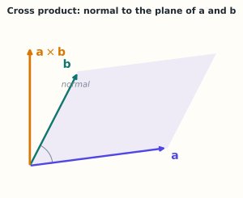

# 1.7 叉积与三重积（选学）

> **本节位置**：模块 1 · 向量与几何 ｜ **前置**：[1.3](03-点积.md) ｜ **预计**：20 分钟
>
> **一句话**：叉积是三维空间里「由两个向量造出第三个垂直向量」的运算，长度等于平行四边形面积。

## 0. 场景引入

一个 3D 手游，卡在 60 fps 的预算里：每帧 **16.7 ms**。场景 **20 万个三角形**，视野内 3 万个。

每个可见三角形都要算法向量，用来算光照、做背面剔除。法向量由两条边的叉积得到；如果叉积的**顺序写反**（$\mathbf{b}\times\mathbf{a}$ 而不是 $\mathbf{a}\times\mathbf{b}$），方向整个翻过来：光照从「太阳在左上」变成「太阳在右下」，背面剔除同步反转——角色一半的面被剔掉，看起来像透明的。

决定：法向量预计算存进顶点缓冲（3 万个 × 3 个 float = 360 KB），还是每帧现算（3 万个 × 15 次乘加）？两边的取舍很清楚：预计算省下每帧的算术，却让顶点缓冲多传 360 KB；现算省显存，但顶点着色器里每个顶点都要重做一次。低端机内存带宽只有 5 GB/s 时，这点差别足以让帧率从 60 掉到 45。押错的代价：美术验收时一眼看出「塑料感」，返工一周。

读完本节，你应该能回答三个问题：

1. 叉积为什么只在三维有「唯一」的垂直方向？
2. 交换顺序为什么翻转方向，这在渲染里意味着什么？
3. 三重积为什么等于体积，它和行列式是什么关系？

## 1. 直觉

给两个不共线的箭头，它们张成一个平面。叉积给出这个平面的**法向量**，方向由右手定则决定，长度等于平行四边形面积。

*图：a、b 张成的平行四边形是浅色平面；叉积沿法线方向，长度等于这个平行四边形的面积。*

右手定则：四指从 $\mathbf{a}$ 弯向 $\mathbf{b}$，拇指指向 $\mathbf{a}\times\mathbf{b}$。

> 💡 **一句话直觉**：**叉积 = 用两个向量造出「垂直于它们所在平面」的向量，长度 = 面积。**

这个类比只适用于三维（以及七维的某些构造）；二维没有真正的叉积，四维以上也没有唯一的「垂直方向」。

### 1.1 它在现实世界里对应什么

力矩 $\boldsymbol{\tau}=\mathbf{r}\times\mathbf{F}$ 是最直观的对应：用 0.3 m 的扳手，手施加 100 N 且**垂直于扳手**，力矩 $0.3\times100=30\ \text{N}\cdot\text{m}$；若力的方向沿扳手往外推（与力臂平行），叉积为 0——你使了 100 N 的劲，螺丝纹丝不动。

量级：轮毂螺丝的标准拧紧力矩约 100 N·m，用 0.3 m 扳手需要约 333 N 的力，接近一个成年人体重的一半。

这个类比在哪里失效？力矩的「正负」由右手定则**约定**，不是物理规律；换一个约定（左手系），公式里所有叉积要同时变号。叉积只保证「垂直」，指向哪边是人选的。

## 2. 定义

对 $\mathbf{a}=(a_1,a_2,a_3)$，$\mathbf{b}=(b_1,b_2,b_3)$：

$$
\mathbf{a}\times\mathbf{b}
=\begin{bmatrix}
a_2b_3-a_3b_2\\
a_3b_1-a_1b_3\\
a_1b_2-a_2b_1
\end{bmatrix}
$$

用行列式助记：

$$
\mathbf{a}\times\mathbf{b}
=\begin{vmatrix}
\mathbf{i}&\mathbf{j}&\mathbf{k}\\
a_1&a_2&a_3\\
b_1&b_2&b_3
\end{vmatrix}
$$

其中 $\mathbf{i},\mathbf{j},\mathbf{k}$ 是标准基。

今天的点积、叉积并立的向量记号，由[吉布斯](#ref-gibbs-1881)在 1881 年为课堂编写的《向量分析》中系统化；它把四元数里的「数量部分」和「向量部分」拆成了两个独立运算。

**三重积**：

$$
\mathbf{a}\cdot(\mathbf{b}\times\mathbf{c})
=\det\begin{bmatrix}a_1&a_2&a_3\\b_1&b_2&b_3\\c_1&c_2&c_3\end{bmatrix}
$$

其绝对值等于三个向量张成的平行六面体体积。

## 3. 为什么这样定义

叉积要同时满足：

1. 与 $\mathbf{a},\mathbf{b}$ 都正交；
2. 长度等于平行四边形面积 $\|\mathbf{a}\|\|\mathbf{b}\|\sin\theta$；
3. 方向由右手定则确定。

在三维中，垂直于一个平面的方向只有两个（正反），长度和方向的条件唯一确定了叉积。定义中的六个乘积项，正是满足这些条件的唯一线性组合。

叉积的代数前身是四元数乘法：两个纯虚四元数满足 $(0,\mathbf{a})(0,\mathbf{b})=(-\mathbf{a}^\top\mathbf{b},\ \mathbf{a}\times\mathbf{b})$，虚部就是叉积。这是[哈密顿](#ref-hamilton-1866)四元数代数的直接推论。

叉积**只存在于三维**，本质原因与「二重向量（bivector）」有关：三维中两个向量的[格拉斯曼外积](#ref-grassmann-1844)对偶于一个向量，四维中则不对偶。这里不展开。

### 3.1 反事实：换一种「造垂直向量」的定义

**反事实 A：逐元素相乘。** 取 $\mathbf{a}=(1,0,0)$、$\mathbf{b}=(0,1,0)$，它们张成单位正方形，面积应为 1：

$$
\mathbf{a}\odot\mathbf{b}=(0,0,0)
$$

长度是 0。拿它当法向量，归一化时除以 0，屏幕上要么全黑要么 NaN。荒谬之处一眼可见：**面积被算成 0**，而这两个向量明明垂直。

**反事实 B：漏掉减号。** 把定义改成 $(a_2b_3,\ a_3b_1,\ a_1b_2)$，取 $\mathbf{a}=(1,2,3)$、$\mathbf{b}=(4,5,6)$：

$$
\mathbf{a}\times\mathbf{b}=(-3,\,6,\,-3),\qquad
\text{漏减号的版本}=(12,\,12,\,5)
$$

正确版本交换顺序得 $-\mathbf{a}\times\mathbf{b}=(3,-6,3)$，方向正好相反；漏减号版本交换顺序得 $(15,6,8)$，既不相反也不相等。反交换性一丢，渲染器就分不清正面和背面：背面剔除失效，光照在两面一样亮，模型看起来像一张塑料纸片。

## 4. 性质与推导

| 性质 | 式子 | 说明 |
|---|---|---|
| 反交换 | $\mathbf{a}\times\mathbf{b}=-\mathbf{b}\times\mathbf{a}$ | 顺序反了，方向反了 |
| 自叉为零 | $\mathbf{a}\times\mathbf{a}=\mathbf{0}$ | 共线，面积为零 |
| 正交 | $\mathbf{a}^\top(\mathbf{a}\times\mathbf{b})=0$ | 同理对 $\mathbf{b}$ |
| 长度 | $\|\mathbf{a}\times\mathbf{b}\|=\|\mathbf{a}\|\|\mathbf{b}\|\sin\theta$ | 面积 |
| 分配律 | $\mathbf{a}\times(\mathbf{b}+\mathbf{c})=\mathbf{a}\times\mathbf{b}+\mathbf{a}\times\mathbf{c}$ | 双线性 |
| 不结合 | $(\mathbf{a}\times\mathbf{b})\times\mathbf{c}\neq\mathbf{a}\times(\mathbf{b}\times\mathbf{c})$ | 一般不等 |

**推导长度**：由拉格朗日恒等式

$$
\|\mathbf{a}\times\mathbf{b}\|^2=\|\mathbf{a}\|^2\|\mathbf{b}\|^2-(\mathbf{a}^\top\mathbf{b})^2
=\|\mathbf{a}\|^2\|\mathbf{b}\|^2(1-\cos^2\theta)
$$

开方即得。

## 5. 例子

### 5.1 手算：标准基

$$
\mathbf{i}\times\mathbf{j}=\mathbf{k},\qquad
\mathbf{j}\times\mathbf{k}=\mathbf{i},\qquad
\mathbf{k}\times\mathbf{i}=\mathbf{j}
$$

而 $\mathbf{j}\times\mathbf{i}=-\mathbf{k}$，验证反交换。

### 5.2 手算：一般向量

$\mathbf{a}=(1,2,3)$，$\mathbf{b}=(4,5,6)$：

$$
\mathbf{a}\times\mathbf{b}=
\begin{bmatrix}2\cdot6-3\cdot5\\3\cdot4-1\cdot6\\1\cdot5-2\cdot4\end{bmatrix}
=\begin{bmatrix}-3\\6\\-3\end{bmatrix}
$$

验证正交：$\mathbf{a}^\top(\mathbf{a}\times\mathbf{b})=-3+12-9=0$。

长度：$\sqrt{9+36+9}=\sqrt{54}=3\sqrt6$。
$\|\mathbf{a}\|=\sqrt{14}$，$\|\mathbf{b}\|=\sqrt{77}$，$\sin\theta=\frac{3\sqrt6}{\sqrt{1078}}\approx0.224$。

### 5.3 场景：法向量与光照

在图形学里，三角形的法向量由两条边的叉积得到：

$$
\mathbf{n}=(\mathbf{v}_2-\mathbf{v}_1)\times(\mathbf{v}_3-\mathbf{v}_1)
$$

归一化后用于计算光照。法向量的方向还决定了三角形的「正面/背面」（定向）。

### 5.4 场景闭环：一帧里的 3 万个法向量

**输入**：20 万个三角形，视野内 3 万个；每个三角形 3 个顶点 × 3 个 float，共 $3\times10^4\times3\times3\times4\ \text{B}=1.08\ \text{MB}$。

**计算**：每条边一次叉积，9 次乘 + 6 次加共 15 次乘加；3 万个三角形合计 $4.5\times10^5$ FLOP。

**输出**：每个面片的单位法向量与朝向 → 背面剔除 + 光照。

**成本**：算力可以忽略——手机 GPU 按 100 GFLOP/s 估算，$4.5\times10^5$ FLOP 只要 4.5 μs；而把 1.08 MB 顶点数据读一遍，按 20 GB/s 估算约 54 μs。**带宽比算力贵一个数量级**，所以预计算法向量存进显存（360 KB）常常更快，代价是每个顶点多占 12 B。

**失败条件**：

- **退化三角形**：三点共线，叉积为零向量，归一化除零 → 面片变黑或闪烁。兜底：$\|\mathbf{n}\|<\epsilon$ 时跳过，或用相邻面法向平均。
- **绕序不一致**：不同建模工具导出的顶点顺序不同，一半面片反了 → 模型「内翻」，看到的是内壁。兜底：双面材质，或导入时统一绕序。
- **坐标精度**：大地图坐标（几十万米）用 fp32 算叉积，两个相近的大数相减吃掉有效位，法向量抖动。兜底：先减去相机相对坐标再算。

## 6. 常见误区

1. **误区**：叉积可以用于任意维度。
   **纠正**：标准叉积只在三维（和七维的例外）有定义；高维要用外积或楔积。

2. **误区**：叉积满足结合律。
   **纠正**：一般不满足；它满足雅可比恒等式，构成李代数结构。

3. **误区**：$\mathbf{a}\times\mathbf{b}=\mathbf{0}$ 说明其中一个为零向量。
   **纠正**：也可能是两者共线；面积为零。

4. **误区**：叉积方向「随便选一个垂直方向」。
   **纠正**：右手定则固定了方向；交换顺序会得到相反方向。

## 7. 概念网络

- 前置：[1.3 点积](03-点积.md) —— 正交判据。
- 关联：5.2 行列式 —— 三重积就是行列式。
- 关联：11.5 RoPE —— 二维旋转用旋转矩阵，不用叉积。

## 8. 通往大模型：几乎不出现，但旋转思想相关

标准 Transformer 不做叉积。与它最接近的是 **RoPE 的二维旋转**：

$$
\begin{bmatrix}x'\\y'\end{bmatrix}
=\begin{bmatrix}\cos\theta&-\sin\theta\\\sin\theta&\cos\theta\end{bmatrix}
\begin{bmatrix}x\\y\end{bmatrix}
$$

这是二维旋转，不产生第三个向量。理解叉积的价值在于：**「垂直」与「定向」是几何的基本操作**，旋转、法向量、体积这些概念会以别的形式反复出现（如行列式、正交矩阵）。

**可检验结论**：旋转矩阵的行列式为 1，保长度、保夹角；它不会像叉积那样「升维」到第三个方向。

**如果这一步算错，用户会看到什么**：法向量忘了归一化，光照强度会随三角形面积变化——大三角形过曝、小三角形全黑，模型表面斑驳；绕序反了，模型「内翻」，玩家看到角色是透明的，或者脸上有黑块。RoPE 里把 $\sin$ 的符号写反等价于反向旋转，用户看到的是长文本里复读最后一句，短句却几乎正常——这正是这类 bug 难查的原因。

## 9. 练习

1. **概念**：为什么二维没有标准的叉积？如果硬要定义，会缺什么？
2. **计算**：$\mathbf{a}=(2,-1,3)$，$\mathbf{b}=(0,4,1)$，求 $\mathbf{a}\times\mathbf{b}$ 并验证与两者正交。
3. **计算**：求由 $(1,0,0),(0,1,0),(0,0,1)$ 张成的平行六面体体积。
4. **开放**：在图形学中，法向量方向反了会导致什么渲染问题？

参考答案

1. 二维中「垂直于一个向量」仍在该平面内，且有两个相反方向，无法像三维那样由「平面法向」唯一确定；缺少「第三个维度」来承载方向。
2. $(-1\cdot1-3\cdot4,\ 3\cdot0-2\cdot1,\ 2\cdot4-(-1)\cdot0)=(-13,-2,8)$；与 $\mathbf{a}$ 点积 $-26+2+24=0$，与 $\mathbf{b}$ 点积 $0-8+8=0$。
3. 1。
4. 光照计算错误、背面剔除反向（该显示的没显示、不该显示的显示）。

## 10. 一页速记

- 叉积只在三维：$\mathbf{a}\times\mathbf{b}$ 垂直于 $\mathbf{a},\mathbf{b}$，长度 = 平行四边形面积。
- 反交换、不结合、自叉为零。
- 三重积 = 平行六面体体积 = 行列式。
- 大模型不用叉积，但旋转矩阵与定向思想相关。
- **物理意义 / 现实对应**：力矩（扳手）与法向量（光照）；叉积长度就是平行四边形面积，三重积就是平行六面体体积。

## 11. 参考文献与致谢

这一页的知识不是凭空来的。下面列出本页直接借用的原始工作与权威整理；正文中的人名、定理名已链接到对应条目。链接优先指向 DOI、arXiv 或可长期访问的原文存档。

- **哈密顿（William Rowan Hamilton, 1866）**：*Elements of Quaternions*。四元数乘法 $(0,\mathbf{a})(0,\mathbf{b})=(-\mathbf{a}^\top\mathbf{b},\ \mathbf{a}\times\mathbf{b})$ 的虚部就是叉积，本页 §3 的代数来源。[Cambridge 重印本（2010）](https://doi.org/10.1017/cbo9780511707162)
- **吉布斯（J. Willard Gibbs, 1881）**：*Elements of Vector Analysis: Arranged for the Use of Students in Physics*。把点积与叉积从四元数中拆出来，写成独立的向量分析，本页 §2 的记号与运算规则由此系统化。[Smithsonian Libraries 数字化本](https://doi.org/10.5479/sil.325602.39088000942730)
- **格拉斯曼（Hermann Grassmann, 1844）**：*Extension Theory*（德文原著 *Die lineare Ausdehnungslehre*，1844）。外积（exterior product）的提出者；三维中两个向量的外积恰好对偶成一个向量，这解释了叉积为何只在此维数「刚好」存在。[AMS 英译本（2000）](https://doi.org/10.1090/hmath/019)

---

下一篇 → M02 向量空间
