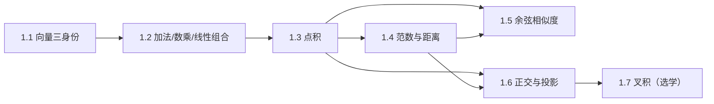

# M01 · 向量与几何

> **一句话**：向量是「有方向的量」，也是「一组数」，还是「一个数据点」。三种身份随时切换，是学好线性代数的第一道关。

## 这个模块解决什么

大模型里到处都是「向量」：一个 token 是向量，一句 hidden state 是向量，一个用户偏好也是向量。
但向量为什么能相加？为什么能比较「像不像」？「方向」到底指什么？

本模块用**几何直觉**回答这些问题：

- 向量到底是什么（1.1）；
- 相加、数乘、线性组合在现实里对应什么（1.2）；
- 如何用一个数衡量「两个向量有多像」（1.3–1.5）；
- 如何把一个向量「投影」到另一个方向上（1.6）。

## 本模块的现实问题

1. 导航 App 怎么用几十个数描述一条路段，还要在 2 MB 缓存里放下 12 万条？（[1.1](01-向量是什么.md)）
2. 两支麦克风录下三个人的声音，为什么数学上不能唯一分离？能分离时靠的是什么？（[1.2](02-加法数乘与线性组合.md)）
3. 12 万个候选商品、8 毫秒预算，怎么挑出最该展示的 200 个？（[1.3](03-点积.md)）
4. 3 万个三角形、每帧 16.7 毫秒，怎么算每个面的朝向、判断它背不背对镜头？（[1.7](07-叉积.md)）

## 概念地图

## 学习顺序

| 顺序 | 文档 | 时间 | 读完你应该能…… |
|---|---|---|---|
| 1 | [1.1 向量：箭头、坐标与数据](01-向量是什么.md) | 30 min | 用三种视角描述同一个向量 |
| 2 | [1.2 加法、数乘与线性组合](02-加法数乘与线性组合.md) | 35 min | 解释 residual connection 为什么是向量加法 |
| 3 | [1.3 点积：相似度的来源](03-点积.md) | 35 min | 手算点积并从几何上解释 |
| 4 | [1.4 范数与距离](04-范数与距离.md) | 30 min | 区分 L1/L2，解释梯度裁剪 |
| 5 | [1.5 夹角与余弦相似度](05-余弦相似度.md) | 30 min | 解释为什么检索用余弦而不是欧氏距离 |
| 6 | [1.6 正交与投影](06-正交与投影.md) | 40 min | 手算投影，解释最小二乘的几何 |
| 7 | [1.7 叉积与三重积（选学）](07-叉积.md) | 20 min | 求三维中垂直于两者的向量 |

## 本模块的大模型钩子

- **embedding**：词表里的一行就是一个向量（1.1）
- **残差连接**：$h\leftarrow h+\operatorname{sublayer}(h)$ 就是向量加法（1.2）
- **注意力打分**：$\mathbf{q}_i^\top\mathbf{k}_j$ 是点积（1.3）
- **归一化**：RMSNorm 用 L2 范数的变体（1.4）
- **语义检索**：余弦相似度（1.5）
- **正交初始化 / 残差流分解**：投影（1.6）

## 自测（读完再做）

1. 向量 $(3,4)$ 的长度是多少？它与 $(1,0)$ 的夹角余弦是多少？
2. 两个向量相加，什么时候长度不变？什么时候变短？
3. 点积为负说明什么？点积为零说明什么？
4. 为什么把向量归一化后，点积就等于余弦相似度？
5. 投影 $\operatorname{proj}_{\mathbf{u}}\mathbf{x}$ 与残差 $\mathbf{x}-\operatorname{proj}_{\mathbf{u}}\mathbf{x}$ 有什么关系？

自测答案

1. 长度 $5$；$\cos\theta=3/5=0.6$。
2. 方向相同时变长；方向相反时可能变短（若长度相等则得零向量）；一般情况遵循平行四边形法则。
3. 负：夹角大于 90°，方向相反成分更多；零：正交（垂直）。
4. 归一化后 $\|\mathbf{x}\|=\|\mathbf{y}\|=1$，点积 $=\cos\theta$。
5. 两者正交，且 $\mathbf{x}=\operatorname{proj}+\text{残差}$，是正交分解。

---

下一篇 → [1.1 向量：箭头、坐标与数据](01-向量是什么.md)
