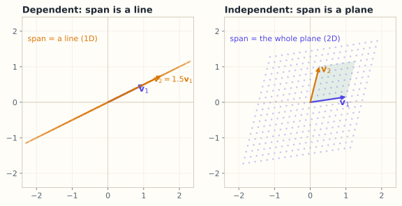

# 2.3 线性无关：没有冗余

> **本节位置**：模块 2 · 向量空间 ｜ **前置**：[2.2](02-子空间与张成.md) ｜ **预计**：35 分钟
>
> **一句话**：一组向量线性无关，意思是「其中没有任何一个能被其他向量拼出来」——没有冗余，每个都带来新方向。

## 0. 场景引入

一个做肿瘤早筛的团队，手上有 **400 例**病人、每例测 **96 个基因**的表达量（qPCR 面板，每个基因每例 8 元）。他们要交付一个 5 年复发风险评分，明年还要把面板做成试剂盒——**每多一个基因，每例多 8 元，400 例就是 3 200 元，量产之后是每年几十万**。

建模时出了两个怪现象：

1. 交叉验证 AUC 有 0.78，但换个随机种子，32 个基因的回归系数就从正变负；
2. 用 bootstrap 重采样 100 次，每次被选为「最重要」的基因都不一样。

查下去发现：96 个基因里有一大批是共表达的——同一通路上的基因，表达量几乎是彼此的固定倍数。**它们不是 96 条独立信息，可能只有 12 条。**

**问题**：怎么用一个可计算的标准，判断「这 96 列里到底有几条独立信息」？只能留 12 个的话，留哪 12 个？删掉的那些真的什么都没丢吗？

读完本节，你应该能回答三件事：

1. 怎么用一句话判断一组向量「有没有冗余」，并且能动手验算？
2. 为什么「两两不共线」不够，而「两两不正交」也不够？
3. 冗余被删掉之后，什么信息会跟着消失？

## 1. 直觉

三个向量：

- $\mathbf{v}_1=(1,0)$，$\mathbf{v}_2=(0,1)$：一个指右，一个指上，谁也代替不了谁——**无关**；
- $\mathbf{v}_1=(1,0)$，$\mathbf{v}_2=(2,0)$：同一个方向，$\mathbf{v}_2=2\mathbf{v}_1$——**相关**；
- $\mathbf{v}_1=(1,0)$，$\mathbf{v}_2=(0,1)$，$\mathbf{v}_3=(1,1)$：第三个是前两个的和，虽然它和谁都不共线，但仍然冗余——**相关**。

*图：以 $\mathbf{v}_1=(1,0.5)$ 为例。左图 $\mathbf{v}_2=1.5\mathbf{v}_1$，所有组合都落在同一条直线上（1 维）；右图两个向量不共线，系数在 $[-1.5,1.5]$ 内变化时组合铺满整个平面（2 维）。*

> 💡 **一句话直觉**：**线性无关 = 每个向量都贡献了一个「新方向」；没有谁在别人的张成里。**

关键：**两两不共线，不代表整组无关**。第三个例子就是反例。

### 1.1 它在现实世界里对应什么

96 个基因探针，像 96 个温度计贴在同一个房间的不同位置。如果其中 84 个是另外 12 个的「加权平均 + 小噪声」，你读 96 个数，其实只拿到 12 条信息，另外 84 个是抄的。

线性无关说的就是：**这 96 个数里，没有哪一个能被别人的加权和凑出来。** 换成耳朵的说法——合唱团里 96 个人，如果 84 个人只是在跟着别人的音高唱，真正独立的声部只有 12 个；音量可以叠加，信息不会。

**量级直觉**：在一个 96 基因的 qPCR 面板里，真实有效秩常在 8～15 之间（经验值，取决于组织类型）。也就是说 80 多列是冗余的：**你以为在做 96 维回归，实际只有十几维的自由度**。

### 1.2 这个类比在哪里失效

线性无关只排除**线性**冗余。两个基因可以线性无关，却在生物学上高度依赖——比如一个只在另一个表达时才有作用（类似 XOR 的交互），或者互相抑制、呈负相关。这种依赖线性代数看不见。

反方向也会错：两个基因可能线性相关（同一通路的不同酶，表达量成固定比例），但它们的**功能**完全不同——删掉一个，通路就断了。**数学上的冗余不等于生物学上的可替代。**

## 2. 定义

### 2.1 线性无关

向量组 $\mathbf{v}_1,\dots,\mathbf{v}_k$ **线性无关（linearly independent）**，若

$$
c_1\mathbf{v}_1+\cdots+c_k\mathbf{v}_k=\mathbf{0}
\ \Longrightarrow\
c_1=\cdots=c_k=0
$$

也就是说，**只有全零系数才能组合出零向量**。否则称**线性相关（linearly dependent）**。

这个定义与 [Halmos](#ref-halmos-1958) 的表述一致：无关性属于一整组向量，判定的是「零组合是否只有平凡解」。

### 2.2 等价刻画

对矩阵 $V=[\mathbf{v}_1\ \cdots\ \mathbf{v}_k]\in\mathbb{R}^{n\times k}$：

- 列向量无关 $\Leftrightarrow$ $V\mathbf{c}=\mathbf{0}$ 只有零解 $\Leftrightarrow$ $\operatorname{null}(V)=\{\mathbf{0}\}$；
- 列向量无关 $\Leftrightarrow$ $\operatorname{rank}(V)=k$（列满秩）。

### 2.3 相关的一个实用判据

一组向量相关，当且仅当其中**至少有一个**向量可以写成其余向量的线性组合（$k\ge2$ 时）。

## 3. 为什么这样定义

如果一组向量相关，坐标表示就**不唯一**：

设 $c_1\mathbf{v}_1+\cdots+c_k\mathbf{v}_k=\mathbf{0}$ 有非零解，那么对任意表示 $\mathbf{w}=\sum a_i\mathbf{v}_i$，都有

$$
\mathbf{w}=\sum a_i\mathbf{v}_i+\sum c_i\mathbf{v}_i=\sum(a_i+c_i)\mathbf{v}_i
$$

得到另一组系数。**冗余的直接后果就是「同一个东西有多种配方」**，这会让「坐标」失去意义。

反过来，无关保证了表示唯一：若 $\sum a_i\mathbf{v}_i=\sum b_i\mathbf{v}_i$，则 $\sum(a_i-b_i)\mathbf{v}_i=\mathbf{0}$，由无关性得 $a_i=b_i$。

这正是「基」所需要的性质（第 2.4 节）。

### 3.1 反事实：把「无关」换成「不正交就无关」

有人会这样记：正交的向量组一定无关（这没错，见 4.4），于是反过来也当成判据——「不垂直，就说明它们没关系」。

取 $\mathbf{v}_1=(1,0)$、$\mathbf{v}_2=(2,0)$。$\mathbf{v}_1^\top\mathbf{v}_2=2\ne0$，按这个判据，它们是两个「无关」的特征。

但 $\mathbf{v}_2=2\mathbf{v}_1$ 一眼就看出来：$1\cdot\mathbf{v}_1-\tfrac12\mathbf{v}_2=\mathbf{0}$，系数不全为零，按定义**相关**。

把这两列放进设计矩阵 $X=[\mathbf{v}_1\ \mathbf{v}_2]$：

$$
X^\top X=\begin{bmatrix}1&2\\2&4\end{bmatrix},\qquad
\det(X^\top X)=1\cdot4-2\cdot2=0
$$

于是回归系数不唯一。以预测 $\hat y=\beta_1x_1+\beta_2x_2$ 为例，$(\beta_1,\beta_2)=(2,0)$ 与 $(0,1)$ 给出**完全相同**的预测，你说不出哪个更「重要」。工程上不会报错，只会静默地把一个 $10^{-17}$ 量级的数当分母，系数跳到 $10^{16}$，训练完的模型在新样本上乱跳。

一眼可见的荒谬：判据把「一个向量是另一个的 2 倍」判成了两个独立方向。

## 4. 性质与推导

### 4.1 含零向量的组必相关

$1\cdot\mathbf{0}=0$，系数不全为零。

### 4.2 无关组的子集仍无关

若整组无关，任取子集也不可能相关——否则给其余向量配零系数，就得到整组的一个非平凡零组合。

### 4.3 $\mathbb{R}^n$ 中超过 $n$ 个向量必相关

这是第 2.4 节「维数」的基础：$n$ 维空间里最多有 $n$ 个无关方向。

它的一般形式是 [Steinitz 交换引理](#ref-steinitz-1913)：若一组向量无关、另一组张成同一个空间，则无关组的个数不超过张成组的个数。

### 4.4 非零正交向量组必无关

设 $\mathbf{v}_i$ 两两正交且非零，若 $\sum c_i\mathbf{v}_i=\mathbf{0}$，两边与 $\mathbf{v}_j$ 做内积：

$$
c_j\|\mathbf{v}_j\|^2=0\ \Longrightarrow\ c_j=0
$$

这个结论在第 2.7 节构造正交基时非常有用。

### 4.5 秩 = 最大无关组的大小

矩阵的秩等于其列向量中最大线性无关子集的元素个数（第 2.6 节）。

## 5. 例子

### 5.1 手算：判断相关性

**(a)** $\mathbf{v}_1=(1,2)$，$\mathbf{v}_2=(2,4)$：
$\mathbf{v}_2=2\mathbf{v}_1$，相关。

**(b)** $\mathbf{v}_1=(1,0,0)$，$\mathbf{v}_2=(0,1,0)$，$\mathbf{v}_3=(0,0,1)$：
设 $c_1\mathbf{v}_1+c_2\mathbf{v}_2+c_3\mathbf{v}_3=(c_1,c_2,c_3)=\mathbf{0}$，只能 $c_i=0$，无关。

**(c)** $\mathbf{v}_1=(1,0,1)$，$\mathbf{v}_2=(0,1,0)$，$\mathbf{v}_3=(1,1,1)$：
观察 $\mathbf{v}_3=\mathbf{v}_1+\mathbf{v}_2$，所以

$$
-\mathbf{v}_1-\mathbf{v}_2+\mathbf{v}_3=\mathbf{0}
$$

系数 $(-1,-1,1)$ 不全为零，相关。尽管三者两两不共线，仍然相关。

### 5.2 手算：用秩判断

$A=\begin{bmatrix}1&2&3\\0&1&4\\1&3&7\end{bmatrix}$，列向量为 $\mathbf{c}_1=(1,0,1)$、$\mathbf{c}_2=(2,1,3)$、$\mathbf{c}_3=(3,4,7)$。
观察到 $\mathbf{c}_3=-5\mathbf{c}_1+4\mathbf{c}_2$（验证：$(-5,0,-5)+(8,4,12)=(3,4,7)$）。

对 $A$ 做行变换：

$$
\begin{bmatrix}1&2&3\\0&1&4\\1&3&7\end{bmatrix}
\to
\begin{bmatrix}1&2&3\\0&1&4\\0&1&4\end{bmatrix}
\to
\begin{bmatrix}1&2&3\\0&1&4\\0&0&0\end{bmatrix}
$$

秩为 2，三列相关，最大无关组是 $\{\mathbf{c}_1,\mathbf{c}_2\}$。

### 5.3 场景：共线性特征

同一个面板里，两个基因如果测的是同一条通路，表达量常近似成比例。完全相关会让 $X^\top X$ 奇异、最小二乘解不唯一；近似相关会让条件数很大（第 4.6 节）。教科书版是「身高（厘米）」与「身高（米）」，工程版是同一台机器的两个重复传感器——病根都一样。

### 5.4 场景闭环：96 个基因、400 例、每人 8 元

**输入**：表达矩阵 $X\in\mathbb{R}^{400\times96}$，fp32，$400\times96\times4\ \text{B}=153.6\ \text{kB}$。已中心化、按基因标准化。

**计算**：带列主元的 QR。秩取 $|R_{jj}|$ 大于阈值（比如 $10^{-8}|R_{11}|$）的个数；主元顺序直接给出「先选哪几列」——这就是最大无关组的贪心版本。运算量约

$$
2mn^2=2\times400\times96^2\approx7.4\times10^6\ \text{FLOP}
$$

10 ms 内跑完。

**输出**：$r=14$。前 14 个主元列就是保留的基因子集，其余 82 列都在这 14 列的张成里（近似意义下）。

**决策**：面板从 96 缩到 14。每例成本从 $96\times8=768$ 元降到 $14\times8=112$ 元；400 例省 $(768-112)\times400=26.2$ 万元，量产按每年 1 万例算是 656 万元。

**成本**：$7.4\times10^6$ FLOP、154 kB 内存，可以忽略。真正贵的是**样本**：400 例、每例 768 元 = 30.7 万元的数据采集费，删错了就得重测。

**失败条件**：

- **线性无关 ≠ 统计独立**：两个基因可能线性无关，但在病例里几乎总是一起升高（阈值/交互关系）。删掉一个，这部分信息就丢了。兜底：按通路分组、每组保留一个代表；或改用岭回归——不删列，只压系数。
- **选哪个不稳定**：共线的几列里，QR 的主元选择对噪声敏感，100 次 bootstrap 里可能换掉 3 个。兜底：稳定性选择，只在超过 80% 的重采样里被选中的基因才留。
- **外部效度**：这 14 个基因是在这 400 例上选的，换一家医院的人群，秩结构可能变。兜底：留独立验证集，只报区间，不报点估计。

## 6. 常见误区

1. **误区**：两两不共线就是线性无关。
   **纠正**：三维中三个共面的向量也相关；上面的 $\mathbf{v}_3=\mathbf{v}_1+\mathbf{v}_2$ 就是反例。

2. **误区**：向量越多，张成的空间越大。
   **纠正**：增加一个「已有方向的组合」不扩大张成；只有增加真正的新方向才扩大。

3. **误区**：线性无关是单个向量的性质。
   **纠正**：它是**一组向量**的性质，取决于整组的相互关系。

4. **误区**：相关就意味着某个向量是另一个的倍数。
   **纠正**：那只是两个向量的特例；三个以上可以是「和/差」的组合。

## 7. 概念网络

- 前置：[2.2 子空间与张成](02-子空间与张成.md) —— 相关就是有人在别人的张成里。
- 后续：[2.4 基与维数](04-基与维数.md) —— 无关 + 张成 = 基。
- 后续：[2.6 秩](06-秩.md) —— 最大无关组的大小。
- 后续：[2.7 正交基](07-内积空间与Gram-Schmidt.md) —— 正交自动无关。
- 关联：7.3 低秩近似 —— 用少数无关方向近似整个矩阵。

## 8. 通往大模型：冗余无处不在

**1. 注意力头冗余**：多头注意力有 $H$ 个头，但研究表明很多头可以被剪掉而性能几乎不变。数学上，这意味着不同头的输出方向高度相关，整组头的「有效秩」小于 $H$。

**2. 权重矩阵低秩**：大型权重矩阵 $W\in\mathbb{R}^{D\times D}$ 的许多奇异值很小，说明它的列向量近似落在一个低维子空间里。LoRA 正是利用这一点（第 7.3 节）。

**3. 表示坍缩（rank collapse）**：深层 Transformer 中，不同 token 的隐藏状态可能越来越相似，激活矩阵 $H\in\mathbb{R}^{T\times D}$ 的秩下降，模型失去区分能力。这是「过度平滑」的一种表现。

**可检验结论**：对 $H\in\mathbb{R}^{T\times D}$，若 $T>D$，秩最多为 $D$；若所有 token 表示相同，秩为 1。可以用奇异值谱观察「有效秩」（第 7.4 节）。

**如果这一步算错，用户会看到什么**：把近似共线的两列（两个冗余的注意力头、两个共表达特征）当成两个独立方向，会得到一份「参数翻倍、信息不变」的模型。训练时两份几乎相同的权重互相抵消，loss 曲线抖动、对随机种子敏感；推理侧一旦量化或剪枝，冗余的那一份被压掉，性能就断崖式下跌。用户侧最典型的现象是：同一个问题问两遍，答案一个详细一个敷衍；长回答到中途开始重复。这些不是「模型不聪明」，是特征空间里本来就没有那么多独立方向。

## 9. 练习

1. **概念**：为什么「含零向量」的向量组一定相关？
2. **判断**：下列各组是否线性无关：
   (a) $(1,2),(2,1)$；(b) $(1,2),(2,4)$；(c) $(1,0,1),(0,1,0),(1,1,1)$；(d) $(1,0,0),(0,1,0),(0,0,1),(1,1,1)$。
3. **计算**：求 $\mathbf{v}_1=(1,1,1)$、$\mathbf{v}_2=(1,2,3)$、$\mathbf{v}_3=(1,4,9)$ 的相关性；若相关，写出一个非平凡关系。
4. **场景**：为什么完全共线的两个特征会让线性回归系数不唯一？
5. **开放**：如果注意力头之间存在冗余，剪掉一些头为什么可能不影响性能？如何检测冗余？

参考答案

1. 取零向量的系数为 1、其余为 0，就得到非平凡零组合。
2. (a) 无关（行列式 $1-4=-3\neq0$）；(b) 相关；(c) 相关（第三=第一+第二）；(d) 相关（4 个向量在 $\mathbb{R}^3$ 中）。
3. 计算行列式 $\det\begin{bmatrix}1&1&1\\1&2&4\\1&3&9\end{bmatrix}=1(18-12)-1(9-4)+1(3-2)=6-5+1=2\neq0$，无关。
4. 设计矩阵 $X$ 的列相关，$X^\top X$ 奇异，正规方程有无穷多解；不同系数对应同一预测。
5. 头的输出方向高度相关，信息重复；可通过头输出的协方差/奇异值、消融实验、注意力模式相似度检测。

## 10. 一页速记

- 无关：$\sum c_i\mathbf{v}_i=\mathbf{0}$ 只有全零解。
- **物理意义 / 现实对应**：96 个探针里只有十几条独立信息，其余在「抄」别人；无关 = 每条信息都带来新方向。
- 相关 ⇔ 至少一个向量在其余向量的张成里。
- 两两不共线 ≠ 整组无关。
- 含零必相关；$\mathbb{R}^n$ 中超过 $n$ 个必相关；非零正交组必无关。
- 秩 = 最大无关组大小。

## 11. 参考文献与致谢

这一页的知识不是凭空来的。下面列出本页直接借用的原始工作与权威整理；正文中的人名、定理名已链接到对应条目。链接优先指向 DOI、arXiv 或可长期访问的原文存档。

- **施泰尼茨（Ernst Steinitz, 1913）**：*Bedingt konvergente Reihen und konvexe Systeme*。证明「无关组的大小不超过任何张成组」的交换引理（Steinitz exchange lemma）；本页 4.3「$\mathbb{R}^n$ 中超过 $n$ 个向量必相关」正是它的直接推论。[J. Reine Angew. Math. 143 (1913), 128–176](https://doi.org/10.1515/crll.1913.143.128)
- **哈尔莫斯（Paul R. Halmos, 1958）**：*Finite-Dimensional Vector Spaces*（1958 年初版，Springer 1974 年重印）。把线性无关定义为「零组合只有平凡解」，并用它推出坐标表示唯一与「无关组可扩充为基」；本页 2.1 的定义、第 3 节的唯一性论证都走这条路线。[Springer 重印本](https://doi.org/10.1007/978-1-4612-6387-6)

---

下一篇 → [2.4 基与维数](04-基与维数.md)
