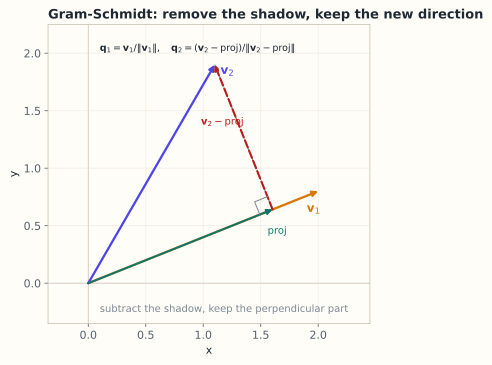

# 2.7 内积空间、正交基与 Gram–Schmidt

> **本节位置**：模块 2 · 向量空间 ｜ **前置**：[1.6](../01-向量与几何/06-正交与投影.md)、[2.4](04-基与维数.md) ｜ **预计**：40 分钟
>
> **一句话**：给向量空间加上内积，就有了长度和角度；再把基变成正交的，投影就只需一次次点积。

## 0. 场景引入

一场 8 人圆桌论坛，2 支麦克风架在桌子两端，间距 **3 cm**（为了不挡镜头）。录音要实时转写成字幕，端到端延迟必须 **< 300 ms**，还要分清「谁在说话」。

问题来了：两支麦克风这么近，录到的几乎是同一个信号——实测相关系数 **0.98**。直接把两路相减做「分离」，剩下的 2% 里主要是电路噪声。

第一步必须做的，是把两路信号「去相关」：构造一组**正交**的方向，一路对齐主讲话人，另一路专门装「其余所有人」。这正是 [Gram–Schmidt](#ref-gram-1883) 在做的事——把新方向里、已被前面方向覆盖的那部分减掉。

算一下代价：混合信号的信噪比只有 **6 dB**，而字幕可用要求 **15 dB** 以上。去相关做得不好，ASR 错字率会从 12% 涨到 25%——一场 90 分钟的论坛，人工校对要多花好几个小时。

**问题**：怎么度量「两路信号有多像」？为什么必须先正交化再分离，而不是分别投影再相加？相关系数 0.98 时，去相关之后还剩多少信号？

读完本节，你应该能回答三件事：

1. 内积给了向量空间什么、没给什么？
2. Gram–Schmidt 每一步到底减掉了什么，为什么减完就正交？
3. 输入几乎共线时，正交化会放大什么误差？

## 1. 直觉

正交基就像一套**互相垂直的坐标轴**：

- 想知道向量在某个轴上的分量？只需一次点积；
- 轴之间没有重叠，不用「扣除」彼此的影响；
- 长度满足勾股定理：$\|\mathbf{x}\|^2=\sum_i\langle\mathbf{x},\mathbf{q}_i\rangle^2$。

Gram–Schmidt 的过程就是：拿第一根轴，第二根减去在第一根上的投影，第三根减去在前两根上的投影……每一根都「擦掉」已有方向，只留下新方向。

> 💡 **一句话直觉**：**Gram–Schmidt = 逐个「减去已有方向的影子」，得到互相垂直的新基。**

### 1.1 它在现实世界里对应什么

一支合唱队里，每个人都在唱，但其中有几个人只是跟着别人的音高唱。要提炼出「真正独立的声部」，做法很朴素：先找一个人当基准，第二个人把自己身上「和第一个重合的部分」减掉，剩下才是他独有的；第三个人把自己身上与前两个重合的部分都减掉。

信号处理里这件事有个更实用的名字：**干扰抵消**。回声消除、主动降噪、麦克风阵列的波束赋形，核心都是「先估计我要去掉的那个方向，再从混合里减掉它在我的方向上的投影」。

**量级直觉**：两路信号相关系数 $\rho=0.98$ 时，减去投影后剩下的能量占比是

$$
\sqrt{1-\rho^2}=\sqrt{1-0.98^2}\approx0.199
$$

**你以为第二路还留着 100% 的信息，实际只剩 20%。** 何况信噪比只有 6 dB，噪声本来就不小——这 20% 里混进的主要是两路麦克风各自的底噪，所以你拿到的更像一条噪声通道，而不是第二个说话人。

### 1.2 这个类比在哪里失效

内积度量的是**同一时刻的线性相关**。真实的两路录音之间还有 0.2 ms 的时延、房间混响、麦克风的非线性失真——这些都会让「内积最大」和「同一个人」对不上。

还有一个边界：Gram–Schmidt **依赖顺序**。你先把谁当第一根轴，结果就不同；它也不告诉你剩下来的那一路是不是「干净的」，只告诉你它「与前面正交」。正交不等于有用。

## 2. 定义

### 2.1 内积空间

实向量空间 $V$ 上若定义了内积 $\langle\cdot,\cdot\rangle$（对称、双线性、正定，见第 1.3 节），称 $(V,\langle\cdot,\cdot\rangle)$ 为**内积空间（inner product space）**。

内积诱导范数 $\|\mathbf{x}\|=\sqrt{\langle\mathbf{x},\mathbf{x}\rangle}$，进而诱导距离与夹角。

### 2.2 正交基与标准正交基

- **正交基**：基向量两两正交，$\langle\mathbf{b}_i,\mathbf{b}_j\rangle=0$（$i\neq j$）；
- **标准正交基（orthonormal basis）**：还要求 $\|\mathbf{b}_i\|=1$，即

$$
\langle\mathbf{q}_i,\mathbf{q}_j\rangle=\delta_{ij}
=\begin{cases}1,&i=j\\0,&i\neq j\end{cases}
$$

### 2.3 Gram–Schmidt 正交化

给定线性无关的 $\mathbf{v}_1,\dots,\mathbf{v}_k$：

$$
\begin{aligned}
\mathbf{u}_1&=\mathbf{v}_1, & \mathbf{q}_1&=\frac{\mathbf{u}_1}{\|\mathbf{u}_1\|}\\
\mathbf{u}_2&=\mathbf{v}_2-\langle\mathbf{v}_2,\mathbf{q}_1\rangle\mathbf{q}_1, & \mathbf{q}_2&=\frac{\mathbf{u}_2}{\|\mathbf{u}_2\|}\\
\mathbf{u}_3&=\mathbf{v}_3-\langle\mathbf{v}_3,\mathbf{q}_1\rangle\mathbf{q}_1-\langle\mathbf{v}_3,\mathbf{q}_2\rangle\mathbf{q}_2, & \mathbf{q}_3&=\frac{\mathbf{u}_3}{\|\mathbf{u}_3\|}\\
&\vdots
\end{aligned}
$$

一般地：

$$
\mathbf{u}_j=\mathbf{v}_j-\sum_{i=1}^{j-1}\langle\mathbf{v}_j,\mathbf{q}_i\rangle\mathbf{q}_i
$$

这个递推由 [Schmidt](#ref-schmidt-1907) 在 1907 年写成显式形式，名字里的 Gram 则来自 1883 年的最小二乘正交化。

*图：$\mathrm{proj}$ 是 $\mathbf{v}_2$ 在 $\mathbf{v}_1$ 上的投影；把它从 $\mathbf{v}_2$ 减掉，剩下的红色向量与 $\mathbf{v}_1$ 垂直。单位化后就是 $\mathbf{q}_1,\mathbf{q}_2$。*

### 2.4 QR 分解

若 $A\in\mathbb{R}^{m\times n}$ 的列线性无关，则可分解为

$$
A=QR
$$

其中 $Q\in\mathbb{R}^{m\times n}$ 的列标准正交，$R\in\mathbb{R}^{n\times n}$ 上三角且对角元为正。

## 3. 为什么这样定义

在普通基下，求坐标要解线性方程组（$P^{-1}\mathbf{v}$）；在正交基下，坐标直接是内积：

$$
\mathbf{v}=\sum_i\langle\mathbf{v},\mathbf{q}_i\rangle\mathbf{q}_i
$$

**证明**：两边与 $\mathbf{q}_j$ 做内积，由正交性只剩 $j$ 项，得 $\langle\mathbf{v},\mathbf{q}_j\rangle=\langle\mathbf{v},\mathbf{q}_j\rangle$。

这把「解方程」降级为「做点积」，是数值线性代数偏爱正交基的根本原因。正交矩阵还保范数、保内积，误差不会被放大（第 10.2 节）。

### 3.1 反事实：不做正交化，分别投影再相加

平面由 $\mathbf{v}_1=(1,0)$、$\mathbf{v}_2=(1,1)$ 张成——注意它们**不**正交。要对 $\mathbf{x}=(2,1)$ 做「分解」。

有人会说：分别投影到两条直线上，再相加不就行了？算一下。

对 $\mathbf{v}_1$：系数 $\frac{\mathbf{x}^\top\mathbf{v}_1}{\mathbf{v}_1^\top\mathbf{v}_1}=\frac{2}{1}=2$，投影是 $(2,0)$。

对 $\mathbf{v}_2$：系数 $\frac{\mathbf{x}^\top\mathbf{v}_2}{\mathbf{v}_2^\top\mathbf{v}_2}=\frac{3}{2}$，投影是 $1.5\cdot(1,1)=(1.5,1.5)$。

两者相加：$(2,0)+(1.5,1.5)=(3.5,1.5)$。原来的 $\mathbf{x}$ 是 $(2,1)$——**差了整整一倍**。

看范数更直观：$\|\mathbf{x}\|=\sqrt5\approx2.24$，而 $\|(3.5,1.5)\|=\sqrt{14.5}\approx3.81$。你以为在「分解」，实际上把重叠的那部分分量算了两遍。

一眼可见的荒谬：分解完再拼起来，拼不回原来的向量。正交化的作用就是把「重叠」先扣掉，让每个方向只贡献自己那一份。

## 4. 性质与推导

### 4.1 Gram–Schmidt 为什么有效

归纳证明：假设 $\mathbf{q}_1,\dots,\mathbf{q}_{j-1}$ 已标准正交。令

$$
\mathbf{u}_j=\mathbf{v}_j-\sum_{i<j}\langle\mathbf{v}_j,\mathbf{q}_i\rangle\mathbf{q}_i
$$

对任意 $l<j$：

$$
\langle\mathbf{u}_j,\mathbf{q}_l\rangle
=\langle\mathbf{v}_j,\mathbf{q}_l\rangle-\sum_{i<j}\langle\mathbf{v}_j,\mathbf{q}_i\rangle\langle\mathbf{q}_i,\mathbf{q}_l\rangle
=\langle\mathbf{v}_j,\mathbf{q}_l\rangle-\langle\mathbf{v}_j,\mathbf{q}_l\rangle=0
$$

所以 $\mathbf{u}_j$ 与所有已有 $\mathbf{q}_l$ 正交。$\mathbf{u}_j\neq\mathbf{0}$ 是因为 $\mathbf{v}_j$ 不在前 $j-1$ 个向量的张成中（原组线性无关）。

### 4.2 QR 与投影

$A=QR$ 中，$Q$ 的列是 $A$ 的列空间的标准正交基。投影矩阵

$$
P=QQ^\top
$$

最小二乘解可写成 $R\hat{\mathbf{c}}=Q^\top\mathbf{y}$，用回代求解，避免显式求 $A^\top A$ 的逆（数值更稳）。

### 4.3 计算复杂度

对 $m\times n$ 矩阵，经典 Gram–Schmidt 约 $2mn^2$ 次浮点运算；改进版（MGS）数值更稳，但仍有累积误差。实际库用 Householder 变换（第 3.5 节）。

## 5. 例子

### 5.1 手算：$\mathbb{R}^3$ 中的 Gram–Schmidt

$\mathbf{v}_1=(1,1,0)$，$\mathbf{v}_2=(1,0,1)$，$\mathbf{v}_3=(0,1,1)$。

**第一步**：

$$
\mathbf{q}_1=\frac{(1,1,0)}{\sqrt2}=\left(\frac{1}{\sqrt2},\frac{1}{\sqrt2},0\right)
$$

**第二步**：$\langle\mathbf{v}_2,\mathbf{q}_1\rangle=\frac{1}{\sqrt2}$，

$$
\mathbf{u}_2=(1,0,1)-\frac{1}{\sqrt2}\left(\frac{1}{\sqrt2},\frac{1}{\sqrt2},0\right)
=\left(\frac12,-\frac12,1\right)
$$

$$
\|\mathbf{u}_2\|=\sqrt{\frac14+\frac14+1}=\sqrt{\frac32},\qquad
\mathbf{q}_2=\left(\frac{1}{\sqrt6},-\frac{1}{\sqrt6},\frac{2}{\sqrt6}\right)
$$

**第三步**：$\langle\mathbf{v}_3,\mathbf{q}_1\rangle=\frac{1}{\sqrt2}$，$\langle\mathbf{v}_3,\mathbf{q}_2\rangle=\frac{1}{\sqrt6}$，

$$
\mathbf{u}_3=(0,1,1)-\frac12(1,1,0)-\frac16(1,-1,2)
=\left(-\frac23,\frac23,\frac23\right)
$$

$$
\|\mathbf{u}_3\|=\sqrt{\frac{12}{9}}=\frac{2}{\sqrt3},\qquad
\mathbf{q}_3=\left(-\frac{1}{\sqrt3},\frac{1}{\sqrt3},\frac{1}{\sqrt3}\right)
$$

验证：$\mathbf{q}_1^\top\mathbf{q}_3=0$，$\mathbf{q}_2^\top\mathbf{q}_3=\frac{-1-1+2}{\sqrt{18}}=0$。

### 5.2 场景：QR 解最小二乘

对第 1.6 节的拟合问题，$A=QR$，则

$$
A^\top A\hat{\mathbf{c}}=A^\top\mathbf{y}
\ \Longrightarrow\
R^\top Q^\top QR\hat{\mathbf{c}}=R^\top Q^\top\mathbf{y}
\ \Longrightarrow\
R\hat{\mathbf{c}}=Q^\top\mathbf{y}
$$

只需回代，不用求逆。这是 `numpy.linalg.lstsq` 背后的思路之一。

### 5.3 场景闭环：2 路、16 kHz、300 ms

**输入**：两路 int16 音频，16 kHz，300 ms 一帧 = 4800 采样/通道，$4800\times2\times2\ \text{B}=19.2$ kB，折算码率 64 kB/s。

**计算**：

1. 估 $2\times2$ 协方差：3 个独立元素，每个 4800 次乘加，合计 $1.44\times10^4$ 次；
2. 用 Gram–Schmidt 构造正交方向：以第一路为主方向，第二路减去它在第一路上的投影，

$$
\mathbf{u}_2=\mathbf{x}_2-\frac{\langle\mathbf{x}_2,\mathbf{x}_1\rangle}{\langle\mathbf{x}_1,\mathbf{x}_1\rangle}\mathbf{x}_1
$$

3. 归一化后得到 $2\times2$ 混合矩阵的逆，逐样本做 $2\times2$ 矩阵乘（4 次乘加/样本，一帧 19200 次）。

**输出**：两路分离信号送 ASR，同时给出质量指标——第二路的残余能量占比 $\sqrt{1-\rho^2}$。$\rho=0.98$ 时是 $0.199$，也就是这一路已经接近「只剩噪声」。

**成本**：每 300 ms 约 $3.4\times10^4$ 次乘加，折合 0.1 MFLOP/s，可以忽略；19.2 kB 的帧缓冲也在 L2 里。**算力和内存都不是瓶颈，精度才是。**

**失败条件**：

- **共线放大噪声**：$\rho=0.98$ 时，去相关要把那 2% 的残余放大 $1/0.199\approx5$ 倍，噪声一起被放大——这就是条件数在起作用（第 10.2 节）。兜底：对角加载，协方差加 $\lambda I$（$\lambda$ 取迹的 1%），宁可少分离一点也不要把噪声拉满。
- **时延与混响**：两路不是同一瞬间的线性混合，有 0.2 ms 时延和混响，「内积最大」不等于「同一个人」。兜底：先用互相关找峰做时延对齐，再正交化。
- **顺序敏感**：Gram–Schmidt 谁先谁后结果不同。兜底：按能量排序，或 2 路时直接用对称的白化。

## 6. 常见误区

1. **误区**：Gram–Schmidt 只是「把向量变单位长度」。
   **纠正**：它还负责**正交化**；只归一化不改变夹角。

2. **误区**：正交化结果与输入顺序无关。
   **纠正**：顺序不同，得到的正交基通常不同（但张成空间相同）。

3. **误区**：经典 Gram–Schmidt 在计算机里总能得到正交基。
   **纠正**：浮点误差会累积，向量接近相关时尤其严重；实际用改进版或 Householder。

4. **误区**：QR 分解唯一。
   **纠正**：若规定 $R$ 对角元为正，则「薄 QR」唯一；否则可差一个对角符号矩阵。

## 7. 概念网络

- 前置：[1.6 正交与投影](../01-向量与几何/06-正交与投影.md) —— 减去投影就是正交化。
- 前置：[2.4 基与维数](04-基与维数.md) —— 正交基也是一种基。
- 后续：[2.8 正交补与投影定理](08-正交补与投影定理.md) —— 正交分解。
- 后续：[4.4 最小二乘](../04-线性方程组/04-最小二乘.md) —— QR 是稳定解法。
- 关联：10.2 条件数 —— 正交变换不放大误差。

## 8. 通往大模型：正交性为什么值钱

**1. 正交初始化**：让权重矩阵的列近似标准正交，使

$$
\|W\mathbf{x}\|\approx\|\mathbf{x}\|
$$

深层连乘时范数既不爆炸也不消失。QR 分解是构造正交矩阵的标准方法。

**2. 正交微调**：一些方法约束权重更新为正交矩阵，以保持预训练知识、减少遗忘；QR/极分解是常见工具。

**3. 头去相关**：多头注意力希望不同头关注不同模式；可以用正交约束或对头输出做去相关，减少冗余（第 2.3 节）。

**可检验结论**：若 $Q$ 正交，则 $\|Q\mathbf{x}\|_2=\|\mathbf{x}\|_2$，且 $\kappa_2(Q)=1$——这是条件数最好的矩阵，误差不会被放大。

**如果这一步算错，用户会看到什么**：正交初始化的目的是让深层连乘时范数守恒。若权重列几乎共线（正交化没做或做错），第 30 层的激活会被放大或压到 $10^{-6}$：放大时 loss 训练几百步后爆成 NaN，压缩时梯度消失、模型只会输出高频的「的、了、是」。另一种可见现象在推理侧——多个注意力头学成同一件事（头之间没去相关），剪掉一半后模型开始复读，因为剩下的头本来就在重复同一份信息。

## 9. 练习

1. **概念**：为什么在正交基下求坐标只需点积，而在普通基下要解方程？
2. **计算**：对 $\mathbf{v}_1=(1,0)$、$\mathbf{v}_2=(1,1)$ 做 Gram–Schmidt。
3. **计算**：对 $\mathbf{v}_1=(1,1,1)$、$\mathbf{v}_2=(1,0,1)$ 做 Gram–Schmidt（只需前两个）。
4. **场景**：为什么最小二乘用 QR 比直接求 $(A^\top A)^{-1}$ 更稳？
5. **开放**：如果两个输入向量几乎共线，Gram–Schmidt 会发生什么？如何在实现中检测？

参考答案

1. 正交基下 $\mathbf{v}=\sum c_i\mathbf{q}_i$，两边点乘 $\mathbf{q}_j$ 得 $c_j=\langle\mathbf{v},\mathbf{q}_j\rangle$；普通基下基向量互相影响，需解线性方程组。
2. $\mathbf{q}_1=(1,0)$；$\mathbf{u}_2=(1,1)-1\cdot(1,0)=(0,1)$，$\mathbf{q}_2=(0,1)$。
3. $\mathbf{q}_1=(1,1,1)/\sqrt3$；$\langle\mathbf{v}_2,\mathbf{q}_1\rangle=2/\sqrt3$；$\mathbf{u}_2=(1,0,1)-\frac23(1,1,1)=(\frac13,-\frac23,\frac13)$；$\|\mathbf{u}_2\|=\sqrt{6}/3$；$\mathbf{q}_2=(\frac{1}{\sqrt6},-\frac{2}{\sqrt6},\frac{1}{\sqrt6})$。
4. $A^\top A$ 会把条件数平方（$\kappa(A^\top A)=\kappa(A)^2$），放大舍入误差；QR 只涉及正交变换，条件数不放大。
5. 第二个向量减去投影后接近零，归一化会放大噪声；检测 $\|\mathbf{u}_j\|$ 小于阈值，或改用带列主元的 QR/Householder。

## 10. 一页速记

- 内积空间 = 向量空间 + 内积（长度、角度）。
- **物理意义 / 现实对应**：内积 = 两段声音有多像；正交化 = 干扰抵消，把已分离出来的声音从混合里减掉。
- 标准正交基：$\langle\mathbf{q}_i,\mathbf{q}_j\rangle=\delta_{ij}$。
- 正交基下坐标 = 点积；$\mathbf{v}=\sum\langle\mathbf{v},\mathbf{q}_i\rangle\mathbf{q}_i$。
- Gram–Schmidt：逐个减去已有方向的投影。
- $A=QR$：$Q$ 正交，$R$ 上三角；最小二乘用 $R\hat{\mathbf{c}}=Q^\top\mathbf{y}$。

## 11. 参考文献与致谢

这一页的知识不是凭空来的。下面列出本页直接借用的原始工作与权威整理；正文中的人名、定理名已链接到对应条目。链接优先指向 DOI、arXiv 或可长期访问的原文存档。

- **格拉姆（Jørgen Pedersen Gram, 1883）**：*Ueber die Entwickelung reeller Functionen in Reihen mittelst der Methode der kleinsten Quadrate*。在最小二乘的级数展开里用「减去已选方向上的投影」构造正交系，Gram–Schmidt 的正交化思想由此而来；本页第 0 节要解决的正是这类「基不正交」的问题。[J. Reine Angew. Math. 94 (1883), 41–73](https://doi.org/10.1515/crll.1883.94.41)
- **施密特（Erhard Schmidt, 1907）**：*Zur Theorie der linearen und nichtlinearen Integralgleichungen*。把正交化写成显式的逐步递推，也就是今天教材里的 Gram–Schmidt 过程；本页 2.3 的 $\mathbf{u}_j=\mathbf{v}_j-\sum_{i<j}\langle\mathbf{v}_j,\mathbf{q}_i\rangle\mathbf{q}_i$ 就是它。[Math. Ann. 63 (1907), 433–476](https://doi.org/10.1007/BF01449770)

---

下一篇 → [2.8 正交补与投影定理](08-正交补与投影定理.md)
