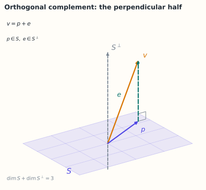

# 2.8 正交补与投影定理

> **本节位置**：模块 2 · 向量空间 ｜ **前置**：[2.2](02-子空间与张成.md)、[2.7](07-内积空间与Gram-Schmidt.md) ｜ **预计**：35 分钟
>
> **一句话**：每个子空间都有一个「垂直的搭档」，两者拼成整个空间；任何向量都能唯一拆成「在子空间内」与「与子空间垂直」两部分。

## 0. 场景引入

一个消费品牌的年度预算会：**3 亿元**，分给 TV、搜索、信息流、线下 4 个渠道。老板问了一个具体问题：去年双 11 那一周，销量比平时多出的 **1 000 万元**里，信息流贡献了多少？

数据是 **156 周**（3 年）的周度销量、4 个渠道的周度花费，外加 2 个控制变量（价格指数、季节因子）。直觉做法是直接回归，拿到 6 个系数再乘花费。

一跑就出问题：大促那几周 4 个渠道是一起加预算的，花费曲线高度共线。6 列的秩只有 5——**单渠道的系数不可辨识**。同一份数据能拟合出「信息流 +30%、TV −10%」，也能拟合出「信息流 +5%、TV +25%」，预测值一模一样。

**决策**：明年是否把 5 000 万元从 TV 挪到信息流。**代价**：归因方向错 1 个百分点，就是 300 万元打水漂；错 10 个百分点，整年的渠道策略翻车。

**问题**：系数不可辨识时，还有哪些量是唯一确定的？怎么把销量拆成「模型能解释」与「解释不了」两块，并证明这个拆分不依赖你怎么选系数？[投影定理](#ref-halmos-1982)在这里保证了什么？

读完本节，你应该能回答三件事：

1. 正交补在做什么，为什么它给出的分解是唯一的？
2. 为什么「投影」必须正交，斜着投会怎样？
3. 当列空间不够大时，哪些结论可以说，哪些绝对不能说？

## 1. 直觉

把子空间 $S$ 想成一张平面，$S^\perp$ 就是「所有与这张平面垂直的方向」组成的直线。

- $S$ 与 $S^\perp$ 只交于原点；
- 两者的维数加起来等于整个空间；
- 空间中任意向量都能唯一拆成「平面内 + 垂直方向」。

> 💡 **一句话直觉**：**正交补 = 子空间的「垂直另一半」；整个空间 = 子空间 ⊕ 正交补。**

类比边界：这个分解依赖内积。没有内积的空间，只能谈「直和」，不能谈「正交」。

*图：$S$ 是一张平面（侧视成菱形），$S^\perp$ 是它的法线；任意 $\mathbf{v}$ 唯一拆成 $\mathbf{p}\in S$ 与 $\mathbf{e}\in S^\perp$，维数 $2+1=3$。*

### 1.1 它在现实世界里对应什么

把销量看成一个 156 维的向量（每周一个分量）。「渠道 + 控制变量能解释的部分」是这些列张成的一个子空间 $S$。它名义上有 6 列，但因为渠道共线，秩只有 5——所以 $S$ 是一个 5 维子空间，挤在 156 维空间里。

正交投影做的事很物理：**把销量往这 6 维的「影子」上投**。影子 $\mathbf{p}$ 是模型能解释的全部；影子以外的 $\mathbf{e}$，就是天气、口碑、竞品、随机冲击——模型构造上无法解释，而且与已纳入的列**正交**。

正交补 $S^\perp$ 因此有个很实在的名字：**「模型永远解释不了的那部分」**。它既不是噪声的同义词，也不是「不重要的东西」——它只是「与这 6 列线性无关」。

**量级直觉**：$R^2=0.8$ 时，残差长度是总量的 $\sqrt{1-0.8}\approx0.45$，也就是 **45%**。渠道解释了大头，但近一半的波动在子空间外。

### 1.2 这个类比在哪里失效

「正交」在这里是**统计**意义上的，不是因果意义上的。残差与已纳入的列正交，是 OLS 的**构造性质**，不是世界的性质：只要漏了一个与花费相关的变量（比如竞品降价恰好赶在大促），它就会躲进残差，而残差仍然与花费相关。

第二个边界：内积的选择决定了「正交」是什么。这里用的是普通点积，等于默认 156 周同等重要。若误差方差不齐（大促周波动远大于淡季），应该用加权内积 $\langle\mathbf{x},\mathbf{y}\rangle_W=\mathbf{x}^\top W\mathbf{y}$，那时「正交」是另一组方向，投影结果也不同（第 6.5 节）。

## 2. 定义

### 2.1 正交补

设 $S\subseteq V$ 是子空间。其 **正交补（orthogonal complement）** 为

$$
S^\perp=\{\mathbf{v}\in V\mid \langle\mathbf{v},\mathbf{s}\rangle=0\ \ \forall\mathbf{s}\in S\}
$$

### 2.2 正交分解

若 $V=S\oplus S^\perp$，则任意 $\mathbf{v}\in V$ 可唯一写成

$$
\mathbf{v}=\mathbf{v}_{\parallel}+\mathbf{v}_{\perp},\qquad
\mathbf{v}_{\parallel}\in S,\ \mathbf{v}_{\perp}\in S^\perp
$$

其中 $\mathbf{v}_{\parallel}=\operatorname{proj}_S\mathbf{v}$，$\mathbf{v}_{\perp}=\mathbf{v}-\mathbf{v}_{\parallel}$。

### 2.3 投影定理

设 $S$ 是内积空间 $V$ 的有限维子空间，则对任意 $\mathbf{v}\in V$，存在唯一的 $\mathbf{p}\in S$ 使

$$
\|\mathbf{v}-\mathbf{p}\|=\min_{\mathbf{s}\in S}\|\mathbf{v}-\mathbf{s}\|
$$

且 $\mathbf{p}$ 是 $\mathbf{v}$ 在 $S$ 上的正交投影，满足 $\mathbf{v}-\mathbf{p}\perp S$。

## 3. 为什么这样定义

如果没有「正交」，$V=S+T$ 的分解不唯一：平面上的一个点可以写成无数种「平面内 + 另一方向」的组合。
加上正交条件，分解唯一，且投影点就是「最近点」（第 1.6 节）。

正交补也把「四个基本子空间」串起来：

$$
\operatorname{null}(A)=\operatorname{col}(A^\top)^\perp,\qquad
\operatorname{null}(A^\top)=\operatorname{col}(A)^\perp
$$

这是线性代数最优雅的结构之一（第 3.7 节）。

### 3.1 反事实：用「斜投影」代替正交投影

$S=\operatorname{span}\{(1,0)\}$（$x$ 轴），$\mathbf{v}=(1,1)$。正交投影很好算：

$$
\mathbf{p}=(1,0),\qquad \mathbf{e}=\mathbf{v}-\mathbf{p}=(0,1),\qquad \|\mathbf{e}\|=1
$$

$\mathbf{e}\perp S$，且 $\|\mathbf{e}\|$ 就是 $\mathbf{v}$ 到 $S$ 的最短距离。

现在换一种「投影」：沿着方向 $\mathbf{d}$ 把 $\mathbf{v}$ 投到 $S$ 上，也就是解 $\mathbf{v}-t\mathbf{d}\in S$。

- 沿 $\mathbf{d}=(1,1)$：要求第二个分量为 0，$1-t=0\Rightarrow t=1$，落点 $(0,0)$，残差 $(1,1)$，长度 $\sqrt2\approx1.41$；
- 沿 $\mathbf{d}=(2,1)$：同样 $t=1$，落点 $(1-2,0)=(-1,0)$，残差 $(2,1)$，长度 $\sqrt5\approx2.24$。

**同一个 $\mathbf{v}$、同一个 $S$，两个「投影」，落点从 $(0,0)$ 变到 $(-1,0)$。** 更荒唐的是沿 $\mathbf{d}=(1,1)$ 那次：$\mathbf{v}$ 明明离开 $x$ 轴有一段距离，却被「投影」成了原点——等于宣称它完全在 $S$ 里。

这就是「分解不唯一」的样子：没有正交条件，$\mathbf{v}=\mathbf{p}+\mathbf{e}$ 有无穷多组解。正交投影是其中唯一让 $\|\mathbf{e}\|$ 取最小的一组，也只有它保证 $\mathbf{e}\perp S$。

## 4. 性质与推导

### 4.1 维数互补

若 $V$ 有限维，$S$ 是子空间，则

$$
\dim S+\dim S^\perp=\dim V
$$

证明思路：取 $S$ 的标准正交基 $\mathbf{q}_1,\dots,\mathbf{q}_k$，扩充为 $V$ 的标准正交基 $\mathbf{q}_1,\dots,\mathbf{q}_n$。则 $\mathbf{q}_{k+1},\dots,\mathbf{q}_n$ 张成 $S^\perp$，故 $\dim S^\perp=n-k$。

### 4.2 双正交补

$$
(S^\perp)^\perp=S
$$

（有限维情形。）

有限维情形下，$S\subseteq(S^\perp)^\perp$。设 $\dim S=k$，则 $\dim S^\perp=n-k$，于是 $\dim((S^\perp)^\perp)=n-(n-k)=k=\dim S$，两边维数相同，故相等；[Axler](#ref-axler-2015) 的证明就是这两步。

### 4.3 投影矩阵

若 $Q$ 的列是 $S$ 的标准正交基，则

$$
P_S=QQ^\top,\qquad P_{S^\perp}=I-QQ^\top
$$

且 $P_S+P_{S^\perp}=I$，$P_SP_{S^\perp}=0$。

### 4.4 正交分解的勾股定理

$$
\|\mathbf{v}\|^2=\|\mathbf{v}_{\parallel}\|^2+\|\mathbf{v}_{\perp}\|^2
$$

因为两项正交。这给出「投影不增范数」的另一种证明。

## 5. 例子

### 5.1 手算：$\mathbb{R}^3$ 中的平面与直线

$S=\{(x,y,0)\}$（$xy$ 平面），则 $S^\perp=\{(0,0,z)\}$（$z$ 轴）。
$\mathbf{v}=(1,2,3)$ 的分解：

$$
\mathbf{v}_{\parallel}=(1,2,0),\qquad \mathbf{v}_{\perp}=(0,0,3)
$$

验证：$\mathbf{v}_{\parallel}^\top\mathbf{v}_{\perp}=0$，$\|\mathbf{v}\|^2=14=5+9$。

### 5.2 手算：零空间与行空间

$$
A=\begin{bmatrix}1&2&3\\2&4&6\end{bmatrix}
$$

行空间是 $\operatorname{span}\{(1,2,3)\}$（秩 1），零空间是 $x_1+2x_2+3x_3=0$ 的解，维数 2。
两者正交：零空间中任意向量与 $(1,2,3)$ 点积为 0。于是

$$
\mathbb{R}^3=\operatorname{row}(A)\oplus\operatorname{null}(A)
$$

维数 $1+2=3$，与秩-零化度一致。

### 5.3 场景：最小二乘的几何

$A\mathbf{x}=\mathbf{b}$ 无解时，把 $\mathbf{b}$ 投影到 $\operatorname{col}(A)$：

$$
\mathbf{b}=\underbrace{\mathbf{p}}_{\in\operatorname{col}(A)}+\underbrace{\mathbf{e}}_{\perp\operatorname{col}(A)}
$$

$\mathbf{e}$ 就是残差，且 $A^\top\mathbf{e}=\mathbf{0}$。这正是正规方程 $A^\top A\hat{\mathbf{x}}=A^\top\mathbf{b}$ 的来源（第 4.4 节）。

### 5.4 场景闭环：156 周、6 列、3 亿元

**输入**：设计矩阵 $X\in\mathbb{R}^{156\times6}$（4 渠道 + 2 控制），fp64，$156\times6\times8\ \text{B}=7.5$ kB；销量 $\mathbf{y}\in\mathbb{R}^{156}$，另 1.2 kB。合计不到 9 kB。

**计算**：先算 $X^\top X$（$6\times6$），$156\times6\times6=5616$ 次乘加；再做 QR，$156\times6^2\approx5.6\times10^3$ 次。投影 $\mathbf{p}=QQ^\top\mathbf{y}$ 与残差 $\mathbf{e}=\mathbf{y}-\mathbf{p}$ 各 $156\times6=936$ 次。全程约 $1.2\times10^4$ 次运算，1 ms 内完成。

**输出**：

1. 投影 $\mathbf{p}$ 与残差 $\mathbf{e}$——**这两个是唯一的**，与你怎么选系数无关；
2. $R^2=\|\mathbf{p}\|^2/\|\mathbf{y}\|^2$。假设 $R^2=0.8$，残差长度是总量的 $\sqrt{1-0.8}\approx0.45$，即 45%；
3. 渠道**整体**贡献的区间。单渠道贡献只能给区间，不能给点估计——因为列相关，那个点估计取决于你把共线部分记在谁头上。

**决策**：报告「4 个渠道合计解释 80%，其中信息流的贡献在 15%～45% 之间」，据此只挪 2 000 万元而不是 5 000 万元；剩下的用一次地理实验（选 20 个城市停投信息流 4 周）来定。

**成本**：计算可以忽略（$10^4$ 量级次运算、9 kB）。真正的成本是**决策延迟**——多等 4 周做实验，就错过一个投放季。工程上的折中是：先用投影给出区间，同时并行做小范围实验。

**失败条件**：

- **残差并不干净**：正交只是对**已包含的列**正交。如果漏了「竞品降价」这个变量，它会藏进残差，而残差与花费仍可能相关，此时 $R^2$ 和系数都有偏。兜底：补控制变量，或用工具变量 / 实验。
- **共线导致的方差爆炸**：单列系数的方差按 $1/(1-R_j^2)$ 放大。若某渠道对其余 5 列的 $R_j^2=0.96$，方差放大 25 倍，标准误放大 5 倍。兜底：合并渠道、加岭正则、或只报列空间上的总量。
- **外推**：投影只在历史花费范围内可信。把信息流预算翻 3 倍，是在数据支撑之外做预测。

## 6. 常见误区

1. **误区**：$S^\perp$ 是「不在 $S$ 里的向量」。
   **纠正**：$S^\perp$ 要求与 $S$ 中**所有**向量正交，远小于补集；零向量同时属于两者。

2. **误区**：$S\cap S^\perp$ 可以包含非零向量。
   **纠正**：若 $\mathbf{v}$ 同时在两者中，则 $\|\mathbf{v}\|^2=\langle\mathbf{v},\mathbf{v}\rangle=0$，故 $\mathbf{v}=\mathbf{0}$。

3. **误区**：任意两个子空间都能正交分解。
   **纠正**：需要 $V=S+S^\perp$；有限维内积空间总是成立，但一般空间需 $S$ 闭。

4. **误区**：投影到 $S$ 后再投影到 $S^\perp$ 会得到原向量。
   **纠正**：$P_{S^\perp}(P_S\mathbf{v})=\mathbf{0}$；但 $P_S\mathbf{v}+P_{S^\perp}\mathbf{v}=\mathbf{v}$。

## 7. 概念网络

- 前置：[1.6 正交与投影](../01-向量与几何/06-正交与投影.md) —— 一维投影。
- 前置：[2.7 正交基](07-内积空间与Gram-Schmidt.md) —— 构造 $Q$。
- 后续：3.7 四个基本子空间 —— 正交补的矩阵版本。
- 后续：[4.4 最小二乘](../04-线性方程组/04-最小二乘.md) —— 投影定理的应用。
- 关联：11.1 残差流与表示 —— 表示的正交分解。

## 8. 通往大模型：正交分解与「概念擦除」

**1. 残差流分解**：把隐藏状态写成「与某概念方向平行」+「正交残差」。若概念近似线性，可以用投影读出强度、用减去投影做编辑（第 1.6 节）。

**2. 概念擦除的局限**：减去 $\mathbf{d}$ 方向只删除了**一维**成分；如果概念分布在多维子空间 $S$ 中，需要投影到整个 $S$ 并减去：

$$
\mathbf{h}'=\mathbf{h}-P_S\mathbf{h}=(I-P_S)\mathbf{h}
$$

这要求先估计子空间 $S$（例如用 PCA 或探针权重张成）。

**3. 正交子空间与信息隔离**：如果我们希望「任务 A 的修改不影响任务 B」，可以让两者的更新方向尽量正交。这是一种设计原则，不是自动保证。

**可检验结论**：对任意子空间 $S$，$\|(I-P_S)\mathbf{h}\|\le\|\mathbf{h}\|$，且等号只在 $\mathbf{h}\perp S$ 时成立。若编辑后范数反而变大，说明实现有误或 $P_S$ 不是正交投影。

**如果这一步算错，用户会看到什么**：概念擦除的维度选错，用户侧的现象非常具体——擦得太少，模型还能被一句话诱导回原话题（「你现在是一个没有立场的助手」立刻破功）；擦得太多，模型对这个话题完全回避，用空泛套话应付，甚至波及其他话题（问 A 答 B 的模板）。如果 $P_S$ 实现上不是正交投影（比如忘了对称化 $QQ^\top$），编辑后范数会变大，输出退化成重复或乱码——这正是上面那条不等式能当回归测试用的原因。

## 9. 练习

1. **概念**：为什么 $S\cap S^\perp=\{\mathbf{0}\}$？
2. **计算**：$S=\operatorname{span}\{(1,1,0)\}$，求 $S^\perp$ 的一组基，并把 $(2,0,1)$ 分解为 $S$ 内与 $S^\perp$ 两部分。
3. **计算**：$A=\begin{bmatrix}1&0&1\\0&1&1\end{bmatrix}$，验证 $\operatorname{null}(A)=\operatorname{col}(A^\top)^\perp$。
4. **场景**：最小二乘残差为什么与 $A$ 的每一列都正交？用投影定理解释。
5. **开放**：如果「概念子空间」估计得不准（比如维度选错），用 $I-P_S$ 做擦除会有什么后果？

参考答案

1. 若 $\mathbf{v}\in S\cap S^\perp$，则 $\langle\mathbf{v},\mathbf{v}\rangle=0$，由正定性 $\mathbf{v}=\mathbf{0}$。
2. $S^\perp=\{(x,y,z)\mid x+y=0\}=\operatorname{span}\{(1,-1,0),(0,0,1)\}$。投影系数 $\frac{2}{2}=1$，$\mathbf{v}_{\parallel}=(1,1,0)$，$\mathbf{v}_{\perp}=(1,-1,1)$。
3. 零空间：$x_1+x_3=0,x_2+x_3=0$，基 $(-1,-1,1)$；列空间是 $\mathbb{R}^2$，其正交补只有零；而 $A^\top$ 的列空间是 $\operatorname{span}\{(1,0,1),(0,1,1)\}$，其正交补正是 $\operatorname{span}\{(-1,-1,1)\}$。
4. 残差 $\mathbf{e}=\mathbf{b}-A\hat{\mathbf{x}}$ 是 $\mathbf{b}$ 到 $\operatorname{col}(A)$ 的正交投影的差，由投影定理 $\mathbf{e}\perp\operatorname{col}(A)$，故与每列正交，即 $A^\top\mathbf{e}=0$。
5. 维度太小：擦除不干净；维度太大：误删有用信息，且子空间可能包含与概念无关的方向；需要验证任务性能与副作用。

## 10. 一页速记

- $S^\perp=\{\mathbf{v}\mid\langle\mathbf{v},\mathbf{s}\rangle=0,\forall\mathbf{s}\in S\}$。
- **物理意义 / 现实对应**：销量在「渠道能解释的方向」上的影子，加上影子外那 45% 解释不了的部分。
- $V=S\oplus S^\perp$，$\dim S+\dim S^\perp=\dim V$。
- 投影定理：最近点 = 正交投影，残差垂直于子空间。
- $P_S=QQ^\top$，$P_S+P_{S^\perp}=I$，$P_SP_{S^\perp}=0$。
- $\operatorname{null}(A)=\operatorname{col}(A^\top)^\perp$，$\operatorname{null}(A^\top)=\operatorname{col}(A)^\perp$。

## 11. 参考文献与致谢

这一页的知识不是凭空来的。下面列出本页直接借用的原始工作与权威整理；正文中的人名、定理名已链接到对应条目。链接优先指向 DOI、arXiv 或可长期访问的原文存档。

- **哈尔莫斯（Paul R. Halmos, 1982）**：*A Hilbert Space Problem Book*（第 2 版）。在希尔伯特空间框架下处理闭子空间的正交投影与正交分解，本页 2.3 的投影定理是它在有限维内积空间的特例。[Springer](https://doi.org/10.1007/978-1-4684-9330-6)
- **阿克斯勒（Sheldon Axler, 2015）**：*Linear Algebra Done Right*（第 3 版）。用 $V=U\oplus U^\perp$ 与维数公式证明正交分解和双正交补，本页 4.1–4.2 的论证与它一致。[Springer](https://doi.org/10.1007/978-3-319-11080-6)

---

下一篇 → M03 矩阵与线性映射
