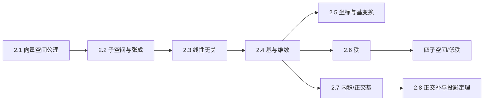

# M02 · 向量空间

> **一句话**：向量空间把「箭头」抽象成「一切可以做线性组合的对象」；基、维数、秩则回答「这个空间到底有多大、有没有冗余」。

## 这个模块解决什么

学完 M01，你会算点积和投影，但还没有回答：

- 为什么有的向量组能张成整个空间，有的只能张成一条线？
- 「维度」到底是什么？为什么 $\mathbb{R}^3$ 的维数是 3，而不是「有三个坐标」这么简单？
- 一个矩阵的「秩」为什么能代表信息量？
- 为什么正交基这么好用？

本模块给出这套语言：**空间 → 子空间 → 无关 → 基/维数 → 坐标 → 秩 → 内积/正交化**。
它也是后面矩阵、特征值、SVD 的地基。

## 概念地图

## 学习顺序

| 顺序 | 文档 | 时间 | 读完你应该能…… |
|---|---|---|---|
| 1 | [2.1 向量空间：为什么需要八条公理](01-向量空间公理.md) | 35 min | 判断一个集合是不是向量空间 |
| 2 | [2.2 子空间与张成](02-子空间与张成.md) | 35 min | 判断子空间，求张成 |
| 3 | [2.3 线性无关：没有冗余](03-线性无关.md) | 35 min | 用定义和秩判断相关性 |
| 4 | [2.4 基与维数](04-基与维数.md) | 35 min | 求基、维数、坐标 |
| 5 | [2.5 坐标与基变换](05-坐标与基变换.md) | 35 min | 做换基与相似变换 |
| 6 | [2.6 秩：信息的维度](06-秩.md) | 40 min | 求秩、用秩-零化度 |
| 7 | [2.7 内积空间与 Gram–Schmidt](07-内积空间与Gram-Schmidt.md) | 40 min | 正交化、QR 分解 |
| 8 | [2.8 正交补与投影定理](08-正交补与投影定理.md) | 35 min | 做正交分解、解释最小二乘 |

## 本模块的大模型钩子

- **低秩子空间**：LoRA 的 $\Delta W=BA$ 落在维数至多 $r$ 的子空间（2.2、2.6）
- **有效维度**：激活/权重的谱衰减，远小于名义维度（2.4、2.6）
- **秩坍缩**：深层 Transformer 的 token 表示趋同（2.3、2.6）
- **正交初始化 / 正交微调**：QR 分解构造正交矩阵（2.7）
- **概念擦除**：减去在概念子空间上的投影（2.8）

## 自测（读完再做）

1. 判断：$\{(x,y,z)\mid x+y+z=1\}$ 是 $\mathbb{R}^3$ 的子空间吗？为什么？
2. $(1,0,1),(0,1,0),(1,1,1)$ 是否线性无关？若相关，写出关系。
3. 求 $A=\begin{bmatrix}1&2&3\\0&1&1\end{bmatrix}$ 的秩与零空间维数。
4. 为什么同一线性映射在不同基下的矩阵特征值相同？
5. 标准正交基下，投影矩阵为什么可以写成 $QQ^\top$？
6. 若 $A$ 是 $4\times6$ 矩阵且秩为 4，零空间维数是多少？

自测答案

1. 不是；不含零（$0+0+0=0\neq1$），是仿射平面。
2. 相关；第三 $=$ 第一 $+$ 第二。
3. 秩 2，零空间维数 $3-2=1$。
4. 相似矩阵 $P^{-1}AP$ 有相同特征多项式。
5. 因为 $Q^\top Q=I$，投影到列空间为 $Q(Q^\top Q)^{-1}Q^\top=QQ^\top$。
6. $6-4=2$。

---

下一篇 → [2.1 向量空间：为什么需要八条公理](01-向量空间公理.md)
