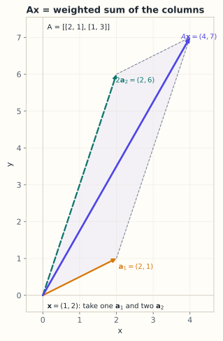

# 3.2 矩阵乘向量：线性映射

> **本节位置**：模块 3 · 矩阵与线性映射 ｜ **前置**：[3.1](01-矩阵的四种身份.md) ｜ **预计**：35 分钟
>
> **一句话**：$A\mathbf{x}$ 同时是「列向量的加权和」「一排点积」和「对空间做一次变换」——三种算法，同一个结果。

## 0. 场景引入

周五下午，协作机器人调试现场。一台 6 轴机械臂要在 **2 毫秒**的控制周期里（500 Hz）走一条直线：末端以 **0.25 m/s** 沿桌面匀速前推，焊一条 **300 mm** 的缝。

控制器每一拍只做一件事：给定末端速度 $\mathbf{v}\in\mathbb{R}^6$（3 个线速度 + 3 个角速度），求 6 个关节的速度 $\dot{\mathbf{q}}$，满足

$$
\mathbf{v}=J(\mathbf{q})\,\dot{\mathbf{q}}
$$

$J$ 是 $6\times6$ 的雅可比矩阵（Jacobian），随姿态 $\mathbf{q}$ 变化，每一拍都要重算。

算错的代价很直接：缝偏 1 mm 就是废件。更糟的是某个关节的速度超过额定 180°/s（约 3.14 rad/s），驱动器过流保护直接抱闸——机械臂停在半空，工件和夹具一起报废。

这条缝要走 $300\ \text{mm}\div0.25\ \text{m/s}=1.2$ s，也就是 **600** 个控制周期。每一拍都要把新的 $J$ 乘一次、解一次，中间任何一拍算错，后面的轨迹就全歪了。

**问题**：$J\dot{\mathbf{q}}$ 为什么能算出一个速度，而不是六个互不相干的数？当 $J$ 接近不可逆时，$\dot{\mathbf{q}}$ 为什么会突然爆掉？

读完本节，你应该能回答三件事：

1. 三种算法（列组合、行点积、变换）在机器人上分别对应什么物理量；
2. 为什么 $J$ 的第 $j$ 列就是「只动第 $j$ 个关节、其余锁死」时末端的速度；
3. $\kappa(J)$ 变大时，为什么解出的关节速度会失控，工程上怎么兜底。

## 1. 直觉

### 1.1 三种算，同一件事

一个 2 维向量 $\mathbf{x}=(1,2)^\top$ 经过矩阵

$$
A=\begin{bmatrix}2&1\\1&3\end{bmatrix}
$$

之后变成什么？你可以按三种方式算：

- 把 $A$ 的两列按 $x_1,x_2$ 加权相加；
- 用 $A$ 的每一行和 $\mathbf{x}$ 做点积；
- 把 $A$ 看成对平面的一次拉伸，看 $\mathbf{x}$ 这个点被搬到哪里。

**列组合：把输入当配方。** $A$ 有两列 $\mathbf{a}_1=(2,1)^\top$、$\mathbf{a}_2=(1,3)^\top$。输入 $\mathbf{x}=(1,2)^\top$ 说的是：**取 1 份第一列、2 份第二列**。

$$
1\begin{bmatrix}2\\1\end{bmatrix}+2\begin{bmatrix}1\\3\end{bmatrix}
=\begin{bmatrix}4\\7\end{bmatrix}
$$

这是「鸡尾酒配方」视角：输入是各原料的用量，矩阵的列是原料，输出是调好的酒。

*图：$A$ 的两列 $\mathbf{a}_1=(2,1)$、$\mathbf{a}_2=(1,3)$；输入 $(1,2)$ 表示取 1 份 $\mathbf{a}_1$、2 份 $\mathbf{a}_2$，平行四边形的对角线就是 $A\mathbf{x}=(4,7)$。*

**行点积：把矩阵当一组测量。** $A$ 的第一行 $(2,1)$ 与 $\mathbf{x}$ 做点积得 $2\cdot1+1\cdot2=4$；第二行 $(1,3)$ 得 $1\cdot1+3\cdot2=7$。输出分量就是**每个行向量与输入的相似度/投影**。

**变换：把矩阵当动作。** $A$ 把基向量 $\mathbf{e}_1=(1,0)^\top$ 送到 $(2,1)^\top$，把 $\mathbf{e}_2=(0,1)^\top$ 送到 $(1,3)^\top$。单位正方形因此被拉成一个平行四边形，$\mathbf{x}$ 跟着一起被搬走。

> 💡 **一句话直觉**：**列组合是「怎么算」，行点积是「每个输出看什么」，变换是「几何上发生了什么」。**

类比边界：只有当矩阵是方阵且可逆时，「变换」才是一个可来回搬运的坐标变换；$m\neq n$ 时它是升维/降维，信息一定丢失或冗余。

### 1.2 现实对应：一组传动比

把 $J$ 的第 $j$ 列单独拎出来看。若只有第 $j$ 个关节在动（$\dot q_j\neq0$，其余为 0），则 $\mathbf{v}=\dot q_j\,\mathbf{j}_j$。也就是说：

> **$J$ 的第 $j$ 列 = 只动第 $j$ 个关节时，末端的速度方向；它的长度就是这个关节的「力臂」。**

以连杆总长 0.4 m 的机械臂为例，第 6 个关节（腕部）转 1 rad/s，末端走 0.4 m/s。所以 $J$ 的第 6 列范数约 0.4，单位是「米每弧度」。

这就是列组合视角在机器人上的样子：末端速度是 6 个关节各自贡献的**线性叠加**——每个关节按自己的角速度贡献一列，加起来就是末端的总速度。$A\mathbf{x}$ 里的 $x_j$ 在机器人上就是 $\dot q_j$。

**这个类比在哪里失效**：传动比是常数，雅可比不是。$J$ 依赖当前姿态 $\mathbf{q}$，机械臂一动 $J$ 就变。把 $J$ 当固定矩阵用（比如整条轨迹只算一次），等于假设机械臂没动——这是仿真与实机对不上的最常见原因。

### 1.3 量级直觉

关节速度的额定值是 180°/s，即 3.14 rad/s。连杆 0.4 m 时，末端速度上限约 $0.4\times3.14\approx1.26$ m/s——比焊接要的 0.25 m/s 快 5 倍，看起来余量充足。

余量是被 $J^{-1}$ 吃掉的。末端要 0.25 m/s，若某个方向上 $\kappa(J)=10$，最坏方向上的关节速度就要 $10\times0.25/0.4\approx6$ rad/s，直接超限。**线性映射的增益不是均匀的：沿不同方向，它差 $\kappa$ 倍。**

## 2. 定义

### 2.1 矩阵乘向量（matrix-vector product）

设 $A\in\mathbb{R}^{m\times n}$，$\mathbf{x}\in\mathbb{R}^n$，则 $A\mathbf{x}\in\mathbb{R}^m$，其第 $i$ 个分量为

$$
(A\mathbf{x})_i=\sum_{j=1}^{n}a_{ij}x_j,\qquad i=1,\dots,m
$$

逐项读法：输出的第 $i$ 个分量，是 $A$ 第 $i$ 行与 $\mathbf{x}$ 的点积。形状：$(m\times n)(n\times1)=(m\times1)$。

### 2.2 列组合形式

把 $A$ 按列分块 $A=[\mathbf{a}_1\ \cdots\ \mathbf{a}_n]$，则

$$
A\mathbf{x}=\sum_{j=1}^{n}x_j\mathbf{a}_j
$$

这是与 §2.1 等价的写法，只是把「按行求和」换成了「按列加权」。

把 $A\mathbf{x}$ 读成「列的组合」，也是 [Trefethen & Bau](#ref-trefethen-bau-1997) 第一讲的开篇算法。

### 2.3 线性性

映射 $T(\mathbf{x})=A\mathbf{x}$ 满足：对任意 $\mathbf{x},\mathbf{y}\in\mathbb{R}^n$ 和标量 $\alpha,\beta$，

$$
T(\alpha\mathbf{x}+\beta\mathbf{y})=\alpha T(\mathbf{x})+\beta T(\mathbf{y})
$$

满足这条性质的映射叫**线性映射（linear map）**。注意 $T(\mathbf{0})=\mathbf{0}$ 是它的必要条件：原点必须不动。

## 3. 为什么这样定义

为什么不逐元素乘？因为逐元素乘 $A\odot\mathbf{x}$ 要求形状相同，而且它不满足「先组合再变换 = 先变换再组合」。线性映射的价值恰恰在于这条可交换性：你可以先把输入拆成基向量的组合，分别看它们去哪，再加起来。

为什么行点积和列组合必须一致？因为矩阵只有一份数字。行定义给出计算顺序，列定义给出几何含义；两者一致，才能让「代数计算」和「空间变换」互相翻译。

为什么原点必须不动？如果 $T(\mathbf{0})=\mathbf{b}\neq\mathbf{0}$，映射就是 **仿射（affine）** 的。线性层里的偏置 $\mathbf{b}$ 正是干这个的：$W\mathbf{x}+\mathbf{b}$ 是仿射，不是严格线性。把 $\mathbf{x}$ 增广成 $(\mathbf{x},1)$、$W$ 增广一列 $\mathbf{b}$，就又能写成线性形式。

### 3.1 反事实：如果 $A\mathbf{x}$ 定义成「第 $i$ 个输出只看第 $i$ 个输入」

逐元素乘 $A\odot\mathbf{x}$ 要求形状相同，所以对 $2\times2$ 的矩阵和 2 维向量来说，形状上说得通。把它明确写成：第 $i$ 个输出取 $a_{ii}x_i$。

取一个 90° 姿态下的平面二连杆，只保留两个关节对末端线速度的贡献：

$$
J=\begin{bmatrix}0&-0.4\\0.4&0\end{bmatrix}
$$

第 1 列 $(0,0.4)$：动第 1 关节，末端沿 $y$ 走；第 2 列 $(-0.4,0)$：动第 2 关节，末端沿 $-x$ 走。两个力臂都是 0.4 m。

让第 1 个关节以 1 rad/s 转动，第 2 个锁死：$\dot{\mathbf{q}}=(1,0)^\top$。

**正确算法**（行点积）：

$$
\mathbf{v}=J\dot{\mathbf{q}}=\begin{bmatrix}0\cdot1+(-0.4)\cdot0\\0.4\cdot1+0\cdot0\end{bmatrix}=\begin{bmatrix}0\\0.4\end{bmatrix}
$$

末端沿 $y$ 走 0.4 m/s，符合「力臂 × 角速度」。

**逐元素算法**：

$$
\begin{bmatrix}J_{11}\dot q_1\\J_{22}\dot q_2\end{bmatrix}=\begin{bmatrix}0\cdot1\\0\cdot0\end{bmatrix}=\begin{bmatrix}0\\0\end{bmatrix}
$$

末端速度为零。也就是说：电机在转、关节在动、连杆扫过 0.4 m 的弧，末端却「没动」。

**一眼可见的荒谬**：末端固定在连杆上，关节一动它必动（除非力臂为 0）。逐元素算法做了两件错事：把「第 2 个关节锁死」误读成「整行归零」；同时丢掉了 $J_{12}=-0.4$ 对第 1 个输出的贡献——那正是「第 2 个关节也在推着末端往 $-x$ 走」这件事。

结论：$A\mathbf{x}$ 的每个输出分量必须**把所有输入维度都看一遍**（行点积），才能表达「多个关节共同决定一个方向的速度」。任何「第 $i$ 个输出只看第 $i$ 个输入」的定义，都会把耦合整个删掉。

## 4. 性质与推导

### 4.1 两种算法为什么相等

把 $A\mathbf{x}=\sum_j x_j\mathbf{a}_j$ 的第 $i$ 个分量写出来：

$$
\left(\sum_{j=1}^{n}x_j\mathbf{a}_j\right)_i
=\sum_{j=1}^{n}x_j(\mathbf{a}_j)_i
=\sum_{j=1}^{n}a_{ij}x_j
=(A\mathbf{x})_i
$$

第一步是向量线性组合按分量展开，第二步用「第 $j$ 列的第 $i$ 个分量就是 $a_{ij}$」。**列组合与行点积不是两个定义，而是同一个求和的两种分组方式。**

### 4.2 线性性的推导

$$
(A(\alpha\mathbf{x}+\beta\mathbf{y}))_i
=\sum_j a_{ij}(\alpha x_j+\beta y_j)
=\alpha\sum_j a_{ij}x_j+\beta\sum_j a_{ij}y_j
=\alpha(A\mathbf{x})_i+\beta(A\mathbf{y})_i
$$

逐分量相等，所以向量相等。

### 4.3 基本性质

| 性质 | 式子 | 说明 |
|---|---|---|
| 零矩阵 | $O\mathbf{x}=\mathbf{0}$ | $O$ 是所有元素为 0 的矩阵 |
| 单位阵 | $I_n\mathbf{x}=\mathbf{x}$ | $I_n$ 对角为 1、其余为 0 |
| 加法分配 | $(A+B)\mathbf{x}=A\mathbf{x}+B\mathbf{x}$ | 形状必须相同 |
| 数乘 | $(\alpha A)\mathbf{x}=\alpha(A\mathbf{x})$ | 先缩放矩阵等于先缩放输出 |
| 原点不动 | $A\mathbf{0}=\mathbf{0}$ | 线性的必要条件 |

单位阵的列是标准基：$I_n=[\mathbf{e}_1\ \cdots\ \mathbf{e}_n]$，所以 $I_n\mathbf{x}=\sum_j x_j\mathbf{e}_j=\mathbf{x}$。

## 5. 例子

### 5.1 手算：三种算法算同一个 $A\mathbf{x}$

取 $A=\begin{bmatrix}2&1\\1&3\end{bmatrix}$，$\mathbf{x}=(1,2)^\top$。

**列组合**：

$$
A\mathbf{x}=1\begin{bmatrix}2\\1\end{bmatrix}+2\begin{bmatrix}1\\3\end{bmatrix}
=\begin{bmatrix}2+2\\1+6\end{bmatrix}=\begin{bmatrix}4\\7\end{bmatrix}
$$

**行点积**：第一行 $2\cdot1+1\cdot2=4$；第二行 $1\cdot1+3\cdot2=7$。

**变换**：$\mathbf{e}_1\mapsto(2,1)^\top$，$\mathbf{e}_2\mapsto(1,3)^\top$。单位正方形被拉成顶点依次为 $(0,0),(2,1),(3,4),(1,3)$ 的平行四边形；$\mathbf{x}=(1,2)$ 被送到 $(4,7)$。

**验证线性性**：取 $\mathbf{y}=(2,-1)^\top$，则 $\mathbf{x}+\mathbf{y}=(3,1)^\top$，$A(\mathbf{x}+\mathbf{y})=(7,6)^\top$；而 $A\mathbf{x}+A\mathbf{y}=(4,7)^\top+(3,-1)^\top=(7,6)^\top$，一致。

### 5.2 场景：带偏置的线性层

线性层实际算的是 $\mathbf{y}=W\mathbf{x}+\mathbf{b}$。取 $W=\begin{bmatrix}1&-1\\0&2\end{bmatrix}$、$\mathbf{x}=(3,1)^\top$、$\mathbf{b}=(0.5,-1)^\top$，则 $W\mathbf{x}=(2,2)^\top$，加偏置得 $\mathbf{y}=(2.5,1)^\top$。因为 $\mathbf{x}=\mathbf{0}$ 时 $\mathbf{y}=\mathbf{b}\neq\mathbf{0}$，这个映射是仿射的；偏置让输出整体平移。

### 5.3 场景闭环：500 Hz 的速度环

**输入**：$J\in\mathbb{R}^{6\times6}$（fp64，288 字节），末端目标速度 $\mathbf{v}=(0,0,-0.25,0,0,0)^\top$（沿 $-z$ 匀速下降 0.25 m/s），控制周期 $T=2$ ms。

**计算**：每一拍解 $J\dot{\mathbf{q}}=\mathbf{v}$。用 LU：分解约 $\frac{2}{3}6^3=144$ FLOPs，回代 $2\cdot6^2=72$ FLOPs，合计 216 FLOPs。若 $J$ 在 6 拍内不变，分解可以复用，每拍只花 72 FLOPs。

**输出**：6 个关节速度指令，先过一道限幅 $|\dot q_j|\le3.14$ rad/s。通过才下发；任一关节超限，就按比例整体缩放（保方向、降速度），并上报「接近奇异位形」。

**成本**：算力完全不紧张——$216\times500=1.1\times10^5$ FLOP/s，一块几十 MHz 的 MCU 都绰绰有余；内存也只是 36 个数。真正的成本在**重算 $J$ 本身**：6 个关节角要做十几次三角函数、几十次乘法，比解方程贵一个数量级。所以瓶颈从来不是「算不动 $A\mathbf{x}$」，而是「来不及更新 $A$」。

**失败条件与兜底**：

- **奇异位形**：手臂完全伸直时，末端沿手臂方向无法产生速度，$J$ 某列退化，$\sigma_{\min}\to0$，$\kappa(J)\to\infty$，解出的 $\dot{\mathbf{q}}$ 可以是 $10^3$ rad/s。兜底：阻尼最小二乘，把 $J^{-1}$ 换成 $J^\top(JJ^\top+\lambda I)^{-1}$，$\lambda$ 随 $\kappa$ 增大（第 3.4 节的伪逆，第 4.5 节的一般形式）。代价是末端速度略小于目标——宁可慢，不要抱闸。
- **编码器噪声**：关节角读数上 $10^{-4}$ rad 的噪声经 $J^{-1}$ 放大 $\kappa$ 倍。$\kappa=100$ 时，速度指令上就有 $10^{-2}$ rad/s 的抖动，表现为末端高频震颤。兜底：对 $\dot{\mathbf{q}}$ 低通滤波，但会引入相位滞后，直线走成轻微弧线。
- **$J$ 过期**：若为省算力每 10 拍才更新一次 $J$，中间 20 ms 里机械臂已经转了几度，$J$ 与实际姿态不符，直线误差到毫米级。兜底：让 $J$ 的更新与插补周期对齐，宁可多算三角函数。

## 6. 常见误区

1. **误区**：$A\mathbf{x}$ 是 $A$ 的每个元素乘 $\mathbf{x}$ 的对应元素。
   **纠正**：逐元素乘是 Hadamard 积 $A\odot X$，要求同形状；$A\mathbf{x}$ 是行点积/列组合，输出维度由 $A$ 的行数决定。

2. **误区**：行向量也能直接写 $A\mathbf{x}$。
   **纠正**：本书约定 $\mathbf{x}$ 是列向量。若在代码里拿到行向量 `x`，应写 `x @ A.T`，本质仍是 $A\mathbf{x}$。

3. **误区**：$A\mathbf{x}+\mathbf{b}$ 是线性映射。
   **纠正**：只要 $\mathbf{b}\neq\mathbf{0}$ 就是仿射映射，原点被搬到了 $\mathbf{b}$。深度学习里习惯把整层叫「线性层」，是工程叫法。

## 7. 概念网络

- 前置：[3.1 矩阵的四种身份](01-矩阵的四种身份.md) —— 矩阵的列与映射方向。
- 前置：[1.2 加法、数乘与线性组合](../01-向量与几何/02-加法数乘与线性组合.md) —— 列组合就是线性组合。
- 前置：[1.3 点积](../01-向量与几何/03-点积.md) —— 行视角的每一行是一次点积。
- 后续：[3.3 矩阵乘法](03-矩阵乘法.md) —— 把两个 $A\mathbf{x}$ 串起来。
- 后续：[3.4 逆矩阵与可逆性](04-逆矩阵与可逆性.md) —— 已知 $A\mathbf{x}$ 反求 $\mathbf{x}$。
- 后续：[3.7 四个基本子空间](07-四个基本子空间.md) —— 哪些 $\mathbf{x}$ 被送到零。
- 关联：[11.2 线性层](../11-大模型专题/02-线性层.md) —— 大模型里的 $XW^\top+\mathbf{b}$。

## 8. 通往大模型：线性层就是一次矩阵乘向量

**出现位置**：Transformer 的每个线性层、QKV 投影、FFN 的第一层与第二层、输出 logits 层，本质都是对每个 token 做一次 $W\mathbf{x}+\mathbf{b}$。

**形状**：隐藏状态 $X\in\mathbb{R}^{B\times T\times D}$，权重 $W\in\mathbb{R}^{D_{\text{out}}\times D}$。代码写作 `X @ W.T + b`，逐 token 展开就是 $B\cdot T$ 次矩阵乘向量；这一层在 BLAS 里叫 GEMV，即第 2 层矩阵–向量例程（[Golub & Van Loan](#ref-golub-vanloan-2013)）。QKV 投影常把三个矩阵拼成 $W_{QKV}\in\mathbb{R}^{3D\times D}$，一次算出 $[\mathbf{q},\mathbf{k},\mathbf{v}]$（三组投影的原始定义见 [Vaswani 等，2017](#ref-vaswani-2017)）；当 $D=4096$ 时输出维是 12288。

**为什么需要**：线性层是模型里把特征维度**线性组合**起来的主要运算：attention 混合的是不同 token 的信息，LayerNorm 做的是逐 token 的归一化，它们都不提供可学习的跨维线性权重。没有 $W\mathbf{x}$，每个特征维度永远独立，模型无法组合特征。

**可检验结论**：对 $B=8$、$T=512$、$D=4096$ 的 QKV 投影，FLOPs 约为 $2\cdot B\cdot T\cdot D\cdot 3D=2\cdot8\cdot512\cdot4096\cdot12288\approx4.12\times10^{11}$，即约 412 GFLOP。把 $D$ 翻倍，FLOPs 变为 4 倍——这就是大模型算力随宽度平方增长的来源。

**如果这一步算错，用户会看到什么现象**：$A\mathbf{x}$ 少算一项，最典型的症状是「某些东西永远不变」——某个注意力头对某些 token 的分数恒为 0，模型对这些词完全无感，表现为系统性忽略某类实体。把输出维度方向搞反（`x @ W` 写成本该 `x @ W.T`），如果形状恰好还能对上，模型会照常训练、loss 照常下降，只是学到的东西整体「错位」，最终效果比随机初始化好不了多少。符号错（少一个负号）则常表现为训练早期 loss 突然变 NaN 或爆炸——因为残差流被反复放大而不是相互抵消。

## 9. 练习

1. **概念**：用列组合语言解释「$A$ 的第 $j$ 列等于 $A\mathbf{e}_j$」。
2. **计算**：$A=\begin{bmatrix}1&2\\3&4\end{bmatrix}$，$\mathbf{x}=(2,-1)^\top$，分别用列组合与行点积求 $A\mathbf{x}$。
3. **计算**：接上题，求 $A(A\mathbf{x})$，并验证它等于 $(A^2)\mathbf{x}$，其中 $A^2=AA$。
4. **场景**：$W=\begin{bmatrix}0.5&-1\\2&0\end{bmatrix}$，$\mathbf{b}=(1,0)^\top$，$\mathbf{x}=(2,1)^\top$，求 $W\mathbf{x}+\mathbf{b}$，并说明为什么它不是线性映射。
5. **开放**：如果线性层去掉偏置，表达能力会损失什么？在什么情况下偏置是冗余的？

参考答案

1. $\mathbf{e}_j$ 表示「只取第 $j$ 份原料」，列组合 $A\mathbf{e}_j=1\cdot\mathbf{a}_j$，其余系数为 0，所以结果就是第 $j$ 列。
2. 列组合：$2(1,3)^\top-1(2,4)^\top=(0,2)^\top$；行点积：$1\cdot2+2\cdot(-1)=0$，$3\cdot2+4\cdot(-1)=2$。
3. $A\mathbf{x}=(0,2)^\top$；$A(0,2)^\top=(4,8)^\top$。$A^2=\begin{bmatrix}7&10\\15&22\end{bmatrix}$，$(A^2)\mathbf{x}=(14-10,30-22)^\top=(4,8)^\top$，一致。
4. $W\mathbf{x}=(0,4)^\top$，加偏置得 $(1,4)^\top$。$\mathbf{x}=\mathbf{0}$ 时输出 $(1,0)^\top\neq\mathbf{0}$，原点被平移，故不是线性映射。
5. 偏置让每个输出维度可以整体平移，相当于给决策边界/激活阈值一个可学习的起点；如果数据已经中心化、或下一层有 LayerNorm，偏置的作用会大幅减弱，甚至可省略。

## 10. 一页速记

- $(A\mathbf{x})_i=\sum_j a_{ij}x_j$；形状 $(m\times n)(n\times1)=(m\times1)$。
- **物理意义 / 现实对应**：$A\mathbf{x}$ 是「每个输入的贡献按列加权求和」；在机械臂上就是各关节速度按各自力臂叠加成末端速度，$A$ 的列就是力臂。
- 列组合：$A\mathbf{x}=\sum_j x_j\mathbf{a}_j$；行点积：每个输出是一次点积。
- 线性：$A(\alpha\mathbf{x}+\beta\mathbf{y})=\alpha A\mathbf{x}+\beta A\mathbf{y}$，且 $A\mathbf{0}=\mathbf{0}$。
- $I_n\mathbf{x}=\mathbf{x}$，$O\mathbf{x}=\mathbf{0}$。
- 线性层实际是仿射：$W\mathbf{x}+\mathbf{b}$，偏置让原点平移。

## 11. 参考文献与致谢

这一页的知识不是凭空来的。下面列出本页直接借用的原始工作与权威整理；正文中的人名、定理名已链接到对应条目。链接优先指向 DOI、arXiv 或可长期访问的原文存档。

- **Golub & Van Loan（2013）**：*Matrix Computations*（第 4 版）。把 $A\mathbf{x}$ 定为 BLAS 第 2 层的 GEMV，并给出 $2mn$ FLOPs 与访存计数，本页的行点积/列组合在实现里就是它。[Johns Hopkins University Press](https://doi.org/10.56021/9781421407944)
- **Trefethen & Bau（1997）**：*Numerical Linear Algebra*。第一讲就把 $A\mathbf{x}$ 解释成列向量的线性组合，本页「列组合」视角的标准出处。[SIAM](https://doi.org/10.1137/1.9780898719574)
- **Vaswani 等（2017）**：*Attention Is All You Need*。给出 $XW^\top+\mathbf{b}$ 的线性层与 $W_Q,W_K,W_V$ 三组投影，本页 §8 的形状推导直接沿用。[arXiv:1706.03762](https://arxiv.org/abs/1706.03762)

---

下一篇 → [3.3 矩阵乘法：四种视角](03-矩阵乘法.md)
