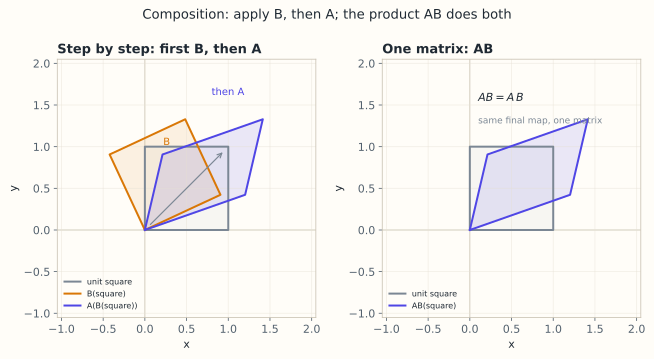

# 3.3 矩阵乘法：四种视角

> **本节位置**：模块 3 · 矩阵与线性映射 ｜ **前置**：[3.2](02-矩阵乘向量.md) ｜ **预计**：40 分钟
>
> **一句话**：矩阵乘法是「复合两个线性映射」，行乘列、列组合、行组合、外积和只是同一笔账的四种记法。

## 0. 场景引入

一个 5G 基站的基带板，每个时隙 **0.5 ms** 就要重算一次等效信道。链路是串起来的：

$$
H_{\text{eff}}=R\,H\,F
$$

$F\in\mathbb{C}^{64\times8}$ 是发射预编码（64 根天线、8 层数据），$H\in\mathbb{C}^{4\times64}$ 是空口信道（终端 4 根天线），$R\in\mathbb{C}^{2\times4}$ 是接收合并（4 根天线合成 2 个基带流）。三者相乘得 $2\times8$ 的等效信道——它决定这 8 层数据能不能被分开。

一个 100 MHz 载波有 **3276** 个子载波（273 个资源块 × 12），每个都要算一遍 $RHF$。基带 DSP 的预算是每时隙约 30 MFLOP，折合 60 GFLOP/s。

**决定**：先算 $RH$ 还是先算 $HF$？两者数学上完全一样（结合律保证），但一个要 $512+1024=1536$ 次复数乘加，另一个要 $2048+64=2112$ 次，少 27%；中间矩阵一个 128 个复数、一个 32 个复数，差 4 倍。

**代价**：等效信道算错，基站会误以为 8 层数据互不干扰，而实际层间干扰有 -10 dB。终端解调误块率从 1% 飙到 30%，用户看到的是视频一直转圈、信号满格却不走流量。

**问题**：为什么「先乘哪两个」不影响结果，却影响代价？为什么两个矩阵相乘必须是行乘列，而不能逐元素？

读完本节，你应该能回答三件事：

1. 四种视角（行乘列、列组合、行组合、外积和）各自回答什么问题；
2. 为什么结合律允许你自由加括号，而交换律不允许你换顺序；
3. 一次矩阵链乘的 FLOPs 与中间内存怎么估，为什么两者会指向不同的最优括号。

## 1. 直觉

### 1.1 四种读法

矩阵乘法有四种读法，它们回答四个不同的问题：

1. **行乘列（row times column）**：$c_{ij}$ 是 $A$ 第 $i$ 行与 $B$ 第 $j$ 列的点积——「第 $i$ 个输出对第 $j$ 个输入通道的总响应」。
2. **列组合（columns）**：$C$ 的第 $j$ 列是 $A$ 乘 $B$ 的第 $j$ 列——「$B$ 的第 $j$ 个输入方向经过 $A$ 后去哪」。
3. **行组合（rows）**：$C$ 的第 $i$ 行是 $A$ 的第 $i$ 行乘 $B$——「$A$ 的第 $i$ 个输出方向如何混合 $B$ 的行」。
4. **外积和（sum of outer products）**：$C=\sum_{k=1}^{n}\mathbf{a}_k\mathbf{b}_k^\top$——「$n$ 个秩 1 矩阵叠加」。

> 💡 **一句话直觉**：**矩阵乘法 = 先做 $B$ 再做 $A$；四种视角是四种「按什么顺序加」的记账方式。**

类比边界：这个「复合」解释只对线性映射成立。若中间夹了非线性（ReLU、softmax），就不能合并成一个矩阵；这也正是深度网络不能塌缩成单层的原因。

*图：为便于画图，这里用 $2\times2$ 矩阵演示；先作用 $B$ 再作用 $A$，与直接乘 $AB$ 得到同一个正方形的像。正文的 $2\times3$ 与 $3\times2$ 复合同理。*

### 1.2 现实对应：一条串联的流水线

最简单的复合是两个小矩阵。第一层 $B\in\mathbb{R}^{3\times2}$ 把 2 维变成 3 维，第二层 $A\in\mathbb{R}^{2\times3}$ 再变回 2 维。输入 $\mathbf{x}\in\mathbb{R}^2$ 先过 $B$ 再过 $A$，结果是 $A(B\mathbf{x})$。如果有 100 万个 token 要一次算完，你希望有一个矩阵 $C$ 直接表示「先 $B$ 后 $A$」，让 $C\mathbf{x}=A(B\mathbf{x})$ 对所有 $\mathbf{x}$ 成立——这个 $C$ 就是 $AB$，形状 $(2\times3)(3\times2)=(2\times2)$。

现实里的每一级都有物理含义。以开头的 5G 链路为例：

- $F$：把 8 层数据「铺」到 64 根天线上（预编码）；
- $H$：空口传播，每根发射天线到每根接收天线一条路径；
- $R$：把 4 根天线的信号「压」成 2 个基带流。

乘积 $RHF$ 是整条链路的等效映射：给 8 层输入，直接得 2 个基带输出，中间的 64 维、4 维全部被消掉。这也解释了为什么中间维会在形状里消失——$(2\times4)(4\times64)(64\times8)=(2\times8)$。

**这个类比在哪里失效**：流水线的每一级必须是**线性**的，才能合并成一个矩阵。实际链路里功率放大器会饱和、ADC 会量化（取整）、相位噪声让 $H$ 随时间漂移。这些一旦进来，「三级合并成一个矩阵」就不再成立——这也是实际系统必须在每一级留观测点（耦合器、参考信号）的原因。

### 1.3 量级直觉

一次 $4096\times4096$ 乘 $4096\times4096$ 的 GEMM，FLOPs 是 $2\cdot4096^3\approx1.37\times10^{11}$，而参与的三块矩阵按 fp16 存一共 $3\cdot4096^2\cdot2\ \text{B}\approx100$ MB。计算/访存比约 $1.4\times10^3$ FLOP/B——这个数字越大，GPU 越「吃得饱」。

对比矩阵乘向量：$4096\times4096$ 乘一个向量只有 $2\cdot4096^2\approx3.4\times10^7$ FLOPs，却要读 33 MB 的矩阵，比值只有 $1$ FLOP/B。**同一个矩阵，乘矩阵比乘向量「划算」一千倍**——这就是批处理存在的理由。

## 2. 定义

### 2.1 矩阵乘法（matrix multiplication）

设 $A\in\mathbb{R}^{m\times n}$，$B\in\mathbb{R}^{n\times p}$，则 $C=AB\in\mathbb{R}^{m\times p}$，其元素为

$$
c_{ij}=\sum_{k=1}^{n}a_{ik}b_{kj},\qquad i=1,\dots,m,\quad j=1,\dots,p
$$

逐项读法：$C$ 的第 $(i,j)$ 个元素，是 $A$ 第 $i$ 行与 $B$ 第 $j$ 列的长度 $n$ 点积。形状：$(m\times n)(n\times p)=(m\times p)$，**中间维 $n$ 必须相等，且会在结果里消失**。

### 2.2 四种视角的公式

**行乘列**：$c_{ij}=\mathbf{a}_{i:}\mathbf{b}_{:j}$，其中 $\mathbf{a}_{i:}$ 是 $A$ 的第 $i$ 行，$\mathbf{b}_{:j}$ 是 $B$ 的第 $j$ 列。

**列组合**：把 $B$ 按列分块 $B=[\mathbf{b}_1\ \cdots\ \mathbf{b}_p]$，则 $C$ 的每一列是 $\mathbf{c}_j=A\mathbf{b}_j$（$j=1,\dots,p$）。

**行组合**：把 $A$ 按行分块，则 $C$ 的每一行是 $\mathbf{c}_{i:}=\mathbf{a}_{i:}B$（$i=1,\dots,m$）。

**外积和**：把 $A$ 按列分块、$B$ 按行分块，则 $AB=\sum_{k=1}^{n}\mathbf{a}_k\mathbf{b}_k^\top$，其中 $\mathbf{a}_k\in\mathbb{R}^m$ 是 $A$ 的第 $k$ 列，$\mathbf{b}_k^\top\in\mathbb{R}^{1\times p}$ 是 $B$ 的第 $k$ 行；每一项 $\mathbf{a}_k\mathbf{b}_k^\top$ 是 $m\times p$ 的秩 1 矩阵。

## 3. 为什么这样定义

因为矩阵代表线性映射，而映射可以复合。设 $B$ 对应 $T_B:\mathbb{R}^p\to\mathbb{R}^n$，$A$ 对应 $T_A:\mathbb{R}^n\to\mathbb{R}^m$，则复合映射 $T_A\circ T_B:\mathbb{R}^p\to\mathbb{R}^m$ 仍是线性的，必然对应某个矩阵 $C$。**这个 $C$ 就是 $AB$**。这个「乘法 = 复合」的定义来自 [Cayley 1858](#ref-cayley-1858)：他把矩阵乘法写成线性替换的复合，并指出它结合、但一般不可交换。

如果定义成逐元素乘，复合就做不到了：逐元素乘只对同形状矩阵有意义，而且 $(A\odot B)\mathbf{x}\neq A\odot(B\mathbf{x})$。矩阵乘法的每个元素都等于「一行 × 一列」，正是为了让 $(AB)\mathbf{x}=A(B\mathbf{x})$ 对**所有** $\mathbf{x}$ 成立。§4.1 会证明这一点。

为什么中间维必须相等？因为复合要求 $B$ 的输出维（$n$）等于 $A$ 的输入维（$n$）。形状不匹配，映射根本接不上。

### 3.1 反事实：如果定义成逐元素相乘

取两个 $2\times2$：

$$
A=\begin{bmatrix}1&2\\3&4\end{bmatrix},\qquad B=\begin{bmatrix}5&6\\7&8\end{bmatrix}
$$

**行乘列**：$c_{11}=1\cdot5+2\cdot7=19$，$c_{12}=1\cdot6+2\cdot8=22$，$c_{21}=3\cdot5+4\cdot7=43$，$c_{22}=3\cdot6+4\cdot8=50$，即

$$
AB=\begin{bmatrix}19&22\\43&50\end{bmatrix}
$$

**逐元素**：$A\odot B=\begin{bmatrix}5&12\\21&32\end{bmatrix}$。

现在看复合。取输入 $\mathbf{x}=(1,0)^\top$（只开第一层）：

$$
A(B\mathbf{x})=A\begin{bmatrix}5\\7\end{bmatrix}=\begin{bmatrix}1\cdot5+2\cdot7\\3\cdot5+4\cdot7\end{bmatrix}=\begin{bmatrix}19\\43\end{bmatrix}
$$

用逐元素矩阵作用在同一个 $\mathbf{x}$ 上，取它的第 1 列：

$$
(A\odot B)\,\mathbf{x}=\begin{bmatrix}5\\21\end{bmatrix}
$$

$19$ 对 $5$，$43$ 对 $21$——差了将近 4 倍和 2 倍，而且偏差随 $\mathbf{x}$ 变（换个 $\mathbf{x}$ 比例就变），不能靠乘一个常数修正。

**结论**：逐元素乘只在一种情形下等于复合——两个矩阵都是**对角**的。对角矩阵的复合确实就是逐元素乘（对应位置的比例相乘）。一旦出现非对角项（也就是「不同通道之间的混合」），逐元素乘就把混合关系全部丢掉。这也解释了工程上的分工：**缩放可以用逐元素，线性层不行。**

## 4. 性质与推导

### 4.1 定义是被复合逼出来的

我们希望 $(AB)\mathbf{x}=A(B\mathbf{x})$。看第 $i$ 个分量：

$$
((AB)\mathbf{x})_i=\sum_{j=1}^{p}(AB)_{ij}x_j
=\sum_{j=1}^{p}\left(\sum_{k=1}^{n}a_{ik}b_{kj}\right)x_j
=\sum_{k=1}^{n}a_{ik}\underbrace{\sum_{j=1}^{p}b_{kj}x_j}_{(B\mathbf{x})_k}
=(A(B\mathbf{x}))_i
$$

把 $(AB)_{ij}$ 换成任何别的公式，这一步都走不通。取 $\mathbf{x}=\mathbf{e}_j$ 还能直接看出：$AB$ 的第 $j$ 列必须是 $A\mathbf{b}_j$。所以「行乘列再求和」不是任意约定，而是复合映射的唯一矩阵表示。

### 4.2 四种视角为什么一致

- 列组合与行乘列：$A\mathbf{b}_j$ 的第 $i$ 个分量就是 $\sum_k a_{ik}b_{kj}=c_{ij}$。
- 行组合与行乘列：$\mathbf{a}_{i:}B$ 的第 $j$ 个分量也是 $\sum_k a_{ik}b_{kj}=c_{ij}$。
- 外积和：$\sum_k\mathbf{a}_k\mathbf{b}_k^\top$ 的 $(i,j)$ 元素是 $\sum_k a_{ik}b_{kj}=c_{ij}$。

四种视角只是把同一个三重循环按不同轴分组，结果必然相同。

### 4.3 运算性质

| 性质 | 式子 | 注意 |
|---|---|---|
| 结合律 | $(AB)C=A(BC)$ | 形状接得上就成立 |
| 分配律 | $A(B+C)=AB+AC$ | 形状必须匹配 |
| 单位阵 | $I_mA=AI_n=A$ | 左右单位阵尺寸可不同 |
| 转置 | $(AB)^\top=B^\top A^\top$ | 顺序反转 |
| 幂 | $A^k=AA\cdots A$ | 只对方阵 |
| 不可交换 | 一般 $AB\neq BA$ | 甚至可能 $BA$ 无定义 |

**FLOPs**：$m\times n$ 乘 $n\times p$ 需要 $mnp$ 次乘法与 $mnp$ 次加法，共 $2mnp$ 次浮点运算。$2\times3$ 乘 $3\times2$ 是 $2\cdot2\cdot3\cdot2=24$ FLOPs。这个计数不是下界：[Strassen 1969](#ref-strassen-1969) 用 7 次乘法完成 $2\times2$ 分块乘法，把渐近指数降到 $\log_2 7\approx2.81$。

### 4.4 零因子的存在

$AB=O$ 不要求 $A=O$ 或 $B=O$。例如 $A=\begin{bmatrix}0&1\\0&0\end{bmatrix}$ 非零，但 $A^2=\begin{bmatrix}0&0\\0&0\end{bmatrix}$ 是零矩阵。这说明矩阵乘法没有「消去律」：$AB=AC$ 不能直接推出 $B=C$。

用零空间的语言说：$AB=O$ 意味着 $B$ 的每一列都落在 $A$ 的零空间里，乘积的秩因此被乘掉。秩是刻画「哪些信息被压掉」的不变量，第 3.7 节会用四个子空间把它讲完。

## 5. 例子

### 5.1 手算：四种视角算同一个 $AB$

取

$$
A=\begin{bmatrix}1&2&3\\4&5&6\end{bmatrix}\in\mathbb{R}^{2\times3},\qquad
B=\begin{bmatrix}1&0\\0&1\\1&1\end{bmatrix}\in\mathbb{R}^{3\times2}
$$

**行乘列**：$c_{11}=1\cdot1+2\cdot0+3\cdot1=4$，$c_{12}=1\cdot0+2\cdot1+3\cdot1=5$，$c_{21}=4+0+6=10$，$c_{22}=0+5+6=11$。所以

$$
AB=\begin{bmatrix}4&5\\10&11\end{bmatrix}
$$

**列组合**：$B$ 的两列是 $\mathbf{b}_1=(1,0,1)^\top$、$\mathbf{b}_2=(0,1,1)^\top$，

$$
A\mathbf{b}_1=\begin{bmatrix}1+3\\4+6\end{bmatrix}=\begin{bmatrix}4\\10\end{bmatrix},\qquad
A\mathbf{b}_2=\begin{bmatrix}2+3\\5+6\end{bmatrix}=\begin{bmatrix}5\\11\end{bmatrix}
$$

两列拼起来正是 $AB$。

**行组合**：$A$ 的两行乘 $B$：$(1,2,3)B=(4,5)$，$(4,5,6)B=(10,11)$。反过来，$AB$ 的第 $i$ 行也是 $B$ 的行的加权和，权重是 $A$ 的第 $i$ 行：$1(1,0)+2(0,1)+3(1,1)=(4,5)$。

**外积和**：

$$
\begin{bmatrix}1\\4\end{bmatrix}(1,0)+\begin{bmatrix}2\\5\end{bmatrix}(0,1)+\begin{bmatrix}3\\6\end{bmatrix}(1,1)
=\begin{bmatrix}1&0\\4&0\end{bmatrix}+\begin{bmatrix}0&2\\0&5\end{bmatrix}+\begin{bmatrix}3&3\\6&6\end{bmatrix}
=\begin{bmatrix}4&5\\10&11\end{bmatrix}
$$

四种视角完全一致。

### 5.2 手算：复合映射与 FLOPs

再取 $C=\begin{bmatrix}1&2\\0&1\\2&0\end{bmatrix}\in\mathbb{R}^{3\times2}$。复合 $C(AB)=\begin{bmatrix}1&2\\0&1\\2&0\end{bmatrix}\begin{bmatrix}4&5\\10&11\end{bmatrix}=\begin{bmatrix}24&27\\10&11\\8&10\end{bmatrix}$，形状 $3\times2$。先算 $CA$ 再乘 $B$ 结果相同：$CA$ 的第一行是 $1(1,2,3)+2(4,5,6)=(9,12,15)$，再乘 $B$ 得 $(9+15,12+15)=(24,27)$。这就是结合律。

整个 $C(AB)$ 的计算量约 $2\cdot3\cdot2\cdot2$（先 $AB$）加 $2\cdot3\cdot2\cdot2$（再乘 $C$），共 48 FLOPs；若先算 $CA$ 再乘 $B$，则要 $2\cdot3\cdot2\cdot3+2\cdot3\cdot3\cdot2=72$ FLOPs。**结合律保证结果相同，但括号化顺序会改变计算量**——这就是矩阵链乘顺序优化的入口。

### 5.3 场景闭环：0.5 ms 里的三次矩阵乘

**输入**：每个子载波一组 $(R,H,F)$，形状 $(2\times4)$、$(4\times64)$、$(64\times8)$，复数 fp16（每个复数 4 字节）。共 3276 个子载波。一帧的原始数据 $=3276\times(8+256+512)=2.5\times10^6$ 个复数 $\approx10$ MB。

**计算**：两种括号，以复数乘加计：

- $(RH)F$：$RH$ 是 $2\cdot4\cdot64=512$ 次，再乘 $F$ 是 $2\cdot64\cdot8=1024$ 次，共 1536；
- $R(HF)$：$HF$ 是 $4\cdot64\cdot8=2048$ 次，再乘 $R$ 是 $2\cdot4\cdot8=64$ 次，共 2112。

比值 $2112/1536=1.375$。乘上 3276 个子载波、2000 个时隙/秒，前者 $1.0\times10^{10}$ 次复数乘加/秒，后者 $1.4\times10^{10}$。

**输出**：每个子载波一个 $2\times8$ 的等效矩阵，送进 MIMO 检测器算后处理信干噪比（SINR），再据此查表选调制编码档位（MCS）：SINR 高就上 256QAM，低就退回 QPSK。

**成本**：一次复数乘加折成 4 次实数乘 + 2 次实数加，$1.0\times10^{10}$ 次/秒约合 60 GFLOP/s——正好卡在基带 DSP 的预算线上。省下的那 27% 不是「慢一点」，是「要不要砍掉四分之一子载波、改用插值」。中间内存也指相反：$RH$ 是 $2\times64=128$ 个复数，$HF$ 只有 $4\times8=32$ 个，前者要多占 4 倍片上缓存。**FLOPs 最少和内存最少，在这里不是同一个括号**——这才是真正的取舍。

**失败条件与兜底**：

- **信道过期**：$H$ 是 0.5 ms 前估的。终端以 30 km/h 移动（8.3 m/s），0.5 ms 走 4.2 mm；28 GHz 下波长约 10.7 mm，相位就转了 $2\pi\cdot4.2/10.7\approx2.5$ rad。等效信道已经不对。兜底：退回更保守的 MCS，并加密参考信号。
- **秩塌陷**：终端在电梯里，8 层里只有 2 层有能量，$H$ 的奇异值从大到小差 30 dB，等效信道接近秩 2。此时按 8 层算出的 SINR 是虚高的，选高档位会大量误块。兜底：用秩指示（RI）反馈，按 $\sigma_i/\sigma_1$ 的阈值砍层数。
- **预编码量化**：$F$ 是从码本里选的，不是精确的奇异向量，实际 $RHF$ 会偏离设计值几个 dB。兜底：外环链路自适应——根据 ACK/NACK 统计慢慢下调 MCS，用「事后」补「事前」的偏差。

## 6. 常见误区

1. **误区**：矩阵乘法可交换。
   **纠正**：取 $D=\begin{bmatrix}2&1\\1&1\end{bmatrix}$、$E=\begin{bmatrix}1&3\\2&1\end{bmatrix}$，则 $DE=\begin{bmatrix}4&7\\3&4\end{bmatrix}$，$ED=\begin{bmatrix}5&4\\5&3\end{bmatrix}$，不同。

2. **误区**：$AB$ 就是对应元素相乘。
   **纠正**：那是 Hadamard 积 $A\odot B$；矩阵乘法的内维会被求和掉。

3. **误区**：$AB=O$ 则 $A=O$ 或 $B=O$。
   **纠正**：§4.4 的反例即可说明；矩阵没有消去律。

4. **误区**：$(AB)^\top=A^\top B^\top$。
   **纠正**：顺序必须反转，$(AB)^\top=B^\top A^\top$，否则形状常常接不上。

## 7. 概念网络

- 前置：[3.2 矩阵乘向量](02-矩阵乘向量.md) —— $A\mathbf{x}$ 是列组合。
- 前置：[1.3 点积](../01-向量与几何/03-点积.md) —— 行乘列是一次点积。
- 后续：[3.4 逆矩阵与可逆性](04-逆矩阵与可逆性.md) —— 复合的逆是逆的反序复合。
- 后续：[3.5 高斯消元与 LU](05-高斯消元与LU.md) —— 把矩阵分解成简单矩阵的乘积。
- 后续：[3.6 转置、对称与分块](06-转置对称与分块.md) —— 分块乘法与转置。
- 后续：[3.7 四个基本子空间](07-四个基本子空间.md) —— $AB$ 的秩不会超过任一因子。
- 关联：[10.3 BLAS 与 GEMM](../10-数值线性代数/03-BLAS与GEMM.md) —— 为什么 GPU 为矩阵乘法而生。

## 8. 通往大模型：GEMM 是训练的计量单位

**出现位置**：线性层、注意力打分、FFN、输出投影，全部是批量矩阵乘法（batched matrix multiplication），底层调用 GEMM（general matrix multiply）。

**形状**：一个 batch 的隐藏状态 $X\in\mathbb{R}^{B\times T\times D}$，展平成 $[BT,D]$ 后与 $W^\top\in\mathbb{R}^{D\times4D}$ 相乘，得到一个 $[BT,4D]$ 的中间结果。注意力打分则是 $Q\in\mathbb{R}^{B\times H\times T\times d_k}$ 与 $K^\top\in\mathbb{R}^{B\times H\times d_k\times T}$ 相乘，得到 $[B,H,T,T]$ 的分数矩阵。

**为什么需要**：GEMM 的 FLOPs 是 $2mnp$，而显存访问是 $O(mn+np+mp)$（这套计数与分块实现见 [Golub & Van Loan](#ref-golub-vanloan-2013) 第 1 章）。矩阵越大，计算/访存比越高，GPU 越能被喂饱。这解释了为什么训练要凑大 batch、为什么推理要合并请求：小矩阵的 GEMM 会被内存带宽卡住。

**可检验结论**：$B=8,T=1024,D=4096$ 的 FFN 升维（$D\to4D$），FLOPs 为 $2\cdot(8\cdot1024)\cdot4096\cdot16384\approx1.1\times10^{12}$，即约 1.1 TFLOP；若把 batch 减半，FLOPs 减半，但权重读取量不变，所以单位算力的能耗反而上升。**大 batch 不只是快，是更省。**

**如果这一步算错，用户会看到什么现象**：括号选错只费电、发热、掉续航，结果完全正确；真正的错是把 $AB$ 当成 $A\odot B$——发射端会误以为各层正交，实际层间干扰压不下去，终端表现为「信号满格但网速很慢」、重传率飙升。最隐蔽的一种是 $(AB)^\top$ 写成 $A^\top B^\top$：顺序一反，等效信道成了它的转置，检测器解出的符号全错，现象不是「有点慢」而是「完全解不出」，此时终端会一直停在搜网状态。

## 9. 练习

1. **概念**：用复合映射解释为什么 $(AB)C=A(BC)$，并说明为什么 $AB\neq BA$ 不影响结合律。
2. **计算**：$A=\begin{bmatrix}1&2&0\\0&1&1\end{bmatrix}$，$B=\begin{bmatrix}2&1\\1&0\\0&1\end{bmatrix}$，用行乘列求 $AB$，再用外积和验证。
3. **计算**：接上题，求 $BA$，比较形状与数值，说明不可交换。
4. **计算**：$A\in\mathbb{R}^{4\times6}$、$B\in\mathbb{R}^{6\times3}$、$C\in\mathbb{R}^{3\times5}$，求 $(AB)C$ 与 $A(BC)$ 的 FLOPs，哪个更省？
5. **开放**：为什么 GPU 上的矩阵乘法通常要把矩阵分块（tiling）？分块与「四种视角」中的哪一种最接近？

参考答案

1. 复合映射满足 $T_A\circ(T_B\circ T_C)=(T_A\circ T_B)\circ T_C$，而矩阵乘法正是复合的表示，所以结合律成立。$AB\neq BA$ 是「先 $B$ 后 $A$」与「先 $A$ 后 $B$」不同，不涉及三个映射的结合顺序。
2. $AB=\begin{bmatrix}4&1\\1&1\end{bmatrix}$。外积和：$(1,0)^\top(2,1)+(2,1)^\top(1,0)+(0,1)^\top(0,1)=\begin{bmatrix}2&1\\0&0\end{bmatrix}+\begin{bmatrix}2&0\\1&0\end{bmatrix}+\begin{bmatrix}0&0\\0&1\end{bmatrix}=\begin{bmatrix}4&1\\1&1\end{bmatrix}$。
3. $BA=\begin{bmatrix}2&5&1\\1&2&0\\0&1&1\end{bmatrix}$，是 $3\times3$；与 $AB$ 形状就不同，谈不上相等。
4. $(AB)C$：$2\cdot4\cdot6\cdot3+2\cdot4\cdot3\cdot5=144+120=264$；$A(BC)$：$2\cdot6\cdot3\cdot5+2\cdot4\cdot6\cdot5=180+240=420$。先算 $AB$ 更省。一般应让中间矩阵尽量小。
5. 分块把大矩阵拆成能塞进片上缓存的小块，提高数据复用、减少显存往返；它与「外积和/列组合」最接近——每次取一块 $A$ 的列块与 $B$ 的行块做外积累加。

## 10. 一页速记

- $c_{ij}=\sum_{k=1}^n a_{ik}b_{kj}$；形状 $(m\times n)(n\times p)=(m\times p)$。
- **物理意义 / 现实对应**：矩阵乘法是「两台机器串联」；现实里就是一条流水线的总传递函数，中间维是流水线的工位数，中间维在结果里消失。
- 四种视角：行乘列、列组合 $A\mathbf{b}_j$、行组合 $\mathbf{a}_{i:}B$、外积和 $\sum_k\mathbf{a}_k\mathbf{b}_k^\top$。
- 矩阵乘法 = 复合映射：$(AB)\mathbf{x}=A(B\mathbf{x})$。
- 不可交换、无消去律、$(AB)^\top=B^\top A^\top$。
- FLOPs $=2mnp$；GEMM 是训练算力的基本计量单位。

## 11. 参考文献与致谢

这一页的知识不是凭空来的。下面列出本页直接借用的原始工作与权威整理；正文中的人名、定理名已链接到对应条目。链接优先指向 DOI、arXiv 或可长期访问的原文存档。

- **凯莱（Arthur Cayley, 1858）**：*A Memoir on the Theory of Matrices*。把矩阵乘法定义为线性替换的复合，并指出它结合但一般不可交换；本页 §2.1 的「行乘列」是它的现代写法。[Phil. Trans. R. Soc. (1858)](https://doi.org/10.1098/rstl.1858.0002)
- **Golub & Van Loan（2013）**：*Matrix Computations*（第 4 版）。第 1 章给出 GEMM 的 $2mnp$ 计数、分块算法与快速乘法的适用边界，本页 §4.3 与 §8 的算力账以它为准。[Johns Hopkins University Press](https://doi.org/10.56021/9781421407944)
- **施特拉森（Volker Strassen, 1969）**：*Gaussian Elimination Is Not Optimal*。用 7 次乘法完成 $2\times2$ 分块乘法，证明 $2mnp$ 不是矩阵乘法的下界。[Numerische Mathematik](https://doi.org/10.1007/BF02165411)

---

下一篇 → [3.4 逆矩阵与可逆性](04-逆矩阵与可逆性.md)
