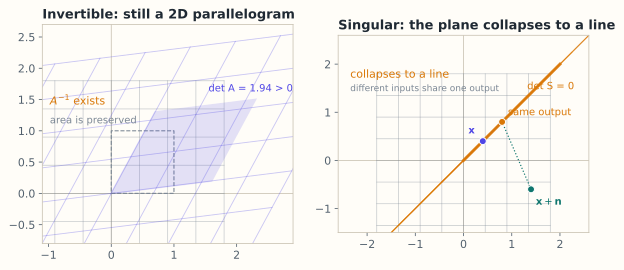

# 3.4 逆矩阵与可逆性

> **本节位置**：模块 3 · 矩阵与线性映射 ｜ **前置**：[3.3](03-矩阵乘法.md) ｜ **预计**：35 分钟
>
> **一句话**：逆矩阵是线性变换的「撤销键」；只有方阵且不把空间压扁时，撤销键才存在。

## 0. 场景引入

影像科的一台 CT，重建网格 $512\times512$，一共 $512^2=262{,}144$ 个像素待求。扫一圈取 360 个角度，每个角度 512 个探测器读数，共 $360\times512=184{,}320$ 个测量。

写成矩阵就是 $A\in\mathbb{R}^{184{,}320\times262{,}144}$，要解 $A\mathbf{x}=\mathbf{b}$：$\mathbf{x}$ 是每个像素的衰减系数，$\mathbf{b}$ 是探测器读数。

先算一笔账。这个矩阵有 $4.8\times10^{10}$ 个元素，按 fp32 存要 **193 GB**；医院工作站只有 64 GB 内存。**矩阵本身装不下，更谈不上求逆。**

更麻烦的是，测量数（18 万）比未知数（26 万）少，方程欠定：满足 $A\mathbf{x}=\mathbf{b}$ 的解有无穷多个。医生要的那张图，是这无穷多个解里「最像人体」的那一个。

**决定**：用滤波反投影（FBP，一次解析重建，约 0.1 s），还是迭代重建（SIRT/CG，几十次正反投影，约 20 s）？前者快，但低剂量下条纹伪影明显；后者慢，却能在欠采样时保住细节。

**问题**：一个 $18\text{ 万}\times26\text{ 万}$ 的矩阵连方阵都不是——「不可逆」到底是什么意思？为什么有的矩阵行列式不为 0、逆也确实存在，反解出来却是垃圾？

读完本节，你应该能回答三件事：

1. 可逆的五个等价条件，以及每个条件对应的几何图像；
2. 为什么 $2\times2$ 的公式里恰好出现 $\det$，它衡量的到底是什么；
3. 「可逆」（数学上能撤销）与「可靠」（数值上撤得准）的区别，条件数怎么量化这个区别。

## 1. 直觉

### 1.1 撤销键

把 $A$ 看成对平面的一个动作。$A^{-1}$ 就是把这个动作**原路撤回**：

$$
\mathbf{x}\xrightarrow{\ A\ }\mathbf{y}\xrightarrow{\ A^{-1}\ }\mathbf{x}
$$

- 如果 $A$ 把单位正方形拉成一个面积为 10 的平行四边形，$A^{-1}$ 就把它压回去，面积乘 $1/10$。
- 如果 $A$ 把平面压成一条直线（比如 $\begin{bmatrix}1&2\\2&4\end{bmatrix}$），不同点被压到同一处，**信息丢了，撤不回来**。

*图：左图 $A=\begin{bmatrix}1.6&0.7\\0.2&1.3\end{bmatrix}$ 把单位正方形变成仍有面积的平行四边形，$\det A=1.94$，所以能沿 $A^{-1}$ 撤回；右图以 $S=\begin{bmatrix}1&1\\1&1\end{bmatrix}$ 为例（与正文的 $\begin{bmatrix}1&2\\2&4\end{bmatrix}$ 同为奇异矩阵），单位正方形被压成线段，两个不同的输入映到同一个输出。*

> 💡 **一句话直觉**：**可逆 = 没有信息被压丢；逆矩阵 = 沿原路返回的变换。**

类比边界：这里的「撤销」是精确的代数撤销。数值计算里，即使 $A^{-1}$ 存在，浮点误差也可能让「撤销」失败——这就是条件数要解决的问题（§5.3）。

### 1.2 现实对应：从影子里反推物体

CT 的物理过程是：X 射线穿过人体，沿途被吸收，探测器记录的是「这条线上吸收的总和」。每个测量是一道**线积分**，重建就是从一堆线积分反推每一点的密度——这正是「撤销」的物理版本。

写成矩阵，$A$ 的每一行对应一条射线，元素 $a_{ij}$ 是「第 $i$ 条射线穿过第 $j$ 个像素的长度」。$A\mathbf{x}$ 是正问题（已知物体，算影子）；$A^{-1}\mathbf{b}$ 是反问题（已知影子，还原物体）。

**这个类比在哪里失效**：$A$ 既不是方阵，也不满秩。18 万个方程解 26 万个未知数，即使没有噪声，解也有一整个 $262{,}144-184{,}320=77{,}824$ 维的自由空间。所以严格说 CT 不存在 $A^{-1}$；工程上用伪逆、正则化或迭代，得到的是「在某种先验下最合理」的那个解，而不是「唯一正确」的那个解。

### 1.3 量级直觉

条件数决定「能反推到几位有效数字」。经验规律：$\kappa(A)=10^{k}$ 时，双精度（约 16 位十进制）只剩 $16-k$ 位可信；fp32（约 7 位）只剩 $7-k$ 位。

CT 系统矩阵的条件数常在 $10^{4}$ 到 $10^{6}$ 之间（依扫描几何与正则化而变，这是工程经验值，不是定理）。取 $\kappa=10^{6}$：fp32 只剩 1 位有效数字，重建出来就是一屏条纹。**这不是「精度差一点」，是「结果和真值没有关系」。**

## 2. 定义

### 2.1 逆矩阵

设 $A$ 是 $n\times n$ 方阵。若存在 $n\times n$ 矩阵 $B$，使得

$$
AB=BA=I_n
$$

则称 $A$ **可逆（invertible）**，$B$ 是 $A$ 的**逆矩阵（inverse）**，记作 $A^{-1}$。逆若存在则唯一。

把逆矩阵当成矩阵代数的一等运算（连同 $(AB)^{-1}=B^{-1}A^{-1}$ 的反序规则）是 [Cayley 1858](#ref-cayley-1858) 回忆录的内容。

### 2.2 $2\times2$ 的显式公式

对 $A=\begin{bmatrix}a&b\\c&d\end{bmatrix}$，若 $ad-bc\neq0$，则

$$
A^{-1}=\frac{1}{ad-bc}\begin{bmatrix}d&-b\\-c&a\end{bmatrix}
$$

其中 $ad-bc$ 是**行列式（determinant）** $\det(A)$。读法：主对角线互换、副对角线变号、整体除以行列式。

### 2.3 奇异与可逆的等价条件

对方阵 $A\in\mathbb{R}^{n\times n}$，以下说法等价：

1. $A$ 可逆；
2. $\det(A)\neq0$；
3. $\operatorname{rank}(A)=n$（满秩）；
4. $A\mathbf{x}=\mathbf{0}$ 只有零解（零空间只含 $\mathbf{0}$）；
5. $A$ 的列线性无关。

前两条在第 5.2–5.3 节证明，第三、四条在第 3.7 节展开。若某条不成立，称 $A$ **奇异（singular）**。

### 2.4 长方形矩阵的左逆与右逆

$m\neq n$ 时不存在两边逆，但可能有一边：

- $m>n$ 且列满秩：**左逆（left inverse）** $A^{+}=(A^\top A)^{-1}A^\top$，满足 $A^{+}A=I_n$；
- $m<n$ 且行满秩：**右逆（right inverse）** $A^{+}=A^\top(AA^\top)^{-1}$，满足 $AA^{+}=I_m$。

两者都叫伪逆（pseudoinverse）的特例；一般矩阵的伪逆在第 4.5 节。

## 3. 为什么这样定义

为什么要求 $AB=BA=I$ 两边都成立？因为线性映射的撤销必须**双向**：先 $A$ 后 $A^{-1}$ 回到原样，先 $A^{-1}$ 后 $A$ 也要回到原样。对方阵而言，可以证明只要一边成立，另一边自动成立；对长方形矩阵，两边不可能同时成立。

为什么可逆等价于「没有信息被压丢」？若 $A\mathbf{x}=\mathbf{0}$ 有非零解 $\mathbf{x}$，则 $A\mathbf{x}=A\mathbf{0}$，两个不同输入映到同一输出，反推不可能唯一。反过来，若零空间只有 $\mathbf{0}$，$n$ 个列线性无关，它们张成整个 $\mathbb{R}^n$，映射是双射，逆自然存在。

为什么 $2\times2$ 公式里恰好出现 $\det$？因为 $\det$ 衡量「面积被放大多少倍」。倍数为 0 意味着平面被压扁，映射不是双射；倍数非 0 才能除回去。

### 3.1 反事实：如果逆定义成「逐元素取倒数」

$A=\begin{bmatrix}4&7\\2&6\end{bmatrix}$，$\det=10$，真正的逆是

$$
A^{-1}=\frac{1}{10}\begin{bmatrix}6&-7\\-2&4\end{bmatrix}
=\begin{bmatrix}0.6&-0.7\\-0.2&0.4\end{bmatrix}
$$

「每个数取倒数」看起来是个很自然的候选定义：

$$
A^{\oslash}=\begin{bmatrix}0.25&0.1429\\0.5&0.1667\end{bmatrix}
$$

验证 $AA^{\oslash}$ 的第 $(1,1)$ 项：

$$
4\cdot0.25+7\cdot0.5=1+3.5=4.5\ \neq\ 1
$$

第 $(1,2)$ 项：$4\cdot0.1429+7\cdot0.1667=0.571+1.167=1.74\ \neq\ 0$。

**一眼可见的坏**：逆的定义要求 $AA^{-1}=I$，而逐元素倒数连「对角线上是 1」都做不到（这里是 4.5）。它坏在根子上——逆是**复合的撤销**，撤销必须对所有输入方向同时成立；逐元素操作只对每个坐标单独看一眼，天生表达不了「坐标之间的混合」。

顺带一说：唯一能让逐元素倒数成立的情形是对角矩阵，$\operatorname{diag}(a,b)^{-1}=\operatorname{diag}(1/a,1/b)$。这和 §3.3 里「逐元素乘只对对角矩阵等于复合」是同一件事的两面。

## 4. 性质与推导

### 4.1 $2\times2$ 公式的验证

设 $A=\begin{bmatrix}a&b\\c&d\end{bmatrix}$，$B=\frac{1}{ad-bc}\begin{bmatrix}d&-b\\-c&a\end{bmatrix}$。计算 $AB$：

$$
AB=\frac{1}{ad-bc}
\begin{bmatrix}ad-bc&-ab+ab\\cd-dc&-bc+ad\end{bmatrix}
=\begin{bmatrix}1&0\\0&1\end{bmatrix}
$$

$BA$ 同理。所以只要 $ad-bc\neq0$，$B$ 就是逆。

### 4.2 运算性质

| 性质 | 式子 | 条件 |
|---|---|---|
| 逆的逆 | $(A^{-1})^{-1}=A$ | $A$ 可逆 |
| 乘积的逆 | $(AB)^{-1}=B^{-1}A^{-1}$ | $A,B$ 都可逆 |
| 转置的逆 | $(A^\top)^{-1}=(A^{-1})^\top$ | $A$ 可逆 |
| 数乘 | $(\alpha A)^{-1}=\frac1\alpha A^{-1}$ | $\alpha\neq0$ |
| 行列式 | $\det(A^{-1})=1/\det(A)$ | $A$ 可逆 |

乘积的逆要**反序**：先穿袜子再穿鞋，撤销时先脱鞋再脱袜子；写成 $A^{-1}B^{-1}$ 通常在形状上就接不上。

### 4.3 可逆性与条件数

可逆是「理论上能撤销」，条件数（condition number）衡量「撤销有多不稳」：

$$
\kappa(A)=\|A\|\,\|A^{-1}\|
$$

这个量由 [Turing 1948](#ref-turing-1948) 引入（他称之为 N-condition number），用来衡量消元与求逆会把舍入误差放大多少。$\kappa(A)$ 越大，输入的微小扰动被放大得越厉害。$\kappa(A)=1$ 时最稳定（如正交矩阵）；$\kappa(A)=10^{12}$ 时，双精度也只剩几位有效数字。第 4.6 节与第 10.2 节会展开。

## 5. 例子

### 5.1 手算：求逆并解方程

对 $A=\begin{bmatrix}4&7\\2&6\end{bmatrix}$，$\det(A)=4\cdot6-7\cdot2=24-14=10$，所以

$$
A^{-1}=\frac{1}{10}\begin{bmatrix}6&-7\\-2&4\end{bmatrix}
=\begin{bmatrix}0.6&-0.7\\-0.2&0.4\end{bmatrix}
$$

解 $A\mathbf{x}=(1,0)^\top$：$\mathbf{x}=A^{-1}(1,0)^\top=(0.6,-0.2)^\top$。验证：$4(0.6)+7(-0.2)=2.4-1.4=1$；$2(0.6)+6(-0.2)=1.2-1.2=0$。

### 5.2 手算：奇异矩阵与左逆

$S=\begin{bmatrix}1&2\\2&4\end{bmatrix}$ 的 $\det=1\cdot4-2\cdot2=0$。取 $\mathbf{x}=(2,-1)^\top$，$S\mathbf{x}=(2-2,4-4)^\top=\mathbf{0}$；非零输入被压成零，不可逆。

左逆例子：$L=\begin{bmatrix}1&0\\0&1\\1&1\end{bmatrix}$（$3\times2$，列满秩）。$L^\top L=\begin{bmatrix}2&1\\1&2\end{bmatrix}$，其逆为 $\frac13\begin{bmatrix}2&-1\\-1&2\end{bmatrix}$，于是 $L^{+}=(L^\top L)^{-1}L^\top=\frac13\begin{bmatrix}2&-1&1\\-1&2&1\end{bmatrix}$。验证 $L^{+}L=I_2$：第一行 $(2,-1,1)$ 与两列 $(1,0,1)^\top$、$(0,1,1)^\top$ 的点积为 $(3,0)$，第二行为 $(0,3)$，整体除以 3 正好得到单位阵。

### 5.3 手算：可逆但不稳定

$H=\begin{bmatrix}1&1\\1&1.0001\end{bmatrix}$，$\det=10^{-4}$，$\kappa(H)\approx4.0\times10^4$。取 $\mathbf{b}=(2,2.0001)^\top$，解为 $\mathbf{x}=(1,1)^\top$；把 $\mathbf{b}$ 只改 $10^{-4}$ 变成 $(2,2.0002)^\top$，解变成 $\mathbf{x}=(0,2)^\top$。

输入相对变化约 $5\times10^{-5}$，输出相对变化约 $100\%$。**可逆不等于可靠**：$A^{-1}$ 存在，不代表数值上能放心用它反推。

还有一个更反直觉的例子。取整数矩阵

$$
A=\begin{bmatrix}1&1000\\0&1\end{bmatrix},\qquad A^{-1}=\begin{bmatrix}1&-1000\\0&1\end{bmatrix}
$$

$\det A=1$，逆矩阵也是整数矩阵，看起来「完美可逆」。但 $\sigma_{\max}\approx1000.001$、$\sigma_{\min}\approx10^{-3}$，所以 $\kappa(A)\approx10^{6}$。

取 $\mathbf{b}=(1,\ 0.001)^\top$：$\mathbf{x}=A^{-1}\mathbf{b}=(1-1000\times0.001,\ 0.001)^\top=(0,\ 0.001)^\top$。把 $\mathbf{b}$ 的第二分量从 $0.001$ 改成 $0$（相对变化 $0.1\%$），解变成 $\mathbf{x}=(1,\ 0)^\top$——两个分量全变了。

**判据要分清**：$\det\neq0$ 回答「能不能撤销」，$\kappa$ 回答「撤销得准不准」。整数、行列式为 1 这些「看起来干净」的性质，和数值可靠性没有关系。

### 5.4 场景闭环：26 万未知数的一次重建

**输入**：$A\in\mathbb{R}^{184{,}320\times262{,}144}$ 的稀疏系统矩阵。每条射线只穿过约 700 个像素，所以非零元约 $184{,}320\times700=1.3\times10^8$ 个，按 CSR（fp32 值 + int32 列号）存约 1 GB；测量 $\mathbf{b}$ 是 18 万个 fp32 数，只有 0.7 MB。

**计算**：迭代重建的一步是两次稀疏矩阵乘——正投影 $A\mathbf{x}$（$1.3\times10^8$ 次乘加）和反投影 $A^\top\mathbf{r}$（同量级），共约 $2.6\times10^8$ 次乘加。跑 50 次迭代是 $1.3\times10^{10}$ 次乘加，约合 26 GFLOP。

**输出**：$262{,}144$ 个像素值（Hounsfield 单位），重排成 $512\times512$ 图像。医生在这张图上量结节直径、看密度差。

**成本**：50 次迭代 × 0.4 s ≈ 20 s，比 FBP 的 0.1 s 慢 200 倍。慢的代价是**运动伪影**：病人在 20 s 里呼吸、心跳，投影数据前后不一致，重建边缘发虚。所以低剂量、需要迭代的场景通常要配呼吸门控，把扫描和重建都卡在呼气末的静止窗口里。

**失败条件与兜底**：

- **条件数被忽略**：若指望「一次反投影」解决问题，$\kappa\approx10^{6}$ 会把高频噪声同样放大 $10^{6}$ 倍，图像上出现放射状条纹（streak artifact）。兜底：加正则项（TV 或二次罚），本质是给 $\kappa$ 大的方向加阻尼。
- **非负约束**：衰减系数不可能是负数，但线性反解会给出负值。兜底：每次迭代后把负值截断到 0（投影到非负象限），这也是 CT 更常用 SIRT 而不是纯 CG 的原因。
- **金属伪影**：体内有金属植入物时，那片区域测量饱和、线性模型失效，重建出放射状亮线。兜底：先分割出金属区域，从投影里「抠掉」再补全（金属伪影校正）——这又是一个反问题。

## 6. 常见误区

1. **误区**：$(A+B)^{-1}=A^{-1}+B^{-1}$。
   **纠正**：逆不满足加法；取 $A=I,B=I$，左边 $(2I)^{-1}=0.5I$，右边 $2I$，不等。

2. **误区**：$(AB)^{-1}=A^{-1}B^{-1}$。
   **纠正**：必须反序：$(AB)^{-1}=B^{-1}A^{-1}$。

3. **误区**：只要 $A$ 是方阵就可逆。
   **纠正**：方阵也可能奇异，如 $\begin{bmatrix}1&2\\2&4\end{bmatrix}$，$\det=0$。

## 7. 概念网络

- 前置：[3.3 矩阵乘法](03-矩阵乘法.md) —— 逆是复合映射的反序撤销。
- 前置：[1.6 正交与投影](../01-向量与几何/06-正交与投影.md) —— $A^\top A$ 可逆当且仅当列满秩。
- 后续：[3.5 高斯消元与 LU](05-高斯消元与LU.md) —— 不解逆，直接解方程。
- 后续：[3.7 四个基本子空间](07-四个基本子空间.md) —— 可逆 ⇔ 零空间只有零。
- 后续：[5.2 行列式的性质与计算](../05-行列式/02-行列式的性质与计算.md) —— $\det\neq0$ 的证明。
- 后续：[4.6 条件数与病态](../04-线性方程组/06-条件数与病态.md) —— 误差放大的定量分析。

## 8. 通往大模型：没人真的去求逆

**出现位置**：权重矩阵的可逆性、特征编辑、LoRA 合并、线性探针（linear probe）、归一化层的仿射参数，都会遇到「这个变换能不能撤销」。

**形状与运算**：$W\in\mathbb{R}^{D\times D}$ 可逆当且仅当 $\det(W)\neq0$。但训练和推理中几乎从不显式计算 $W^{-1}$：求逆是 $O(D^3)$，而解 $W\mathbf{x}=\mathbf{y}$ 用分解只需常数倍更少的运算，且更稳定。显式求逆的误差界比直接解方程差，[Higham](#ref-higham-2002) 专门用一章讨论这件事。LoRA 把更新写成 $W'=W+BA$，其中 $B\in\mathbb{R}^{D\times r}$、$A\in\mathbb{R}^{r\times k}$；若 $W$ 可逆，用矩阵行列式引理可判断 $W'$ 是否可逆，而不必构造 $D\times D$ 的逆。

**为什么需要**：条件数决定数值精度。$D=4096$ 的权重在 fp16 下只有约 3 位十进制有效数字；若 $\kappa(W)\sim10^4$，反解出的 $\mathbf{x}$ 可能几乎不可用。这就是为什么推理框架宁愿做前向矩阵乘，也不愿「解一个线性系统」。

**可检验结论**：用 NumPy 生成随机 $W$ 并算 `np.linalg.cond(W)`；随机高斯矩阵的条件数通常随 $D$ 增长，而正交矩阵恒为 1——这就是正交初始化受青睐的原因。

**如果这一步算错，用户会看到什么现象**：把「可逆」当成「能放心求逆」，反解结果会带放射状条纹或整体偏亮偏暗；用 $A^\top$ 代替 $A^{-1}$（以为转置就是逆），图像会被翻折，解剖结构左右颠倒——这类最危险，因为图「看起来像」人体，医生可能据此误判。工程上的兜底从来不是「更仔细地求逆」，而是根本不求逆：解方程、加正则、做残差检查（把解代回 $A\mathbf{x}$，看与 $\mathbf{b}$ 差多少）。模型侧同理：与其监控「权重是否可逆」，不如监控权重的最小奇异值，一旦掉到阈值以下就告警。

## 9. 练习

1. **概念**：为什么「$A\mathbf{x}=\mathbf{0}$ 只有零解」等价于「$A$ 可逆」？用映射的语言说。
2. **计算**：$A=\begin{bmatrix}3&1\\5&2\end{bmatrix}$，求 $A^{-1}$ 并解 $A\mathbf{x}=(1,1)^\top$。
3. **计算**：判断 $\begin{bmatrix}2&4\\1&2\end{bmatrix}$ 是否可逆；若不可逆，找一个非零 $\mathbf{x}$ 使 $A\mathbf{x}=\mathbf{0}$。
4. **计算**：$L=\begin{bmatrix}1&0\\0&1\\1&1\end{bmatrix}$ 的左逆已在 §5.2 给出，验证 $L^{+}L=I_2$ 并解释为什么 $LL^{+}\neq I_3$。
5. **开放**：如果权重矩阵的条件数是 $10^6$，在 fp16 下做线性层前向会有什么风险？你会怎样检测？

参考答案

1. 若零空间只有零，映射是单射；有限维同维空间里单射即双射，所以每个 $\mathbf{y}$ 都有唯一原像，逆映射存在且线性，对应 $A^{-1}$。
2. $\det=6-5=1$，$A^{-1}=\begin{bmatrix}2&-1\\-5&3\end{bmatrix}$；$\mathbf{x}=(1,-2)^\top$。验证：$3-2=1$，$5-4=1$。
3. $\det=4-4=0$，不可逆；$\mathbf{x}=(2,-1)^\top$ 使 $A\mathbf{x}=(4-4,2-2)^\top=\mathbf{0}$。
4. $L^{+}L=I_2$ 已在文中验证。$L$ 是 $3\times2$，$LL^{+}$ 是 $3\times3$ 的投影矩阵，秩为 2，不可能等于 $I_3$；它把 $\mathbb{R}^3$ 投影到 $L$ 的列空间。
5. 条件数 $10^6$ 意味着相对误差可能被放大 $10^6$ 倍；fp16 的机器精度约 $10^{-3}$，前向结果可能损失大部分有效位，甚至溢出。检测方法：监控权重奇异值/条件数、用 fp32 累加、对关键层做数值梯度或与 fp64 对比。

## 10. 一页速记

- $A^{-1}$ 满足 $AA^{-1}=A^{-1}A=I$；逆唯一。
- **物理意义 / 现实对应**：逆是「撤销」，在 CT 里就是从投影反推人体；$\det\neq0$ 只保证撤销存在，$\kappa$ 才决定撤销得准不准。
- $2\times2$：$A^{-1}=\frac{1}{ad-bc}\begin{bmatrix}d&-b\\-c&a\end{bmatrix}$。
- 可逆 ⇔ $\det\neq0$ ⇔ 满秩 ⇔ 零空间只有零 ⇔ 列线性无关。
- $(AB)^{-1}=B^{-1}A^{-1}$，$(A^\top)^{-1}=(A^{-1})^\top$。
- 长方形矩阵只有左逆或右逆；可逆不等于数值可靠，条件数决定误差放大。

## 11. 参考文献与致谢

这一页的知识不是凭空来的。下面列出本页直接借用的原始工作与权威整理；正文中的人名、定理名已链接到对应条目。链接优先指向 DOI、arXiv 或可长期访问的原文存档。

- **凯莱（Arthur Cayley, 1858）**：*A Memoir on the Theory of Matrices*。给出逆矩阵与 $(AB)^{-1}=B^{-1}A^{-1}$ 等矩阵代数规则，本页 §2.1 的 $AB=BA=I_n$ 是它的直系后代。[Phil. Trans. R. Soc. (1858)](https://doi.org/10.1098/rstl.1858.0002)
- **图灵（Alan M. Turing, 1948）**：*Rounding-off Errors in Matrix Processes*。引入用 $\|A\|\,\|A^{-1}\|$ 衡量求逆敏感度的条件数（他称之为 N-condition number），本页 §4.3 的 $\kappa(A)$ 出自这里。[Quart. J. Mech. Appl. Math.](https://doi.org/10.1093/qjmam/1.1.287)
- **海厄姆（Nicholas J. Higham, 2002）**：*Accuracy and Stability of Numerical Algorithms*（第 2 版）。用一整章说明显式求逆的误差界比直接解方程更差，本页「没人真的去求逆」的定量依据。[SIAM](https://doi.org/10.1137/1.9780898718027)

---

下一篇 → [3.5 高斯消元、初等矩阵与 LU 分解](05-高斯消元与LU.md)
