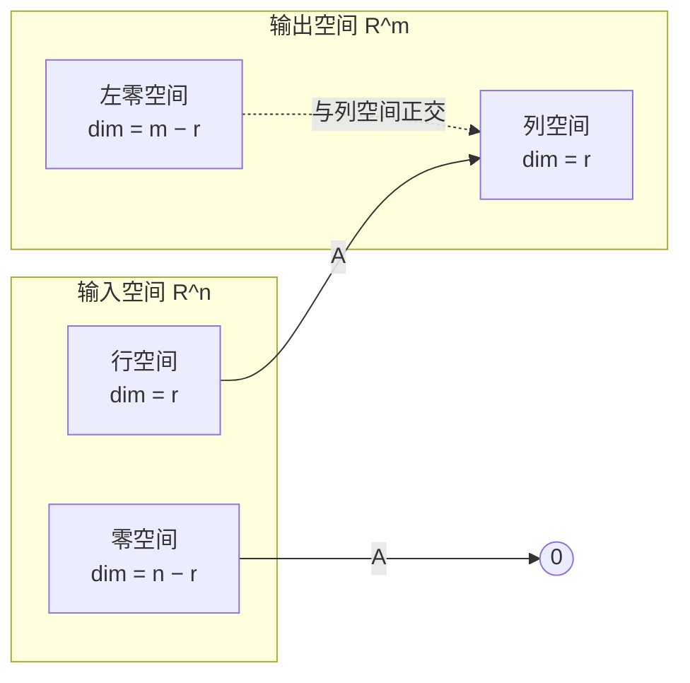

# 3.7 四个基本子空间与秩-零化度定理

> **本节位置**：模块 3 · 矩阵与线性映射 ｜ **前置**：[2.6 秩](../02-向量空间/06-秩.md)、[3.6](06-转置对称与分块.md) ｜ **预计**：45 分钟
>
> **一句话**：一个 $m\times n$ 矩阵把输入空间切成「被保留」与「被压掉」两半，把输出空间切成「够得着」与「够不着」两半——这就是四个基本子空间。

## 0. 场景引入

一个 $3\times4$ 的矩阵

$$
A=\begin{bmatrix}1&2&0&1\\0&1&1&0\\1&3&1&1\end{bmatrix}
$$

把 4 维输入送到 3 维输出。但它真的用满了 4 维输入、3 维输出吗？

如果你喂给它某个特殊的 4 维向量，输出可能是零；如果你想要某个 3 维输出，可能根本找不到输入。**问题**：哪些输入被压成零？哪些输出根本到达不了？这个矩阵实际「传递」了几维信息？

## 1. 直觉

把矩阵想成一栋有四个房间的房子：

注意：零空间整体被送到 $\mathbf{0}$；左零空间不是任何输入的像，而是与列空间正交的输出方向。

- **行空间（row space）** 里的向量被 $A$ 原样「看见」，映射到列空间，维度不变（$r$）。
- **零空间（null space）** 里的向量被压成 $\mathbf{0}$，信息彻底丢失。
- **列空间（column space）** 是所有可能的输出，维度 $r$。
- **左零空间（left null space）** 是与所有输出都正交的方向，$A$ 永远够不着。

> 💡 **一句话直觉**：**$A$ 是一个信息通道：输入有 $n$ 维，只有 $r$ 维能通过；输出有 $m$ 维，只有 $r$ 维能被点亮。**

类比边界：这是**线性**通道的图景。非线性网络可以在不同区域用不同的有效秩，四个子空间只描述某一点附近的线性化。

## 2. 定义

设 $A\in\mathbb{R}^{m\times n}$，$\operatorname{rank}(A)=r$。

**列空间（column space）**：$\operatorname{Col}(A)=\{A\mathbf{x}\mid\mathbf{x}\in\mathbb{R}^n\}\subseteq\mathbb{R}^m$，是 $A$ 的 $n$ 个列向量的张成，维数为 $r$。

**零空间（null space）**：$\operatorname{Null}(A)=\{\mathbf{x}\in\mathbb{R}^n\mid A\mathbf{x}=\mathbf{0}\}\subseteq\mathbb{R}^n$，也叫核（kernel），维数为 $n-r$。

**行空间（row space）**：$\operatorname{Row}(A)=\operatorname{Col}(A^\top)\subseteq\mathbb{R}^n$，是 $A$ 的 $m$ 个行向量的张成，维数为 $r$。

**左零空间（left null space）**：$\operatorname{Null}(A^\top)=\{\mathbf{y}\in\mathbb{R}^m\mid A^\top\mathbf{y}=\mathbf{0}\}\subseteq\mathbb{R}^m$，即满足 $\mathbf{y}^\top A=\mathbf{0}$ 的 $\mathbf{y}$，维数为 $m-r$。

**秩-零化度定理（rank-nullity theorem）**：$\dim\operatorname{Null}(A)+\dim\operatorname{Col}(A)=n$，即 $(n-r)+r=n$。

## 3. 为什么这样定义

为什么要四个而不是两个？因为输入和输出是两个不同的空间，各自都要分成「保留/丢失」两部分。

想解 $A\mathbf{x}=\mathbf{b}$，会问两个问题：

1. **有没有解？** 当且仅当 $\mathbf{b}\in\operatorname{Col}(A)$。若 $\mathbf{b}$ 有左零空间分量，就永远解不出来。
2. **解唯一吗？** 不唯一；若 $\mathbf{x}_0$ 是一个解，则所有解是 $\mathbf{x}_0+\operatorname{Null}(A)$。零空间越大，解的自由度越大。

四个子空间把这两个问题几何化：**可达性看列空间，唯一性看零空间**。行空间与左零空间则是它们的正交补，负责「分解」输入与输出空间。

为什么秩同时等于列空间和行空间的维数？这不是巧合：转置不改变「非零子式的最大阶数」，所以行秩 = 列秩。第 2.6 节给出了秩的直观与等价刻画，本节从 RREF 角度给出构造性证明。

## 4. 性质与推导

### 4.1 两组正交关系

**行空间 ⊥ 零空间**（都在 $\mathbb{R}^n$）：若 $\mathbf{x}\in\operatorname{Null}(A)$，则 $A\mathbf{x}=\mathbf{0}$，即 $A$ 的每一行与 $\mathbf{x}$ 的点积都是 0。行空间的任意向量是这些行的线性组合，所以也与 $\mathbf{x}$ 正交。

**列空间 ⊥ 左零空间**（都在 $\mathbb{R}^m$）：若 $\mathbf{y}\in\operatorname{Null}(A^\top)$，则 $A^\top\mathbf{y}=\mathbf{0}$，即 $\mathbf{y}$ 与 $A$ 的每一列正交；列空间的任意向量是列的线性组合，所以也与 $\mathbf{y}$ 正交。

于是得到两个正交直和分解：

$$
\mathbb{R}^n=\operatorname{Row}(A)\oplus\operatorname{Null}(A),\qquad
\mathbb{R}^m=\operatorname{Col}(A)\oplus\operatorname{Null}(A^\top)
$$

### 4.2 秩-零化度的构造性证明

把 $A$ 化成 RREF。设主元有 $r$ 个，位于第 $j_1,\dots,j_r$ 列；其余 $n-r$ 列是自由列。

- 每个自由变量取 1、其余自由变量取 0，回代得到唯一的 $\mathbf{x}$，得到一个零空间基向量。共 $n-r$ 个，线性无关，所以 $\dim\operatorname{Null}(A)=n-r$。
- RREF 的主元列是 $\mathbf{e}_1,\dots,\mathbf{e}_r$，说明 $A$ 的主元列线性无关；而行变换保持列之间的线性关系，每个自由列都是主元列的线性组合（RREF 的系数直接给出），所以主元列张成 $\operatorname{Col}(A)$。共 $r$ 个，所以 $\dim\operatorname{Col}(A)=r$。

两式相加即得 $n=r+(n-r)$。

### 4.3 常用推论

| 结论 | 说明 |
|---|---|
| $\operatorname{rank}(A)=\operatorname{rank}(A^\top)$ | 行秩 = 列秩 |
| $\operatorname{rank}(A^\top A)=\operatorname{rank}(A)$ | $\operatorname{Null}(A^\top A)=\operatorname{Null}(A)$ |
| $\operatorname{rank}(AB)\le\min(\operatorname{rank}A,\operatorname{rank}B)$ | 复合不会增加维数 |
| $A\mathbf{x}=\mathbf{b}$ 有解 $\iff$ $\operatorname{rank}([A\mid\mathbf{b}])=\operatorname{rank}(A)$ | 增广不增加秩 |
| 方阵可逆 $\iff r=n$ | 零空间只有零 |

$\operatorname{Null}(A^\top A)=\operatorname{Null}(A)$ 的证明：若 $A\mathbf{x}=\mathbf{0}$，两边左乘 $A^\top$ 即得 $A^\top A\mathbf{x}=\mathbf{0}$；反之若 $A^\top A\mathbf{x}=\mathbf{0}$，左乘 $\mathbf{x}^\top$ 得 $\|A\mathbf{x}\|^2=0$，故 $A\mathbf{x}=\mathbf{0}$。两边零空间相同，维数相同，秩也就相同。

## 5. 例子

### 5.1 手算：$3\times4$ 矩阵的四个子空间

对开头的 $A$，行 3 = 行 1 + 行 2，所以秩最多 2；行 1、行 2 不成比例，秩恰为 2。消元：

$$
A\ \longrightarrow\ \begin{bmatrix}1&0&-2&1\\0&1&1&0\\0&0&0&0\end{bmatrix}
$$

（行 1 减 2 倍行 2 得第一行；行 3 减行 1 再减行 2 得零行。）

**列空间**：主元在第 1、2 列，取 $A$ 的第 1、2 列，基为 $(1,0,1)^\top$、$(2,1,3)^\top$，维数为 2。

**零空间**：由 RREF，$x_1=2x_3-x_4$，$x_2=-x_3$。取 $(x_3,x_4)=(1,0)$ 与 $(0,1)$，得 $\mathbf{n}_1=(2,-1,1,0)^\top$、$\mathbf{n}_2=(-1,0,0,1)^\top$，维数为 2。

**行空间**：取 RREF 的非零行（与原行空间相同），基为 $(1,0,-2,1)^\top$、$(0,1,1,0)^\top$，维数为 2。

**左零空间**：解 $A^\top\mathbf{y}=\mathbf{0}$，即 $\mathbf{y}$ 与每一列正交。取 $\mathbf{y}=(1,1,-1)^\top$：与第 1 列点积 $1+0-1=0$，与第 2 列 $2+1-3=0$，与第 3、4 列也为 0。所以 $\operatorname{Null}(A^\top)=\operatorname{span}\{(1,1,-1)^\top\}$，维数为 1。

**验证正交与维数**：

- 行空间 ⊥ 零空间：$(1,0,-2,1)^\top\cdot(2,-1,1,0)=2-2=0$，与 $\mathbf{n}_2$ 也正交；第二行同理。
- 列空间 ⊥ 左零空间：$(1,0,1)\cdot(1,1,-1)=0$，$(2,1,3)\cdot(1,1,-1)=0$。
- 秩-零化度：$2+2=4=n$；输出侧 $2+1=3=m$。

**解方程**：取 $\mathbf{b}=(3,1,4)^\top$，它等于第 1 列 + 第 2 列，所以 $\mathbf{x}_0=(1,1,0,0)^\top$ 是特解；通解是 $\mathbf{x}_0+s\mathbf{n}_1+t\mathbf{n}_2$。而 $\mathbf{b}'=(0,0,1)^\top$ 不在列空间里（前两列的任何组合第三分量都是 $c_1+3c_2$，要等于 1 且前两分量都为 0 只能 $c_1=c_2=0$），所以无解。

## 6. 常见误区

1. **误区**：$\dim\operatorname{Col}(A)+\dim\operatorname{Null}(A)=m$。
   **纠正**：应等于**输入维数** $n$。$\operatorname{Col}$ 在 $\mathbb{R}^m$，$\operatorname{Null}$ 在 $\mathbb{R}^n$，两者不在同一个空间里相加。

2. **误区**：零空间就是 $A$ 的零行对应的解。
   **纠正**：零空间由**自由变量**产生，与零行没有直接对应；应看 RREF 的主元列与自由列。

3. **误区**：行变换会保持列空间不变。
   **纠正**：行变换保持行空间与零空间，但会改变列空间（只保持维数）。所以列空间的基要取**原矩阵**的主元列，不能取 RREF 的列。

4. **误区**：秩就是原矩阵非零行的个数。
   **纠正**：非零行个数要化成 REF 后才可靠；原矩阵的行可能相关（如本例行 3 = 行 1 + 行 2）。

## 7. 概念网络

- 前置：[2.6 秩](../02-向量空间/06-秩.md) —— 秩是信息的维度。
- 前置：[3.6 转置、对称与分块](06-转置对称与分块.md) —— 行空间是列空间的转置，正交性来自点积。
- 前置：[1.6 正交与投影](../01-向量与几何/06-正交与投影.md) —— 正交补与直和分解。
- 后续：[4.2 解的存在性与通解](../04-线性方程组/02-解的存在性与通解.md) —— 特解 + 零空间。
- 后续：[4.5 伪逆与最小范数解](../04-线性方程组/05-伪逆与最小范数解.md) —— 四个子空间给出伪逆的几何。
- 后续：[7.3 低秩近似](../07-SVD/03-低秩近似.md) —— 秩决定能压缩多少。
- 关联：[11.2 线性层](../11-大模型专题/02-线性层.md) —— 权重矩阵的秩瓶颈。

## 8. 通往大模型：秩就是信息瓶颈

**出现位置**：权重矩阵的秩、LoRA 的低秩更新、注意力的打分矩阵、隐藏状态的有效维度。

**形状与运算**：任意 $W\in\mathbb{R}^{D_{\text{out}}\times D_{\text{in}}}$ 的秩不超过 $\min(D_{\text{out}},D_{\text{in}})$。LoRA 把更新写成 $\Delta W=BA$，$B\in\mathbb{R}^{D\times r}$、$A\in\mathbb{R}^{r\times k}$，于是 $\operatorname{rank}(\Delta W)\le r$：它只能改动权重的一个 $r$ 维子空间。注意力里 $S=QK^\top$，$Q\in\mathbb{R}^{T\times d_k}$、$K^\top\in\mathbb{R}^{d_k\times T}$，所以 $\operatorname{rank}(S)\le d_k$；$T=1024$、$d_k=64$ 时，$1024\times1024$ 的分数矩阵秩最多 64。

**为什么需要**：秩告诉你「这个矩阵能携带多少独立信息」。若某层权重秩为 $r$，则无论输入多丰富，该层输出只能落在 $r$ 维子空间里（加偏置后是这个子空间的平移）；残差流经过它，该分支能新增的信息被限制在 $r$ 维。这就是低秩压缩、LoRA、KV 低秩缓存等方法的共同数学基础。

**可检验结论**：随机生成 $Q,K\in\mathbb{R}^{1024\times64}$，计算 $S=QK^\top$ 的奇异值；非零奇异值恰有 64 个（数值上其余接近 $10^{-14}$），即 `np.linalg.matrix_rank(S) == 64`。若把 $d_k$ 降到 8，秩也降到 8——**注意力的表达力被每个头的维度直接限制**。

## 9. 练习

1. **概念**：用四个子空间解释「$A\mathbf{x}=\mathbf{b}$ 有解且解唯一」的条件。
2. **计算**：$A=\begin{bmatrix}1&0&1\\0&1&1\\1&1&2\end{bmatrix}$，求四个子空间的基与维数，并验证两组正交关系。
3. **计算**：接上题，判断 $\mathbf{b}=(1,1,2)^\top$ 与 $\mathbf{b}'=(1,0,0)^\top$ 是否在列空间里。
4. **计算**：$A=\begin{bmatrix}1&2\\2&4\\3&6\end{bmatrix}$，求秩、零空间、左零空间，并验证 $3=r+(m-r)$。
5. **开放**：如果一层权重被约束为秩 1，它的输入输出关系会退化成什么样？这对模型容量意味着什么？

参考答案

1. 有解 $\iff$ $\mathbf{b}\in\operatorname{Col}(A)$；解唯一 $\iff$ $\operatorname{Null}(A)=\{\mathbf{0}\}$，即 $r=n$。两者同时成立要求 $r=n$ 且 $\mathbf{b}$ 在列空间。
2. 行 3 = 行 1 + 行 2，秩 2；RREF 为 $\begin{bmatrix}1&0&1\\0&1&1\\0&0&0\end{bmatrix}$。列空间基 $(1,0,1)^\top,(0,1,1)^\top$；零空间基 $(-1,-1,1)^\top$；行空间基 $(1,0,1),(0,1,1)$；左零空间基 $(1,1,-1)^\top$。验证：$(1,0,1)\cdot(-1,-1,1)=0$，$(1,1,-1)\cdot(1,0,1)=0$、$\cdot(0,1,1)=0$。
3. $\mathbf{b}=(1,1,2)^\top$ 是两列之和，在列空间；$\mathbf{b}'=(1,0,0)^\top$ 若在列空间，需 $c_1=1,c_2=0$ 且第三分量 $c_1+c_2=0$，矛盾，不在。
4. 两列成比例，秩 1；零空间由 $x_1+2x_2=0$ 给出，基 $(-2,1)^\top$，维数 1；左零空间由 $y_1+2y_2+3y_3=0$ 与 $2y_1+4y_2+6y_3=0$（同一方程）给出，基 $(2,-1,0)^\top,(-3,0,1)^\top$，维数 2。$3=1+2$。
5. 秩 1 权重 $W=\mathbf{u}\mathbf{v}^\top$ 先与 $\mathbf{v}$ 做内积（得到在 $\mathbf{v}$ 方向上的投影系数），再沿 $\mathbf{u}$ 输出：$W\mathbf{x}=(\mathbf{v}^\top\mathbf{x})\mathbf{u}$。所有输出共线，模型只能学「一个方向」的映射，容量急剧下降；但计算与存储都极省。

## 10. 一页速记

- 四个子空间：$\operatorname{Col}(A)\subseteq\mathbb{R}^m$、$\operatorname{Null}(A)\subseteq\mathbb{R}^n$、$\operatorname{Row}(A)\subseteq\mathbb{R}^n$、$\operatorname{Null}(A^\top)\subseteq\mathbb{R}^m$。
- 维数：$r,\ n-r,\ r,\ m-r$。
- 正交：行空间 ⊥ 零空间，列空间 ⊥ 左零空间；两个正交直和分解。
- 秩-零化度：$r+(n-r)=n$；行秩 = 列秩。
- 可解性看列空间，唯一性看零空间；$r$ 就是信息通道的宽度。

---

下一篇 → [模块 4 · 线性方程组](../04-线性方程组/README.md)
