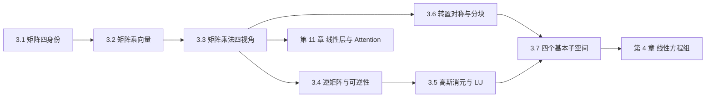

# M03 · 矩阵与线性映射

> **一句话**：矩阵不是「一张数字表」，而是线性映射的坐标表示——乘向量是作用，乘矩阵是复合，求逆是撤销，消元是拆解，四个子空间是它的信息通道。

## 这个模块解决什么

到了这里，你已经熟悉向量、点积、基与维数。但大模型里真正被存储和计算的参数是**矩阵**：一个线性层是一个矩阵，一次注意力打分是两次矩阵乘法，LoRA 是两个瘦矩阵的乘积。矩阵到底在做什么？

本模块用一条主线回答：**矩阵 = 线性映射**。先把矩阵的四种身份摆清楚（3.1），再学会用三种视角算 $A\mathbf{x}$（3.2）；接着把「两个映射接起来」翻译成矩阵乘法，并用四种视角算同一个结果（3.3）。这一步是全模块的枢纽：它解释了为什么乘法定义成「行乘列」，也解释了为什么顺序不能交换。

有了乘法，就能问「能不能撤销」——逆矩阵与可逆性（3.4）；撤销不了时怎么办——高斯消元与 LU 分解（3.5）。然后补上两个结构工具：转置、对称与分块（3.6），它们是大模型形状操作的语言；最后把矩阵的输入输出空间切成四块，得到列空间、零空间、行空间、左零空间与秩-零化度定理（3.7）。

七篇文档的顺序是**严格递进**的：3.2 依赖 3.1 的列视角，3.3 依赖 3.2 的 $A\mathbf{x}$，3.4–3.5 依赖 3.3 的乘法与结合律，3.7 同时用到 3.6 的转置和第 2.6 节的秩。建议按顺序读，每篇都动手算一遍 §5 的例子。

## 本模块的现实问题

1. 手机 AR 的相机内参为什么必须存 $3\times3$？省掉最后一行会怎样？（[3.1](01-矩阵的四种身份.md)）
2. 六个关节的速度怎么合成机械臂末端的速度？为什么某些姿态下会失控？（[3.2](02-矩阵乘向量.md)）
3. CT 有 18 万个测量、26 万个未知数，为什么不能直接求逆？（[3.4](04-逆矩阵与可逆性.md)）
4. 12 个荷载工况怎么共用一次 LU 分解，省下 11 倍计算？（[3.5](05-高斯消元与LU.md)）

## 概念地图

## 学习顺序

| 顺序 | 文档 | 时间 | 读完你应该能…… |
|---|---|---|---|
| 1 | [3.1 矩阵的四种身份](01-矩阵的四种身份.md) | 30 min | 对同一个矩阵，分别按数据表、映射、算子、列向量组解释 |
| 2 | [3.2 矩阵乘向量：线性映射](02-矩阵乘向量.md) | 35 min | 用列组合、行点积、变换三种方式手算 $A\mathbf{x}$，并说明线性性 |
| 3 | [3.3 矩阵乘法：四种视角](03-矩阵乘法.md) | 40 min | 对同一个 $2\times3$ 乘 $3\times2$ 用四种视角算，并数清 FLOPs |
| 4 | [3.4 逆矩阵与可逆性](04-逆矩阵与可逆性.md) | 35 min | 手算 $2\times2$ 逆，判断可逆性，解释条件数为何让逆「不可靠」 |
| 5 | [3.5 高斯消元、初等矩阵与 LU 分解](05-高斯消元与LU.md) | 40 min | 对 $3\times3$ 做 LU，解 $A\mathbf{x}=\mathbf{b}$，说明为什么要分解 |
| 6 | [3.6 转置、对称与分块矩阵](06-转置对称与分块.md) | 30 min | 解释 $QK^\top$ 的形状，做分块乘法与上三角块求逆 |
| 7 | [3.7 四个基本子空间与秩-零化度定理](07-四个基本子空间.md) | 45 min | 求一个 $3\times4$ 矩阵的四个子空间，验证正交与维数公式 |

## 本模块的大模型钩子

- **线性层**：$XW^\top+\mathbf{b}$，逐 token 就是矩阵乘向量（3.2）
- **QKV 投影**：$W_{QKV}\in\mathbb{R}^{3D\times D}$，一次乘出 $[\mathbf{q},\mathbf{k},\mathbf{v}]$（3.2）
- **GEMM**：$[BT,D]@[D,4D]$ 是训练算力的基本计量单位，FLOPs $2mnp$（3.3）
- **条件数**：为什么权重矩阵「可逆」不代表能放心求逆（3.4）
- **数值求解**：LU/Cholesky 藏在二阶优化、高斯过程与线性探针里（3.5）
- **Attention**：$S=QK^\top$ 的形状是 $[B,H,T,T]$，多头拼接靠转置与 reshape（3.6）
- **信息瓶颈**：权重与注意力的秩限制了每层能传递多少维信息（3.7）
- **LoRA**：$\Delta W=BA$，$B\in\mathbb{R}^{D\times r}$、$A\in\mathbb{R}^{r\times k}$，秩不超过 $r$（3.6–3.7）

## 自测（读完再做）

1. $A\in\mathbb{R}^{2\times3}$，$\mathbf{x}\in\mathbb{R}^3$，$A\mathbf{x}$ 是什么形状？$A$ 有几列、每列多长？
2. 同一个 $W\in\mathbb{R}^{4\times3}$，分别用「数据表 / 线性映射 / 算子 / 列向量组」说一句话，哪个身份不成立？为什么？
3. $A=\begin{bmatrix}1&2\\3&4\end{bmatrix}$、$B=\begin{bmatrix}2&0\\1&1\end{bmatrix}$，求 $AB$ 与 $BA$，并说明这说明什么。
4. $A=\begin{bmatrix}3&1\\5&2\end{bmatrix}$，求 $A^{-1}$，并解 $A\mathbf{x}=(1,1)^\top$。
5. 为什么 $A=LU$ 能省计算？换一个右端项时，哪一步不用重做？条件数在这里起什么作用？
6. $A$ 是 $3\times4$ 矩阵、秩为 2。四个子空间分别在哪、维数多少？$A\mathbf{x}=\mathbf{b}$ 有解与解唯一分别要求什么？

自测答案

1. $A\mathbf{x}\in\mathbb{R}^2$；$A$ 有 3 列，每列长 2。形状 $(2\times3)(3\times1)=(2\times1)$。
2. 数据表：4 个样本、3 个特征；线性映射：$\mathbb{R}^3\to\mathbb{R}^4$；列向量组：3 个 4 维列向量；算子不成立，因为 $4\neq3$，输入输出不是同一个空间。
3. $AB=\begin{bmatrix}4&2\\10&4\end{bmatrix}$，$BA=\begin{bmatrix}2&4\\4&6\end{bmatrix}$，不相等；矩阵乘法一般不可交换，因为它表示不同的复合顺序。
4. $\det=6-5=1$，$A^{-1}=\begin{bmatrix}2&-1\\-5&3\end{bmatrix}$，$\mathbf{x}=(1,-2)^\top$。
5. 消元 $O(n^3)$、三角求解每个右端项 $O(n^2)$；换 $\mathbf{b}$ 时 $L,U$ 不变，只做前代与回代。条件数决定问题本身对扰动的敏感度；主元过小会放大消元中的舍入误差，所以实际实现要部分主元。
6. 列空间在 $\mathbb{R}^3$、维数 2；零空间在 $\mathbb{R}^4$、维数 $4-2=2$；行空间在 $\mathbb{R}^4$、维数 2；左零空间在 $\mathbb{R}^3$、维数 $3-2=1$。有解要求 $\mathbf{b}\in\operatorname{Col}(A)$；解唯一要求零空间只有零，即秩为 4，与秩 2 矛盾，所以这里解不唯一。

## 配套练习与实验

- 习题：[m03-习题](../exercises/m03-习题.md)（A 概念 / B 计算 / C 大模型 / D 开放，共 15 题）
- 答案：[m03-答案](../exercises/m03-答案.md)（含步骤，先自己做再对）
- 实验：[lab03_矩阵四视角.py](../labs/lab03_矩阵四视角.py)（NumPy 验证四种视角、复合、不可交换、FLOPs）

> 建议节奏：读 3.1–3.3 后做习题 B1–B3 与 lab03 的前三节；读 3.4–3.5 后做 B4–B5；读 3.6–3.7 后做 C、D 组。

---

下一篇 → [3.1 矩阵的四种身份](01-矩阵的四种身份.md)
