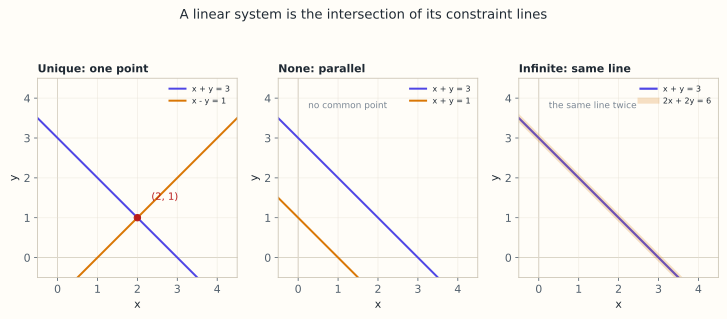

# 4.1 线性方程组的几何：约束的交点

> **本节位置**：模块 4 · 线性方程组 ｜ **前置**：[3.2 矩阵乘向量](../03-矩阵与线性映射/02-矩阵乘向量.md) ｜ **预计**：30 分钟
>
> **一句话**：每个线性方程是一张「等值面」，方程组的解就是这些面共同穿过的那部分空间。

## 0. 场景引入

早上 7 点 40，一辆网约车开进东三环的立交桥下。车上的北斗接收机以 10 Hz 输出定位，这一次收到 9 颗卫星，用了其中 8 颗。它要解 4 个未知数：经度、纬度、高程，以及接收机钟差——$1\ \mu s$ 的钟差对应约 300 m 的伪距误差，所以钟差必须和位置一起解。

8 个伪距方程、4 个未知数，这是一次超定求解。卫星几何好时，8 颗星给出的几何精度因子（GDOP）约 1.8，伪距噪声 3 m，于是 $1\sigma$ 位置误差约 $1.8\times3=5.4$ m；可一旦 4 颗高仰角卫星挤在同一片天空，GDOP 恶化到 6，同样的噪声就变成 18 m。车道级导航要求 1.5 m，差了 3.6 倍，出口就会报错，司机多绕 6 km。

更麻烦的是，卫星不是「越多越好」：两颗星视线夹角只有 5° 时，对应的两个单位行向量只差 $2\sin(2.5^\circ)\approx0.09$，第 8 个方程几乎等于没加。

**问题**：8 个方程为什么只定得住 4 个数？「方程多」和「约束独立」差在哪？读完本节，你应该能回答三件事：

1. 一个线性方程在 4 维空间里是什么几何对象，8 个方程的交集是什么？
2. 行图像与列图像各自回答什么问题，为什么高维里只能靠列图像？
3. 什么情况下「多加一颗卫星」等于「没加」？

## 1. 直觉

### 1.1 一个方程 = 一张等值面

在平面上，$2x+y=4$ 是一条直线：线上每点代入左边都等于 4，线外都不等于。在三维里 $x+2y+z=3$ 是一张平面；在 $n$ 维里，一个线性方程是 $n-1$ 维的**超平面（hyperplane）**。

### 1.2 解 = 交集

$$
\text{解集}=\{\mathbf{x}\mid A\mathbf{x}=\mathbf{b}\}=\text{第 1 张面}\cap\cdots\cap\text{第 }m\text{ 张面}
$$

每加一个方程，就往交集里再切一刀。两刀可以交于一点、交于一条线，也可以平行（无交点）或重合（切了等于没切）：

| 情形 | 两张面的关系 | 解集 |
|---|---|---|
| 唯一解 | 交于一点 | 一个点 |
| 无穷多解 | 交于一条线（或完全重合） | 一条线 / 一整张面 |
| 无解 | 平行且不重合 | 空集 |



*图：两条约束线交于一点（唯一解）、平行（无解）、重合（无穷多解）。解集就是这些线的交集。*

> 💡 **一句话直觉**：**解方程组就是求若干超平面的公共部分**；结局只有三种——一点、一个低维面、空集。

### 1.3 它在现实世界里对应什么

回到开头的接收机。在初始位置 $\mathbf{p}_0$ 处线性化后，每颗卫星给出一个方程：

$$
-\mathbf{u}_i^\top\,\Delta\mathbf{p}+c\,\delta t=\rho_i-\hat\rho_i(\mathbf{p}_0),
\qquad \hat\rho_i(\mathbf{p}_0)=\|\mathbf{s}_i-\mathbf{p}_0\|
$$

其中 $\mathbf{s}_i$ 是卫星位置，$\mathbf{u}_i$ 是从接收机指向卫星的单位向量，$\rho_i$ 是测到的伪距，$\hat\rho_i(\mathbf{p}_0)$ 是按初始位置算出的距离。这个式子说的是：第 $i$ 颗卫星的测量，是未知数 $(\Delta\mathbf{p},\,c\delta t)$ 的一张超平面。把这 8 个方程排成矩阵，就是下面场景闭环里的 $G$。

| 数学对象 | 接收机里的对应物 |
|---|---|
| 未知数 $\mathbf{x}=(\Delta\mathbf{p},c\delta t)$ | 位置修正量 3 个 + 钟差 1 个 |
| 第 $i$ 行 $\mathbf{g}_i^\top$ | $-\mathbf{u}_i$ 再补一位 1（钟差系数） |
| 右端 $b_i$ | 伪距减去按初始位置算出的距离 |
| 解 | 所有球面（线性化后是超平面）的公共点 |

**量级直觉**：伪距约 $2\times10^7$ m，钟差 $1\ \mu s$ 就是 300 m；两颗星视线夹角 5° 时，两行只差 $2\sin(2.5^\circ)\approx0.09$，这个方程对定位的边际贡献大致相当于 0.09 个独立方程。**精度不是靠卫星数量堆出来的，是靠方向的多样性。**

### 1.4 这个类比在哪里失效

超平面只在工作点附近成立。伪距方程的本体是欧氏距离 $\|\mathbf{s}_i-\mathbf{p}\|$，是弯的；初始位置差 1 km 时，线性化误差可能到米级，所以要迭代 4～5 轮，每轮重算 $\mathbf{u}_i$。

第二，4 维超平面画不出来，肉眼几何到此为止；能替代它的是秩与 GDOP 这类标量。

第三，噪声不是高斯的：城市峡谷里多路径和非视距信号有系统性偏差，最小二乘会把偏差平均进去，解看起来「收敛了」，其实整体偏了几米到十几米（按多路径偏差估算；4.4 讨论残差，4.6 讨论放大）。

## 2. 定义

### 2.1 线性方程

含 $n$ 个未知数的线性方程可写成

$$
\mathbf{a}^\top\mathbf{x}=b,\qquad \mathbf{a}\in\mathbb{R}^n,\ b\in\mathbb{R}
$$

$\mathbf{a}$ 是**法向量（normal vector）**，垂直于超平面；$b$ 决定这张面离原点多远。

### 2.2 方程组与矩阵

$m$ 个方程、$n$ 个未知数写成 $A\mathbf{x}=\mathbf{b}$，$A\in\mathbb{R}^{m\times n}$。$A$ 的第 $i$ 行就是第 $i$ 张超平面的法向量。

### 2.3 行图像与列图像

同一个等式的两种读法（[Strang](#ref-strang-1993) 定下的两个名字）：

- **行图像（row picture）**：$m$ 张超平面求交。
- **列图像（column picture）**：把 $A$ 的列记作 $\mathbf{a}_1,\dots,\mathbf{a}_n$，问 $x_1\mathbf{a}_1+\cdots+x_n\mathbf{a}_n=\mathbf{b}$ 的系数是多少。

## 3. 为什么这样定义

为什么用「交集」而不是「逐个方程求解」？因为方程会互相筛选：第一个方程的无穷多组解，还要被第二个方程再筛一遍。交集语言把「筛」说清楚了——每次筛选都在缩小集合。

为什么需要两种图像？

| 视角 | 回答的问题 | 适合 |
|---|---|---|
| 行图像 | 每个约束长什么样？解在几何上是什么？ | 理解唯一/无穷/无解 |
| 列图像 | 目标 $\mathbf{b}$ 能否被列组合达到？ | 理解秩、列空间、最小二乘 |

列图像是后续主线：$A\mathbf{x}=\mathbf{b}$ 有解 $\iff\mathbf{b}\in\operatorname{col}(A)$。4.2 把它变成秩判据，4.4 处理它不成立时的最优近似。

### 3.1 反事实：用「方程个数」判断解的情况

最省事的判据是数数：方程比未知数多就无解，少就无穷多，相等就唯一。试两个手算例子。

**例子 A**（3 个方程、2 个未知数）：

$$
x+y=2,\qquad x-y=0,\qquad 2x+2y=4
$$

按「3>2 所以超定、无解」判断，错了。第三式就是第一式乘 2，系数秩 $r=2$，增广秩也是 2，$r=n=2$，唯一解 $(1,1)$。**多出来的那一行没有提供任何新约束。**

**例子 B**（2 个方程、2 个未知数）：

$$
x+y=1,\qquad x+y=2
$$

按「2=2 所以唯一」判断，也错了。两行系数相同、右端不同，$r=1$、增广秩 2，无解。

两个例子放在一起说明：**解的存在性只取决于 $\mathbf{b}$ 是否落在 $\operatorname{col}(A)$ 里，与 $m,n$ 谁大谁小无关。** 卫星定位也一样：8 颗星若都挤在一个方向，$G$ 的秩可能仍然是 4，但某个奇异值会非常小，多出来的方程几乎不提供新方向——那是 4.6 的病态，不是「方程不够」。

## 4. 性质与推导

### 4.1 法向量为什么垂直

设 $\mathbf{x},\mathbf{y}$ 都在面 $\mathbf{a}^\top\mathbf{z}=b$ 上，则 $\mathbf{a}^\top(\mathbf{x}-\mathbf{y})=b-b=0$。面内任意方向都与 $\mathbf{a}$ 正交，所以 $\mathbf{a}$ 是法向量。

### 4.2 三种情形

记 $r=\operatorname{rank}(A)$，$n$ 为未知数个数：

| 情形 | 几何 | 代数条件 | 解集 |
|---|---|---|---|
| 唯一解 | 交于一点 | $r=\operatorname{rank}([A\mid\mathbf{b}])=n$ | 一个点 |
| 无穷多解 | 交于直线/平面/… | $r=\operatorname{rank}([A\mid\mathbf{b}])<n$ | $n-r$ 维仿射集 |
| 无解 | 没有公共点 | $r<\operatorname{rank}([A\mid\mathbf{b}])$ | 空集 |

先看有没有解（两个秩是否相等），再看解多不多（$r$ 与 $n$）。证明在 4.2。

### 4.3 解集是仿射集（affine set）

若 $\mathbf{x}_p$ 是一个解、$\mathbf{z}\in N(A)$，则 $A(\mathbf{x}_p+\mathbf{z})=\mathbf{b}$。所以解集是 $\mathbf{x}_p+N(A)$，一般**不过原点**，不是子空间——除非 $\mathbf{b}=\mathbf{0}$。这套「相容性 + 仿射解集」的语言在 [Horn 与 Johnson](#ref-horn-johnson-2012) 里有完整的代数处理。

## 5. 例子

### 5.1 手算：两线交于一点

$$
\begin{cases}2x+y=4\\ x-y=1\end{cases}
$$

两式相加消去 $y$：$3x=5\Rightarrow x=\frac53$。代回 $y=x-1=\frac23$。验证：$2\cdot\frac53+\frac23=4$ ✓

列图像：$x(2,1)+y(1,-1)=(4,1)$，取 $x=\frac53,y=\frac23$：

$$
\frac53(2,1)+\frac23(1,-1)=\left(\frac{10}{3}+\frac23,\ \frac53-\frac23\right)=(4,1)\ ✓
$$

NumPy 复核：`np.linalg.solve([[2, 1], [1, -1]], [4, 1])` 返回 `[1.6667, 0.6667]`，与 $\left(\frac53,\frac23\right)$ 一致。

### 5.2 同一组系数，三种结局

固定左边、只改右端：

- $2x+y=4$ 与 $x-y=1$：系数行列式 $-3\neq0$，**唯一解** $(\frac53,\frac23)$。
- $2x+y=4$ 与 $4x+2y=3$：左边成 2 倍、右端却是 3 而非 8，**无解**（平行）。
- $2x+y=4$ 与 $4x+2y=8$：第二式就是第一式乘 2，**无穷多解**，解集 $\{(t,4-2t)\}$。

判别只看两件事：左边系数是否成比例（决定 $r$），右端是否同步成比例（决定增广秩）。

### 5.3 三维：三张平面的交

$x+y+z=3$、$x-y=0$、$z=1$。由后两式 $x=y$、$z=1$，代入第一式得 $x=y=1$：三面交于 $(1,1,1)$。

若把第一式换成 $2x+2y+2z=6$（同一张面写两遍），只剩两张独立平面，交线为 $\{(t,t,3-2t)\}$。

### 5.4 场景闭环：8 颗卫星、4 个未知数

**输入**：8 颗卫星的视线方向拼成 $G\in\mathbb{R}^{8\times4}$（最后一列全是 1，对应钟差），伪距残差向量 $\mathbf{y}\in\mathbb{R}^{8}$。$8\times4$ 的 fp64 矩阵只有 256 B，10 Hz 下每秒读 2.5 kB，可以常驻缓存。

**计算**：正规矩阵 $G^\top G$ 是 $4\times4$，需要 $8\times4\times4\times2=256$ FLOP；解 4 元方程再按 $4^3/3\approx21$ FLOP 估。迭代 5 轮也不过约 $1.4\times10^3$ FLOP，在 1 GFLOP/s 的 MCU 上不到 2 μs——相对 100 ms 的定位周期可以忽略。

**输出**：位置 $\mathbf{p}$ 与钟差 $\delta t$，以及

$$
\mathrm{GDOP}=\sqrt{\operatorname{tr}\big((G^\top G)^{-1}\big)}
$$

这个式子说的是：把「单位伪距噪声」经过求逆放大后的总方差开根号。$\mathrm{GDOP}=1.8$、$\sigma=3$ m 时定位误差 5.4 m；$\mathrm{GDOP}=6$ 时 18 m。

**决策**：若 $\mathrm{GDOP}\times\sigma>1.5$ m，这次 fix 不采纳，改用上一历元 + IMU 推算，或等卫星几何变好。按 10 Hz、连续 20 个历元被拒估算，推算要撑 2 s。

**成本**：算力几乎为零，真正的成本是「拒绝定位」——2 s 内没有绝对位置，车道匹配只能靠惯性，误差随时间的平方增长。反过来，若为了不拒而放宽阈值，就会把 18 m 的错解喂给导航。

**失败条件**：

- **几何退化**：卫星全在同一侧或共面，$G$ 秩亏，GDOP 发散。兜底：直接看 $\sigma_{\min}(G)$，小于阈值就拒绝。
- **多路径与非视距**：残差有偏，最小二乘把偏差平均进去，GDOP 再小也没用。兜底：按仰角加权、剔除残差最大的星。
- **钟差跳变**：接收机时钟被驯服时 $\delta t$ 会阶跃，前一历元的解不能直接作初值。

## 6. 常见误区

1. **误区**：方程个数多于未知数就一定无解。**纠正**：$x=1$、$y=2$、$x+y=3$ 三个方程两个未知数仍有唯一解；要看两个秩。
2. **误区**：无解说明方程组写错了。**纠正**：带噪声的测量必然过约束；4.4 的最小二乘就是为无解准备的。
3. **误区**：行图像和列图像是两套解法。**纠正**：它们是同一个等式的两种解读，代数上没变。
4. **误区**：解集是子空间，可以随便相加。**纠正**：非齐次解集不过原点；两个解相加得 $2\mathbf{b}$，不封闭。
5. **误区**：高维没法画图，几何直觉就没用了。**纠正**：超平面、交集、法向量照常使用，维数公式照常成立。

## 7. 概念网络

- 前置：[3.2 矩阵乘向量](../03-矩阵与线性映射/02-矩阵乘向量.md) —— $A\mathbf{x}=\mathbf{b}$ 就是「输入 $\mathbf{x}$，输出 $\mathbf{b}$」。
- 前置：[1.6 正交与投影](../01-向量与几何/06-正交与投影.md) —— 法向量垂直于超平面靠的是点积。
- 后续：[4.2 解的存在性与通解结构](02-解的存在性与通解.md) —— 把三种情形变成秩判据。
- 后续：[4.3 齐次方程与零空间](03-齐次方程与零空间.md) —— 解集里可自由移动的部分。
- 后续：[4.4 最小二乘](04-最小二乘.md) —— 无解时退而求其次。

## 8. 通往大模型：微调就是一个欠定方程组

**出现位置**：约束式微调、激活编辑、线性探针的「求解」步骤。

**形状**：设某层是 $W\in\mathbb{R}^{D\times D}$（$D=4096$），希望它在 $K$ 个样本上满足 $W\mathbf{h}_i=\mathbf{y}_i$。把 $\mathbf{h}_i$ 按列拼成 $H\in\mathbb{R}^{D\times K}$，得到矩阵方程 $WH=Y$，$Y\in\mathbb{R}^{D\times K}$。

**为什么需要**：每一行 $\mathbf{w}^\top$ 是 $D$ 个未知数，只被 $K$ 个方程约束。当 $K<D$ 时这是**欠定（underdetermined）**系统，可行集是一个 $D-r$ 维（$r=\operatorname{rank}H\le K$）仿射子空间，不是单点。选哪一个点，决定了微调后模型离原点多远、遗忘多少；这正是 4.5 的最小范数解要回答的问题。

**可检验结论**：取 $D=4096$、$K=32$，可行解的自由度是 $4096-32=4064$ 维；`numpy.linalg.lstsq` 返回其中范数最小的那个。反过来，若 $K>D$ 且 $\mathbf{y}_i$ 之间的线性关系与 $\mathbf{h}_i$ 不一致（例如 $\mathbf{h}_1+\mathbf{h}_2=\mathbf{h}_3$ 但 $\mathbf{y}_1+\mathbf{y}_2\neq\mathbf{y}_3$），方程无解，只能最小二乘近似。

```python
import numpy as np
rng = np.random.default_rng(0)
D, K = 64, 8
H = rng.normal(size=(D, K)); Y = rng.normal(size=(D, K))
W, *_ = np.linalg.lstsq(H.T, Y.T, rcond=None); W = W.T  # 每行独立求最小范数解
print(W.shape, np.linalg.norm(W @ H - Y))                # 约束被精确满足
```

**如果这一步算错，工程上看到什么现象**：把钟差当成已知（令 $\delta t=0$），$G$ 就少一列，变成 $8\times3$。此时高程误差会把钟差吸收进去：水平看起来还正常，高程却漂几十米，地图匹配把车吸附到高架和地面中的错误一层。用户侧的表现是「导航一直说你在桥上」，而不是「定位失败」。

## 9. 练习

1. **概念**：用交集语言解释：为什么给无穷多解的方程组再加一个方程，可能变唯一，也可能仍然无穷多？
2. **计算**：解 $3x-2y=5$、$x+4y=7$，并写出列图像。
3. **计算**：判断 $x+y=2$、$2x+2y=5$、$x-y=1$ 是否有解。
4. **几何**：三维中 $x+y+z=1$ 与 $x-y=0$ 的解集是什么形状？维数多少？
5. **开放**：为什么说「列图像比行图像更适合高维」？结合 $m=1000,n=10$ 说明。

<details>
<summary>参考答案</summary>

1. 新超平面若与原解集（直线）交于一点，则唯一；若包含这条直线，则仍无穷多；若与它平行不重合，则无解。
2. 由第二式 $x=7-4y$ 代入第一式：$21-12y-2y=5\Rightarrow y=\frac87$，$x=7-\frac{32}{7}=\frac{17}{7}$。列图像 $\frac{17}{7}(3,1)+\frac87(-2,4)=(5,7)$。
3. 第二式左边是第一式的 2 倍、右端却是 5 而非 4，前两式已矛盾，无解（系数秩 1，增广秩 2）。
4. 两平面法向量不成比例，交于一条直线，维数 $3-2=1$；令 $y=x$ 得 $z=1-2x$，解集 $\{(t,t,1-2t)\}$。
5. 高维里画不出 $m$ 张超平面，但「$\mathbf{b}$ 是否在 $n$ 个列向量的张成空间里」只涉及 $n=10$ 个向量和两个秩，与 $m=1000$ 无关。

</details>

## 10. 一页速记

- 一个线性方程 = 一张超平面，法向量是该方程的行向量。
- **物理意义 / 现实对应**：解是若干约束共同穿过的点；GNSS 里就是「几颗卫星的等距面（线性化后是超平面）交于一点」。
- 解集 = 所有超平面的交集：一点、一个仿射子空间、或空集。
- 行图像看约束，列图像看「$\mathbf{b}$ 能否由列组合」。
- 先判有无解（两个秩），再判解多不多（$r$ 与 $n$）。
- 非齐次解集 = 特解 + 零空间，一般不过原点。

## 11. 参考文献与致谢

这一页的知识不是凭空来的。下面列出本页直接借用的原始工作与权威整理；正文中的人名、定理名已链接到对应条目。链接优先指向 DOI、arXiv 或可长期访问的原文存档。

- <a id="ref-strang-1993"></a>**斯特朗（Gilbert Strang, 1993）**：*The Fundamental Theorem of Linear Algebra*。行图像／列图像的框架与四个基本子空间的「大图」：把「$\mathbf{b}$ 在不在列空间里」当成解存在性的判据，也就是本页第 2.3 节两种读法的标准表述。[Amer. Math. Monthly 100(9), 848–855](https://doi.org/10.1080/00029890.1993.11990500)
- <a id="ref-horn-johnson-2012"></a>**霍恩与约翰逊（Roger A. Horn & Charles R. Johnson, 2012）**：*Matrix Analysis*（2nd ed.）。把相容性与解集写成 $\{\mathbf{x}\mid A\mathbf{x}=\mathbf{b}\}=\mathbf{x}_p+N(A)$ 的仿射集语言，是第 4.2–4.3 节那张三情形表背后的代数依据。[Cambridge University Press](https://doi.org/10.1017/CBO9781139020411)

---

下一篇 → [4.2 解的存在性与通解结构](02-解的存在性与通解.md)
