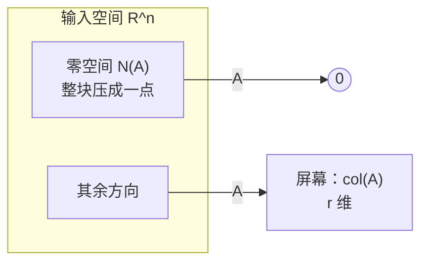

# 4.3 齐次方程与零空间：哪些方向被压成零

> **本节位置**：模块 4 · 线性方程组 ｜ **前置**：[4.2](02-解的存在性与通解.md) ｜ **预计**：30 分钟
>
> **一句话**：零空间是「被矩阵压成零的全部方向」，它的维数告诉你解的自由度从哪来。

## 0. 场景引入

一个 6 节点、8 根杆的模板支撑架，一端铰支、一端滚动，共 3 个支座约束；剩下 $2\times6-3=9$ 个自由位移。浇筑前工程师要确认一件事：这 9 个方向都被杆件约束住了吗？

把每根杆的轴向刚度组装成 $9\times9$ 的刚度矩阵 $K$。8 根杆最多提供 8 个独立约束，所以 $K$ 的秩最多 8——**至少有 1 个方向，整个架子可以动，而所有杆件都不产生应变**。这个方向就是零空间里的一个机构（mechanism）。

后果很具体：浇筑时混凝土重 12 t，若机构方向恰好是竖向，模板会下沉 30 mm，楼板超厚、保护层不足，返工 12 万元；而补一根斜撑只要 800 元。问题是：机构方向到底是哪个？8 根杆里有没有一根是白放的？

**问题**：零空间里能有多少个独立方向？它和「杆件数」「自由度数」是什么关系？读完本节，你应该能回答三件事：

1. 为什么齐次方程 $K\mathbf{u}=\mathbf{0}$ 的解集一定是子空间？
2. 零度 $n-r$ 在结构里对应什么，为什么不能直接用「杆数减自由度数」？
3. 数值上最小的奇异值小到什么程度，才该判成机构？

## 1. 直觉

### 1.1 被压扁的方向

把矩阵 $A$ 想成一台投影仪：它把 $\mathbb{R}^n$ 投到低维屏幕上。屏幕上没被照到的方向，就是零空间——那些方向上的向量输出全是零。



### 1.2 齐次解集一定过原点

$A\mathbf{0}=\mathbf{0}$ 永远成立；解集还对加法与数乘封闭：$A(\mathbf{x}+\mathbf{y})=\mathbf{0}$、$A(c\mathbf{x})=\mathbf{0}$。这正是**子空间**的定义。对比 4.2 的非齐次解集 $\mathbf{x}_p+N(A)$：它是平移过的子空间，一般不过原点。

> 💡 **一句话直觉**：**零空间 = 矩阵「看不见」的方向的集合**；维数越大，被压掉的信息越多。

### 1.3 它在现实世界里对应什么

$K\mathbf{u}=\mathbf{0}$ 里的 $\mathbf{u}$ 不是「没有位移」，而是**不产生任何杆件应变的位移模式**。杆件只感受长度变化；如果整个架子能沿某个方向滑出去而每根杆的长度不变，杆件就使不上劲。

| 数学对象 | 桁架里的对应物 |
|---|---|
| 矩阵 $K$ | 杆件刚度按节点组装 |
| 零空间 $N(K)$ | 所有「杆件不伸长」的位移模式，即机构 |
| 零度 $\dim N(K)$ | 机构个数 |
| 秩 $r$ | 真正起作用的独立约束数 |
| 基础解系 | 每个机构的形状 |

**量级直觉**：9 个自由位移、8 根杆，零度至少是 $9-8=1$。数值上 $\sigma_{\min}(K)$ 通常是 $10^{-13}$ 量级（舍入误差），补一根斜撑后升到 $0.9$ 左右——**从「精确为零」到「正常刚度」，只需要一根杆。**

### 1.4 这个类比在哪里失效

第一，这是小变形、线弹性的 $K$。大变形后刚度随位移变，机构可能被几何硬化（张拉膜、悬索）；反过来，受压杆件失稳（屈曲）不是零空间问题，是特征值问题。

第二，$K$ 奇异有两种：精确机构，和数值近奇异（$\kappa$ 很大但没有精确零空间）。真实结构有节点板、螺栓、次构件，计算模型一简化就会造出「假机构」。

第三，理想铰接、杆件只受轴力是模型假设；实物节点有转动刚度，机构可能被摩擦和节点刚度挡住——但那只意味着它「暂时没动」，不意味着安全。

## 2. 定义

### 2.1 齐次方程

$$
A\mathbf{x}=\mathbf{0},\qquad A\in\mathbb{R}^{m\times n}
$$

「齐次（homogeneous）」指右端为零。它一定有平凡解（trivial solution）$\mathbf{x}=\mathbf{0}$；我们关心的是**非零解**。

### 2.2 零空间

$$
N(A)=\ker(A)=\{\mathbf{x}\in\mathbb{R}^n\mid A\mathbf{x}=\mathbf{0}\}
$$

它是 $\mathbb{R}^n$ 的子空间（不是 $\mathbb{R}^m$），维数叫**零度（nullity）**。

### 2.3 基础解系

零空间的一组基叫**基础解系（fundamental system of solutions）**：线性无关的 $\mathbf{z}_1,\dots,\mathbf{z}_{n-r}$，使 $N(A)=\operatorname{span}\{\mathbf{z}_1,\dots,\mathbf{z}_{n-r}\}$。齐次通解即 $\mathbf{x}=c_1\mathbf{z}_1+\cdots+c_{n-r}\mathbf{z}_{n-r}$。

### 2.4 秩–零度定理（rank–nullity theorem）

$$
\dim N(A)=n-\operatorname{rank}(A)
$$

$n$ 是列数（未知数个数）。这就是 4.2 里「自由变量个数 $=n-r$」的来源；[Strang](#ref-strang-1993) 把它与 $N(A)=\operatorname{row}(A)^\perp$ 一起称为线性代数的基本定理。

## 3. 为什么这样定义

为什么不直接说「解就是零向量」？因为非零解携带关键信息：**它说明列向量线性相关**。若存在 $\mathbf{x}\neq\mathbf{0}$ 使 $x_1\mathbf{a}_1+\cdots+x_n\mathbf{a}_n=\mathbf{0}$，那么 $A$ 的列线性相关、映射不单射、方阵不可逆。

反过来，零空间只有零向量，说明列线性无关、映射单射、方阵可逆。一个集合同时刻画了三件事。

为什么零空间是「通解的积木」？因为任意两个解的差都在 $N(A)$ 里。拿到 $N(A)$ 的一组基，就能把任何一个非齐次解沿零空间方向移动，生成全部解。求 $A\mathbf{x}=\mathbf{b}$ 因此被拆成两半：消元找特解，解齐次方程找基。

### 3.1 反事实：用「杆数减自由度数」当零度

结构工程里常听到一句话：杆件比自由度多，就不会有机构。把它写成公式就是 $\dim N(K)=n-m$（自由度减杆数）。用矩阵算一遍就知道它错在哪。

$$
A=\begin{bmatrix}1&0&0\\0&1&0\\1&1&0\\2&2&0\end{bmatrix}
$$

四行、三列。秩是 2（后两行是前两行的组合），所以真实零度是 $3-2=1$，零空间由 $(0,0,1)^\top$ 张成。按「行数减秩」算，零度是 $4-2=2$；按「列数减行数」算，是 $3-4=-1$。**三个答案：1、2、−1。**

放回桁架：8 根杆、9 个自由度，$9-8=1$ 碰巧对；但如果再加一根不增加独立约束的杆（与另一根共线、端点已被其它杆锁死），杆数变 9、秩仍是 8，按 $n-m$ 得 $9-9=0$，就漏掉了仍然存在的机构。换一个「行数减秩」的算法 $m-r$：8 根杆时得 $8-8=0$，也错；有两根冗余杆时得 $10-8=2$，而真实零度还是 1。

正确的关系只有一条：**零度 $=n-\operatorname{rank}(K)$，秩要算，不能数。**

## 4. 性质与推导

### 4.1 维数公式的证明思路

把 $A$ 化成阶梯形：主元列有 $r$ 个，对应 $r$ 个被定住的未知数；剩下 $n-r$ 列没有主元，对应自由变量。每个自由变量取 1、其余取 0，回代就得到零空间的一个基向量。它们线性无关（每个向量在一个自由坐标上是 1、其它自由坐标是 0），且张成整个零空间。所以 $\dim N(A)=n-r$。

### 4.2 零空间与行空间正交

对任意 $\mathbf{z}\in N(A)$，有 $A\mathbf{z}=\mathbf{0}$，即 $\mathbf{a}_i^\top\mathbf{z}=0$ 对每一行成立。所以

$$
N(A)=\operatorname{row}(A)^\perp,\qquad \dim N(A)+\dim\operatorname{row}(A)=n
$$

这与第 3.7 节的四个基本子空间是同一件事的两面。

### 4.3 方阵可逆的等价条件

对 $A\in\mathbb{R}^{n\times n}$，以下等价：$A$ 可逆；$N(A)=\{\mathbf{0}\}$；$\operatorname{rank}(A)=n$；$\det(A)\neq0$（第 5.1 节）；列线性无关。

只要 $N(A)$ 里有一个非零向量，逆就不存在——那个方向被压成零，无法还原。

### 4.4 和非齐次解的关系

若 $\mathbf{x}_p$ 是 $A\mathbf{x}=\mathbf{b}$ 的解，则全部解是 $\mathbf{x}_p+N(A)$。零空间越大，解集越大；$\dim N(A)$ 就是解集的维数。

## 5. 例子

### 5.1 手算：$3\times3$ 的零空间

$$
A=\begin{bmatrix}1&2&0\\0&1&1\\1&3&1\end{bmatrix}
$$

先看秩：$R_3\leftarrow R_3-R_1=[0,1,1]$，与 $R_2$ 相同，所以 $r=2$，$\dim N(A)=3-2=1$。

解 $A\mathbf{x}=\mathbf{0}$：$x_1+2x_2=0$、$x_2+x_3=0$。令 $x_2=t$，则 $x_3=-t$、$x_1=-2t$，所以

$$
N(A)=\operatorname{span}\left\{\begin{bmatrix}-2\\1\\-1\end{bmatrix}\right\}
$$

**验算**：$A(-2,1,-1)^\top=(-2+2,\ 1-1,\ -2+3-1)^\top=(0,0,0)^\top$ ✓ 取 $t=2$ 得 $(-4,2,-2)^\top$，也在零空间里；基础解系只有一个向量，零空间却有无穷多个向量。NumPy 复核：`np.linalg.svd(A)` 的最小奇异值为 0（数值上约 $10^{-16}$），对应右奇异向量与 $(-2,1,-1)^\top$ 平行（可差一个符号）。数值秩与「多小才算零」的判读见 [Trefethen & Bau](#ref-trefethen-bau-1997)。

### 5.2 对照：4.2 的系统零空间是 2 维

4.2 的 $A\in\mathbb{R}^{3\times4}$ 秩为 2，所以 $\dim N(A)=4-2=2$，基是 $(-2,1,0,0)^\top$ 与 $(4,0,-3,1)^\top$——正是通解里那两个自由方向。两篇文档说的是同一件事。

### 5.3 场景：列相关的判定

三个向量 $\mathbf{a}_1=(1,0,1)$、$\mathbf{a}_2=(2,1,3)$、$\mathbf{a}_3=(0,1,1)$ 是否线性无关？按列排成上面的 $A$，求 $A\mathbf{x}=\mathbf{0}$ 得 $(-2,1,-1)$，非零，于是

$$
-2\mathbf{a}_1+\mathbf{a}_2-\mathbf{a}_3=\mathbf{0}
$$

三者线性相关。零空间的一个非零向量，直接给出了相关系数组合。

### 5.4 场景闭环：9 个自由位移、8 根杆

**输入**：8 根杆的 $EA/L$ 与节点坐标，组装出 $K\in\mathbb{R}^{9\times9}$，fp64 共 $9^2\times8=648$ B。荷载 $\mathbf{f}$ 由 12 t 混凝土分配到 6 个节点，约 $1.18\times10^5$ N（按 $12\times10^3\times9.8$ 估）。

**计算**：对 $K$ 做特征分解，$9^3\approx729$ 次乘法，微秒级。最小的特征值是 $3\times10^{-13}$，对应特征向量就是机构形状；检查它的竖向分量，若与重力方向夹角小于 30°，就是危险机构。

**输出**：一个决策——在这个方向补一根斜撑。补完后重新组装 $K$，$\sigma_{\min}$ 从 $3\times10^{-13}$ 升到 $0.9$，机构消失；若想留冗余，可以再加一根，代价还是 800 元。

**成本**：一根斜撑 800 元、安装 2 小时；返工 12 万元、工期 5 天。计算成本可以忽略——**这一步的价值全在「算不算」而不是「算多快」。**

**失败条件**：

- **假机构**：$\sigma_{\min}=10^{-6}$ 被当成零，多补一根撑，白花 800 元。兜底：用相对阈值（如 $10^{-8}\sigma_{\max}$），并对照节点简图人工确认。
- **真机构被滤掉**：阈值取得太松，$10^{-9}$ 被当成零，架子照塌。兜底：同时检查 $\kappa(K)$ 与荷载方向上的柔度。
- **荷载不在列空间**：$K\mathbf{u}=\mathbf{f}$ 无解，意味着这个荷载下没有静力平衡——不是「解不出来」，是「站不住」。这时补撑也未必够，要改结构布置。

## 6. 常见误区

1. **误区**：零空间就是零向量。**纠正**：零空间是子空间，至少含零向量；只有满列秩时才退化成 $\{\mathbf{0}\}$。
2. **误区**：基础解系唯一。**纠正**：零空间的基不唯一，$\{(1,0),(0,1)\}$ 与 $\{(1,1),(1,-1)\}$ 都是 $\mathbb{R}^2$ 的基；唯一确定的是维数 $n-r$。
3. **误区**：$N(A)$ 与左零空间是一回事。**纠正**：$N(A)\subseteq\mathbb{R}^n$，左零空间 $\{\mathbf{y}\mid\mathbf{y}^\top A=\mathbf{0}\}\subseteq\mathbb{R}^m$，维数分别是 $n-r$ 与 $m-r$。
4. **误区**：行变换保持列空间。**纠正**：行变换保持解集（求 $N(A)$ 合法），但改变列空间；判断 $\mathbf{b}\in\operatorname{col}(A)$ 要用原矩阵。
5. **误区**：方阵有非零零空间，说明所有方程都无解。**纠正**：只说明对某些 $\mathbf{b}$ 无解、对另一些有无穷多解。

## 7. 概念网络

- 前置：[4.2 解的存在性与通解](02-解的存在性与通解.md) —— 非齐次通解 $=\mathbf{x}_p+N(A)$。
- 前置：[3.7 四个基本子空间](../03-矩阵与线性映射/07-四个基本子空间.md) —— 零空间与行空间互为正交补。
- 后续：[4.4 最小二乘](04-最小二乘.md) —— 满列秩保证 $A^\top A$ 可逆。
- 后续：[4.5 伪逆与最小范数解](05-伪逆与最小范数解.md) —— 在 $\mathbf{x}_p+N(A)$ 里挑范数最小的。
- 关联：第 6.1 节（特征值与特征向量）—— 特征值 0 的特征向量属于零空间。
- 关联：[2.5 基与维数](../02-向量空间/04-基与维数.md) —— 零空间是子空间，也要用基来描述。

## 8. 通往大模型：零空间、秩亏与 LoRA

**出现位置**：线性层的秩亏、表示坍缩（representation collapse）、LoRA 更新的作用范围。

**形状**：LoRA 把权重更新写成 $\Delta W=BA$，其中 $B\in\mathbb{R}^{D\times r}$、$A\in\mathbb{R}^{r\times D}$，$r\ll D$（常见 $r=8$ 或 $16$，$D=4096$）。

**为什么需要**：$\operatorname{rank}(\Delta W)\le r$，所以 $\Delta W$ 的零空间维数至少是 $D-r$。取 $D=4096,r=8$，至少有 $4088$ 个方向上的输入经过这个更新后输出不变。这就是「LoRA 只改一个低维子空间」的精确含义：大部分方向根本没被动过，所以不容易灾难性遗忘；同时容量上限也在此——需要改的方向若不在那个 $r$ 维子空间里，就学不到。

**可检验结论**：`np.linalg.matrix_rank(B @ A) <= r` 恒成立；把 $\Delta W$ 做 SVD，非零奇异值最多 $r$ 个，其余全为 0。若某层原本就秩亏，它的零空间方向上梯度长期接近零，这部分容量相当于「死掉」。

```python
import numpy as np
rng = np.random.default_rng(0)
D, r = 64, 4
B, A = rng.normal(size=(D, r)), rng.normal(size=(r, D))
dW = B @ A
print(np.linalg.matrix_rank(dW), np.linalg.svd(dW, compute_uv=False)[:6])
z = rng.normal(size=D)
z -= dW.T @ np.linalg.lstsq(dW.T, z, rcond=None)[0]   # 投影到零空间
print(np.linalg.norm(dW @ z))                          # ≈ 0
```

**如果这一步算错，工程上看到什么现象**：把近零奇异值当零（或反过来），LoRA 更新会多删/多留一个方向。用户侧不一定看到报错，而是「某些 prompt 忽然完全不响应」或「一个无关的改写让整段输出跑偏」。这类现象很难归因，因为零空间方向本来就不产生可见输出——它只在换一个输入时才露头。

## 9. 练习

1. **概念**：为什么齐次方程的解集一定是子空间，而非齐次解集一般不是？
2. **计算**：求 $A=\begin{bmatrix}1&2&3\\2&4&6\\1&1&1\end{bmatrix}$ 的秩、零空间的一组基与维数。
3. **计算**：求 $A=\begin{bmatrix}1&1&0\\0&1&1\end{bmatrix}$ 的零空间，并用它写出 $A\mathbf{x}=(1,0)^\top$ 的通解。
4. **概念**：若 $A\in\mathbb{R}^{3\times5}$ 且 $\operatorname{rank}(A)=3$，零空间维数是多少？$A\mathbf{x}=\mathbf{b}$ 对任意 $\mathbf{b}$ 都有解吗？
5. **开放**：一个 $4096\times4096$ 的权重矩阵如果秩只有 512，对模型意味着什么？给出两个可测的后果。

<details>
<summary>参考答案</summary>

1. 齐次解集对加法、数乘封闭且含零向量，满足子空间定义；非齐次解集不含零向量（除非 $\mathbf{b}=\mathbf{0}$），两个解相加得 $2\mathbf{b}\neq\mathbf{b}$，不封闭。
2. 第二行是第一行的 2 倍，第一、三行不成比例，$r=2$，维数 $3-2=1$。令 $x_3=t$：由 $x_1+x_2+t=0$ 与 $x_1+2x_2+3t=0$ 相减得 $x_2=-2t$，$x_1=t$。基为 $(1,-2,1)^\top$。
3. $x_1+x_2=0$、$x_2+x_3=0$，令 $x_3=t$：$N(A)=\operatorname{span}\{(-1,1,-1)^\top\}$。取 $x_3=0$ 得特解 $(1,0,0)^\top$，通解 $(1,0,0)^\top+t(-1,1,-1)^\top$。
4. $\dim N=5-3=2$。$A$ 行满秩，列空间是整个 $\mathbb{R}^3$，所以对任意 $\mathbf{b}$ 都有解，且每个 $\mathbf{b}$ 对应一个 2 维解集。
5. 意味着 4096 个输入方向中约 3584 个被压掉。后果：(a) 有效容量下降，只能用低维子空间区分输入；(b) 这些方向梯度接近零，训练难以恢复；(c) 输出对某些输入差异不敏感，表现为坍缩或同质化。可用有效秩（奇异值谱的熵）量化。

</details>

## 10. 一页速记

- $N(A)=\{\mathbf{x}\mid A\mathbf{x}=\mathbf{0}\}$，是 $\mathbb{R}^n$ 的子空间，一定含零向量。
- **物理意义 / 现实对应**：零空间 = 不产生任何输出的输入方向；桁架里是机构，网络里是看不见的流量重分配，模型里是被压掉的表征方向。
- $\dim N(A)=n-\operatorname{rank}(A)$：自由变量个数就是零度。
- 基础解系是零空间的一组基，写成 $n-r$ 个向量，不唯一。
- $N(A)=\operatorname{row}(A)^\perp$；方阵 $N(A)=\{\mathbf{0}\}\iff$ 可逆。
- 非零解 $\iff$ 列线性相关；非齐次通解 $=\mathbf{x}_p+N(A)$。

## 11. 参考文献与致谢

这一页的知识不是凭空来的。下面列出本页直接借用的原始工作与权威整理；正文中的人名、定理名已链接到对应条目。链接优先指向 DOI、arXiv 或可长期访问的原文存档。

- <a id="ref-strang-1993"></a>**斯特朗（Gilbert Strang, 1993）**：*The Fundamental Theorem of Linear Algebra*。四个基本子空间的正交关系 $N(A)=\operatorname{row}(A)^\perp$ 与维数公式 $\dim N(A)=n-r$，构成本页第 2.4 节秩–零度定理的矩阵版。[Amer. Math. Monthly 100(9), 848–855](https://doi.org/10.1080/00029890.1993.11990500)
- <a id="ref-trefethen-bau-1997"></a>**特雷费森与鲍（Lloyd N. Trefethen & David Bau, III, 1997）**：*Numerical Linear Algebra*。用 SVD 讨论数值秩与近零奇异值，解释了第 5.1 节里「最小奇异值约为 $10^{-16}$ 而不是精确的 0」该怎么读。[SIAM](https://doi.org/10.1137/1.9780898719574)

---

下一篇 → [4.4 最小二乘与正规方程](04-最小二乘.md)
