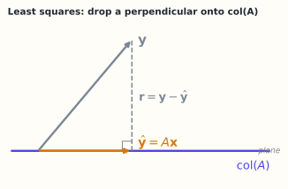

# 4.4 最小二乘与正规方程：无解时找最近

> **本节位置**：模块 4 · 线性方程组 ｜ **前置**：[1.6 正交与投影](../01-向量与几何/06-正交与投影.md)、[2.8 正交补与投影定理](../02-向量空间/08-正交补与投影定理.md) ｜ **预计**：40 分钟
>
> **一句话**：方程解不出来时，退一步找让残差平方和最小的 $\mathbf{x}$；它的充要条件是残差与 $A$ 的列空间正交。

## 0. 场景引入

一家二手房平台要给 5000 套在售房做自动估值，特征 12 个：面积、房龄、到地铁距离、学区排名、楼层、朝向……目标是预测成交总价，误差控制在 8% 以内。估高了，银行按这个价放贷，抵押物虚高 20 万元；估低了，房东把房源挂到别家。

5000 个样本、12 个参数，这是一个超定系统：$X\in\mathbb{R}^{5000\times12}$、$\mathbf{y}\in\mathbb{R}^{5000}$。12 个特征不可能让 5000 个价格同时落在一张超平面上，方程必然无解——这正是最小二乘的用武之地。成交记录里还混着亲属过户、含车位的打包价，噪声会一起进方程。

数据里还有个陷阱：面积与房间数的相关系数约 0.95，两列几乎成比例，$X^\top X$ 接近奇异。方差膨胀因子约 $1/(1-0.95^2)\approx10.3$，两个系数的标准误各放大 $\sqrt{10.3}\approx3.2$ 倍。换一批成交数据，系数可能翻号。

**问题**：无解时「最合适」到底怎么定义？为什么是平方，而不是绝对值？读完本节，你应该能回答三件事：

1. 为什么最优解的条件是「残差与列空间正交」？
2. 正规方程从哪来，它在什么时候不能用？
3. 共线特征与离群点，分别会把最小二乘带偏到哪里？

## 1. 直觉

### 1.1 把 $\mathbf{y}$ 投影到列空间

$A\mathbf{c}$ 的所有可能取值构成 $\operatorname{col}(A)$——由 $A$ 两列张成的平面（$\mathbb{R}^3$ 里）。$\mathbf{y}$ 一般不在这个平面上。

最近的点只有一个：$\mathbf{y}$ 在平面上的**正交投影** $\hat{\mathbf{y}}$，满足 $\mathbf{y}-\hat{\mathbf{y}}\perp\operatorname{col}(A)$。残差垂直于平面，就是「最近」的几何条件。



*图：侧视图。col(A) 画成一条直线，残差 r = y − ŷ 与它垂直，所以 ŷ 是列空间里离 y 最近的点。*

> 💡 **一句话直觉**：**最小二乘 = 把目标向量投影到列空间，投影点就是最优拟合值**，投影的系数就是参数。

类比边界：这里的「最近」用 L2 范数。换成 L1，最近点会不同（中位数而非均值），也没有正规方程这种线性条件。

### 1.2 为什么用平方和

为什么用平方和？残差 $r_i=a+bx_i-y_i$ 有正有负，直接相加会抵消。取绝对值不好求导；取平方既可导，又把大残差惩罚得更重。平方和最小等价于欧氏距离最小。

这个方法有一段公案：Legendre 1805 年首次发表，Gauss 1809 年在《天体运动论》里给出它的误差理论版本并主张自己更早使用。[Stigler（1981）](#ref-stigler-1981) 与 [Plackett（1972）](#ref-plackett-1972) 把这段优先权之争和当时的计算背景考据清楚。

### 1.3 它在现实世界里对应什么

最小二乘在估值场景里做的事，用一句话说：**把 5000 个成交价，投影到「12 个特征能解释的那张平面」上。**

| 数学对象 | 估值里的对应物 |
|---|---|
| $\operatorname{col}(X)$ | 12 个特征所有可能的线性组合能给出的价格 |
| 投影 $\hat{\mathbf{y}}$ | 模型对 5000 套房的拟合价 |
| 残差 $\mathbf{r}$ | 每套房的「特征解释不了的溢价/折价」 |
| 正交条件 $X^\top\mathbf{r}=\mathbf{0}$ | 残差里不再含任何特征方向，否则还能再降一点误差 |
| 系数 $\hat{\mathbf{x}}$ | 每平方米、每一年房龄各值多少钱 |

**量级直觉**：5000 个样本、12 个参数，残差自由度是 $5000-12=4988$，平均每个参数有约 417 个样本支撑。构造 $X^\top X$ 只需要 $5000\times12^2\times2\approx1.4\times10^6$ FLOP——**计算便宜到可以忽略，贵的是数据质量和模型假设。**

### 1.4 这个类比在哪里失效

第一，平方误差由大残差主导。一套 1 亿元的别墅混进来，能把整条回归线拉歪；换成绝对误差，它又会被完全无视（3.1 算给你看）。

第二，「最近」量的是竖直距离（沿价格方向），不是点到直线的垂直距离。面积本身也有测量误差时，应该用正交回归（总最小二乘）。

第三，相关不是因果。学区系数大，不代表把学校排名改一改，房价就会按系数涨。

## 2. 定义

### 2.1 最小二乘问题

对 $A\in\mathbb{R}^{m\times n}$、$\mathbf{b}\in\mathbb{R}^m$，最小二乘问题就是 $\min_{\mathbf{x}}\ \|A\mathbf{x}-\mathbf{b}\|_2^2$。

即使 $A\mathbf{x}=\mathbf{b}$ 无解，最小值也总存在（列空间是闭集，投影存在）。残差（residual）记为 $\mathbf{r}(\mathbf{x})=A\mathbf{x}-\mathbf{b}$。

### 2.2 正规方程

若 $A$ 满列秩（$\operatorname{rank}(A)=n$），最优解唯一，且满足**正规方程（normal equations）**

$$
A^\top A\,\hat{\mathbf{x}}=A^\top\mathbf{b}
$$

$A^\top A\in\mathbb{R}^{n\times n}$ 对称、半正定；满列秩时正定、可逆，于是 $\hat{\mathbf{x}}=(A^\top A)^{-1}A^\top\mathbf{b}$。

## 3. 为什么这样定义

为什么不直接解 $A\mathbf{x}=\mathbf{b}$？因为无解时它没有答案。而现实里「无解」是常态：数据点多于参数、测量有噪声、目标互相冲突。

为什么条件恰好是 $A^\top\mathbf{r}=\mathbf{0}$？残差必须与 $\operatorname{col}(A)$ 中每个向量正交。列空间由 $A$ 的列张成，所以只需与每一列正交，即 $A^\top\mathbf{r}=\mathbf{0}$。展开就是正规方程：

$$
A^\top(A\hat{\mathbf{x}}-\mathbf{b})=\mathbf{0}\iff A^\top A\hat{\mathbf{x}}=A^\top\mathbf{b}
$$

这只是必要条件；但 $\|A\mathbf{x}-\mathbf{b}\|^2$ 是凸二次函数，驻点就是全局最小点，所以也是充分条件。

### 3.1 反事实：用「绝对误差」代替「平方误差」

最小二乘的定义里，最容易被替换的是那个平方。把它换成绝对值，问题变成 $\min\sum_i\lvert r_i\rvert$。先看一维的版本：四个成交价 $1,2,3,100$（单位：10 万元）。

- 平方误差最小化给出**均值** $(1+2+3+100)/4=26.5$；
- 绝对误差最小化给出**中位数** $2.5$。

同一组数，一个说「典型价格 265 万」，一个说「25 万」。谁对？取决于你要不要被那套 100 的样本代表。

二维更微妙。取四个点 $(1,1),(2,2),(3,3),(4,10)$，拟合 $y=a+bx$：

- 平方误差：$b=2.8$、$a=-3$，残差平方和 $10.8$，在 $x=5$ 处预测 $11$。
- 绝对误差：最小值是 $6$，但**最优点不唯一**——任何 $b\in[1,3]$ 配上相应的 $a$（使 $y-bx$ 的中位数为 0）都能达到 6。在 $x=5$ 处的预测从 $5$ 一路到 $13$。

也就是说，换掉平方之后，答案从「唯一但被离群点拖走」变成「稳健但不唯一」。而且绝对值在 0 点不可导，写不出正规方程这样的线性条件，求解要从二次规划绕。

**平方不是更「正确」，是同时买到三件事：唯一解、可导、有闭式条件。** 代价是对离群点敏感，所以工程上会先用 Huber 损失或剔除异常成交来补这一刀。

## 4. 性质与推导

### 4.1 微积分推导

$$
f(\mathbf{x})=\|A\mathbf{x}-\mathbf{b}\|^2
=\mathbf{x}^\top A^\top A\mathbf{x}-2\mathbf{b}^\top A\mathbf{x}+\mathbf{b}^\top\mathbf{b}
$$

对 $\mathbf{x}$ 求梯度（第 8.5 节的矩阵求导）：$\nabla f=2A^\top A\mathbf{x}-2A^\top\mathbf{b}$。令其为零即得正规方程；二阶导是 $2A^\top A\succeq0$，所以是极小值。

### 4.2 满列秩才可逆

$A^\top A$ 可逆 $\iff A$ 满列秩。若 $A^\top A\mathbf{x}=\mathbf{0}$，左乘 $\mathbf{x}^\top$ 得 $\|A\mathbf{x}\|^2=0$，即 $A\mathbf{x}=\mathbf{0}$；满列秩时只有 $\mathbf{x}=\mathbf{0}$，故 $A^\top A$ 零空间平凡。不满列秩时 $A^\top A$ 奇异，正规方程有无穷多解，应取最小范数解（4.5）。

### 4.3 投影矩阵

$$
\hat{\mathbf{y}}=A\hat{\mathbf{x}}=A(A^\top A)^{-1}A^\top\mathbf{b}=H\mathbf{b}
$$

$H=A(A^\top A)^{-1}A^\top$ 是到 $\operatorname{col}(A)$ 的投影矩阵：对称（$H^\top=H$）、幂等（$H^2=H$），就是 1.6 里 $P_S$ 的矩阵形式。因为 $\hat{\mathbf{y}}\perp\mathbf{r}$，还有 $\|\mathbf{b}\|^2=\|\hat{\mathbf{y}}\|^2+\|\mathbf{r}\|^2$。

### 4.4 条件数会平方

$\kappa(A^\top A)=\kappa(A)^2$（2-范数下），所以正规方程会把数值误差平方放大；实践中更常用 QR 或 `lstsq`（内部用 SVD/QR），4.6 展开。这条「不要显式构造 $A^\top A$」的建议是 [Golub & Van Loan](#ref-golub-van-loan-2013) 的标准结论。

## 5. 例子

### 5.1 手算：三点拟合直线

$$
A^\top A=\begin{bmatrix}1&1&1\\0&1&2\end{bmatrix}
\begin{bmatrix}1&0\\1&1\\1&2\end{bmatrix}
=\begin{bmatrix}3&3\\3&5\end{bmatrix},\qquad
A^\top\mathbf{y}=\begin{bmatrix}1&1&1\\0&1&2\end{bmatrix}
\begin{bmatrix}0\\1\\3\end{bmatrix}=\begin{bmatrix}4\\7\end{bmatrix}
$$

正规方程：$3a+3b=4$、$3a+5b=7$。两式相减得 $2b=3\Rightarrow b=\frac32$；代回 $3a+\frac92=4\Rightarrow a=-\frac16$。

**最优直线**：$y=-\frac16+\frac32x$。预测值与残差：

| $x$ | $y$ | $\hat{y}$ | $r=y-\hat{y}$ |
|---|---|---|---|
| 0 | 0 | $-\frac16$ | $\frac16$ |
| 1 | 1 | $\frac43$ | $-\frac13$ |
| 2 | 3 | $\frac{17}{6}$ | $\frac16$ |

**验证正交条件**：

$$
A^\top\mathbf{r}=
\begin{bmatrix}1&1&1\\0&1&2\end{bmatrix}
\begin{bmatrix}1/6\\-1/3\\1/6\end{bmatrix}
=\begin{bmatrix}0\\0\end{bmatrix}\ ✓
$$

**残差平方和**：$\|\mathbf{r}\|^2=\frac1{36}+\frac4{36}+\frac1{36}=\frac16\approx0.167$。

NumPy 复核：`np.linalg.lstsq(A, y)` 返回 $(-0.1667,1.5)$，与手算一致；`A.T @ (y - A @ c)` 在 $10^{-17}$ 量级。

### 5.2 场景：给线性层做表示对齐

有两组表示 $H\in\mathbb{R}^{N\times D_1}$、$T\in\mathbb{R}^{N\times D_2}$，想找 $W\in\mathbb{R}^{D_1\times D_2}$ 使 $HW\approx T$。按列拆开，每一列都是一个最小二乘问题，共用同一个 $H^\top H\in\mathbb{R}^{D_1\times D_1}$。这就是线性探针/表示对齐的标准做法。

### 5.3 场景闭环：5000 套房、12 个特征

**输入**：$X\in\mathbb{R}^{5000\times12}$、$\mathbf{y}\in\mathbb{R}^{5000}$，fp64 分别占 $5000\times12\times8=480$ kB 与 40 kB。每天凌晨全量重算一次。

**计算**：先中心化，再算 $X^\top X$（$12\times12$）：

$$
5000\times12\times12\times2\approx1.44\times10^6\ \text{FLOP}
$$

按 1 GFLOP/s 估约 1.4 ms；Cholesky 分解 $12^3/3\approx576$ FLOP，可以忽略。**所以「用正规方程还是 QR」在时间上没有区别，区别在数值与统计性质。**

**输出**：12 个系数，加上每套房的拟合价与残差。决策是：估值进入挂牌参考价；残差绝对值超过预测价 8% 的房源，转人工复核。

**成本**：计算 1.4 ms；真正的成本是 5000 条成交记录的清洗（重复房源、亲属间过户、含车位的打包价）和重算后的系数漂移。若 $\kappa(X)\approx10^3$，$\kappa(X^\top X)\approx10^6$，双精度还剩约 10 位有效数字——**数值上够用，统计上不够稳**：系数标准误大，业务上表现为「这周学区系数 1.8，下周 0.6」。

**失败条件**：

- **离群点**：一套 1 亿元的别墅能把斜率拉走。兜底：Huber 损失、按残差迭代剔除、分小区建模。
- **共线**：面积与房间数相关系数 0.95，两个系数此消彼长。兜底：岭回归（$\lambda I$ 把 $\kappa$ 压下来），或合并成一个特征。
- **外推**：样本里没有 20 m² 以下的房子，模型照样会给一个数。兜底：按特征范围做拒绝域，超出范围不自动估值。

## 6. 常见误区

1. **误区**：最小二乘解会让每个方程都成立。**纠正**：只有 $\mathbf{b}\in\operatorname{col}(A)$ 时残差才为零；一般残差非零，只是它在列空间方向的分量为零。
2. **误区**：$\hat{\mathbf{x}}=(A^\top A)^{-1}A^\top\mathbf{b}$ 永远可用。**纠正**：前提是满列秩；列相关时 $A^\top A$ 奇异，要用伪逆或最小范数解（4.5）。
3. **误区**：代码里应该显式写 `inv(A.T @ A)`。**纠正**：显式求逆既慢又不稳；用 `np.linalg.solve` 好一些，最好直接 `np.linalg.lstsq`（QR/SVD）。
4. **误区**：最小二乘最小化「点到直线的垂直距离」。**纠正**：它最小化沿 $y$ 方向的残差（竖直距离）；自变量也有误差时要用正交回归。
5. **误区**：残差越小模型越好。**纠正**：参数多到能插值所有点时残差为零，但没有泛化。残差只是拟合指标。

## 7. 概念网络

- 前置：[1.6 正交与投影](../01-向量与几何/06-正交与投影.md) —— 投影的残差正交条件。
- 前置：[2.8 正交补与投影定理](../02-向量空间/08-正交补与投影定理.md) —— 正交基让投影公式最简。
- 前置：[3.6 转置、对称与分块](../03-矩阵与线性映射/06-转置对称与分块.md) —— 最小二乘的目标是 $\operatorname{col}(A)$。
- 后续：[4.5 伪逆与最小范数解](05-伪逆与最小范数解.md) —— 不满列秩时的统一写法。
- 后续：[4.6 条件数与病态问题](06-条件数与病态.md) —— 为什么正规方程不稳。
- 关联：第 8.5 节（矩阵求导）—— 正规方程的推导工具。

## 8. 通往大模型：线性回归头与表示对齐

**出现位置**：线性回归/线性探针、奖励模型的最后一层、把一批 $(h,y)$ 对齐到目标表示，以及 LoRA 之外的「闭式微调」方案。

**形状**：设特征矩阵 $X\in\mathbb{R}^{N\times D}$（$N$ 个样本、$D$ 维隐藏状态），目标 $Y\in\mathbb{R}^{N\times C}$。线性头 $W\in\mathbb{R}^{D\times C}$ 的最小二乘解为 $\hat W=(X^\top X)^{-1}X^\top Y$，其中 $X^\top X$ 是 $[D,D]$，$X^\top Y$ 是 $[D,C]$。$D=4096$ 时 $X^\top X$ 有 $4096^2\approx1.68\times10^7$ 个元素，fp32 下约 67 MB——单矩阵就占这么多显存，所以大模型很少真的构造它，而用 QR/迭代法或直接调 `lstsq`。

**为什么需要**：当 $N<D$（样本数少于特征维数）时 $X$ 不满列秩，$X^\top X$ 不可逆，正规方程有无穷多解；所有解里范数最小的那个（4.5）是「改动最小」的线性头。反过来 $N\gg D$ 时解唯一，但 $\kappa(X^\top X)=\kappa(X)^2$，特征若近共线，解对噪声极其敏感——这就是 4.6 要处理的问题。

**可检验结论**：同一份数据分别用正规方程和 `lstsq` 求解，在 $\kappa(X)\approx10^4$ 时结果可能相差很大；`lstsq` 的残差更接近真实最小值。岭回归 $(X^\top X+\lambda I)^{-1}X^\top Y$ 可以把 $\kappa$ 压到可控范围。

```python
import numpy as np
rng = np.random.default_rng(0)
N, D, C = 200, 64, 3
X = rng.normal(size=(N, D)); W_true = rng.normal(size=(D, C))
Y = X @ W_true + 0.01 * rng.normal(size=(N, C))
W_ls, *_ = np.linalg.lstsq(X, Y, rcond=None)
print(W_ls.shape, np.linalg.norm(X @ W_ls - Y))
print(np.linalg.norm(X.T @ (Y - X @ W_ls)))   # 残差与列空间正交 ≈ 0
```

**如果这一步算错，工程上看到什么现象**：残差只与部分列正交（比如漏掉了「房龄」这一列的归一化），系数会出现系统性偏移，用户看到同一套房源在一周内估值差 15%，而训练残差看起来还不错。另一个典型现象是直接写 `inv(X.T @ X)`：$X$ 一旦不满列秩就报奇异，或者给出量级 $10^8$ 的系数，把估值打到负值。

## 9. 练习

1. **概念**：为什么最优残差必须与 $A$ 的每一列正交？如果只与部分列正交会怎样？
2. **计算**：对 $(0,1)$、$(1,2)$、$(2,4)$ 拟合 $y=a+bx$，写出 $A^\top A$ 与 $A^\top\mathbf{y}$，求 $a,b$。
3. **计算**：对 $A=\begin{bmatrix}1&1\\1&1\\1&1\end{bmatrix}$、$\mathbf{b}=(1,2,6)^\top$，最小二乘解是什么？$A^\top A$ 是什么状态？
4. **几何**：验证 5.1 的投影矩阵 $H=\frac16\begin{bmatrix}5&2&-1\\2&2&2\\-1&2&5\end{bmatrix}$ 满足 $H^2=H$，并计算 $H\mathbf{y}$。
5. **开放**：$N<D$ 时最小二乘解不唯一。除了「范数最小」，还能用什么准则挑解？各有什么代价？

<details>
<summary>参考答案</summary>

1. 若残差在某一列 $\mathbf{a}_j$ 上有非零分量，把 $\hat{\mathbf{x}}$ 沿第 $j$ 个坐标微调可使 $\|\mathbf{r}\|^2$ 下降（$\partial_j\|\mathbf{r}\|^2=-2\mathbf{a}_j^\top\mathbf{r}\neq0$），与最优矛盾。所以必须与所有列正交。
2. $A^\top A=\begin{bmatrix}3&3\\3&5\end{bmatrix}$，$A^\top\mathbf{y}=\begin{bmatrix}7\\12\end{bmatrix}$。$2b=5\Rightarrow b=2.5$，$3a+7.5=7\Rightarrow a=-\frac16$。直线 $y=-\frac16+\frac52x$。
3. 三行相同，秩 1，$A^\top A=\begin{bmatrix}3&3\\3&3\end{bmatrix}$ 奇异。最小化 $\|(a+b)\mathbf{1}-\mathbf{b}\|^2$ 得 $a+b=3$，解集 $\{(t,3-t)\}$，无穷多。
4. 逐项乘得 $H^2=\frac1{36}\begin{bmatrix}30&12&-6\\12&12&12\\-6&12&30\end{bmatrix}=\frac16\begin{bmatrix}5&2&-1\\2&2&2\\-1&2&5\end{bmatrix}=H$。$H\mathbf{y}=(-\frac16,\frac43,\frac{17}{6})^\top$，正是拟合值。
5. 可选最小范数（岭回归极限）、L1（稀疏）、固定部分参数、加先验（贝叶斯）。最小范数改动最小但可能不稀疏；L1 可解释但求解更贵；加先验依赖先验是否正确。

</details>

## 10. 一页速记

- 无解时最小化 $\|A\mathbf{x}-\mathbf{b}\|_2^2$，解是 $\mathbf{b}$ 在 $\operatorname{col}(A)$ 上投影的系数。
- **物理意义 / 现实对应**：最小二乘 = 把观测投影到「模型能解释的方向」；残差是模型解释不了的部分，房价里就是特征之外的溢价。
- 正规方程 $A^\top A\hat{\mathbf{x}}=A^\top\mathbf{b}$，几何含义是 $A^\top\mathbf{r}=\mathbf{0}$。
- 满列秩 $\Rightarrow A^\top A$ 可逆、解唯一；否则无穷多解，取最小范数。
- 投影矩阵 $H=A(A^\top A)^{-1}A^\top$ 对称且幂等。
- $\kappa(A^\top A)=\kappa(A)^2$，所以实践用 `lstsq`，别显式求逆。

## 11. 参考文献与致谢

这一页的知识不是凭空来的。下面列出本页直接借用的原始工作与权威整理；正文中的人名、定理名已链接到对应条目。链接优先指向 DOI、arXiv 或可长期访问的原文存档。

- <a id="ref-stigler-1981"></a>**斯蒂格勒（Stephen M. Stigler, 1981）**：*Gauss and the Invention of Least Squares*。把最小二乘的两种起源讲清楚：Legendre 1805 年首发，Gauss 1809 年在《天体运动论》中给出误差理论版本，并对「谁先想到」给出史料判断。[Annals of Statistics 9(3), 465–474](https://doi.org/10.1214/aos/1176345451)
- <a id="ref-plackett-1972"></a>**普拉克特（R. L. Plackett, 1972）**：*Studies in the History of Probability and Statistics. XXIX: The discovery of the method of least squares*。按当时的天文测量问题复盘 1805–1809 年那段优先权公案，说明「平方和最小」为什么会在误差处理里胜出。[Biometrika 59(2), 239–251](https://doi.org/10.1093/biomet/59.2.239)
- <a id="ref-golub-van-loan-2013"></a>**戈卢布与范隆（Gene H. Golub & Charles F. Van Loan, 2013）**：*Matrix Computations*（4th ed.）。第 4.4 节那条结论的出处：正规方程把条件数平方成 $\kappa(A)^2$，所以实际求解走 QR 或 SVD，而不是显式构造 $A^\top A$。[Johns Hopkins University Press](https://doi.org/10.56021/9781421407944)

---

下一篇 → [4.5 伪逆与最小范数解](05-伪逆与最小范数解.md)
