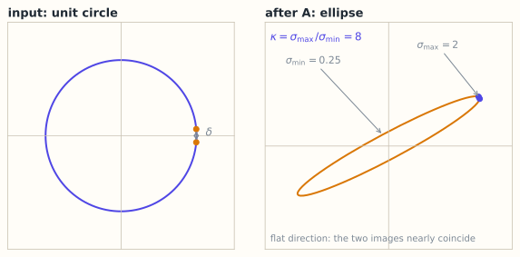

# 4.6 条件数与病态问题：误差被放大多少倍

> **本节位置**：模块 4 · 线性方程组 ｜ **前置**：[4.4](04-最小二乘.md) ｜ **预计**：35 分钟
>
> **一句话**：条件数衡量「输入的小扰动会让解变化多少倍」；它是问题本身的属性，不是某个算法的 bug。

## 0. 场景引入

一条协作机械臂要装腕部相机做抓取：相机看到零件，机械臂得知道零件在自己坐标系里的位置。标定方法是走 30 个姿态，每个姿态同时记录末端位姿与标定板位姿，解手眼方程 $AX=XB$。未知数只有 6 个：相机相对末端的旋转 3 个、平移 3 个。

问题出在姿态上：这 30 个姿态里有 20 个只是让第 6 轴原地转，另外 10 个的旋转轴也几乎平行。对方程来说，这等于用 20 个几乎相同的约束去定 6 个未知数——最小奇异值只有最大奇异值的 $1/400$，条件数 $\kappa\approx400$。

后果可以算：特征点定位的等效噪声按 0.02 mm 估，$400\times0.02=8$ mm。抓取公差是 ±2 mm，8 mm 意味着每次都要撞一下夹具；停线 4 小时，按 2 万元/小时估，8 万元。而省下的，只是把 30 个姿态减成 30 个「差不多的姿态」。

**问题**：为什么「多拍 20 组」没有让结果更准？$\kappa$ 能不能提前算出来？读完本节，你应该能回答三件事：

1. 条件数为什么是「问题」的属性，而不是算法的 bug？
2. $\kappa$ 与奇异值、行列式分别是什么关系？
3. 标定姿态怎么选，才能把 $\kappa$ 压下来？

## 1. 直觉

### 1.1 圆被压成扁椭圆

$A$ 把单位圆映射成一个椭圆，半轴长就是奇异值 $\sigma_{\max}$ 与 $\sigma_{\min}$。若 $\sigma_{\min}$ 很小，椭圆被压得很扁：某个方向几乎被压成零。求逆时要把这个方向重新拉长，拉长倍数就是 $1/\sigma_{\min}$，误差也随之放大。



*图：左为输入单位圆，右为像椭圆。σ_min 方向被压得越扁，求逆时误差被放大的倍数 1/σ_min 就越大。*

### 1.2 病态是「问题」的属性

同一个 $A$、同一个 $\mathbf{b}$，无论用高斯消元、LU 还是 `np.linalg.solve`，都逃不过这个放大。算法只能决定「额外再引入多少误差」，不能改变问题本身把误差放大多少倍。

> 💡 **一句话直觉**：**条件数 = 最坏情况下，输入的相对误差被放大成输出相对误差的倍数。**

### 1.3 它在现实世界里对应什么

条件数在标定里有一个很物理的读法：**这套动作能把空间分辨得多细。**

| 数学对象 | 手眼标定里的对应物 |
|---|---|
| $\sigma_{\max}$ | 标定动作最强的那一个方向 |
| $\sigma_{\min}$ | 所有 30 个姿态都没能好好区分的那个方向 |
| $1/\sigma_{\min}$ | 该方向上噪声被放大的倍数 |
| $\kappa=\sigma_{\max}/\sigma_{\min}$ | 最坏方向相对最好方向的放大比 |
| 右奇异向量 | 哪个参数组合最不敏感 |

**量级直觉**：30 个姿态若旋转轴只覆盖 5°，相当于只测了一个方向；$\kappa=400$ 时 0.02 mm 的噪声变成 8 mm。把姿态补到绕三个正交轴都有 30° 以上的转动，$\kappa$ 通常能压到 10 以下（按一类标定流程估算）——**同样的算法，换一组动作，精度差一个数量级。**

### 1.4 这个类比在哪里失效

第一，$\kappa$ 是最坏情况上界。具体噪声若落在不敏感方向上，实际放大远小于 $\kappa$；反过来，系统偏差（标定板不平、畸变没校正）根本不在这个上界里。

第二，$\kappa$ 依赖参数化。旋转用欧拉角，在万向锁附近会人为放大条件数；换成四元数或带约束的旋转矩阵，数值会不同。**比较两个 $\kappa$ 之前，先确认它们用的是同一套参数。**

第三，非线性最小二乘的协方差近似是 $\sigma^2(J^\top J)^{-1}$，与 $\kappa$ 同源；但鲁棒核、固定部分参数都会改变有效条件数。

## 2. 定义

### 2.1 条件数

对可逆矩阵 $A$ 与选定的范数，条件数（condition number）定义为 $\kappa(A)=\|A\|\,\|A^{-1}\|$。2-范数下

$$
\kappa_2(A)=\frac{\sigma_{\max}(A)}{\sigma_{\min}(A)}
$$

其中 $\sigma_{\max},\sigma_{\min}$ 是最大、最小奇异值。$\kappa_2\ge1$，等号当且仅当 $A$ 是正交矩阵的常数倍。

这个量出自 1940 年代对矩阵求逆的舍入误差分析：[von Neumann 与 Goldstine](#ref-von-neumann-goldstine-1947)（1947）与 [Turing](#ref-turing-1948)（1948）各自引入了它。

### 2.2 相对误差上界

若 $A\mathbf{x}=\mathbf{b}$、$A(\mathbf{x}+\delta\mathbf{x})=\mathbf{b}+\delta\mathbf{b}$，则

$$
\frac{\|\delta\mathbf{x}\|}{\|\mathbf{x}\|}
\le
\kappa(A)\,\frac{\|\delta\mathbf{b}\|}{\|\mathbf{b}\|}
$$

若 $A$ 本身有扰动 $\delta A$，一阶近似下 $\dfrac{\|\delta\mathbf{x}\|}{\|\mathbf{x}\|}\lesssim\kappa(A)\left(\dfrac{\|\delta A\|}{\|A\|}+\dfrac{\|\delta\mathbf{b}\|}{\|\mathbf{b}\|}\right)$。$\kappa$ 接近 1 是良态（well-conditioned），误差不被显著放大；$\kappa\gg1$ 是病态（ill-conditioned）。双精度约 16 位十进制有效数字，$\kappa\approx10^{16}$ 时解可能一位有效数字都不剩。

## 3. 为什么这样定义

为什么不直接用 $\det(A)$ 判断？因为行列式随整体缩放变化：$0.1I_{100}$ 的 $\det=10^{-100}$，但它条件数为 1，非常良态。行列式小可能只是「整体尺度小」或「维数大」，与「某个方向被压扁」不是一回事。

为什么用相对误差？绝对误差没有可比性：把 $\mathbf{b}$ 的单位从米换成毫米，绝对误差变 1000 倍，但解的质量没变。

为什么是奇异值的比值？最坏情况下误差落在 $\sigma_{\min}$ 对应的方向（被压得最扁），而解本身主要由 $\sigma_{\max}$ 方向贡献；比值正是这两个方向的放大倍数之比。

### 3.1 反事实：用行列式判断病态

「行列式接近 0 就病态」是最常见的替代判据。它错得很直接：两个矩阵可以有完全相同的行列式，条件数差 400 倍。

$$
A=\begin{bmatrix}0.1&0\\0&0.1\end{bmatrix},\qquad
B=\begin{bmatrix}1&1\\1&1.01\end{bmatrix}
$$

$\det A=0.01$，$\det B=1\times1.01-1\times1=0.01$，一模一样。但 $A=0.1I$ 的条件数是 1——它只是把整个平面缩小 10 倍，任何方向都没被压扁；$B$ 的条件数是 402（5.1 手算），最小奇异值方向被压得只剩约 $1/400$。

更极端：$0.1I_{100}$ 的行列式是 $10^{-100}$，条件数仍然是 1。

**行列式量的是「体积缩放」，条件数量的是「形状畸变」。** 求逆的误差放大只跟后者有关，所以判据必须是奇异值的比值，不是行列式。

## 4. 性质与推导

### 4.1 上界的推导

由 $A\,\delta\mathbf{x}=\delta\mathbf{b}$ 得 $\delta\mathbf{x}=A^{-1}\delta\mathbf{b}$，所以 $\|\delta\mathbf{x}\|\le\|A^{-1}\|\,\|\delta\mathbf{b}\|$。又由 $\|\mathbf{b}\|=\|A\mathbf{x}\|\le\|A\|\,\|\mathbf{x}\|$ 得 $\|\mathbf{x}\|\ge\|\mathbf{b}\|/\|A\|$。两式相除即得
$\dfrac{\|\delta\mathbf{x}\|}{\|\mathbf{x}\|}\le\dfrac{\|A^{-1}\|\,\|\delta\mathbf{b}\|}{\|\mathbf{b}\|/\|A\|}=\|A\|\,\|A^{-1}\|\cdot\dfrac{\|\delta\mathbf{b}\|}{\|\mathbf{b}\|}$。

这个上界**可以取到**：让 $\mathbf{b}$ 沿 $\sigma_{\max}$ 对应的左奇异方向（此时 $\|\mathbf{x}\|=\|\mathbf{b}\|/\sigma_{\max}$ 最小），$\delta\mathbf{b}$ 沿 $\sigma_{\min}$ 对应的左奇异方向（此时 $\|\delta\mathbf{x}\|=\|\delta\mathbf{b}\|/\sigma_{\min}$ 最大）即可。

### 4.2 最小二乘的条件数会平方

$\kappa(A^\top A)=\sigma_{\max}^2/\sigma_{\min}^2=\kappa(A)^2$。这就是 4.4 说「别显式求逆」的原因：$\kappa(A)=10^4$ 时 $\kappa(A^\top A)=10^8$，正规方程会丢掉一半有效数字；QR 与 SVD 直接在 $A$ 上工作，避免这一步。

### 4.3 基本性质

| 性质 | 说明 |
|---|---|
| $\kappa(A)\ge1$ | 由 $\sigma_{\max}\ge\sigma_{\min}$ |
| $\kappa(A^{-1})=\kappa(A)$ | 求逆不改变条件数 |
| $\kappa(cA)=\kappa(A)$ | 整体缩放不影响（$c\neq0$） |
| $\kappa(QA)=\kappa(A)$（$Q$ 正交） | 正交变换不放大误差 |
| $\kappa(AB)\le\kappa(A)\kappa(B)$ | 乘法可能让条件数变差 |

### 4.4 一个可手算的近似

对 $A=\begin{bmatrix}1&1\\1&1+\varepsilon\end{bmatrix}$：$A^\top A=\begin{bmatrix}2&2+\varepsilon\\2+\varepsilon&2+2\varepsilon+\varepsilon^2\end{bmatrix}$，$\det(A^\top A)=\varepsilon^2$。特征值之和为迹 $\approx4$、之积为 $\varepsilon^2$，所以小特征值 $\approx\varepsilon^2/4$，对应 $\sigma_{\min}\approx\varepsilon/2$；大特征值 $\approx4$，$\sigma_{\max}\approx2$。于是

$$
\kappa_2(A)\approx\frac{2}{\varepsilon/2}=\frac{4}{\varepsilon}
$$

$\varepsilon=0.01$ 时估计 $400$，实测 $402$——量级与系数都对上了。

## 5. 例子

### 5.1 手算：$\varepsilon=0.01$ 的 2×2 系统

$A=\begin{bmatrix}1&1\\1&1.01\end{bmatrix}$：$\det(A)=0.01$；$A^\top A=\begin{bmatrix}2&2.01\\2.01&2.0201\end{bmatrix}$，迹 $=4.0201$、行列式 $=0.0001$；$\lambda_{\max}\approx4.020075$，$\lambda_{\min}=\det/\lambda_{\max}\approx2.4876\times10^{-5}$。于是 $\sigma_{\max}\approx2.00501$、$\sigma_{\min}\approx0.004987$，$\kappa_2\approx2.00501/0.004987\approx402$。

**扰动实验**：$\mathbf{b}=(2,2.01)^\top$、$\delta\mathbf{b}=(0.001,-0.001)^\top$，则 $\|\delta\mathbf{b}\|/\|\mathbf{b}\|=0.001414/2.834\approx4.99\times10^{-4}$。理论上界 $402\times4.99\times10^{-4}\approx0.200$；实际 $\|\delta\mathbf{x}\|/\|\mathbf{x}\|=\sqrt{0.201^2+0.2^2}/\sqrt2\approx0.2005$。几乎正好撞上上界——这个扰动恰好落在最敏感的方向附近。

### 5.2 Hilbert 矩阵：越算越不准

$H_n=[1/(i+j-1)]_{i,j=1}^{n}$ 是经典的病态矩阵：

| $n$ | 2 | 3 | 4 | 5 | 6 |
|---|---|---|---|---|---|
| $\kappa_2(H_n)$ | $19.3$ | $524$ | $1.55\times10^4$ | $4.77\times10^5$ | $1.50\times10^7$ |

$n=6$ 时已经丢掉 7 位有效数字。Hilbert 矩阵病态但**不奇异**：行列式很小、逆的元素很大，这正是「病态」的典型样子；它是 [Higham](#ref-higham-2002) 里反复使用的标准例子。

### 5.3 场景：为什么用 QR 而不是正规方程

拟合 20 个点、10 个特征，若特征近共线，$\kappa(X)$ 可能到 $10^4$。正规方程的矩阵条件数是 $10^8$，双精度只剩约 8 位；QR 直接在 $X$ 上做，只损失约 4 位。两个算法会给出不同答案，而精度上限由 $\kappa$ 决定。

### 5.4 场景闭环：30 个姿态、6 个未知数

**输入**：30 个姿态，每个姿态给 6 个线性化方程，拼成 $J\in\mathbb{R}^{180\times6}$；fp64 共 $180\times6\times8=8.6$ kB。采集本身要 30 次移动，每次约 5 s，合计 2.5 分钟。

**计算**：$J^\top J$ 是 $6\times6$，$180\times6\times6\times2=1.3\times10^4$ FLOP；特征分解 $6^3=216$ 次乘法。整套计算在微秒级——**标定的时间全花在动机械臂上，不在解方程上。**

**输出**：6 个参数的估计 $X$，以及 $\kappa(J)$ 和 6 个奇异值。决策规则：$\kappa>50$ 就拒绝这次标定，提示操作员补绕 $X$、$Y$ 轴的姿态；$\kappa\le50$ 才允许上线。

**成本**：重标一次 3 分钟；带着 8 mm 误差上线，撞一次夹具停线 4 小时、8 万元。所以阈值应该定得比「能用」更严——**标定的成本是分钟，撞机的成本是小时。**

**失败条件**：

- **姿态共轴**：$\sigma_{\min}$ 接近 0，$\kappa$ 爆掉。兜底：直接看奇异值谱，缺哪个方向补哪个方向。
- **标定板在视野边缘**：镜头畸变没被模型吸收，等效噪声远大于 0.02 mm。兜底：标定板只走视野中央 60% 区域，或先做畸变校正。
- **机器人重复定位误差**：0.05 mm 的重复精度与特征噪声同量级，再多的姿态也压不下去。兜底：先测重复精度，把它作为噪声下限代入误差预算。

## 6. 常见误区

1. **误区**：解不准是算法实现有 bug。**纠正**：先算 $\kappa$。若 $\kappa\approx10^{12}$，任何双精度算法都只剩 4 位；换算法不能突破问题的上限。
2. **误区**：$\det(A)$ 小就病态。**纠正**：$0.1I_{100}$ 的 $\det=10^{-100}$，但 $\kappa=1$；$\kappa$ 看的是奇异值的比值。
3. **误区**：残差小说明解准确。**纠正**：病态系统里可以构造「残差很小但误差很大」的解；残差衡量 $A\mathbf{x}-\mathbf{b}$，误差衡量 $\mathbf{x}-\mathbf{x}^*$，两者差一个 $\kappa$。
4. **误区**：条件数大就完全不能用。**纠正**：$\kappa$ 是最坏情况；若已知扰动方向，或用正则化（岭回归）把最小奇异值抬起来，实际精度可以接受。
5. **误区**：条件数与单位无关，不用预处理。**纠正**：$\kappa$ 依赖矩阵缩放；把不同量纲的列归一化常能显著降低 $\kappa$。

## 7. 概念网络

- 前置：[4.4 最小二乘与正规方程](04-最小二乘.md) —— $\kappa(A^\top A)=\kappa(A)^2$。
- 前置：[3.4 逆矩阵与可逆性](../03-矩阵与线性映射/04-逆矩阵与可逆性.md) —— 条件数刻画「求逆有多难」。
- 前置：[4.5 伪逆与最小范数解](05-伪逆与最小范数解.md) —— 奇异值阈值决定数值秩。
- 后续：第 7.4 节（伪逆、数值秩与条件数）—— SVD 视角下的完整处理。
- 后续：第 10 章（数值线性代数）—— 浮点、稳定性与迭代法。
- 关联：第 6.5 节（二次型）—— Hessian 的条件数决定优化难度。

## 8. 通往大模型：训练不稳与量化误差

**出现位置**：优化器的曲率、权重低精度存储、推理时的激活量化。

**形状**：一层 $W\in\mathbb{R}^{D\times D}$ 作用在 $\mathbf{x}\in\mathbb{R}^D$ 上，$\mathbf{y}=W\mathbf{x}$。若权重有扰动 $\delta W$，则 $\delta\mathbf{y}=\delta W\,\mathbf{x}$，相对误差满足

$$
\frac{\|\delta\mathbf{y}\|}{\|\mathbf{y}\|}
\lesssim
\kappa(W)\,\frac{\|\delta W\|}{\|W\|}
$$

bfloat16 有 8 位有效位，相对精度约 $2^{-8}\approx0.4\%$；fp16 约 $2^{-11}\approx0.05\%$。若某层 $\kappa(W)\approx10^3$，bf16 的舍入误差在输出端可以被放大到 $4$ 倍量级——这是低精度训练需要混合精度与归一化（fp16 还需要 loss scaling）的原因之一。

**为什么需要**：训练时的 Hessian $H=\nabla^2L$ 若条件数很大，梯度下降在不同方向上步长差异巨大：大曲率方向震荡、小曲率方向几乎不动。学习率必须小于 $2/\lambda_{\max}$，收敛速度受 $\lambda_{\max}/\lambda_{\min}$ 限制。LayerNorm/RMSNorm 把激活尺度拉回可控范围，本质上是在改善后续矩阵的条件数。

**可检验结论**：构造一个 $\kappa(W)=1000$ 的权重，把 $0.4\%$ 的相对扰动放在最敏感的组合上，输出相对误差会放大约 $1000$ 倍；随机扰动则远小于此。对真实权重做 4-bit 量化时，可用同一上界 $\kappa(W)\cdot\|\delta W\|/\|W\|$ 估计风险。

```python
import numpy as np
rng = np.random.default_rng(0)
D = 256
U, _ = np.linalg.qr(rng.normal(size=(D, D)))
V, _ = np.linalg.qr(rng.normal(size=(D, D)))
W = U @ np.diag(np.logspace(0, 3, D)) @ V.T   # 构造 κ = 1000
Uw, sw, Vt = np.linalg.svd(W)
x = Vt[-1]                                    # 沿最小奇异值方向
dW = 0.004 * np.outer(Uw[:, -1], Vt[-1])      # 扰动放在最敏感的组合上
rel_in, rel_out = 0.004 / sw[0], np.linalg.norm(dW @ x) / np.linalg.norm(W @ x)
print(f"κ={sw[0]/sw[-1]:.0f}, 输入={rel_in:.2e}, 输出={rel_out:.2e}, 放大={rel_out/rel_in:.0f}")
```

**如果这一步算错，工程上看到什么现象**：训练侧，Hessian 病态会让 loss 在小批量上突然尖峰、梯度裁剪频繁触发；量化侧，$\kappa(W)=10^3$ 时 bf16 的 $0.4\%$ 舍入误差在最敏感方向上放大到 $4$ 倍量级，用户看到的是「同一个 prompt 两次输出风格不同」，而不是报错。这些现象都不是某个算子写错了，而是误差被问题的条件数放大。

## 9. 练习

1. **概念**：为什么说条件数是「问题」的性质而不是「算法」的性质？举一个算法无法突破 $\kappa$ 的例子。
2. **计算**：求 $A=\begin{bmatrix}1&2\\3&4\end{bmatrix}$ 的 $\kappa_2$。
3. **计算**：$A=\operatorname{diag}(2,\frac12)$，求 $\kappa_2$；若右端扰动相对误差 $10^{-6}$，解的相对误差上界是多少？
4. **推导**：用 4.4 的近似说明：$\varepsilon$ 减半，$\kappa$ 大约变几倍？
5. **开放**：训练中 loss 突然震荡，如何判断是「学习率太大」还是「Hessian 病态」？你会看哪些量？

<details>
<summary>参考答案</summary>

1. $\kappa$ 由 $A$ 的奇异值决定，与求解方法无关，上界对任何算法都成立。例：$\kappa=10^{16}$ 时双精度只有约 16 位有效数字，任何算法都无法保证解的第一位有效数字。
2. $A^\top A=\begin{bmatrix}10&14\\14&20\end{bmatrix}$，迹 30、行列式 4，特征值 $15\pm\sqrt{221}\approx29.866,0.134$；$\sigma_{\max}\approx5.465$、$\sigma_{\min}\approx0.366$，$\kappa\approx14.93$。
3. $\kappa=2/(1/2)=4$；解相对误差上界 $4\times10^{-6}$。
4. $\kappa\approx4/\varepsilon$，$\varepsilon$ 减半则 $\kappa$ 约翻倍（渐近意义下）；实测 $\varepsilon=0.01\to402$，$\varepsilon=0.0001\to40002$，正好约 100 倍。
5. 看梯度范数分布与 Hessian 的最大/最小特征值（幂迭代估 $\lambda_{\max}$、逆迭代估 $\lambda_{\min}$）。若 $\kappa$ 很大，是病态；若各方向曲率正常但步长超过 $2/\lambda_{\max}$，是学习率问题。也可比较不同参数组的梯度尺度。

</details>

## 10. 一页速记

- $\kappa(A)=\|A\|\|A^{-1}\|$；2-范数下 $=\sigma_{\max}/\sigma_{\min}$。
- **物理意义 / 现实对应**：条件数 = 误差放大倍数；标定里是「姿态多样性不足」，训练里是 Hessian 的谱跨度，量化里是权重扰动被放大的倍数。
- 相对误差上界：$\|\delta\mathbf{x}\|/\|\mathbf{x}\|\le\kappa\,\|\delta\mathbf{b}\|/\|\mathbf{b}\|$。
- $\kappa\ge1$，正交矩阵取等；整体缩放、正交变换不改变 $\kappa$。
- $\kappa(A^\top A)=\kappa(A)^2$，所以最小二乘用 QR/SVD。
- 病态是问题的属性；$\det$ 小不等于病态。

## 11. 参考文献与致谢

这一页的知识不是凭空来的。下面列出本页直接借用的原始工作与权威整理；正文中的人名、定理名已链接到对应条目。链接优先指向 DOI、arXiv 或可长期访问的原文存档。

- <a id="ref-von-neumann-goldstine-1947"></a>**冯·诺伊曼与戈德斯坦（John von Neumann & Herman H. Goldstine, 1947）**：*Numerical inverting of matrices of high order*。第一份系统的矩阵求逆舍入误差分析：把误差放大与矩阵本身的「条件」挂钩，后来被写成 $\kappa(A)=\|A\|\,\|A^{-1}\|$ 这个比值。[Bull. Amer. Math. Soc. 53(11), 1021–1099](https://doi.org/10.1090/S0002-9904-1947-08909-6)
- <a id="ref-turing-1948"></a>**图灵（Alan M. Turing, 1948）**：*Rounding-off Errors in Matrix Processes*。独立引入 $N(A)=\|A\|\,\|A^{-1}\|$ 作为「求逆会损失多少有效位」的度量，并分析消元过程中的误差累积，对应第 2.2 节的相对误差上界。[Quart. J. Mech. Appl. Math. 1(1), 287–308](https://doi.org/10.1093/qjmam/1.1.287)
- <a id="ref-higham-2002"></a>**海厄姆（Nicholas J. Higham, 2002）**：*Accuracy and Stability of Numerical Algorithms*（2nd ed.）。条件数与扰动界的严格处理，也是 Hilbert 矩阵这类「病态但不奇异」例子的标准来源，第 4.1 节的上界推导与之一致。[SIAM](https://doi.org/10.1137/1.9780898718027)

---

下一篇 → 回到 [模块导览](README.md)
