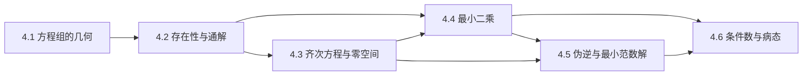

# M04 · 线性方程组

> **一句话**：解方程组的全部问题可以归结为三件事——有没有解、解的集合长什么样、解对误差有多敏感。

## 这个模块解决什么

你已经在 [M03 矩阵与线性映射](../03-矩阵与线性映射/README.md) 里把矩阵看成线性映射。现在反过来问：**给定输出 $\mathbf{b}$，哪些输入 $\mathbf{x}$ 会被送到它？**

这个问题有三种结局，对应三种工具：

- 无解：$\mathbf{b}$ 不在列空间里。退而求其次，找残差最小的 $\mathbf{x}$——**最小二乘**（4.4）。
- 唯一解：$A$ 满列秩且 $\mathbf{b}$ 落在列空间里，直接消元。**秩判据**（4.2）。
- 无穷多解：自由变量决定一个解集。描述它需要**零空间**（4.3），挑出其中最「小」的则要**伪逆**（4.5）。

最后，任何数值计算都躲不开误差。**条件数**（4.6）告诉你问题本身会把误差放大多少倍，这与用哪个算法无关。

## 本模块的现实问题

1. 8 颗卫星、4 个未知数，为什么 1 微秒的时间误差会变成 300 米的位置误差？（[4.1](01-方程组的几何.md)）
2. 12 条链路测 40 个 OD 流量，欠定系统能推出什么、绝对不能推出什么？（[4.2](02-解的存在性与通解.md)）
3. 6 个节点、8 根杆，怎么判断这个桁架是稳定的还是机构？（[4.3](03-齐次方程与零空间.md)）
4. 30 个姿态标定手眼，条件数 400 怎么会把 0.02 mm 放大到 8 mm？（[4.6](06-条件数与病态.md)）

## 概念地图

## 学习顺序

| 顺序 | 文档 | 时间 | 读完你应该能…… |
|---|---|---|---|
| 1 | [4.1 线性方程组的几何](01-方程组的几何.md) | 30 min | 用超平面交集解释唯一/无穷/无解 |
| 2 | [4.2 解的存在性与通解结构](02-解的存在性与通解.md) | 40 min | 用秩判据分类，并写出 $3\times4$ 系统的通解 |
| 3 | [4.3 齐次方程与零空间](03-齐次方程与零空间.md) | 30 min | 求基础解系，用 $n-r$ 数自由度 |
| 4 | [4.4 最小二乘与正规方程](04-最小二乘.md) | 40 min | 手算三点拟合，解释残差正交 |
| 5 | [4.5 伪逆与最小范数解](05-伪逆与最小范数解.md) | 35 min | 用 SVD 写伪逆，区分超定/欠定 |
| 6 | [4.6 条件数与病态问题](06-条件数与病态.md) | 35 min | 手算 $2\times2$ 的 $\kappa$，解释误差上界 |

建议顺序阅读：4.2 依赖 4.1 的几何图像；4.5 同时用到 4.4 的投影与 4.3 的零空间；4.6 放在最后，因为它给前五节的所有计算补上「精度上限」这一层。

## 本模块的大模型钩子

- **约束满足 / 欠定**：微调时 $K$ 个约束、$D$ 个参数，$K<D$ 就有无穷多组权重（4.1、4.2）。
- **零空间与坍缩**：LoRA 的 $\Delta W=BA$ 秩不超过 $r$，至少 $D-r$ 个方向完全不变（4.3）。
- **最小二乘与表示对齐**：线性探针、回归头、$X^\top X$ 的 $[D,D]$ 形状（4.4）。
- **最小范数更新**：约束编辑取 $\Delta W=\Delta H^{+}$，改动最小（4.5）。
- **训练不稳与量化**：权重扰动被 $\kappa(W)$ 放大，bf16 的 $0.4\%$ 相对误差可能变成输出端的大误差（4.6）。

## 自测（读完再做）

1. 两个方程、两个未知数，一定有唯一解吗？给出一个反例。
2. 一个 $3\times4$ 的方程组，系数秩为 2、增广秩为 3。有解吗？若增广秩也是 2，有多少个自由变量？
3. 零空间维数为 0 意味着什么？对方阵和非方阵分别说。
4. 最小二乘的残差与什么正交？为什么这个条件给出正规方程？
5. 伪逆在超定与欠定两种情形下分别给出什么解？
6. 条件数大是算法的问题吗？写出相对误差上界。

自测答案

1. 不一定。$x+y=1$ 与 $x+y=2$ 无解；$x+y=1$ 与 $2x+2y=2$ 有无穷多解。唯一解要求两个秩相等且等于未知数个数。
2. 无解，因为增广秩更大（出现 $0=c$ 的矛盾行）。若增广秩也是 2，则 $r=2<n=4$，自由变量 $4-2=2$ 个。
3. 零空间只有零向量：对 $n\times n$ 方阵意味着满秩、可逆、列线性无关；对 $m\times n$ 矩阵意味着列满秩（$r=n$），映射是单射。
4. 残差与 $A$ 的列空间正交，即 $A^\top\mathbf{r}=\mathbf{0}$。展开 $A^\top(A\hat{\mathbf{x}}-\mathbf{b})=\mathbf{0}$ 就是 $A^\top A\hat{\mathbf{x}}=A^\top\mathbf{b}$。
5. 超定时给最小二乘解（残差最小）；欠定时给最小范数解（在精确解中取 $\|\mathbf{x}\|_2$ 最小）；秩亏时先最小化残差、再在最优解集里取最小范数。
6. 不是。$\kappa(A)$ 由 $A$ 的奇异值比值决定，与算法无关。上界：$\|\delta\mathbf{x}\|/\|\mathbf{x}\|\le\kappa(A)\,\|\delta\mathbf{b}\|/\|\mathbf{b}\|$。

## 本模块文档

- [4.1 线性方程组的几何](01-方程组的几何.md)
- [4.2 解的存在性与通解结构](02-解的存在性与通解.md)
- [4.3 齐次方程与零空间](03-齐次方程与零空间.md)
- [4.4 最小二乘与正规方程](04-最小二乘.md)
- [4.5 伪逆与最小范数解](05-伪逆与最小范数解.md)
- [4.6 条件数与病态问题](06-条件数与病态.md)

配套材料：

- 习题：[m04-习题](../exercises/m04-习题.md) ｜ 答案：[m04-答案](../exercises/m04-答案.md)
- 实验：[lab04 最小二乘](../labs/lab04_最小二乘.py)

---

下一篇 → [4.1 线性方程组的几何](01-方程组的几何.md)
