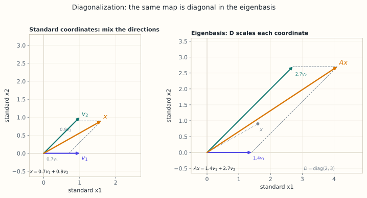

# 6.3 对角化：换基让矩阵变简单

> **本节位置**：模块 6 · 特征值 ｜ **前置**：[2.5 坐标与基变换](../02-向量空间/05-坐标与基变换.md)、[6.2 特征多项式](02-特征多项式与迹.md) ｜ **预计**：40 分钟
>
> **一句话**：如果矩阵有足够多的线性无关特征向量，就把它们当新基；在这组基下，矩阵变成对角矩阵，$A^k$ 也随之变成逐个元素的幂。

## 0. 场景引入

一种濒危裂腹鱼，按 0–1 龄、2–3 龄、4 龄以上分成三组。两年一次的监测给出：幼鱼存活率 0.5、亚成体存活率 0.4，三组的繁殖率分别为 0、2、3（每尾成体两年的产卵存活数）。写成 Leslie 矩阵

$$
L=\begin{bmatrix}0&2&3\\0.5&0&0\\0&0.4&0\end{bmatrix}
$$

第一排是繁殖率，下斜线是存活率——每一列读作「这一年龄组两年后去了哪」。

当前种群 1200 尾。保护区只有 300 万元预算、每年 40 万元巡护费，要决定：投「孵化场」（提高繁殖率），还是投「湿地修复」（提高幼鱼存活率）？这个决定不能撤回：放流的鱼三年后才性成熟。

先算增长。$p_L(\lambda)=\lambda^3-\lambda-0.6$，最大根 $\lambda_1\approx1.2212$：每两年增长 22%，翻倍时间 $\ln2/\ln1.2212\approx3.5$ 年。$1200\times1.2212^{10}\approx8850$ 尾，10 年 7.4 倍。

**代价**：若真实 $\lambda$ 只有 1.17（存活率估高 0.05），10 年后是 5770 尾；若是 1.27，则是 13100 尾。同一笔预算，结论能差一倍以上——估高 0.05 就提前开放捕捞，实际恢复期要多等约 2.7 年。

读完本节，你能回答的三个问题是：

1. 为什么「换成特征向量当坐标」能让 $L^{10}$ 变成三次乘方？
2. 什么情况下这套换坐标会失败，失败时矩阵长什么样？
3. 稳定年龄结构对「该往哪投钱」给出了什么信号？

## 1. 直觉

在标准坐标里，$A$ 既旋转又拉伸，看起来复杂。但如果改用**特征向量当坐标轴**，$A$ 对每个坐标轴只做伸缩：

- 沿 $\mathbf{v}_1$ 方向，长度乘 $\lambda_1$；
- 沿 $\mathbf{v}_2$ 方向，长度乘 $\lambda_2$。

于是同一个变换在新坐标下就是一个对角矩阵 $D=\operatorname{diag}(\lambda_1,\lambda_2)$。对角矩阵的幂极易计算：$D^k=\operatorname{diag}(\lambda_1^k,\lambda_2^k)$。

整个流程像翻译：

$$
\mathbf{x}\xrightarrow{\;P^{-1}\;}\text{特征坐标}\xrightarrow{\;D\;}\text{缩放}\xrightarrow{\;P\;}\text{回到原坐标}
$$

用矩阵写就是 $A=PDP^{-1}$。$P$ 的列是特征向量，负责「翻译回原坐标」；$P^{-1}$ 负责「翻译到特征坐标」。

> 💡 **一句话直觉**：**对角化 = 换一双「顺着特征方向」的眼睛看同一个变换。**

类比边界：这双眼睛要求特征向量能铺满整个空间。若只有一条特征方向（如剪切），就没有足够的「坐标轴」，对角化失败（§4.4）。

*图：$A$ 把 $\mathbf{x}=0.7\mathbf{v}_1+0.9\mathbf{v}_2$ 变成 $A\mathbf{x}=1.4\mathbf{v}_1+2.7\mathbf{v}_2$；在特征基下只剩坐标各自乘 $\lambda_1=2$、$\lambda_2=3$。*

### 1.1 它在现实世界里对应什么

对年龄结构种群，对角化不是数学游戏，而是**把「一群鱼」翻译成「几种年龄模式」**：

| 数学对象 | 种群生态里的对应物 |
|---|---|
| 矩阵 $L$ | Leslie 矩阵：繁殖率在上排，存活率在下斜线 |
| 特征向量 $\mathbf{v}_i$ | 一种稳定的年龄结构（各组比例） |
| 特征值 $\lambda_i$ | 该模式每步的增长率，无量纲 |
| $\lambda_1>1$ | 种群扩张；$\lambda_1<1$ 则走向灭绝 |
| $L^k$ | $k$ 步之后的年龄结构与总数 |

关键在于：不管初始年龄结构多乱，$L^k$ 都会被 $\lambda_1^k$ 主导，年龄结构自动收敛到 $\mathbf{v}_1$ 的比例。本例中 $\mathbf{v}_1\propto(1,0.409,0.134)$，归一化后是 **64.8% : 26.5% : 8.7%**——成体只占 9%，这就是「该往幼鱼存活率投钱」的数学依据。

**量级**：鱼类种群的年增长率 $\lambda$ 常在 1.1–1.3 之间（经验值，随物种与捕捞压力变化），翻倍时间 $\ln2/\ln\lambda$ 落在 2.4–7.3 年。两年一步的 $\lambda=1.22$，折算成年率约 $1.22^{1/2}\approx1.10$，即每年 10%。

**这个对应在哪里失效**：Leslie 矩阵假设繁殖率与存活率不随密度变。真实种群有密度制约、Allee 效应（密度太低反而难繁殖）和环境随机性；这时 $\lambda$ 只在当前密度附近成立，长期预测必须换成非线性模型。把 $\lambda_1$ 当成「永远的年增长率」，是生态学里最常见的误用。

## 2. 定义

### 2.1 可对角化

设 $A\in\mathbb{R}^{n\times n}$。若存在可逆矩阵 $P$ 和对角矩阵 $D$，使 $A=PDP^{-1}$，则称 $A$ **可对角化（diagonalizable）**，$PDP^{-1}$ 称为 $A$ 的**特征分解（eigendecomposition）**。

把 $P$ 按列写成 $P=[\mathbf{p}_1\;\cdots\;\mathbf{p}_n]$，$D=\operatorname{diag}(\lambda_1,\dots,\lambda_n)$。两边右乘 $P$：

$$
AP=PD
$$

左边第 $j$ 列是 $A\mathbf{p}_j$，右边第 $j$ 列是 $\lambda_j\mathbf{p}_j$。所以 $P$ 的每一列都必须是 $A$ 的特征向量，$D$ 的对角元必须是与之一一对应的特征值。**顺序必须对齐。**

### 2.2 等价条件

$A$ 可对角化，当且仅当 $A$ 有 $n$ 个线性无关的特征向量。

必要性：$P$ 可逆意味着它的 $n$ 列线性无关，而它们都是特征向量。充分性：若 $\mathbf{v}_1,\dots,\mathbf{v}_n$ 线性无关，令 $P=[\mathbf{v}_1\;\cdots\;\mathbf{v}_n]$，则 $P$ 可逆且 $AP=PD$，于是 $A=PDP^{-1}$。

用重数语言说：对每个特征值 $\lambda$，几何重数 $g(\lambda)$ 等于代数重数 $a(\lambda)$，等价地 $\sum_\lambda g(\lambda)=n$。两个常用判据：有 $n$ 个互异特征值一定可对角化；有重特征值时，必须逐个验证 $g(\lambda)=a(\lambda)$，否则不可对角化。

## 3. 为什么这样定义

对角化的价值在于**解耦**。在标准基下，$A\mathbf{x}$ 的每个输出分量都依赖所有输入分量；在对角基下，第 $i$ 个特征坐标只依赖自己：$(A\mathbf{x})$ 的第 $i$ 个特征坐标 $=\lambda_i\cdot(\mathbf{x}$ 的第 $i$ 个特征坐标$)$。

一个 $n$ 维耦合系统被拆成 $n$ 个独立的一维系统。这就是为什么对角化能同时解决三件事：

1. **矩阵幂**：$A^k=PD^kP^{-1}$，$D^k$ 只是把对角元取 $k$ 次方；
2. **动力系统**：$\mathbf{x}_{k+1}=A\mathbf{x}_k$ 的每个模式独立按 $\lambda_i^k$ 演化；
3. **矩阵函数**：$e^{A}=Pe^{D}P^{-1}$，$e^D$ 只是对角元取指数（第 6.7 节）。

为什么不把 $P$ 选成别的？因为只有特征向量能同时满足「$P$ 可逆」和「$AP=PD$ 为对角」。这是一组为 $A$ 量身定制的坐标轴。

### 3.1 反事实：把「可逆」放宽会坏在哪

定义里 $P$ 可逆不是装饰。若放宽成「$n$ 个特征向量，允许重复」，$A=\begin{bmatrix}1&1\\0&1\end{bmatrix}$ 只有一条特征方向 $(1,0)$；凑两次得

$$
P=\begin{bmatrix}1&1\\0&0\end{bmatrix},\qquad \det P=0
$$

$P^{-1}$ 不存在。若还硬套 $A^k=PD^kP^{-1}$，形式上 $D=I$，于是「算出」$A^{10}=I$；而直接相乘的正确结果是 $\begin{bmatrix}1&10\\0&1\end{bmatrix}$，右上角差 10——对种群矩阵同样致命，$L^{10}$ 的每个元素都可能错。

第二个反事实：把判据弱化成「能化成上三角」。每个复矩阵都能做到（Schur 分解），条件就没有区分力；更糟的是上三角矩阵的幂仍带 $k$ 因子：$\begin{bmatrix}1&1\\0&1\end{bmatrix}^{10}=\begin{bmatrix}1&10\\0&1\end{bmatrix}$，那个 10 不是任何 $\lambda^k$ 能表示的。**必须对角，不能只到三角**。

## 4. 性质与推导

### 4.1 从 $AP=PD$ 到 $A=PDP^{-1}$

设 $P=[\mathbf{p}_1\;\cdots\;\mathbf{p}_n]$ 可逆，$D=\operatorname{diag}(\lambda_1,\dots,\lambda_n)$。则

$$
AP=P\begin{bmatrix}\lambda_1&&\\&\ddots&\\&&\lambda_n\end{bmatrix}
$$

逐列看就是 $A\mathbf{p}_j=\lambda_j\mathbf{p}_j$。若这些等式成立且 $P$ 可逆，右乘 $P^{-1}$ 得 $A=PDP^{-1}$；反过来，若 $A=PDP^{-1}$，右乘 $P$ 得 $AP=PD$，逐列读出特征方程。两条路等价。

### 4.2 矩阵幂

$$
A^k=(PDP^{-1})(PDP^{-1})\cdots(PDP^{-1})=PD^kP^{-1}
$$

中间的 $P^{-1}P$ 逐对消掉，只剩 $k$ 个 $D$，而 $D^k=\operatorname{diag}(\lambda_1^k,\dots,\lambda_n^k)$。所以 $A^k=P\operatorname{diag}(\lambda_1^k,\dots,\lambda_n^k)P^{-1}$：把 $\mathbf{x}$ 翻译到特征坐标，每个坐标独立乘 $\lambda_i^k$，再翻译回来。这也是 6.1 中 $\mathbf{x}_k=\sum_i c_i\lambda_i^k\mathbf{v}_i$ 的矩阵版本。

### 4.3 互异特征值与相似变换

$n$ 个互不相同的特征值给出 $n$ 个两两线性无关的特征向量（6.1 §4），构成 $\mathbb{R}^n$ 的基，所以 $P$ 可逆。这是**充分不必要**：重特征值也可能凑够 $n$ 个。

$A=PDP^{-1}$ 说明 $A$ 与 $D$ 相似。相似矩阵有相同的特征多项式（6.2 §4.4），所以对角化不改变特征值，只改变「看它的坐标」。$P$ 的列不唯一：特征向量可缩放、可重排，但 $D$ 的对角元集合（计重数）唯一。更完整的相似分类由[弗罗贝尼乌斯](#ref-frobenius-1878)用不变因子与最小多项式给出：可对角化当且仅当最小多项式无重根。

### 4.4 不可对角化时发生了什么

$A=\begin{bmatrix}1&1\\0&1\end{bmatrix}$ 的特征多项式是 $(\lambda-1)^2$，但 $A-I=\begin{bmatrix}0&1\\0&0\end{bmatrix}$ 的秩为 1，特征空间只有一维，只有一个特征方向 $(1,0)$。找不到第二个线性无关的特征向量，$P$ 无法可逆，对角化失败。这种矩阵称为**亏损矩阵（defective matrix）**，它仍可化成 Jordan 标准形（第 6.7 节），只是对角线上会出现 $1$，代表无法消除的「剪切」成分。

## 5. 例子

### 5.1 手算：完整对角化与 $A^{10}$

取 $A=\begin{bmatrix}2&1\\1&2\end{bmatrix}$。6.2 已算出 $\lambda_1=3$、$\lambda_2=1$，特征向量 $\mathbf{v}_1=(1,1)$、$\mathbf{v}_2=(1,-1)$。令

$$
P=\begin{bmatrix}1&1\\1&-1\end{bmatrix},\qquad D=\begin{bmatrix}3&0\\0&1\end{bmatrix}
$$

$P$ 的行列式为 $-2$，故

$$
P^{-1}=\frac{1}{-2}\begin{bmatrix}-1&-1\\-1&1\end{bmatrix}
=\frac12\begin{bmatrix}1&1\\1&-1\end{bmatrix}=\frac12P
$$

先验证 $PDP^{-1}=A$：

$$
PD=\begin{bmatrix}3&1\\3&-1\end{bmatrix},\qquad
PDP^{-1}=\frac12\begin{bmatrix}3&1\\3&-1\end{bmatrix}\begin{bmatrix}1&1\\1&-1\end{bmatrix}
=\frac12\begin{bmatrix}4&2\\2&4\end{bmatrix}
=\begin{bmatrix}2&1\\1&2\end{bmatrix}
$$

再算 $A^{10}$：

$$
A^{10}=P\begin{bmatrix}3^{10}&0\\0&1\end{bmatrix}P^{-1}
=\frac12\begin{bmatrix}3^{10}+1&3^{10}-1\\3^{10}-1&3^{10}+1\end{bmatrix}
=\begin{bmatrix}29525&29524\\29524&29525\end{bmatrix}
$$

因为 $3^{10}=59049$，$(59049+1)/2=29525$。与 6.1 的 $\mathbf{x}_{10}=(29525,29524)$ 完全一致。注意 $A^{10}$ 几乎等于 $29525\begin{bmatrix}1&1\\1&1\end{bmatrix}$：当 $3^{10}\gg1$，$\lambda=1$ 的模式被彻底淹没，矩阵趋近秩 1。

### 5.2 场景：Fibonacci 数列的闭式

Fibonacci 递推 $F_{n+1}=F_n+F_{n-1}$ 可以写成矩阵形式：

$$
\begin{bmatrix}F_{n+1}\\F_n\end{bmatrix}
=\begin{bmatrix}1&1\\1&0\end{bmatrix}\begin{bmatrix}F_n\\F_{n-1}\end{bmatrix}
=F^n\begin{bmatrix}1\\0\end{bmatrix}
$$

$F$ 的特征值是 $\varphi=\frac{1+\sqrt5}{2}\approx1.618$ 与 $\psi=\frac{1-\sqrt5}{2}\approx-0.618$，特征向量 $(\varphi,1)$ 与 $(\psi,1)$。对角化后得到 Binet 公式

$$
F_n=\frac{\varphi^n-\psi^n}{\sqrt5}
$$

$F^{10}$ 把 $(1,0)$ 送到 $(F_{11},F_{10})=(89,55)$。由于 $|\psi|<1$，$n$ 大时 $F_n\approx\varphi^n/\sqrt5$——增长由主特征值决定，这正是 6.6 幂迭代的思想。

### 5.3 场景闭环：从 1200 尾到「开不开放捕捞」

**输入**：3 个年龄组，每 2 年监测一次，12 年共 6 期、每期 3 个数（36 个）；外加每期的捕捞与放流记录。

**计算**：解 $p_L(\lambda)=\lambda^3-\lambda-0.6$ 得 $\lambda_1=1.2212$；再解 $(L-\lambda_1I)\mathbf{v}=\mathbf{0}$ 得 $\mathbf{v}_1=(1,0.409,0.134)$，归一化 $64.8\%:26.5\%:8.7\%$。10 年后的总数用 $\lambda_1^{10}$ 乘当前总量：$1200\times1.2212^{10}\approx8850$ 尾。

**输出**：稳定年龄结构里成体只占 8.7%，说明瓶颈在幼鱼到亚成体的存活（0.5 → 0.4 这一跳），不在产卵量。决策：暂不开放捕捞，预算优先投湿地修复；把「$\lambda$ 的置信下界仍大于 1.1」作为三年后复核的放行条件。

**成本**：$3\times3$ 特征分解不到 $1\ \mu s$；为了给 $\lambda$ 一个区间，做 1000 次参数重采样（每次一次分解加 10 次幂），约 10 ms。真正贵的是 6 期监测的船时与实验室鉴定，那才是 300 万元预算的大头。

**失败条件与兜底**：

- $\lambda$ 估高 0.05：10 年后实际 5770 尾而非 8850，若此时已开放捕捞，恢复计划要多等约 2.7 年。兜底：用区间而非点估计做决策。
- 密度制约：种群接近承载量时 $\lambda$ 会降向 1，「指数增长」外推会高估。兜底：在模型里加 $1-N/K$ 因子，并只用低密度段估计 $\lambda$。
- 矩阵接近亏损：若存活率把两个年龄组的贡献调成同一条链，$P$ 条件数变大，$L^{10}$ 的误差被放大。兜底：检查 $\kappa(P)$，必要时直接用 $L$ 迭代而不是特征分解。

## 6. 常见误区

1. **误区**：只有特征值互不相同才能对角化。**纠正**：互异是充分条件，不是必要条件。$A=3I$ 的特征值 3 重数为 2，但任取两个线性无关向量都是特征向量，$A$ 本身已经是对角阵。
2. **误区**：只要算出 $n$ 个特征值，就一定能对角化。**纠正**：还要看每个重特征值的几何重数。$\begin{bmatrix}1&1\\0&1\end{bmatrix}$ 有两个特征值（都是 1），却不可对角化。
3. **误区**：$P$ 的列可以随便排，只要 $D$ 对就行。**纠正**：$P$ 的第 $j$ 列必须对应 $D$ 的第 $j$ 个对角元；顺序错了，$AP=PD$ 就不成立。
4. **误区**：对角化只适用于对称矩阵。**纠正**：任何有 $n$ 个线性无关特征向量的矩阵都可对角化；对称矩阵的特殊之处是还能选**正交**的 $P$（第 6.4 节）。
5. **误区**：$A=PDP^{-1}$ 中 $P$ 唯一。**纠正**：特征向量可缩放、可重排，$P$ 也随之改变；不唯一，但 $D$ 的对角元集合（计重数）唯一。

## 7. 概念网络

- 前置：[2.5 坐标与基变换](../02-向量空间/05-坐标与基变换.md) —— 对角化就是换基，$P$ 是基变换矩阵。
- 前置：[6.2 特征多项式](02-特征多项式与迹.md) —— 提供特征值与重数，用来判断能否凑齐特征基。
- 后续：[6.4 对称矩阵与谱定理](04-对称矩阵与谱定理.md) —— 对称矩阵一定可对角化，且 $P$ 可正交。
- 后续：[6.6 幂迭代](06-幂迭代与PageRank.md) —— 反复乘 $A$ 会逼近主特征向量，本质是 $D^k$ 中最大项占主导。
- 后续：[6.7 Jordan 标准形](07-Jordan与矩阵函数.md) —— 不可对角化时的补救方案。
- 关联：[7.1 SVD 的几何](../07-SVD/01-SVD的几何.md) —— 任意矩阵的「对角化」推广，用两组正交基。

## 8. 通往大模型：把循环拆成独立模式

**出现位置**：线性循环层或状态空间模型（state space model, SSM）的隐状态更新可写成 $\mathbf{h}_t=A\mathbf{h}_{t-1}+B\mathbf{x}_t$，其中 $A\in\mathbb{R}^{d\times d}$，$d$ 是状态维度。若 $A$ 可对角化，令 $\mathbf{z}_t=P^{-1}\mathbf{h}_t$，则 $\mathbf{z}_t=D\mathbf{z}_{t-1}+P^{-1}B\mathbf{x}_t$：每个分量独立演化。

**为什么需要**：这解释了「记忆」的长度。第 $i$ 个模式经过 $t$ 步后权重是 $\lambda_i^t$；$|\lambda_i|<1$ 时它指数衰减，$|\lambda_i|$ 越接近 1，记忆越长。工程上用对角或对角加低秩的 $A$，就是为了让循环可以并行扫描（parallel scan），把 $O(T)$ 的串行依赖变成可并行的前缀积。若 $A$ 亏损，$t\lambda^{t-1}$ 这样的多项式因子会出现（第 6.7 节），衰减规律不再是纯指数。

**可检验结论**：取 $d=64$、$A$ 为随机对角矩阵，谱半径 0.9，则 $t=100$ 时最慢模式的权重是 $0.9^{100}\approx2.7\times10^{-5}$，几乎完全遗忘；若谱半径为 0.99，则 $0.99^{100}\approx0.366$，仍有三分之一记忆。训练中 $A$ 的特征值若跑到单位圆外，前向就会指数爆炸。

**算错时下游看到什么**：SSM 的并行扫描默认 $A$ 可对角化。若实际 $A$ 亏损（例如两个通道的极点被整定到同一个值），递推里会漏掉 $t\lambda^{t-1}$ 项（第 6.7 节），$T=4096$ 长序列末尾的隐状态被低估；训练表现为长依赖任务（复制、括号匹配）的准确率随长度断崖式下跌，而短序列指标完全正常。另一个隐性错误是 $P$ 病态：$P^{-1}$ 的元素很大，$PD^kP^{-1}$ 出现大数相减，长序列上的数值误差被放大到不可用。

## 9. 练习

1. **概念**：为什么「有 $n$ 个线性无关特征向量」是可对角化的充要条件？重特征值需要额外检查什么？
2. **计算**：对 $A=\begin{bmatrix}4&1\\2&3\end{bmatrix}$，写出 $P$、$D$、$P^{-1}$，并求 $A^3$。
3. **计算**：证明 $A=\begin{bmatrix}1&1\\0&1\end{bmatrix}$ 不可对角化（写出特征值、特征空间、秩）。
4. **判断**：$A=\begin{bmatrix}2&0&0\\0&2&0\\0&0&5\end{bmatrix}$ 可对角化吗？$B=\begin{bmatrix}2&1&0\\0&2&0\\0&0&5\end{bmatrix}$ 呢？
5. **开放**：对角化 $A=PDP^{-1}$ 在数值计算中有什么风险？如果 $P$ 的条件数很大，$A^k$ 的计算会怎样？

参考答案

1. 必要性：$A=PDP^{-1}$ 中 $P$ 可逆，$n$ 列线性无关，且每列都是特征向量。充分性：把 $n$ 个线性无关特征向量按列拼成 $P$，则 $AP=PD$，右乘 $P^{-1}$ 得 $A=PDP^{-1}$。重特征值要检查 $g(\lambda)=a(\lambda)$；只要有一个不相等，就凑不齐 $n$ 个。
2. $\operatorname{tr}=7$、$\det=10$，特征值 $5,2$，特征向量 $(1,1)$、$(1,-2)$。$P=\begin{bmatrix}1&1\\1&-2\end{bmatrix}$，$D=\operatorname{diag}(5,2)$，$P^{-1}=\frac13\begin{bmatrix}2&1\\1&-1\end{bmatrix}$。$A^3=P\operatorname{diag}(125,8)P^{-1}=\begin{bmatrix}86&39\\78&47\end{bmatrix}$。
3. $p_A(\lambda)=(\lambda-1)^2$，$a(1)=2$。$A-I=\begin{bmatrix}0&1\\0&0\end{bmatrix}$ 秩为 1，故 $g(1)=2-1=1\ne2$。只有一条特征方向，凑不齐 $\mathbb{R}^2$ 的基，所以不可对角化。
4. $A$ 可对角化：它已经是对角阵，且 $\lambda=2$ 的特征空间是 $xy$ 平面（二维），$g(2)=a(2)=2$。$B$ 不可对角化：$B-2I=\begin{bmatrix}0&1&0\\0&0&0\\0&0&3\end{bmatrix}$ 秩为 2，$g(2)=3-2=1<2$。
5. 若 $P$ 接近奇异，$P^{-1}$ 的元素很大，$A^k=PD^kP^{-1}$ 会出现大数相减的抵消，数值误差被放大；$P$ 的条件数 $\kappa(P)$ 会把相对误差放大约 $\kappa(P)$ 倍。实际计算矩阵幂用 [Schur 分解](#ref-schur-1909)或直接迭代，避免显式求 $P^{-1}$。

## 10. 一页速记

- $A=PDP^{-1}$，$P$ 的列是特征向量，$D$ 的对角元是按顺序对应的特征值。
- **物理意义 / 现实对应**：特征值 = 每步的长期增长率或衰减率，特征向量 = 稳定的年龄结构／各模式的比例；换基 = 把「耦合的 n 个个体」拆成「独立的 n 个模式」。
- 可对角化 $\Leftrightarrow$ 有 $n$ 个线性无关特征向量 $\Leftrightarrow$ 每个 $\lambda$ 的 $g(\lambda)=a(\lambda)$。
- 互异特征值是充分条件；重特征值必须检查几何重数。
- $A^k=PD^kP^{-1}$，每个模式独立按 $\lambda_i^k$ 缩放。
- 亏损矩阵（如 $\begin{bmatrix}1&1\\0&1\end{bmatrix}$）不可对角化，需用 Jordan 标准形。

## 11. 参考文献与致谢

这一页的知识不是凭空来的。下面列出本页直接借用的原始工作与权威整理；正文中的人名、定理名已链接到对应条目。链接优先指向 DOI、arXiv 或可长期访问的原文存档。

- **弗罗贝尼乌斯（Ferdinand Georg Frobenius, 1878）**：*Ueber lineare Substitutionen und bilineare Formen*。用不变因子与最小多项式刻画相似类，给出「何时存在特征基」的完整判据；本页 $g(\lambda)=a(\lambda)$ 是它在重根情形的具体化。[De Gruyter Brill](https://www.degruyterbrill.com/document/doi/10.1515/crll.1878.84.1/html)
- **舒尔（Issai Schur, 1909）**：*Beiträge zur Theorie der Gruppen linearer homogener Substitutionen*。证明任意复矩阵都可由酉相似化成上三角，这是不可对角化时仍能稳定计算 $A^k$ 与矩阵函数的依据。[Trans. AMS](https://doi.org/10.1090/s0002-9947-1909-1500832-1)
- **Golub 与 Van Loan（2013）**：*Matrix Computations*（4th ed.）。讨论特征向量矩阵 $P$ 的条件数如何放大 $A^k=PD^kP^{-1}$ 的误差，是本页练习 5 的定量版本。[JHU Press](https://doi.org/10.56021/9781421407944)

---

下一篇 → [6.4 对称矩阵与谱定理](04-对称矩阵与谱定理.md)
