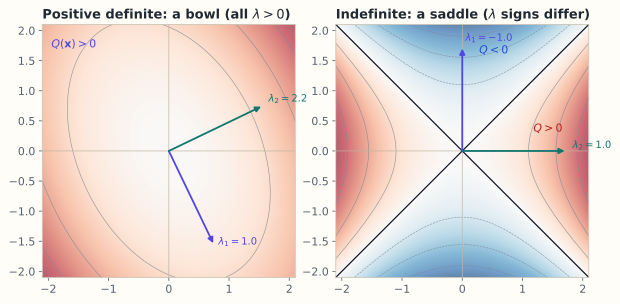

# 6.5 二次型与正定性

> **本节位置**：模块 6 · 特征值 ｜ **前置**：[6.4 对称矩阵与谱定理](04-对称矩阵与谱定理.md) ｜ **预计**：40 分钟
>
> **一句话**：二次型 $\mathbf{x}^\top A\mathbf{x}$ 给每个方向分配一个「高度」；正定意味着这个高度在所有非零方向上都为正，几何上是一个开口向上的碗。

## 0. 场景引入

一只量化基金管着 5 亿元，只配三类资产：A 年化波动 20%、B 12%、C 8%。用 1000 个交易日的日收益估出相关系数 $\rho_{AB}=0.6$、$\rho_{AC}=0.2$、$\rho_{BC}=0.1$，得到一个 $3\times3$ 的协方差矩阵 $\Sigma$。这是季度再平衡会，桌上只有一份日收益表和一页风险报告。

基金经理要决定：允许卖空，还是加「权重 $\ge0$」的约束？风险模型说，权重向量 $\mathbf{w}$（$\sum w_i=1$）的组合风险是 $\mathbf{w}^\top\Sigma\mathbf{w}$——一个二次型。注意这个最优组合与预期收益无关，只由 $\Sigma$ 决定；它回答的是「给定这三类资产，最小能压到多少波动」。不解约束的最小方差组合是 $\mathbf{w}=(-6.3\%,34.4\%,71.9\%)$：为了压波动，它宁愿卖空 6.3% 的 A。年化波动 6.9%，等权则是 10.4%。

**决策**：接受这个带卖空的组合，还是加非负约束？**代价**：若 $\Sigma$ 估错——比如 $\rho_{AB}$ 实际是 0.70——卖空比例会从 6.3% 变成 11.0%，杠杆敞口几乎翻倍。按 5 亿元规模算，多出的约 2400 万元空头在市场踩踏时可能被强制平仓。

读完本节，你能回答的三个问题是：

1. 为什么「组合风险永远 $\ge0$」等价于 $\Sigma$ 半正定？
2. 不画图、不枚举方向，怎么用少数几个数判断这个碗朝上还是朝下？
3. 当 $\Sigma$ 非正定时，优化器会给你什么荒谬的答案？

## 1. 直觉

把 $\mathbf{x}$ 限制在单位圆上，$\mathbf{x}^\top A\mathbf{x}$ 随方向变化。对 $A=\begin{bmatrix}2&1\\1&2\end{bmatrix}$，$Q(\mathbf{x})=2x_1^2+2x_1x_2+2x_2^2$：取 $(1,0)$ 得 2，取 $(1,1)/\sqrt2$ 得 3，取 $(1,-1)/\sqrt2$ 得 1，三个方向都为正。

用 6.4 的谱分解，令 $\mathbf{x}=Q\mathbf{y}$，则 $Q(\mathbf{x})=\sum_i\lambda_i y_i^2$。**二次型在主轴坐标下没有交叉项，只是把各坐标平方后按特征值加权。** 于是所有 $\lambda_i>0$ 时每个方向都向上（碗）；有正有负时有的向上、有的向下（鞍）；有零时某个方向完全平坦（槽）。

*图：左图 $A=\begin{bmatrix}2&0.5\\0.5&1.2\end{bmatrix}$ 的两个特征值都为正，等高线是闭合椭圆，$Q$ 在每个方向都向上弯；右图 $B=\begin{bmatrix}1&0\\0&-1\end{bmatrix}$ 的特征值是 $1$ 和 $-1$，等高线是双曲线，沿一个特征方向 $Q>0$、沿另一个方向 $Q<0$。*

> 💡 **一句话直觉**：**正定 = 二次型在每个方向上都是「向上弯」的；特征值就是各主轴的弯曲刚度。**

类比边界：这里的「向上」是代数符号，不是物理高度；正定也不要求矩阵元素为正，只看所有特征值的符号。

### 1.1 它在现实世界里对应什么

在组合风险里，二次型就是**风险的平方**：

| 数学对象 | 组合风险里的对应物 |
|---|---|
| 权重 $\mathbf{w}$ | 每类资产各投多少，和为 1 |
| 二次型 $\mathbf{w}^\top\Sigma\mathbf{w}$ | 组合方差，单位是「年化波动²」 |
| 特征值 $\lambda_i$ | 各主成分方向上的风险贡献 |
| 正定 | 任何非零持仓都有正风险 |
| 半正定 | 存在零风险组合（完美对冲），$\Sigma$ 奇异 |
| 不定 | 算出负方差，说明 $\Sigma$ 估坏了 |

年化波动 20% 的资产，方差是 $0.04$；波动 7% 的组合，方差约 $0.0047$。所以这个「碗」在数值上很扁：$\lambda_{\max}/\lambda_{\min}$ 可能很大，优化器稍微一歪，权重就跑到极端——这就是 Markowitz 模型著名的「误差最大化器」现象。

**量级**：单资产年化方差在 $0.006$–$0.04$ 之间（对应波动 8%–20%），组合方差通常落在同一区间；$\Sigma$ 的条件数在 3 类资产时约 8，到 500 只股票时常到 $10^3$–$10^5$ 量级（经验值，随样本长度与资产相关性变化）。

**这个对应在哪里失效**：方差只描述二阶矩。真实风险有厚尾、流动性枯竭、危机时相关性一起趋近 1；正态假设下「6.9% 波动」对应的极端损失，在实盘里可能被低估一个数量级。另外 $\Sigma$ 是时变的，用 1000 天估出来的碗，明天可能已经换了形状。

## 2. 定义

### 2.1 二次型

设 $A\in\mathbb{R}^{n\times n}$，**二次型（quadratic form）** 是 $Q(\mathbf{x})=\mathbf{x}^\top A\mathbf{x}=\sum_{i,j}a_{ij}x_ix_j$。由于 $\mathbf{x}^\top A\mathbf{x}=\mathbf{x}^\top\left(\frac{A+A^\top}{2}\right)\mathbf{x}$，只有对称部分起作用。所以讨论二次型时总可假设 $A=A^\top$；否则特征值判据不适用。

### 2.2 五类定性

设 $A$ 对称：

| 名称 | 条件 | 几何 |
|---|---|---|
| 正定（positive definite） | 对所有 $\mathbf{x}\neq\mathbf{0}$，$Q(\mathbf{x})>0$ | 开口向上的碗 |
| 半正定（positive semidefinite） | 对所有 $\mathbf{x}$，$Q(\mathbf{x})\ge0$ | 碗底有平坦方向 |
| 负定（negative definite） | 对所有 $\mathbf{x}\neq\mathbf{0}$，$Q(\mathbf{x})<0$ | 倒扣的碗 |
| 半负定（negative semidefinite） | 对所有 $\mathbf{x}$，$Q(\mathbf{x})\le0$ | 倒扣的槽 |
| 不定（indefinite） | 既有 $Q>0$ 又有 $Q<0$ | 鞍面 |

记号：$A\succ0$ 正定，$A\succeq0$ 半正定，$A\prec0$、$A\preceq0$ 类似。

### 2.3 三条判据

**特征值判据**：$A$ 正定 $\Leftrightarrow$ 所有 $\lambda_i>0$；半正定 $\Leftrightarrow$ 所有 $\lambda_i\ge0$；不定 $\Leftrightarrow$ 特征值有正有负。

**[Sylvester 判据（Sylvester's criterion）](#ref-sylvester-1852)**：$A$ 正定 $\Leftrightarrow$ 所有**顺序主子式（leading principal minors）** $\Delta_k>0$，$k=1,\dots,n$，其中 $\Delta_k$ 是左上角 $k\times k$ 子矩阵的行列式。

**[Cholesky 判据](#ref-higham-2002)**：$A$ 正定 $\Leftrightarrow$ 存在对角元为正的下三角矩阵 $L$，使 $A=LL^\top$。

### 2.4 与谱分解的关系

由 $A=Q\Lambda Q^\top$，令 $\mathbf{y}=Q^\top\mathbf{x}$（正交变换不改长度），则 $Q(\mathbf{x})=\mathbf{y}^\top\Lambda\mathbf{y}=\sum_{i}\lambda_i y_i^2$。换到主轴坐标后，二次型变成 $n$ 个独立平方项，系数就是特征值；所有定性判断都从这条式子来。

## 3. 为什么这样定义

为什么要求「所有非零方向」而不是「某些方向」？因为优化和物理关心**全局**形状：只要有一个方向向下弯，那个方向就能让函数继续下降，极小点不成立。要求对所有 $\mathbf{x}\neq\mathbf{0}$ 成立，才排除这种可能。

为什么用二次型？一次型 $\mathbf{b}^\top\mathbf{x}$ 没有弯曲信息；二次型是 Taylor 展开中第一个能描述弯曲的项，所以 Hessian、协方差、能量都自然落在二次型上。

为什么正定要求对称？若 $A$ 不对称，$\mathbf{x}^\top A\mathbf{x}$ 只看到对称部分，特征值判据会给出错误结论。例如 $\begin{bmatrix}1&3\\0&1\end{bmatrix}$ 的特征值是 $1,1$，但二次型 $x_1^2+3x_1x_2+x_2^2$ 在 $(1,-1)$ 处为 $-1$，并不正定。**先对称化，再判定。**

### 3.1 反事实：只查「每个资产自己的波动」会坏在哪

一个常见的错误判据是「对角元都为正，所以正定」。取

$$
\Sigma=\begin{bmatrix}1&-0.9&-0.9\\-0.9&1&-0.9\\-0.9&-0.9&1\end{bmatrix}
$$

三个对角元都是 1，看起来每个资产都有正风险。但取等权 $\mathbf{w}=(1,1,1)$：

$$
\mathbf{w}^\top\Sigma\mathbf{w}=3+2\cdot3\cdot(-0.9)=3-5.4=-2.4
$$

组合方差是 $-2.4$。这不是「风险很小」，而是**负的方差**：优化器会认为存在无风险套利，把仓位加到无穷。现实中三种资产两两强负相关（$-0.9$）不可能同时成立——这个 $\Sigma$ 根本不是合法的协方差矩阵。

第二个反事实：把数据估出的 $\Sigma$ 直接丢给优化器、不做检查。若收益序列有缺失或异步（不同市场收盘时间不同），估出的矩阵常带一个 $-10^{-6}$ 量级的特征值；Cholesky 在那一行开根号失败，程序抛异常。看起来是个「数值小问题」，实际是模型在告诉你：这组数据撑不起一个合法协方差。

## 4. 性质与推导

### 4.1 特征值判据的证明

若所有 $\lambda_i>0$，对 $\mathbf{x}\neq\mathbf{0}$，有 $\mathbf{y}=Q^\top\mathbf{x}\neq\mathbf{0}$，故 $Q(\mathbf{x})=\sum_i\lambda_i y_i^2>0$（至少一个 $y_i\neq0$）。反过来，若存在 $\lambda_k\le0$，取 $\mathbf{y}=\mathbf{e}_k$，则 $\mathbf{x}=Q\mathbf{e}_k=q_k\neq\mathbf{0}$，而 $Q(\mathbf{x})=\lambda_k\le0$，不满足正定。半正定与不定的证明同理。

### 4.2 Sylvester 判据

对对称 $A$ 做不带行交换的 LU 分解，$A=LDL^\top$，$D=\operatorname{diag}(d_1,\dots,d_n)$ 是主元。顺序主子式满足 $\Delta_k=d_1d_2\cdots d_k$，所以 $\Delta_k>0$ 对每个 $k$ 成立，等价于所有主元 $d_k>0$，等价于 $A$ 正定。直观上，$\Delta_k$ 是前 $k$ 个坐标张成的子空间上的体积缩放，全为正说明每个前缀子空间上的二次型都向上弯。

注意：半正定不能只查顺序主子式。$\begin{bmatrix}0&0\\0&-1\end{bmatrix}$ 的顺序主子式是 $0,0$，但它不定（取 $\mathbf{x}=(0,1)$ 得 $-1$）。半正定要求**所有**主子式 $\ge0$。

### 4.3 Cholesky 分解

若 $A$ 正定，存在唯一的下三角 $L$（对角元为正）使 $A=LL^\top$。逐元素计算：

$$
l_{jj}=\sqrt{a_{jj}-\sum_{k<j}l_{jk}^2},\qquad
l_{ij}=\frac{a_{ij}-\sum_{k<j}l_{ik}l_{jk}}{l_{jj}}\quad(i>j)
$$

从左上到右下，每次用已算出的 $L$ 元素消去当前行列的已知部分，再开方或相除。正定保证根号内恒为正，算法不会失败；若出现负数或零，说明矩阵不是正定（或数值上接近奇异）。

### 4.4 正定与凸性

二次函数 $f(\mathbf{x})=\mathbf{x}^\top A\mathbf{x}-2\mathbf{b}^\top\mathbf{x}$ 的 Hessian 是 $2A$，故 $A\succ0\iff f$ [严格凸](#ref-boyd-2004) $\iff$ 有唯一极小点 $\mathbf{x}^*=A^{-1}\mathbf{b}$（令梯度 $2A\mathbf{x}-2\mathbf{b}=\mathbf{0}$）。若 $A$ 半正定，极小点可能不唯一（沿零特征值方向平坦）；若 $A$ 不定，驻点是鞍点。另外，对任意矩阵 $M$，$A=M^\top M$ 总是半正定：$\mathbf{x}^\top M^\top M\mathbf{x}=\|M\mathbf{x}\|^2\ge0$，零空间等于 $M$ 的零空间。

## 5. 例子

### 5.1 手算：正定矩阵的三种检验

取 $A=\begin{bmatrix}2&1\\1&2\end{bmatrix}$，$Q=2x_1^2+2x_1x_2+2x_2^2$。配方得

$$
Q=2\left(x_1+\frac{x_2}{2}\right)^2+\frac32x_2^2
$$

两个平方项系数为正，且不同时为零（除非 $\mathbf{x}=\mathbf{0}$），故正定。特征值为 $3,1$，都大于 0；Sylvester：$\Delta_1=2>0$、$\Delta_2=4-1=3>0$；Cholesky：

$$
L=\begin{bmatrix}\sqrt2&0\\ \frac{1}{\sqrt2}&\sqrt{\frac32}\end{bmatrix},\qquad
LL^\top=\begin{bmatrix}2&1\\1&\frac12+\frac32\end{bmatrix}=\begin{bmatrix}2&1\\1&2\end{bmatrix}
$$

水平集 $Q=3$ 在主轴坐标下是 $y_1^2+\frac{y_2^2}{3}=1$：椭圆沿 $q_1=(1,1)/\sqrt2$ 的半轴为 1，沿 $q_2=(1,-1)/\sqrt2$ 的半轴为 $\sqrt3$。短轴方向对应大特征值 3——曲率越大，等高线越密。

### 5.2 反例：对角线为正，却不定

取 $A=\begin{bmatrix}1&2\\2&1\end{bmatrix}$，$Q=x_1^2+4x_1x_2+x_2^2$。对角线都是 1，看起来「正」，但 $\Delta_1=1>0$、$\Delta_2=1-4=-3<0$，Sylvester 判据失败。特征值是 $3$ 和 $-1$，主轴坐标下 $Q=3y_1^2-y_2^2$：沿 $(1,1)/\sqrt2$ 向上弯，沿 $(1,-1)/\sqrt2$ 向下弯，是鞍面。取 $\mathbf{x}=(1,-1)$ 直接验证：$Q=1-4+1=-2<0$。

### 5.3 场景：损失曲面的曲率

设 $A=\begin{bmatrix}2&1\\1&2\end{bmatrix}$、$\mathbf{b}=(1,0)$，损失 $f(\mathbf{x})=\mathbf{x}^\top A\mathbf{x}-2\mathbf{b}^\top\mathbf{x}$。Hessian 是 $2A$，特征值 $6$ 和 $2$，条件数 $\kappa=3$。极小点满足 $A\mathbf{x}^*=\mathbf{b}$：

$$
\mathbf{x}^*=A^{-1}\mathbf{b}=\frac13\begin{bmatrix}2&-1\\-1&2\end{bmatrix}\begin{bmatrix}1\\0\end{bmatrix}
=\begin{bmatrix}2/3\\-1/3\end{bmatrix}
$$

最小损失 $f(\mathbf{x}^*)=-\mathbf{b}^\top A^{-1}\mathbf{b}=-2/3$。梯度下降的稳定步长上限是 $2/\lambda_{\max}(2A)=2/6=1/3$；超过它，迭代会在最陡方向上来回震荡。

### 5.4 场景闭环：5 亿元、3 类资产、一次再平衡

**输入**：3 类资产 × 1000 个交易日的日收益，共 3000 个数（fp64 约 24 KB）；组合规模 5 亿元。

**计算**：估出 $3\times3$ 的 $\Sigma$（元素量级 $10^{-2}$），解 $\min\mathbf{w}^\top\Sigma\mathbf{w}$ s.t. $\mathbf{1}^\top\mathbf{w}=1$，得 $\mathbf{w}\propto\Sigma^{-1}\mathbf{1}=(-6.3\%,34.4\%,71.9\%)$，年化波动 6.88%。加上 $\mathbf{w}\ge0$ 后重解（把 A 压到 0，在 B、C 上重新分配），得 $(0,28.8\%,71.2\%)$，波动 6.95%。

**输出**：卖空 6.3% 的 A，只把波动从 6.95% 降到 6.88%，便宜 0.07 个百分点；代价是 3150 万元空头敞口（$5\ \text{亿}\times6.3\%$）和借券成本。决策：加非负约束，放弃这点优化。

**成本**：$3\times3$ 求逆与 Cholesky 都是微秒级，真正的成本在估计。扩到 5000 只股票时 $\Sigma$ 是 $5000^2\times8\ \mathrm{B}=200$ MB，Cholesky 约 $\frac13n^3=4.2\times10^{10}$ FLOP，单核 10 GFLOP/s 下约 4 秒；每天重估一次可以接受，但估计误差远大于计算误差。

**失败条件与兜底**：

- $\Sigma$ 非正定（缺失值、异步收盘、资产数多于天数）：Cholesky 在开根号处报错。兜底：收缩估计把 $\Sigma$ 拉向对角阵，或加 $\lambda I$ 保证最小特征值 $\ge\lambda$。
- 相关系数估错 0.1：卖空从 6.3% 变 11%，如 §0 所示。兜底：对 $\rho$ 做区间敏感性分析，并硬性限制单资产权重与总杠杆。
- 样本太短：1000 天估 3 类资产还行，估 5000 只股票则是 $n\gg T$，$\Sigma$ 必奇异。兜底：换因子模型 $\Sigma=B\Phi B^\top+\Psi$（只有 $k$ 个因子），或改用风险平价。

## 6. 常见误区

1. **误区**：对角线元素都为正，矩阵就正定。**纠正**：交叉项可以破坏正定性。$\begin{bmatrix}1&2\\2&1\end{bmatrix}$ 对角元全正，但特征值 $3,-1$，不定。
2. **误区**：顺序主子式全 $\ge0$ 就是半正定。**纠正**：$\begin{bmatrix}0&0\\0&-1\end{bmatrix}$ 的顺序主子式为 $0,0$，却不定；半正定要查**所有**主子式，或直接看特征值。
3. **误区**：正定就是所有元素为正。**纠正**：正定是谱条件，与单个元素符号无关；$\begin{bmatrix}2&-1\\-1&2\end{bmatrix}$ 有负元素，仍然正定（特征值 $3,1$）。
4. **误区**：不对称矩阵也能直接用特征值判据。**纠正**：先取对称部分 $(A+A^\top)/2$；$\begin{bmatrix}1&3\\0&1\end{bmatrix}$ 的特征值为正，但二次型不定。
5. **误区**：半正定矩阵一定可逆。**纠正**：半正定允许 $0$ 特征值，此时奇异；正定才保证可逆且所有特征值严格为正。

## 7. 概念网络

- 前置：[6.4 对称矩阵与谱定理](04-对称矩阵与谱定理.md) —— $A=Q\Lambda Q^\top$ 把二次型化成 $\sum_i\lambda_i y_i^2$。
- 前置：[6.3 对角化](03-对角化.md) —— 正定矩阵一定可对角化，且特征基正交。
- 后续：[6.6 幂迭代](06-幂迭代与PageRank.md) —— Rayleigh 商在单位球上的极值就是最大/最小特征值。
- 关联：[1.3 点积](../01-向量与几何/03-点积.md) —— $\mathbf{x}^\top A\mathbf{x}$ 是加权内积的平方，$A$ 正定时它定义一个新内积。
- 关联：[8.4 Hessian 与二阶近似](../08-微积分与优化/04-Hessian与二阶近似.md) —— 正定 Hessian 是局部极小的二阶条件。
- 关联：[8.6 凸性](../08-微积分与优化/06-凸性.md) —— 正定 $\Leftrightarrow$ 严格凸。

## 8. 通往大模型：损失曲面是不是一个碗

**出现位置**：训练损失 $L(\theta)$ 在参数 $\theta\in\mathbb{R}^{d}$ 附近的二阶近似 $\frac12\Delta\theta^\top H\Delta\theta$，$H\in\mathbb{R}^{d\times d}$ 对称，正定性决定这个点是不是碗底。微调中 LoRA 的更新 $\Delta W=BA$ 只在一个低维子空间内改变曲率，$B^\top HB$ 的小尺寸特征值决定该子空间是否正定。

**为什么需要**：正定 $\Leftrightarrow$ 严格凸 $\Leftrightarrow$ 局部极小即全局极小。若 Hessian 有负特征值，梯度下降会沿该方向逃逸，训练表现为 loss 先降后升或卡在鞍点。$\lambda_{\max}$ 还给出学习率上限：步长超过 $2/\lambda_{\max}$ 就会在最陡方向发散。Cholesky 则用于高斯采样：若协方差 $\Sigma=LL^\top$，则 $\mathbf{x}=\mu+L\mathbf{z}$（$\mathbf{z}\sim\mathcal{N}(0,I)$）就得到 $\mathcal{N}(\mu,\Sigma)$；形状 $[D,D]$ 的 $\Sigma$ 对应 $[D]$ 的样本。

**可检验结论**：对二次损失，若 Hessian 特征值为 200 和 2，则 $\kappa=100$，稳定步长上限 $2/200=0.01$；取步长 $1/200=0.005$ 时，最慢方向每步缩小 $1-1/\kappa=0.99$ 倍，约 100 步才衰减到 $1/e$。这解释了为什么条件数大的问题需要预条件或二阶方法。用 `np.linalg.cholesky(H)` 是否成功，可以快速检验对称矩阵是否正定（失败即非正定）。

**算错时下游看到什么**：把非正定的矩阵送进 `cholesky`，LAPACK 会在某个主元上返回负值或直接报错。如果代码用 `try/except` 吞掉异常继续跑，协方差模型会给出负方差，下游的仓位优化器把它当成「免费的风险抵消」，于是加杠杆；训练里的对应现象是二阶优化器（Newton、K-FAC）在鞍点附近算出上升方向，loss 不降反升。另一个常见现象是 `cholesky` 成功但条件数 $10^{12}$：分解在数学上合法，数值上无意义，采样出的高斯几乎全部落在一条直线上。

## 9. 练习

1. **概念**：为什么正定性要求「对所有 $\mathbf{x}\neq\mathbf{0}$」，而不是「存在某个 $\mathbf{x}$ 使 $Q>0$」？
2. **计算**：用 Sylvester 判据判断 $A=\begin{bmatrix}2&-1\\-1&2\end{bmatrix}$ 是否正定，并求 Cholesky 分解。
3. **计算**：$A=\begin{bmatrix}1&1\\1&1\end{bmatrix}$ 是正定还是半正定？写出 $Q(\mathbf{x})$ 并说明零方向。
4. **开放**：对 $f(\mathbf{x})=\mathbf{x}^\top A\mathbf{x}-2\mathbf{b}^\top\mathbf{x}$，$A=\begin{bmatrix}2&1\\1&2\end{bmatrix}$、$\mathbf{b}=(1,0)$，求极小点、最小损失与 Hessian 特征值，并给出梯度下降的稳定步长上限。

参考答案

1. 正定要排除「某个方向向下弯」的可能；只要存在一个 $\mathbf{x}$ 使 $Q(\mathbf{x})\le0$，该方向就能让函数继续下降，极小点不成立。要求所有非零方向为正，才是全局的碗。
2. $\Delta_1=2>0$，$\Delta_2=4-1=3>0$，正定。$L=\begin{bmatrix}\sqrt2&0\\-1/\sqrt2&\sqrt{3/2}\end{bmatrix}$，验证 $LL^\top=\begin{bmatrix}2&-1\\-1&2\end{bmatrix}$。
3. $Q=x_1^2+2x_1x_2+x_2^2=(x_1+x_2)^2\ge0$，半正定；特征值 $2,0$，零方向 $(1,-1)/\sqrt2$，$A$ 奇异。
4. $\mathbf{x}^*=A^{-1}\mathbf{b}=(2/3,-1/3)$，$f(\mathbf{x}^*)=-2/3$；Hessian $2A$ 的特征值 $6,2$，稳定步长上限 $2/6=1/3$。

## 10. 一页速记

- $Q(\mathbf{x})=\mathbf{x}^\top A\mathbf{x}$，只看对称部分 $(A+A^\top)/2$。
- **物理意义 / 现实对应**：二次型 = 能量、风险（方差）或距离的平方；特征值 = 各主轴的弯曲刚度或方差；正定 = 碗底，半正定 = 有平坦方向的槽，不定 = 鞍面。
- 正定 $\Leftrightarrow$ 所有特征值 $>0$ $\Leftrightarrow$ 所有顺序主子式 $>0$ $\Leftrightarrow$ 存在正对角 Cholesky 因子 $L$（$A=LL^\top$）。
- 半正定允许零特征值，此时矩阵奇异、等高线有平坦方向。
- 主轴坐标下 $Q=\sum_i\lambda_i y_i^2$：正负号决定碗、槽、鞍。
- 正定 Hessian $\Leftrightarrow$ 严格凸；$\lambda_{\max}$ 决定梯度下降的步长上限 $2/\lambda_{\max}$。

## 11. 参考文献与致谢

这一页的知识不是凭空来的。下面列出本页直接借用的原始工作与权威整理；正文中的人名、定理名已链接到对应条目。链接优先指向 DOI、arXiv 或可长期访问的原文存档。

- **西尔维斯特（James Joseph Sylvester, 1852）**：*A demonstration of the theorem that every homogeneous quadratic polynomial is reducible by real orthogonal substitutions to the form of a sum of positive and negative squares*。证明二次型在正交替换下的惯性定律（正、负平方项个数不变），本页的 Sylvester 判据即以他命名。[Phil. Mag.](https://doi.org/10.1080/14786445208647087)
- **海厄姆（Nicholas J. Higham, 2002）**：*Accuracy and Stability of Numerical Algorithms*（2nd ed.）。用专章分析 Cholesky 分解的舍入误差与正定性检测，说明为什么 $A=LL^\top$ 能当作正定的数值判据。[SIAM](https://doi.org/10.1137/1.9780898718027)
- **Boyd 与 Vandenberghe（2004）**：*Convex Optimization*。把「Hessian 正定 $\Leftrightarrow$ 严格凸 $\Leftrightarrow$ 唯一极小」写成可检验的凸性判据，本页 §4.4 与 §8 的优化解释以此为标准表述。[Cambridge](https://doi.org/10.1017/CBO9780511804441)

---

下一篇 → [6.6 幂迭代与 PageRank](06-幂迭代与PageRank.md)
