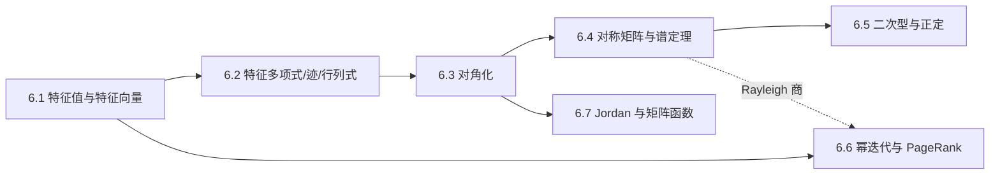

# M06 · 特征值

> **一句话**：矩阵会把大多数方向拧弯，只有少数方向保持方向不变；找到这些方向，就能把矩阵的幂、微分方程、二次型和迭代过程全部拆成「一维的伸缩」。

## 这个模块解决什么

学完前面几个模块，你会算矩阵乘法、行列式、秩，也能解线性方程组。但还有一类问题没有回答：

- 反复用一个矩阵乘向量，最后会停在哪里？为什么？
- 一个 $1000\times1000$ 的矩阵，能不能用几个数概括它的「本质」？
- 为什么对称矩阵总有互相垂直的主方向？
- 损失函数在极小点附近，怎么判断它是一个碗还是马鞍？
- 几十亿个网页，怎么在不求逆的前提下排出名次？

这些问题的共同答案是**特征分解**。本模块从 $A\mathbf{v}=\lambda\mathbf{v}$ 出发，依次建立：

1. 特征值与特征向量的定义、几何与动力系统解释（6.1）；
2. 特征多项式、迹、行列式与重数（6.2）；
3. 对角化与矩阵幂（6.3）；
4. 对称矩阵的谱定理（6.4）；
5. 二次型、正定性与 Cholesky（6.5）；
6. 幂迭代、马尔可夫链与 PageRank（6.6）；
7. 不可对角化时的 Jordan 标准形与矩阵函数（6.7）。

## 概念地图

实线是建议阅读顺序，虚线是概念上的复用关系。

## 学习顺序

| 顺序 | 文档 | 时间 | 读完你应该能…… |
|---|---|---|---|
| 1 | [6.1 特征值与特征向量：不转向的方向](01-特征值与特征向量.md) | 35 min | 手算 $2\times2$ 特征值，解释动力系统为何收敛到主方向 |
| 2 | [6.2 特征多项式、迹与行列式](02-特征多项式与迹.md) | 35 min | 写出特征多项式，用迹/行列式校验，区分代数与几何重数 |
| 3 | [6.3 对角化：换基让矩阵变简单](03-对角化.md) | 40 min | 判断可对角化，写出 $A=PDP^{-1}$，手算 $A^k$ |
| 4 | [6.4 对称矩阵与谱定理](04-对称矩阵与谱定理.md) | 40 min | 正交对角化，解释特征值实、特征向量正交 |
| 5 | [6.5 二次型与正定](05-二次型与正定.md) | 40 min | 用特征值/Sylvester/Cholesky 判断正定，联系凸性 |
| 6 | [6.6 幂迭代与 PageRank](06-幂迭代与PageRank.md) | 35 min | 推导收敛比，手算三节点 PageRank |
| 7 | [6.7 Jordan 标准形与矩阵函数](07-Jordan与矩阵函数.md) | 35 min | 解释 Jordan 块、$e^{At}$ 与多项式因子 |

总时长约 260 分钟。建议顺序阅读 6.1–6.6；6.7 是进阶内容，可以第二轮再读。

## 本模块的大模型钩子

- **稳定性**：残差流/循环层线性化后，谱半径决定信号指数增长还是衰减（6.1）
- **谱与条件数**：Hessian、协方差矩阵的特征值给出曲率、总方差与条件数（6.2、6.4）
- **解耦**：$A=PDP^{-1}$ 把耦合系统拆成独立模式，状态空间模型靠它并行扫描（6.3）
- **损失曲面**：正定 Hessian $\Leftrightarrow$ 严格凸；$\lambda_{\max}$ 决定学习率上限（6.5）
- **幂迭代**：估计谱范数、求主奇异向量，是谱归一化的核心循环（6.6）
- **PageRank 类稳态**：图上的随机游走收敛到平稳分布，阻尼因子控制收敛速度（6.6）
- **矩阵指数**：Neural ODE 与连续时间模型的解，非正规矩阵可能瞬态增长（6.7）

## 自测（读完再做）

1. 特征值定义中为什么要求 $\mathbf{v}\neq\mathbf{0}$？$\lambda=0$ 意味着什么？
2. 对 $A=\begin{bmatrix}2&1\\1&2\end{bmatrix}$，求特征值、特征向量，并写出 $A=PDP^{-1}$。
3. 一个 $3\times3$ 矩阵的迹为 6、行列式为 6，两个特征值是 1 和 2，第三个是多少？为什么？
4. 判断 $A=\begin{bmatrix}1&1\\0&1\end{bmatrix}$ 能否对角化；若不能，Jordan 形是什么？
5. 对 $A=\begin{bmatrix}2&2\\2&-1\end{bmatrix}$，求正交矩阵 $Q$ 与对角阵 $\Lambda$，使 $A=Q\Lambda Q^\top$。
6. 对 $A=\begin{bmatrix}3&1\\1&3\end{bmatrix}$，从 $\mathbf{x}_0=(1,0)$ 做一次幂迭代；收敛比是多少？PageRank 的阻尼因子 $d$ 起什么作用？

自测答案

1. 若 $\mathbf{v}=\mathbf{0}$，则 $A\mathbf{0}=\lambda\mathbf{0}$ 对一切 $\lambda$ 成立，特征值不再由矩阵决定；零向量也没有方向。$\lambda=0$ 意味着存在非零向量被 $A$ 压成零，即 $A$ 奇异、不可逆。
2. $\operatorname{tr}=4$、$\det=3$，特征值 $3,1$，特征向量 $(1,1)$、$(1,-1)$。$P=\begin{bmatrix}1&1\\1&-1\end{bmatrix}$，$D=\operatorname{diag}(3,1)$，$P^{-1}=\frac12P$。
3. $\lambda_3=3$：特征值之和等于迹，$1+2+\lambda_3=6$；积为 $1\cdot2\cdot3=6=\det$，吻合。
4. 不能。$p_A(\lambda)=(\lambda-1)^2$，但 $A-I=\begin{bmatrix}0&1\\0&0\end{bmatrix}$ 秩为 1，几何重数 $2-1=1<2$。Jordan 形是 $\begin{bmatrix}1&1\\0&1\end{bmatrix}$ 本身。
5. 特征值 $3,-2$；特征向量 $(2,1)$、$(1,-2)$。$Q=\frac{1}{\sqrt5}\begin{bmatrix}2&1\\1&-2\end{bmatrix}$，$\Lambda=\operatorname{diag}(3,-2)$。
6. $A\mathbf{x}_0=(3,1)$，归一化 $\mathbf{x}_1=(3,1)/\sqrt{10}$，Rayleigh 商为 3。特征值 $4,2$，收敛比 $|\lambda_2/\lambda_1|=0.5$，每步副方向减半。PageRank 的 $d$ 控制沿链接走的概率，$1-d$ 是随机跳转；$d$ 越大越忠实链接结构但收敛越慢，且保证平稳分布唯一。

## 习题与实验

- 习题：[m06-习题](../exercises/m06-习题.md) ｜ [m06-答案](../exercises/m06-答案.md)
- 实验：[lab06 特征值与幂迭代](../labs/lab06_特征值与幂迭代.py) —— NumPy 复核本模块所有手算例子，并观察收敛比与 PageRank 迭代。

做习题前建议先合上文档，自己把 6.1–6.5 的手算例子重做一遍；算错的步骤比读十遍更有价值。

---

下一篇 → [6.1 特征值与特征向量：不转向的方向](01-特征值与特征向量.md)
