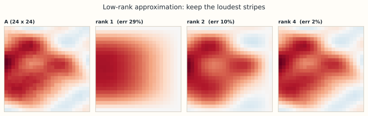

# 7.3 低秩近似与 Eckart–Young

> **本节位置**：模块 7 · SVD ｜ **前置**：[7.2](02-SVD的计算与性质.md) ｜ **预计**：40 分钟
>
> **一句话**：只留前 $k$ 个奇异值，得到的就是所有秩不超过 $k$ 的矩阵里离 $A$ 最近的那个——这不是启发式，是定理。

## 0. 场景引入

一家 SaaS 公司的支持团队有 **20,000 篇**历史工单和 **50,000 个**词构成的词表，想把新工单自动路由到 100 个主题队列，减少人工分拣。

工单-词矩阵 $A\in\mathbb{R}^{20000\times50000}$ 如果按稠密矩阵存，要 $20000\times50000\times4\ \text{B}=4\ \text{GB}$；实际只有 **0.5%** 的非零（$5\times10^6$ 个），稀疏存储约 40 MB。但稀疏矩阵不能直接算「主题相似度」，于是用截断 SVD 取前 $k=100$ 个主题：$A_k=U_k\Sigma_kV_k^\top$，因子只占 $100\times(20000+50000+1)=7.0\times10^6$ 个数，fp32 约 28 MB。

现在的决定是 **$k$ 取 100 还是 300**：100 个主题人看得过来，但会把「某型号电池鼓包」这种只有几百篇的稀有故障并进「其他」；300 个主题分得更细，标注和运维成本翻三倍。代价是：路由错了，工单在队列之间转手，用户等更久；而离线重构误差可能完全看不出这个问题。

他们准备了 **2,000 篇**人工标注，要求路由准确率不低于 **90%** 才上线；这个指标和 Frobenius 误差不是一回事。

读完你能回答三个问题：

1. 为什么「只留前 $k$ 个奇异值」在所有秩 $\le k$ 的矩阵里最优？这个「最优」是对哪种误差说的？
2. 按行范数或词频截断，为什么会丢掉低秩分解能看到的结构？
3. 什么时候 $\eta_k=99\%$ 仍然不够，该看什么指标？

## 1. 直觉

SVD 把 $A$ 写成一层层秩 1 的「图案」叠加：

$$
A=\sigma_1\mathbf{u}_1\mathbf{v}_1^\top+\sigma_2\mathbf{u}_2\mathbf{v}_2^\top+\cdots+\sigma_r\mathbf{u}_r\mathbf{v}_r^\top
$$

每一项 $\mathbf{u}_i\mathbf{v}_i^\top$ 是一张「条纹图」（行方向一个模式、列方向一个模式），$\sigma_i$ 是它的音量。$\sigma_1$ 最大，所以第一层是画面的主体轮廓；越往后越是细节与噪声。

截断 SVD 就是**只保留音量最大的前 $k$ 层**：

$$
A_k=\sum_{i=1}^{k}\sigma_i\mathbf{u}_i\mathbf{v}_i^\top
$$

> 💡 **一句话直觉**：**$A_k$ 是「用 $k$ 张条纹图能拼出的最像 $A$ 的图」，而 [Eckart–Young](#ref-eckart-young-1936) 说没有更好的 $k$ 层拼法。**

*图：一个 $24\times24$ 的合成矩阵（3 个平滑秩 1 图案加小噪声）的截断 SVD。只保留前 1、2、4 层时，相对 Frobenius 误差分别约 29%、10%、2%。*

### 1.1 它在现实世界里对应什么

把工单-词矩阵想成一张**主题地图**：每一行是一篇工单，每一列是一个词，SVD 找出 $k$ 个「主题方向」：

| 数学对象 | 主题分析里的对应物 |
|---|---|
| $A$（$20000\times50000$） | 每行一篇工单、每列一个词的 TF-IDF 权重 |
| $\sigma_i$ | 第 $i$ 个主题在语料里有多强 |
| $\mathbf{u}_i$ | 第 $i$ 个主题在 2 万篇工单上的得分 |
| $\mathbf{v}_i$ | 第 $i$ 个主题在 5 万个词上的权重 |
| $A_k$ | 只用前 $k$ 个主题重建的工单-词矩阵 |

一篇新工单投影到这 $k$ 个方向上，就得到它的「主题坐标」；坐标最接近哪个队列，就路由到哪。这和第 7.1 节的「条纹胶片」是同一件事，只是「胶片」的两边变成了词和文档。

### 1.2 这个类比在哪里失效

- **主题正交，名字不正交**。「电池」和「充电」可能落在两个主题上，人却会把它们合成一个；SVD 不负责给主题起名。
- **$\sigma$ 小不等于主题没价值**。一个只有 200 篇工单的稀有故障，能量占比可能不到 0.1%，但业务价值最高。
- **TF-IDF 本身是一个选择**。词干化、停用词、n-gram 都会改变矩阵；SVD 只对给它的矩阵做最优，不对「原始文本」做最优。
- **词袋丢掉语序和否定**。「不充电」和「充电」在矩阵里可能共享大部分词，主题方向分不开。

### 1.3 量级直觉

$k=100$ 时，因子 $U_k$（$20000\times100$）、$\Sigma_k$（100）、$V_k$（$50000\times100$）一共 $7.0\times10^6$ 个数，fp32 约 **28 MB**；稠密原矩阵是 4 GB，稀疏存储约 40 MB。也就是说，因子比稀疏矩阵还小一些，比稠密矩阵小两个数量级。

能量方面，若谱按 $\sigma_i\propto1/i$ 衰减，则

$$
\eta_{100}=\frac{\sum_{i=1}^{100}i^{-2}}{\sum_{i=1}^{20000}i^{-2}}
=\frac{1.6350}{1.6449}\approx99.4\%.
$$

这个式子说的是：**按 $1/i$ 衰减时，100 个主题就占了约 99.4% 的 Frobenius 能量**。真实语料的谱可能衰减更快（主题集中）也可能更慢（长尾故障多），必须实测。

## 2. 定义

### 2.1 截断 SVD（truncated SVD）

设 $A=U\Sigma V^\top$ 是瘦 SVD，秩为 $r$。对 $k\le r$ 定义

$$
A_k=\sum_{i=1}^{k}\sigma_i\mathbf{u}_i\mathbf{v}_i^\top=U_k\Sigma_kV_k^\top
$$

其中 $U_k\in\mathbb{R}^{m\times k}$、$\Sigma_k\in\mathbb{R}^{k\times k}$、$V_k\in\mathbb{R}^{n\times k}$。$A_k$ 的秩恰为 $k$（若 $\sigma_k>0$）。

**存储量**：$k(m+n+1)$ 个数，而不是 $mn$；压缩比 $mn/\big(k(m+n+1)\big)$。这条「低秩近似（low-rank approximation）」的路子，误差由下面两个等式精确给出。

### 2.2 两种误差

$$
\|A-A_k\|_F^2=\sum_{i=k+1}^{r}\sigma_i^2,\qquad
\|A-A_k\|_2=\sigma_{k+1}
$$

第一式是 Frobenius 误差：剩余全部奇异值的平方和。第二式是谱误差：**最大的那个剩余奇异值**。两者都是精确等式，不是估计。

### 2.3 能量比

把 $\sum_i\sigma_i^2=\|A\|_F^2$ 当总能量，前 $k$ 项占比

$$
\eta_k=\frac{\sum_{i=1}^{k}\sigma_i^2}{\sum_{i=1}^{r}\sigma_i^2}
$$

常用来选 $k$：取最小的 $k$ 使 $\eta_k\ge0.99$。注意这是一个**约定**，不是定理；它成立与否取决于你的任务能否容忍剩余 1% 的能量。

## 3. 为什么这样定义

**为什么不直接用「前 $k$ 行」或「前 $k$ 列」？** 那只是把矩阵切成方块，剩下的部分完全不管；而截断 SVD 让每一个保留的方向都尽量对齐 $A$ 的主要结构。

**为什么「保留最大的 $\sigma_i$」是自然的？** 因为误差公式已经告诉你：丢掉 $\sigma_i$ 就贡献 $\sigma_i^2$ 的平方误差。要最小化总误差，当然先丢最小的那些。Eckart–Young 把这句直觉变成了最优性定理：**在秩不超过 $k$ 的所有矩阵中，$A_k$ 使 Frobenius 误差与谱误差同时达到最小**。

**和最小二乘什么关系？** 都在做「约束下的最近点」。最小二乘约束 $\mathbf{x}$ 在列空间里，这里约束 $B$ 的秩不超过 $k$。区别是：秩不超过 $k$ 的矩阵集合**不是子空间**（两个秩 $k$ 矩阵相加可能秩 $2k$），所以 $A_k$ 是「到非凸集合的最近点」，不能写成投影矩阵。

### 3.1 反事实：按行范数截断会坏在哪

假设有人觉得「低秩就是留最重要的几行」，于是按行范数从大到小，只保留前 $k$ 行、其余置零。取一个**本来就是秩 1** 的矩阵：

$$
A=\begin{bmatrix}1&1\\2&2\\3&3\end{bmatrix}.
$$

三行的范数分别是 $\sqrt2$、$\sqrt8$、$\sqrt{18}$。保留范数最大的第 3 行，得到

$$
B=\begin{bmatrix}0&0\\0&0\\3&3\end{bmatrix},
\qquad
\|A-B\|_F=\sqrt{2+8}=\sqrt{10}\approx3.162.
$$

而 $A$ 本身秩就是 1，最优的 $A_1=A$，误差 **0**。按行范数截断把误差从 0 抬到 $3.162$，相对误差 $3.162/\sqrt{28}\approx59.8\%$——**一个已经低秩的矩阵，被「低秩压缩」丢掉了近六成能量**。

坏在哪：行范数只回答「这一行有多长」，不回答「这些行是不是朝着同一个方向」。$A$ 的三行其实共线，这正是低秩结构；按行截断看不见它。按列范数、按元素绝对值保留前 $k$ 个，犯的是同一类错误：它们优化的是「保留多少原始条目」，不是「用 $k$ 个方向重建」。

### 3.2 Eckart–Young 的边界：Frobenius 最优 ≠ 下游最优

定理的结论必须带着范数读。取

$$
A=\begin{bmatrix}5&0\\0&1\end{bmatrix}.
$$

两个秩 1 的候选：

- $A_1=\begin{bmatrix}5&0\\0&0\end{bmatrix}$，Frobenius 误差 $\sqrt{1^2}=1$；
- $B=\begin{bmatrix}3&0\\0&3\end{bmatrix}$，Frobenius 误差 $\sqrt{2^2+2^2}=\sqrt8\approx2.828$。

Eckart–Young 保证 $A_1$ 是 Frobenius 意义下最好的秩 1 近似。但如果下游指标是「第 2 个特征（比如那件稀有商品）还能不能被召回」，$A_1$ 把它直接置零，得分 0；$B$ 保住了它，得分 1。**Frobenius 最优的选择，在排序/召回指标上可以是最差的。**

所以定理的正确读法是：**在所有秩 $\le k$ 的矩阵中，$A_k$ 最小化 Frobenius 范数与谱范数（更一般地，所有单位不变范数）；它不管逐元素 0-1 损失、AUC/NDCG、主题可解释性，也不管下游模型能不能用。** 把「SVD 最优」泛化成「对所有误差度量最优」，是这一节最常见的误读。

## 4. 性质与推导

### 4.1 Eckart–Young 定理

设 $A\in\mathbb{R}^{m\times n}$，秩为 $r$，奇异值 $\sigma_1\ge\cdots\ge\sigma_r>0$。对任意满足 $\operatorname{rank}(B)\le k$ 的 $B$：

$$
\|A-B\|_2\ge\sigma_{k+1},\qquad
\|A-B\|_F^2\ge\sum_{i=k+1}^{r}\sigma_i^2
$$

且 $B=A_k$ 时两个等号同时成立。

### 4.2 谱范数（spectral norm）部分的证明（三行）

$\operatorname{rank}(B)\le k$ 意味着零空间维数 $\ge n-k$。取子空间 $W=\operatorname{span}\{\mathbf{v}_1,\dots,\mathbf{v}_{k+1}\}$，维数 $k+1$。两个子空间维数之和 $(n-k)+(k+1)=n+1>n$，故必有非零单位向量

$$
\mathbf{x}\in\ker(B)\cap W
$$

对它，$B\mathbf{x}=\mathbf{0}$，且 $\mathbf{x}=\sum_{i\le k+1}c_i\mathbf{v}_i$。于是

$$
\|A-B\|_2^2\ge\|(A-B)\mathbf{x}\|^2=\|A\mathbf{x}\|^2=\sum_{i\le k+1}\sigma_i^2c_i^2\ge\sigma_{k+1}^2\|\mathbf{x}\|^2=\sigma_{k+1}^2
$$

这就是 $\|A-B\|_2\ge\sigma_{k+1}$。等号在 $B=A_k$ 时取到，因为 $A-A_k=\sum_{i>k}\sigma_i\mathbf{u}_i\mathbf{v}_i^\top$ 的最大奇异值正是 $\sigma_{k+1}$。

Frobenius 版本用 Weyl 不等式 $\sigma_{k+j}(A)\le\sigma_j(A-B)$ 逐项比较，再平方求和即可；思路相同，只是把「一个方向」换成「所有剩余方向」。[Mirsky](#ref-mirsky-1960) 证明同一最优性对所有单位不变范数成立，Frobenius 只是其中一例。

### 4.3 三条推论

1. **单调**：$k$ 增大，误差不增（多留一个非负项）。
2. **$k=r$ 时误差为零**；$k=0$ 时 $A_0=0$，误差 $\|A\|_F$。
3. **相对误差**：$\|A-A_k\|_F/\|A\|_F=\sqrt{1-\eta_k}$，可直接用能量比换算。

## 5. 例子

### 5.1 手算：$k=1$ 的最优近似

取 7.1 的矩阵 $A=\begin{bmatrix}3&0\\4&5\end{bmatrix}$，已知 $\sigma_1=3\sqrt5$、$\sigma_2=\sqrt5$，$\mathbf{u}_1=\frac{1}{\sqrt{10}}(1,3)^\top$、$\mathbf{v}_1=\frac{1}{\sqrt2}(1,1)^\top$。

$$
A_1=\sigma_1\mathbf{u}_1\mathbf{v}_1^\top
=\frac{3\sqrt5}{2\sqrt5}\begin{bmatrix}1&1\\3&3\end{bmatrix}
=\begin{bmatrix}1.5&1.5\\4.5&4.5\end{bmatrix}
$$

**误差**：

$$
A-A_1=\begin{bmatrix}1.5&-1.5\\-0.5&0.5\end{bmatrix}
=\sigma_2\mathbf{u}_2\mathbf{v}_2^\top
$$

Frobenius 平方 $=1.5^2+1.5^2+0.5^2+0.5^2=5=\sigma_2^2$ ✓，所以 $\|A-A_1\|_F=\sqrt5\approx2.236$，谱误差也是 $\sqrt5$（只剩一项）。

**能量比**：$\eta_1=45/50=0.9$，即保留了 90% 能量，相对误差 $\sqrt{1-0.9}=\sqrt{0.1}\approx0.316$。

**验证最优性**：随便挑一个秩 1 的对手，比如 $B=\begin{bmatrix}3&0\\0&0\end{bmatrix}$，则 $A-B=\begin{bmatrix}0&0\\4&5\end{bmatrix}$，$\|A-B\|_F=\sqrt{41}\approx6.4>\sqrt5$。换成 $B'=\begin{bmatrix}3&3\\4&4\end{bmatrix}$（也是秩 1），$A-B'=\begin{bmatrix}0&-3\\0&1\end{bmatrix}$，Frobenius 误差 $\sqrt{10}\approx3.16$，仍大于 $A_1$ 的 $2.236$。Eckart–Young 保证：无论怎么试，都赢不了 $A_1$。

### 5.2 场景：主题分析的账与 LoRA 的秩预算

**主题分析**：$20000\times50000$ 的工单-词矩阵，$k=100$ 时因子共 $7.0\times10^6$ 个数，fp32 约 28 MB；稠密原矩阵 4 GB，压缩约 143 倍。但相对稀疏存储的 40 MB，它只小 30%——低秩压缩的对手不是「零」，而是「稀疏」。误差不是猜的，是 $\sqrt{\sum_{i>k}\sigma_i^2}/\|A\|_F$，跑一次截断 SVD 就能画出「误差 vs $k$」曲线（[Trefethen 与 Bau](#ref-trefethen-1997) 第 5 讲用同一套公式讨论低秩近似）。

**LoRA**：一个 $D\times D$ 的权重（$D=4096$）若只允许秩 $r$ 的更新，参数是 $2Dr$ 而不是 $D^2$。$r=16$ 时 $131{,}072$ 对 $16{,}777{,}216$，相差 128 倍。Eckart–Young 告诉你：如果真实需要的更新确实是 $\Delta W$ 且它的谱快速衰减，那么秩 16 的参数化能抓住其中 $99\%$ 的「能量」——**前提是谱真的衰减**，这要用数据验证。

### 5.3 场景闭环：2 万篇工单、100 个主题

**输入**：$20000\times50000$ 的 TF-IDF 矩阵，非零元 $5\times10^6$ 个（密度 0.5%）。稀疏存储按每非零 8 B（4 B 值 + 4 B 索引）估约 40 MB；稠密存储要 4 GB。

**计算**：随机化截断 SVD，$k=100$。每轮的主要开销是 $A$ 与一个 $50000\times100$ 的块相乘，约 $2\times\text{nnz}\times k=10^9$ FLOP；按 4 轮幂迭代估约 $4\times10^9$ FLOP，单核 10 GFLOP/s 约 0.4 s。作为对照，完整 SVD 约 $O(mn\min(m,n))=2\times10^{13}$ FLOP，单核要半个多小时。

**输出**：100 个主题方向，加上每篇工单的 100 维主题坐标；新工单取坐标最大的队列，决策是 $k=100$ 还是 $300$。单篇投影的成本是 $50000\times100=5\times10^6$ FLOP，约 0.5 ms。

**成本**：因子共 $7.0\times10^6$ 个数，fp32 约 28 MB；比稠密矩阵小 143 倍，但只比稀疏矩阵小 30%。存储不是主要瓶颈，**训练与调参的人力**才是：300 个主题意味着 300 份主题命名与标注。

**失败条件**：

- **稀有主题被能量门槛丢掉**：只有 200 篇工单的故障，$\sigma$ 可能排到第 500 位；按 $\eta_k\ge0.99$ 选 $k$，它一定被截掉。兜底：对已知稀有类单独保留方向，或训练一个监督分类器兜底。
- **Frobenius 误差好，路由准确率差**：$A_k$ 最小化的是重构误差，不是「工单该进哪个队列」。兜底：用人工标注的路由准确率验收，不看 $\eta_k$。
- **词表漂移**：新产品带来新词，旧 $V_k$ 里没有这些方向，投影全落在老主题上。兜底：定期重训、给新词留 OOV 桶。

## 6. 常见误区

1. **误区**：截断 SVD 就是「把小的矩阵元素置零」。
   **纠正**：它丢的是**小奇异方向**，$A_k$ 的每个元素通常都变了。元素级稀疏化和低秩是两种完全不同的结构。
2. **误区**：$A_k$ 就是 $A$ 的前 $k$ 行/列。
   **纠正**：$A_k=U_k\Sigma_kV_k^\top$ 是 $k$ 个秩 1 外积之和，行和列都被整体改写。
3. **误区**：$\|A-A_k\|_F$ 与 $\|A-A_k\|_2$ 差不多。
   **纠正**：前者是剩余奇异值的「整体长度」，后者只是最大的一个。若谱衰减慢，两者能差 $\sqrt{r-k}$ 倍。
4. **误区**：$\sigma_i$ 小就一定能丢。
   **纠正**：小奇异值可能对应任务最需要的细节（高频边缘、罕见类别）。误差上「小」≠ 语义上「不重要」。

## 7. 概念网络

- 前置：[7.2 SVD 的计算与性质](02-SVD的计算与性质.md) —— 误差公式来自 $\|A\|_F^2=\sum\sigma_i^2$。
- 前置：[2.6 秩](../02-向量空间/06-秩.md) —— 「秩不超过 $k$」这个约束的含义。
- 后续：[7.4 伪逆与数值秩](04-伪逆与数值秩.md) —— 用截断处理病态与数值秩。
- 后续：[7.5 SVD 应用](05-SVD应用.md) —— PCA、推荐、LoRA 都建立在这一节上。
- 关联：[9.3 PCA](../09-概率与统计/03-PCA.md) —— 只保留主成分，就是截断 SVD 的统计版本。

## 8. 通往大模型：低秩是一种预算

**出现位置**：LoRA 的秩约束、模型/激活压缩、KV Cache 压缩、以及「这个权重到底需要多少秩」的诊断。

**LoRA 的形状**：$\Delta W=BA$，$B\in\mathbb{R}^{D\times r}$、$A\in\mathbb{R}^{r\times D}$，参数量 $2Dr$。$D=4096,r=16$ 时为 $131{,}072$，占全参数 $0.78\%$。训练完可以再对 $\Delta W$ 做一次 SVD：若前 $r'<r$ 个奇异值已占 99% 能量，就能把 $B,A$ 换成秩 $r'$ 的版本，参数量再降 $r'/r$，且由 Eckart–Young 这是该秩下的最优近似。

**KV Cache**：每层每个头缓存 $K,V\in\mathbb{R}^{T\times d_k}$，共 $2\cdot L\cdot T\cdot D$ 个数（$L$ 层、$D=H d_k$）。若对 $K$ 做低秩近似 $K\approx PQ$（$P\in\mathbb{R}^{T\times r}$、$Q\in\mathbb{R}^{r\times d_k}$），存储变成 $Tr+rd_k$，误差由 $\sigma_{r+1}(K)$ 控制。收益条件是 $Tr+rd_k<Td_k$，即 $r<Td_k/(T+d_k)$；$T\gg d_k$ 时近似为 $r<d_k$。所以压的是「每头维度」，不是「序列长度」。

**谱范数/条件数视角**：截断后 $\|A-A_k\|_2=\sigma_{k+1}$，所以「丢掉第 $k+1$ 个奇异值」的直接代价是对该方向的最坏误差。若 $\sigma_{k+1}$ 与 $\sigma_1$ 同量级，截断就是灾难；若 $\sigma_{k+1}/\sigma_1<10^{-2}$，截断基本无损。

**可检验结论**：压缩后必须验证 $\|A-A_k\|_F$ 是否等于 $\sqrt{\sum_{i>k}\sigma_i^2}$（浮点误差内），这是检查实现是否真的做了截断 SVD 的最快办法。

**算错时下游看到什么**：若只按 $\eta_k$ 选 $k$，稀有主题的 $\sigma$ 小，会在压缩时被丢掉；工单路由把它们送进错误队列，用户看到的是转人工、等待时间变长，而离线重构误差仍然很漂亮。兜底是对长尾类单独保留方向、用路由准确率而非 Frobenius 误差做验收。

## 9. 练习

1. **概念**：为什么「秩不超过 $k$ 的矩阵集合」不是子空间？举一个 $2\times2$ 的例子。
2. **计算**：$A=\begin{bmatrix}2&0\\0&1\\0&0\end{bmatrix}$，写出 $A_1$，算 $\|A-A_1\|_F$、$\|A-A_1\|_2$ 与能量比 $\eta_1$。
3. **计算**：$512\times512$ 的图，$k=32$ 时存多少个数？压缩比多少？若要求误差 $\le5\%$，你能只凭压缩比判断可行吗？
4. **场景**：LoRA 训练出的 $\Delta W$ 奇异值为 $(1.0,0.8,0.6,0.1,\dots)$，取 $r'=2$ 会损失多少能量？这个损失合理吗？
5. **开放**：能量比 99% 一定「够用」吗？举一个能量比很高但视觉/语义损失明显的场景。

参考答案

1. 取 $B_1=\operatorname{diag}(1,0)$、$B_2=\operatorname{diag}(0,1)$，两者秩都是 1，但 $B_1+B_2=I_2$ 秩 2，超出集合，故对加法不封闭（$0$ 也在集合里，所以它对加法几乎什么都不封闭）。
2. $\sigma=(2,1)$，$A_1=\operatorname{diag}(2,0)$（加一行零）；$A-A_1=\operatorname{diag}(0,1,0)$，$\|A-A_1\|_F=1=\|A-A_1\|_2$，$\eta_1=4/5=0.8$。
3. $32\times1025=32{,}800$ 个数，压缩比 $262{,}144/32{,}800\approx8.0$。不能：压缩比只由 $k$ 决定，误差由该图的奇异值谱决定，必须实测 $\sqrt{\sum_{i>32}\sigma_i^2}/\|A\|_F$。
4. 保留能量 $1^2+0.8^2=1.64$；总量约 $1+0.64+0.36+0.01=2.01$，$\eta\approx1.64/2.01\approx0.816$，损失约 18% 的 Frobenius 能量——对「保结构」的任务可能过大，应看下游指标而非只看能量。
5. 高对比度的细线条图：能量集中在低频，但去掉高频后边缘模糊、文字不可读。医学影像的微小病灶同理——能量占比极低，语义却关键。

## 10. 一页速记

- $A_k=\sum_{i\le k}\sigma_i\mathbf{u}_i\mathbf{v}_i^\top$，秩恰为 $k$（$\sigma_k>0$），存储 $k(m+n+1)$。
- $\|A-A_k\|_F^2=\sum_{i>k}\sigma_i^2$，$\|A-A_k\|_2=\sigma_{k+1}$，都是精确等式。
- Eckart–Young：所有秩 $\le k$ 的矩阵里，$A_k$ 同时最小化 Frobenius 与谱误差；能量比 $\eta_k=\sum_{i\le k}\sigma_i^2/\|A\|_F^2$ 用来选 $k$，但它是约定不是定理，也不保证下游指标。
- **物理意义 / 现实对应**：$A_k$ 是「用 $k$ 个正交主题方向重建的矩阵」；$\sigma_i$ 是主题强度，$\mathbf{u}_i$ 是文档上的得分，$\mathbf{v}_i$ 是词上的权重。
- LoRA 的 $2Dr$ 与 KV Cache 的低秩压缩，都是这一节公式的直接应用。

## 11. 参考文献与致谢

这一页的知识不是凭空来的。下面列出本页直接借用的原始工作与权威整理；正文中的人名、定理名已链接到对应条目。链接优先指向 DOI、arXiv 或可长期访问的原文存档。

- **Eckart 与 Young（Carl Eckart & Gale Young, 1936）**：*The Approximation of One Matrix by Another of Lower Rank*。证明在所有秩 $\le k$ 的矩阵中，截断 SVD $A_k$ 同时最小化谱误差与 Frobenius 误差，即本页第 4.1 节的 Eckart–Young 定理。[Psychometrika 1(3)](https://doi.org/10.1007/BF02288367)
- **Mirsky（L. Mirsky, 1960）**：*Symmetric Gauge Functions and Unitarily Invariant Norms*。把 Eckart–Young 的最优性从谱范数、Frobenius 范数推广到所有单位不变范数，本页第 4.2 节补 Frobenius 版本时用的正是这条路线。[Quart. J. Math. 11(1)](https://doi.org/10.1093/qmath/11.1.50)
- **Trefethen 与 Bau（Lloyd N. Trefethen & David Bau III, 1997）**：*Numerical Linear Algebra*。第 5 讲专门讲 2-范数与 Frobenius 范数下的低秩近似，并提到它在图像压缩里的用途，对应本页第 2.2 节的两个误差等式。[SIAM, 1997](https://doi.org/10.1137/1.9780898719574)

---

下一篇 → [7.4 伪逆、数值秩与条件数](04-伪逆与数值秩.md)
