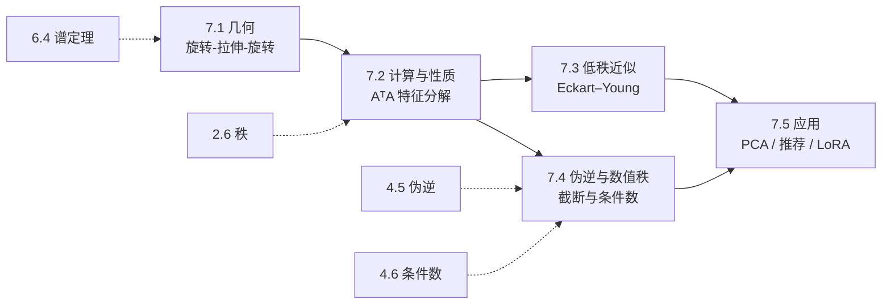

# M07 · SVD

> **一句话**：奇异值分解把**任意**矩阵拆成「旋转—拉伸—旋转」，并告诉你这个矩阵真正用力在哪几个方向；低秩近似、伪逆、PCA、LoRA 都是它的推论。

## 这个模块解决什么

学完 M06，你会对**方阵**做特征分解。但真实世界里的矩阵大多不是方阵，也经常不可对角化：

- 一个 $3000\times2000$ 的数据矩阵，怎么找它的「主要方向」？
- 一个秩亏的矩阵，怎么定义「逆」？
- 一张图和 1600 万参数的权重，凭什么能压到十分之一而「看起来没变」？
- 为什么大模型微调只改 0.1% 的参数也能有效？

SVD 是这些问题的统一答案。它的核心陈述只有一句：$A=U\Sigma V^\top$，而且对任意矩阵都成立。剩下的工作，是理解 $\sigma_i$ 的几何与数值含义，并学会用它做**压缩、求逆、降维、约束**。

本模块的路线：**几何（7.1）→ 计算与性质（7.2）→ 低秩近似（7.3）→ 伪逆与数值秩（7.4）→ 三个应用（7.5）**。

## 本模块的现实问题

1. 12 万张 1024×1024 的老照片，怎么从 126 GB 压到 25 GB 还不糊？（[7.1](01-SVD的几何.md)）
2. 3000 个细胞 × 2000 个基因，保留几个主成分才不算噪声？（[7.2](02-SVD的计算与性质.md)）
3. 2 万篇历史工单，怎么自动路由到 100 个主题队列？（[7.3](03-低秩近似.md)）
4. 7B 模型的全参微调要 112 GB，怎么在 24 GB 的卡上做？（[7.5](05-SVD应用.md)）

## 概念地图

## 学习顺序

| 顺序 | 文档 | 时间 | 读完你应该能…… |
|---|---|---|---|
| 1 | [7.1 SVD 的几何：旋转-拉伸-旋转](01-SVD的几何.md) | 35 min | 说清 $U,\Sigma,V$ 各自的几何角色，手算 $2\times2$ 的 SVD |
| 2 | [7.2 SVD 的计算与性质](02-SVD的计算与性质.md) | 40 min | 由 $A^\top A$ 求 SVD，用 $\sigma_i$ 算秩/范数/条件数，解释与特征值的区别 |
| 3 | [7.3 低秩近似与 Eckart–Young](03-低秩近似.md) | 40 min | 证明并应用 $\|A-A_k\|_F^2=\sum_{i>k}\sigma_i^2$，算压缩比与误差 |
| 4 | [7.4 伪逆、数值秩与条件数](04-伪逆与数值秩.md) | 35 min | 用 $A^{+}=V\Sigma^{+}U^\top$ 统一超定/欠定，判断何时截断 |
| 5 | [7.5 SVD 应用：PCA、推荐与 LoRA](05-SVD应用.md) | 40 min | 写清 PCA 的流水线，区分 SVD 与梯度训练的矩阵分解 |

配套材料：[习题](../exercises/m07-习题.md)（先做，再看[答案](../exercises/m07-答案.md)）、实验 [lab07](../labs/lab07_SVD与低秩.py)（约 30 分钟，验证本模块全部公式）。

## 本模块的大模型钩子

- **权重谱**：$\|W\|_2=\sigma_1$ 是这一层的 Lipschitz 常数；谱衰减快意味着可压缩（7.1、7.2）
- **LoRA**：$\Delta W=BA$，参数量 $2Dr$、秩至多 $r$；$D=4096,r=16$ 时占全参数 $0.78\%$（7.3、7.5）
- **模型与 KV 压缩**：截断 SVD 的误差被 $\sigma_{k+1}$ 精确控制；KV Cache 可低秩近似（7.3）
- **数值稳定性**：$\kappa=\sigma_1/\sigma_r$ 决定误差放大倍数；bf16 下秩有精度天花板（7.2、7.4）
- **闭式编辑**：$\Delta W=(Y-WH)H^{+}$ 是「改动最小」的权重编辑，秩 $\le K$（7.4）
- **表征分析**：中心化后对激活做 SVD，前几个主成分解释表示的主要方差（7.5）

## 自测（读完再做）

1. $A=\begin{bmatrix}3&0\\0&-2\end{bmatrix}$ 的奇异值是多少？$U,\Sigma,V$ 分别是什么？
2. 为什么 $\operatorname{rank}(A)$ 等于非零奇异值的个数，而不是非零特征值的个数？
3. $A$ 是 $100\times100$ 矩阵，奇异值 $\sigma_{10}=0.5$、$\sigma_1=10$。保留秩 9 的 Frobenius 误差至少是多少？谱误差呢？
4. 什么情况下 $A^{+}A=I$？给出一个反例说明一般不成立。
5. 为什么要先中心化再做 PCA？不中心化会得到什么？
6. LoRA 的 $A,B$ 为什么不能直接当作 $\Delta W$ 的奇异向量？

自测答案

1. $\sigma=(3,2)$；$A$ 把 $+y$ 翻成 $-y$，所以 $U=\begin{bmatrix}1&0\\0&-1\end{bmatrix}$、$\Sigma=\operatorname{diag}(3,2)$、$V=I_2$。检验：$\lvert\det A\rvert=6=\sigma_1\sigma_2$。
2. 奇异值非零当且仅当 $A\mathbf{v}_i=\sigma_i\mathbf{u}_i\neq\mathbf{0}$，即 $\mathbf{v}_i$ 不被压进零空间；非零奇异值的个数恰是列空间维数。特征值可能为 0 但秩不为 0（如 $\begin{bmatrix}0&1\\0&0\end{bmatrix}$ 特征值全 0、秩 1），故不能用特征值判断。
3. Frobenius 误差 $=\sqrt{\sum_{i>9}\sigma_i^2}\ge\sigma_{10}=0.5$，仅知道 $\sigma_{10}=0.5$ 时下界是 $0.5$；谱误差恰为 $\sigma_{10}=0.5$。
4. 满列秩（$r=n$）时 $A^{+}A=I$；若 $A=\begin{bmatrix}1&1\\2&2\end{bmatrix}$ 秩 1，则 $A^{+}A=\frac12\begin{bmatrix}1&1\\1&1\end{bmatrix}\neq I$。
5. 不中心化时第一主成分指向数据均值方向，解释的是「位置」而非「变化」；中心化把问题变成围绕均值的形状。
6. $BA$ 只是秩 $\le r$ 的一种参数化，$A,B$ 通常既不正交、也不按奇异值排序；要读出谱，得对训练后的 $\Delta W$ 再做一次 SVD。

## 前置与后续

- **前置**：[6.4 对称矩阵与谱定理](../06-特征值/04-对称矩阵与谱定理.md) —— SVD 的存在性依赖对称矩阵的正交特征基；[2.6 秩](../02-向量空间/06-秩.md)；[4.5 伪逆](../04-线性方程组/05-伪逆与最小范数解.md)；[4.6 条件数](../04-线性方程组/06-条件数与病态.md)。
- **后续**：[9.3 PCA](../09-概率与统计/03-PCA.md) —— 统计视角；M10 数值线性代数 —— 大规模 SVD 与精度；M11 大模型专题 —— LoRA、KV Cache、量化。
- **易混**：[5.1 行列式的几何](../05-行列式/01-行列式几何.md) —— $\lvert\det A\rvert=\prod\sigma_i$，但行列式只对方阵有定义。

---

下一篇 → [7.1 SVD 的几何：旋转-拉伸-旋转](01-SVD的几何.md)
