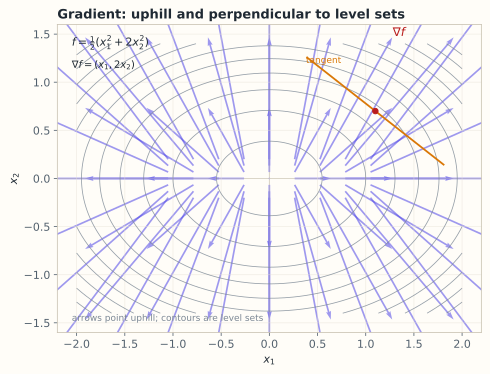

# 8.1 多元函数、偏导与梯度

> **本节位置**：模块 8 · 微积分与优化 ｜ **前置**：[1.3 点积](../01-向量与几何/03-点积.md) ｜ **预计**：35 分钟
>
> **一句话**：梯度把「函数在每个方向上的变化率」打包成一个向量，它指向上升最快的方向。

## 0. 场景引入

清晨 6 点，一台多旋翼无人机要从 **3 km × 3 km** 的风电场东侧起飞，巡检 **12 台风机**。飞控里存的不是一条固定轨迹，而是一个代价函数：

$$
J(x_1,y_1,\dots,x_{12},y_{12})=\text{总飞行时间（秒）}
$$

24 个坐标就是 24 个变量。今天西风 **8 m/s**，空速 15 m/s，返程逆风段要按 7 m/s 的地速折算；电池只够 25 分钟。

电量只剩 5% 余量，飞手要做一个决定：**24 个坐标里，把哪几个、往哪个方向挪一点，能把总时间压下来？** 逐个试是不可能的：24 个坐标、每个正负两个方向，就是 48 次轨迹仿真，每次 0.4 秒，将近 20 秒——而阵风每秒都在变。

算错的代价很具体：方向选反，多飞 40 秒，返航时电量跌破 10% 告警线，备降场在 1.2 km 外，这一架次作废。

把现场抽象掉：你有一个 24 元的函数 $J$，想在一点附近知道「每个坐标动一点，$J$ 变多少」，并且要把这 24 个数组织成一个**既能查表、又能指方向**的对象。这就是梯度（gradient）。

读完本节，你应该能回答三件事：

1. 偏导与梯度分别是什么，为什么梯度的形状必须和变量一致？
2. 梯度为什么垂直于等高线、指向上升最快的方向？
3. 「梯度是敏感度表」和「梯度是方向」这两种读法，各自在什么情况下会骗你？

## 1. 直觉

### 1.1 等高线地图

想象一座山，$f(x,y)$ 是海拔。地图上画着等高线（level set）：同一条线上海拔相同。

- 你沿等高线走，海拔不变；
- 你垂直等高线往上走，海拔升得最快；
- 梯度就是那个「垂直等高线、指向高处」的箭头。

*图：等高线是 $f=\frac12(x_1^2+2x_2^2)$ 的等值线；箭头是 $\nabla f=(x_1,2x_2)$，始终垂直等高线并指向 $f$ 增大的方向。*

### 1.2 偏导是「切一刀」

固定 $y=2$，只看 $x$ 的变化，得到一条曲线；它在该点的斜率就是 $\partial f/\partial x$。同理固定 $x$，得到 $\partial f/\partial y$。

> 💡 **一句话直觉**：**偏导是沿坐标轴的变化率，梯度是把这些变化率按坐标轴拼起来的箭头。**

### 1.3 它在现实世界里对应什么

回到那台无人机。梯度在飞控里有两个身份，**它们不是同一件事**：

| 读法 | 数学对象 | 在航迹里的含义 | 单位 |
|---|---|---|---|
| 敏感度表 | 第 $i$ 个偏导 $\partial J/\partial x_i$ | 第 $i$ 个坐标往东挪 1 m，总时间变多少 | s/m |
| 方向 | 整条向量 $\nabla J$ | 24 个坐标一起动时，时间增长最快的那条调整方向 | s/m（逐分量） |

第一种读法只需要「逐个数字」：$\partial J/\partial x_1=-0.04$ s/m 就是说，第 1 个航点往东挪 1 m，能省 0.04 秒。第二种读法要求你先把 24 个数当成一条向量，才有「方向」可言。

**量级直觉**：一次巡检的 $J$ 约 1200 s，单个偏导的典型量级在 $0.01\sim0.1$ s/m，所以 $\|\nabla J\|$ 大约是 $0.1\sim0.3$ s/m。换算成「挪 200 m 省多少」：$0.3\times200=60$ s——正好和电量余量同一个量级。**梯度大不大，要乘上你能实际移动的距离再判断。**

**单位会直接改变数值。** 如果飞控把坐标从「米」换成「经纬度（度）」，同一个物理敏感度要乘上 $1$ 度 $\approx111320$ m：原来的 $0.04$ s/m 变成 $4.5\times10^3$ s/度。函数没变、物理没变，**梯度的每个分量都放大了 $1.1\times10^5$ 倍**。这也是优化前要统一量纲的原因。

**类比边界**：等高线图只对二维可画。高维时没有图，但「梯度垂直于等值面」这个性质仍然成立——只是你想象不出来。

**这个类比在哪里失效**：梯度的「方向」不是坐标空间里的方向，而是**在给定内积下**的方向。航迹代价由分段欧氏长度求和而成，一旦某一段退化成零长度（两个航点重合），$J$ 在那里有尖点、不可微，梯度根本不存在——这时只能用次梯度，或把航点做光滑化。

## 2. 定义

### 2.1 多元函数

多元函数（multivariable function）是映射 $f:\mathbb{R}^n\to\mathbb{R}$，输入一个 $n$ 维向量，输出一个标量。

$$
f(\mathbf{x})=f(x_1,x_2,\dots,x_n)
$$

### 2.2 偏导数

对第 $i$ 个变量的偏导数（partial derivative）定义为

$$
\frac{\partial f}{\partial x_i}(\mathbf{x})
=\lim_{h\to0}\frac{f(x_1,\dots,x_i+h,\dots,x_n)-f(\mathbf{x})}{h}
$$

读法：把其它变量都当常数，只对 $x_i$ 求导。

### 2.3 梯度

梯度把 $n$ 个偏导排成一列：$\nabla f(\mathbf{x})=\big(\partial f/\partial x_1,\dots,\partial f/\partial x_n\big)^\top\in\mathbb{R}^n$。

**形状约定**：$\nabla f$ 与 $\mathbf{x}$ 同形。若变量是矩阵 $W\in\mathbb{R}^{m\times n}$，则 $\nabla_W f$ 也是 $m\times n$。这个约定在 8.5 节会展开。

### 2.4 可微

$f$ 在 $\mathbf{x}$ 处可微（differentiable），指存在向量 $\mathbf{g}$ 使

$$
f(\mathbf{x}+\Delta\mathbf{x})=f(\mathbf{x})+\mathbf{g}^\top\Delta\mathbf{x}+o(\|\Delta\mathbf{x}\|)
$$

并且这个 $\mathbf{g}$ 就是 $\nabla f(\mathbf{x})$。逐项读法：函数在局部可以用一个线性函数（平面）逼近，误差比一阶小量还小。

## 3. 为什么这样定义

如果只有一元导数，你只能说「沿某个方向的变化率」。但在 $\mathbb{R}^n$ 里有无限多个方向，每个方向都有自己的变化率。

一个自然的想法是：**先测 $n$ 个坐标轴方向，再想办法组合出任意方向。** 梯度正是这个「组合」的载体——8.2 节会证明，任意单位方向 $\mathbf{u}$ 上的方向导数恰好是 $\nabla f^\top\mathbf{u}$。

没有梯度，你就无法用一个有限的对象（$n$ 个数）描述「所有方向的一阶变化」。这就是反向传播能只用一遍计算就拿到全部参数梯度的根本原因。

### 3.1 反事实：换一种「梯度」会坏在哪

**方案 A：只报最大的那个偏导。** 取 $J(x,y)=x+2y$（把 24 维压成 2 维便于手算），在原点 $\nabla J=(1,2)$，$\|\nabla J\|=\sqrt5\approx2.236$。最大偏导在第 2 个坐标，于是你决定「只动 $y$」，沿 $(0,1)$ 的变化率是 2。但真正的陡上升方向是 $(1,2)/\sqrt5$，变化率 $2.236$，比 2 大 $11.8\%$。**只挑最大偏导，等于把「方向」丢掉了，你走的不是最陡的路。**

**方案 B：把梯度定义成偏导的绝对值之和。** $(1,2)\mapsto3$。它不再是一个方向，没法用来决定「往哪走」；而且 $(1,-2)$ 也得到 3——一个上升、一个下降，被算成同一个数。

**方案 C：混用单位。** 这是一个更隐蔽的坑。设 $J(x,y)=x+y$，其中 $x$ 的单位是米、$y$ 的单位是千米。若直接在这组坐标里求偏导，得到 $(1,\,1)$：看起来两个方向一样陡，最陡方向是 $45^\circ$。但把 $y$ 换成米（$y_{\text{m}}=1000\,y_{\text{km}}$），同一个函数是 $J=x_{\text{m}}+0.001\,y_{\text{m}}$，梯度变成 $(1,\,0.001)$——**最陡方向几乎贴着 $x$ 轴**。

同一个物理问题、两种单位，坐标空间里的「梯度方向」差了约 $45^\circ$。真相是：物理上的最陡方向一直是「几乎沿 $x$ 走」，因为沿 $y$ 走 1 m 只值 0.001 秒，沿 $x$ 走 1 m 值 1 秒。**坐标系里的 $45^\circ$ 是被单位伪造出来的。**

三条反事实指向同一个结论：梯度是**敏感度**（每米多少秒），它的数值依赖变量单位；只有当所有坐标共享同一套量纲与度量时，这条敏感度向量才同时是**方向**。工程上的对策是归一化——这也是训练模型前要先做特征标准化的原因。

## 4. 性质与推导

### 4.1 基本运算

| 规则 | 式子 |
|---|---|
| 线性 | $\nabla(af+bg)=a\nabla f+b\nabla g$ |
| 乘积 | $\nabla(fg)=f\nabla g+g\nabla f$ |
| 链式 | $\nabla_{\mathbf{x}}f(g(\mathbf{x}))=g'(\mathbf{x})\,\nabla_g f$（标量情形） |
| 二次型 | $\nabla_{\mathbf{x}}(\mathbf{x}^\top A\mathbf{x})=(A+A^\top)\mathbf{x}$ |

最后一条在 8.5 节推导，这里先记住它和「$2A\mathbf{x}$ 当 $A$ 对称」的关系。

### 4.2 梯度为什么垂直于等值面

设曲线 $\mathbf{x}(t)$ 落在等值面 $f(\mathbf{x})=c$ 上，即 $f(\mathbf{x}(t))\equiv c$。对 $t$ 求导并用链式法则，得 $\nabla f(\mathbf{x}(t))^\top\mathbf{x}'(t)=0$。

$\mathbf{x}'(t)$ 是等值面的任意切方向，所以 $\nabla f$ 与所有切方向正交，即垂直于等值面。

### 4.3 局部线性近似

$$
f(\mathbf{x}+\Delta\mathbf{x})\approx f(\mathbf{x})+\nabla f(\mathbf{x})^\top\Delta\mathbf{x}
$$

这个式子说的是：**函数在一点附近的行为，由「当前值 + 梯度」完全决定到一阶。** 8.3 节把它推广到向量值函数，就是 Jacobian。

## 5. 例子

### 5.1 手算：二元与三元

设 $f(x,y)=x^2y+3y^2$，在点 $(1,2)$：

$$
\frac{\partial f}{\partial x}=2xy=2\cdot1\cdot2=4,\qquad
\frac{\partial f}{\partial y}=x^2+6y=1+12=13
$$

所以 $\nabla f(1,2)=(4,13)^\top$，且 $f(1,2)=1\cdot2+3\cdot4=14$。

用线性近似估计 $f(1.1,\,2.05)$：

$$
f\approx14+4(0.1)+13(0.05)=14+0.4+0.65=15.05
$$

精确值是 $1.21\times2.05+3\times2.05^2=2.4805+12.6075=15.088$，误差 $0.038$，来自二阶项。

再看三元函数 $g(x,y,z)=x^2yz$ 在 $(1,2,3)$：$\nabla g=(2xyz,\;x^2z,\;x^2y)=(12,\;3,\;2)^\top$，$g=6$。

### 5.2 场景：线性回归的梯度

数据 $(x_i,y_i)=(1,2),(2,3),(3,5)$，模型 $\hat y_i=ax_i+b$，损失 $L(a,b)=\sum_{i=1}^{3}(y_i-ax_i-b)^2$。在 $(a,b)=(0,0)$ 处：

$$
\frac{\partial L}{\partial a}=-2\sum_i x_i(y_i-ax_i-b)=-46,\qquad
\frac{\partial L}{\partial b}=-2\sum_i (y_i-ax_i-b)=-20
$$

梯度 $(-46,-20)$ 指向 $L$ 上升方向；沿反方向更新 $a,b$，损失会下降。注意 $a$ 的梯度绝对值更大，因为 $x_i$ 放大了误差——这也是特征未归一化时训练「偏爱某些参数」的原因。

### 5.3 场景闭环：24 维航迹、20 秒预算

把开头那次巡检从头算到尾。

**输入**：12 个航点 → $n=24$ 维；风场用 $600\times600$ 的网格查表（每格 5 m，覆盖 3 km），风速与风向按 10 分钟一次的实测更新；电池余量、空速、地速折算都在飞控里。

**计算**：一次 $J$ 的评估要算 11 段长度、按风向做地速折算、加转弯惩罚，约 $10^4$ FLOP，实测 0.4 s（主要花在读风场表）。中心差分求梯度要 $2\times24=48$ 次评估，总计 $48\times0.4\approx19.2$ s，约 $5\times10^5$ FLOP。

**输出**：24 个偏导排成 $\nabla J$。按 $|\partial J/\partial x_i|$ 排序，取前 3 个航点各挪 200 m，用一阶近似预估省下的时间：

$$
\Delta J\approx\nabla J^\top\Delta\mathbf{x}
\approx0.3\times200=60\ \text{s}
$$

（这里用 $\|\nabla J\|=0.3$ s/m 的量级；实际要逐分量相乘再求和。）决策是「改这 3 个点，还是申请换电池」。

**成本**：19.2 s 的仿真、24 个标量进飞控。若在机载端把代价函数写成计算图、用反向模式求一次梯度，成本约是 1 次前向的 2.5 倍，即 1 s 量级——**快 19 倍，内存只需多存 24 个中间量。** 这就是真正的航迹优化器都写自动微分、而不是有限差分的原因。

**失败条件与兜底**：

- **不可微点**：两个航点重合、或转弯角超过阈值时，$J$ 有尖点，中心差分给出的「梯度」依赖步长 $h$。兜底：先用 $h=1$ m 与 $h=0.1$ m 各算一次，若结果差一个量级以上就判定不可信。
- **梯度过期**：风场 10 分钟才更新一次，梯度算完时风已经变了。兜底：把 $\Delta J$ 的预估值乘 0.6 的安全系数，飞过 2 个航点后重算。
- **数值淹没**：$J$ 是 $10^3$ s 量级，双精度相对误差约 $10^{-16}$，差分步长取 $h=10^{-8}$ m 时分子上的差只有 $10^{-8}$ s，已经贴着舍入噪声。兜底：$h$ 取 1 m，宁可引入 $10^{-3}$ 的二阶截断误差，也不要被舍入误差支配。

## 6. 常见误区

1. **误区**：偏导都存在，函数就可微。
   **纠正**：反例 $f(x,y)=\dfrac{xy}{x^2+y^2}$（原点补 0）。两个偏导在原点都是 0，但沿 $y=x$ 趋近时极限是 $1/2$，函数不连续，更不可微。

2. **误区**：梯度是一个数。
   **纠正**：梯度是向量，维数等于变量维数。只有一元函数时它才退化成一个数。

3. **误区**：梯度大，步子就该迈得大。
   **纠正**：梯度只描述局部斜率，不决定步长。步长由学习率控制，过大会越过极小点（8.7 节）。

4. **误区**：梯度为零就是极小值。
   **纠正**：也可能是极大值或鞍点。例如 $f(x,y)=x^2-y^2$ 在原点梯度为零，但沿 $x$ 上升、沿 $y$ 下降（8.4 节用 Hessian 判定）。

## 7. 概念网络

- 前置：[1.3 点积](../01-向量与几何/03-点积.md) —— $\nabla f^\top\Delta\mathbf{x}$ 是点积，梯度是线性泛函的向量表示。
- 后续：[8.2 方向导数与梯度下降](02-方向导数与梯度下降.md) —— 用梯度决定走哪、走多远。
- 后续：[8.3 Jacobian](03-Jacobian.md) —— 把标量输出的梯度推广到向量输出。
- 后续：[8.5 矩阵求导](05-矩阵求导与链式法则.md) —— 参数是矩阵时，梯度与参数同形。
- 关联：6.5 二次型 —— $\mathbf{x}^\top A\mathbf{x}$ 的梯度是 $(A+A^\top)\mathbf{x}$。

## 8. 通往大模型：梯度是「与参数同形」的张量

**出现位置**：反向传播（backpropagation；[Goodfellow 等, 2016](#ref-goodfellow-2016) 第 6 章）的最后一步。对损失 $L$，框架要算出每个参数张量的梯度，形状与参数**完全一致**。

**形状**：若某层权重 $W\in\mathbb{R}^{d_{\text{out}}\times d_{\text{in}}}$，则 $\partial L/\partial W$ 也是 $[d_{\text{out}},d_{\text{in}}]$。一个 4096×4096 的权重矩阵对应 1677 万个梯度值；这就是为什么训练显存里除了参数，还要放梯度和优化器状态。

**为什么需要**：没有「梯度与参数同形」这个约定，更新规则 $\boldsymbol\theta\leftarrow\boldsymbol\theta-\eta\nabla_{\boldsymbol\theta}L$ 就无法逐元素写。Adam 的 $m_t,v_t$ 也按元素维护，形状必须和 $\boldsymbol\theta$ 一致。

**可检验结论**：对一个线性层 $L=\frac12\|\mathbf{y}-W\mathbf{x}\|^2$，有 $\partial L/\partial W=-(\mathbf{y}-W\mathbf{x})\mathbf{x}^\top$，是外积，形状 $[d_{\text{out}},d_{\text{in}}]$。误差向量与输入向量的外积，正好填满整个权重矩阵——一次矩阵乘法就得到全部梯度。

**如果梯度算错，你在曲线上看到什么**：漏掉一项偏导，更新方向会系统性偏斜，loss 仍在降，但停在一个比预期高的平台，训练集和验证集同步变差；符号写反，等价于在做上升步，loss 会在几步内单调抬升直到发散。这两种都不报错——框架只会执行你给的公式。所以自定义算子必须做数值梯度检查（8.5 节）：解析梯度与中心差分的相对误差应在 $10^{-6}$ 量级。

## 9. 练习

1. **概念**：为什么梯度要定义成列向量而不是行向量？如果定义成行向量，8.2 节的 $\nabla f^\top\mathbf{u}$ 会变成什么？
2. **计算**：$f(x,y)=x^3y^2$，求 $\nabla f(2,1)$，并用线性近似估计 $f(2.1,0.9)$。
3. **计算**：$f(x,y,z)=x^2+y^2+z^2+xy$，求 $\nabla f(1,1,0)$。
4. **场景**：数据 $(1,1),(2,3)$，模型 $\hat y=ax$，损失 $L=\sum(y_i-ax_i)^2$。在 $a=0$ 处求梯度，并说明第一步该往哪走。
5. **开放**：如果只允许你查询函数在坐标轴方向上的变化率（偏导），能否恢复任意方向的变化率？需要什么额外条件？

参考答案

1. 定义成列向量是为了让 $\nabla f^\top\mathbf{u}$ 直接是点积（标量），并与「梯度与变量同形」保持一致。若定义成行向量，则应写成 $\nabla f\,\mathbf{u}$；两者只差转置，但混用会导致链式法则里转置位置出错。
2. $\partial_x f=3x^2y^2=12$，$\partial_y f=2x^3y=16$；$\nabla f=(12,16)^\top$，$f(2,1)=8$。近似 $8+12(0.1)+16(-0.1)=7.6$；精确值 $2.1^3\times0.9^2=9.261\times0.81\approx7.50$，误差约 $0.10$，来自二阶项。
3. $\nabla f=(2x+y,\;2y+x,\;2z)=(3,3,0)^\top$。
4. $\partial L/\partial a=-2\sum_i x_i(y_i-ax_i)=-2(1+6)=-14$。负梯度方向为正，所以第一步增大 $a$。
5. 仅凭偏导不够；需要函数在该点**可微**。可微时任意方向导数由 $\nabla f^\top\mathbf{u}$ 给出；不可微时（如 §6 的反例）各方向行为可以完全不一致。

## 10. 一页速记

- 偏导：固定其它变量，沿一个坐标轴求导。
- 梯度：所有偏导拼成的向量，与变量同形。
- 可微：$f(\mathbf{x}+\Delta)\approx f(\mathbf{x})+\nabla f^\top\Delta$，误差 $o(\|\Delta\|)$。
- 梯度垂直于等值面，指向上升最快的方向。
- 梯度为零只说明是驻点，不说明是极小值。
- **物理意义 / 现实对应**：梯度是「每个坐标挪 1 m，代价变多少秒」的敏感度表（单位 s/m）；只有量纲统一时，它才同时是最陡上坡的方向。

## 11. 参考文献与致谢

这一页的知识不是凭空来的。下面列出本页直接借用的原始工作与权威整理；正文中的人名、定理名已链接到对应条目。链接优先指向 DOI、arXiv 或可长期访问的原文存档。

- **Nocedal & Wright（2006）**：*Numerical Optimization*（2nd ed.）。梯度、一阶最优性条件与反向传播在优化中的系统处理，本页 §2–§4 的框架可与之对照。[Springer](https://doi.org/10.1007/978-0-387-40065-5)
- **Goodfellow, Bengio & Courville（2016）**：*Deep Learning*。第 6 章把梯度、Jacobian、计算图与反向传播串成一条线，对应本页 §8 的大模型落点。[MIT Press（开放网页版）](https://www.deeplearningbook.org/)

---

下一篇 → [8.2 方向导数与梯度下降](02-方向导数与梯度下降.md)
