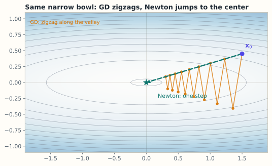

# 8.7 梯度下降、牛顿法与学习率

> **本节位置**：模块 8 · 微积分与优化 ｜ **前置**：[8.2 梯度下降](02-方向导数与梯度下降.md)、[8.6 凸性](06-凸性.md) ｜ **预计**：35 分钟
>
> **一句话**：梯度下降只利用斜率，牛顿法额外利用曲率；学习率的上界由最大曲率决定，收敛快慢由曲率之比决定。

## 0. 场景引入

下午 5 点，区域分拨中心的 **240 条**配送线路要重新分配车辆。当天 **4.2 万单**，车辆总数固定。成本模型在最优附近是一个二次型：

$$
C(\mathbf{x})=\tfrac12\sum_i a_ix_i^2+\sum_i b_ix_i
$$

第 $i$ 条线路的曲率 $a_i$ 从 $0.02$（干线，多派一辆车几乎不增加成本）到 $2$（冷链线路，装卸台已经排满），**跨度 100 倍**。

每个决策周期只有 **3 分钟**。算一次成本加梯度要 1.8 秒——得把 4.2 万单重新分拣、估算每条线路的装载时间。梯度下降取最优学习率

$$
\eta^\star=\frac{2}{a_{\max}+a_{\min}}=\frac{2}{2.02}\approx0.990
$$

每步误差只乘 $(\kappa-1)/(\kappa+1)=99/101\approx0.9802$，要把误差压到千分之一需要

$$
\frac{\ln10^{-3}}{\ln0.9802}\approx345\ \text{步}
$$

也就是 $345\times1.8=621$ 秒，**超预算 3.5 倍**。

牛顿法呢？Hessian 是 $240\times240$，$5.76\times10^4$ 个数、0.46 MB，Cholesky 分解 $240^3/3\approx4.6\times10^6$ FLOP，一步到位，总共约 4 秒。

**为什么同一个问题，一个要 345 步、一个只要 1 步？学习率上界 $2/a_{\max}$ 是从哪来的？** 代价：慢一步，12 条线路约 2100 单超时，按每单 8 元赔付，一天多付 1.7 万元。

读完本节，你应该能回答三件事：

1. 为什么二次函数上 GD 的收敛速度只由 $\lambda_{\max}/\lambda_{\min}$ 决定？
2. 牛顿法为什么一步到位，它的代价和失效条件是什么？
3. 什么时候该用牛顿法，什么时候它反而更慢、甚至跑向鞍点？

## 1. 直觉

### 1.1 碗的形变

二次函数的等高线是椭圆。椭圆越狭长（条件数越大），梯度方向越不指向最低点：梯度几乎垂直于「长轴」，于是走一步就横穿山谷，形成 zigzag。

### 1.2 牛顿法：先把碗掰圆

牛顿法用 Hessian 的逆做坐标变换，把椭圆碗「掰」成正圆，然后一步走到中心。对二次函数，它确实一步到位。

*图：等高线是 $f(x_1,x_2)=\frac12(x_1^2+20x_2^2)$，条件数 $\kappa=20$。梯度下降（橙点）沿长轴来回横穿山谷，呈之字形；牛顿法（绿色虚线）用 $H^{-1}$ 把碗掰圆，从同一起点一步到中心。*

> 💡 **一句话直觉**：**梯度下降按斜率走，牛顿法按曲率把地形拉平再走。**

类比边界：牛顿法假设二次近似可靠。远离最优点、Hessian 不定或非正定时，这一步可能指向鞍点甚至上升方向。

### 1.3 它在现实世界里对应什么

在这张调度表里，几何图像里的「碗」有了非常具体的对应：

| 数学对象 | 调度系统里的对应物 | 单位 |
|---|---|---|
| $x_i$ | 第 $i$ 条线路增派的车辆数（连续松弛） | 辆 |
| $a_i$ | 该线路的边际成本斜率：多派一辆，下一辆更难安排 | 元/辆² |
| 特征方向 | 一组「哪些线路一起加车」的组合 | — |
| 特征值 $\lambda_i$ | 沿这个组合方向的成本曲率 | 元/辆² |
| 条件数 $\kappa$ | 最陡与最平方向的曲率之比 = 100 | 无量纲 |

**这个碗为什么这么扁？** 因为 240 条线路的约束完全不同：干线上多一辆车只是多烧一点油（$a=0.02$），冷链线路上多一辆车要新开一个装卸台班次（$a=2$）。**曲率差 100 倍，就是「有的方向一推就动、有的方向推不动」。**

**量级直觉**：$\kappa=100$ 时 GD 要 345 步；$\kappa=10^4$ 时每步乘 $0.9998$，要

$$
\frac{\ln10^{-3}}{\ln(1-2\times10^{-4})}\approx3.5\times10^4\ \text{步}
$$

**同一份代码，条件数从 100 涨到 $10^4$，步数涨 100 倍。**

**边界**：二次型只在最优点附近成立。真实的 $C$ 有整数约束（车辆数必须是整数）、班次约束，以及需求对价格的反馈（加车会拉低单价，成本不再是凸的）。牛顿法给出的是连续松弛的解，取整之后可能偏离，甚至不可行。

**这个类比在哪里失效**：碗是静态的，而调度问题每 15 分钟换一个碗——需求变了，$a_i$ 和 $b_i$ 都变。昨天的「最优步长」今天未必安全，所以工程上要么每轮重估曲率，要么用保守学习率加自适应。

## 2. 定义

### 2.1 梯度下降

$\mathbf{x}_{k+1}=\mathbf{x}_k-\eta\nabla f(\mathbf{x}_k)$。

### 2.2 [牛顿法（Newton's method）](#ref-ypma-1995)

若 $H_f(\mathbf{x}_k)$ 可逆：$\mathbf{x}_{k+1}=\mathbf{x}_k-H_f(\mathbf{x}_k)^{-1}\nabla f(\mathbf{x}_k)$。

读法：先解线性方程 $H\mathbf{d}=\nabla f$，再令 $\mathbf{x}_{k+1}=\mathbf{x}_k-\mathbf{d}$。

### 2.3 条件数

对对称正定矩阵 $A$，条件数（condition number）定义为 $\kappa(A)=\lambda_{\max}/\lambda_{\min}\ge1$。

$\kappa=1$ 时等高线是圆；$\kappa$ 越大，椭圆越狭长。

## 3. 为什么这样定义

梯度下降只用了 $\nabla f$，它对坐标缩放敏感：把 $x_1$ 的尺度改变 100 倍，梯度分量也随之改变 100 倍，同一个学习率的有效步长就变了。

牛顿法用 $H^{-1}$ 抵消这种缩放。若做线性换元 $\mathbf{x}=T\mathbf{y}$，牛顿法的轨迹会跟着变换，而梯度下降不会——这就是「牛顿法对仿射变换不变」的含义。

代价是：算 $H$ 要 $O(n^2)$ 存储、解方程要 $O(n^3)$。$n=10^9$ 时完全不可行，所以大模型用一阶方法加各种近似。

### 3.1 反事实：牛顿法在不定 Hessian 上会朝鞍点跑

前面说牛顿法「用曲率把碗掰圆」。如果曲率是负的呢？取

$$
f(x,y)=x^2-y^2,\qquad \mathbf{x}_0=(0.1,\,1)
$$

$$
\nabla f=\begin{bmatrix}0.2\\-2\end{bmatrix},\quad
H=\begin{bmatrix}2&0\\0&-2\end{bmatrix},\quad
H^{-1}\nabla f=\begin{bmatrix}0.1\\1\end{bmatrix}
$$

牛顿步落在 $(0,0)$：函数值从 $f(0.1,1)=-0.99$ 变成 $f(0,0)=0$，**上升了 0.99**，而且正好是鞍点。牛顿法把 $-2$ 这个负曲率当成了「要往下走的方向」，把符号翻了过来。

同样的点，梯度下降（$\eta=0.1$）落在 $(0.08,\,1.2)$，$f=-1.4336<-0.99$，是下降的。**在不定区域，一阶方法比二阶方法更可靠**——这就是实用牛顿法都要检测 $H$ 的正定性、必要时加 $\tau I$ 或退回梯度方向的原因。

**第二个反事实：学习率只看最慢方向。** 若取 $\eta=2/\lambda_{\min}$（想让慢方向一步到位），对 $\kappa=100$ 的问题，快方向的乘子是

$$
1-\eta\lambda_{\max}=1-\frac{2\lambda_{\max}}{\lambda_{\min}}=1-200=-199
$$

绝对值远大于 1，**直接发散**。这就是为什么上界必须由 $\lambda_{\max}$ 决定：**一个步长要同时满足所有方向，只能迁就最陡的那个。**

## 4. 性质与推导

### 4.1 二次函数上的收敛条件

设 $f(\mathbf{x})=\frac12\mathbf{x}^\top A\mathbf{x}$，$A$ 对称正定，最优解 $\mathbf{x}^\star=\mathbf{0}$。梯度 $\nabla f=A\mathbf{x}$，于是 $\mathbf{x}_{k+1}=(I-\eta A)\mathbf{x}_k$。

对 $A$ 做特征分解 $A=Q\Lambda Q^\top$，令 $\mathbf{y}=Q^\top\mathbf{x}$，各分量解耦：

$$
y_i^{(k+1)}=(1-\eta\lambda_i)\,y_i^{(k)}
\quad\Longrightarrow\quad
y_i^{(k)}=(1-\eta\lambda_i)^k\,y_i^{(0)}
$$

要所有方向都收敛，需要 $|1-\eta\lambda_i|<1$ 对每个 $i$ 成立，即

$$
-1<1-\eta\lambda_i<1
\quad\Longleftrightarrow\quad
0<\eta<\frac{2}{\lambda_i}\ \text{对所有 }i
\quad\Longleftrightarrow\quad
\boxed{\ \eta<\frac{2}{\lambda_{\max}}\ }
$$

### 4.2 最优学习率与收敛速率

让最慢的方向也尽量快，取 $\eta^\star=2/(\lambda_{\max}+\lambda_{\min})$。此时快方向乘子为 $-(\kappa-1)/(\kappa+1)$，慢方向为 $+(\kappa-1)/(\kappa+1)$，所以每步误差按 $(\kappa-1)/(\kappa+1)$ 收缩。$\kappa=1$ 时一步到零；$\kappa=100$ 时每步只缩小约 2%。

### 4.3 牛顿法为什么一步到位

对二次函数，$\nabla f(\mathbf{x}_k)=A\mathbf{x}_k$，$H=A$，所以 $\mathbf{x}_{k+1}=\mathbf{x}_k-A^{-1}A\mathbf{x}_k=\mathbf{0}$。

对一般函数，牛顿法是在当前点解二次近似的最小值，等价于在 $\mathbf{x}_k$ 处做二阶 Taylor 后令导数为零。

### 4.4 动量与 Adam 的直觉

- **动量（momentum）**：$\mathbf{v}_{t+1}=\beta\mathbf{v}_t+\nabla f$，$\mathbf{x}_{t+1}=\mathbf{x}_t-\eta\mathbf{v}_{t+1}$。它把历史梯度累加，抵消 zigzag，等效把条件数从 $\kappa$ 降到约 $\sqrt{\kappa}$。
- **Adam**：为每个坐标维护梯度的一阶矩 $m_t$ 和二阶矩 $v_t$，更新量约等于 $\eta\,\hat m_t/(\sqrt{\hat v_t}+\epsilon)$。分母逐元素缩放，让不同尺度的参数共享一个学习率。

## 5. 例子

### 5.1 手算：二次函数上的 GD 与牛顿法

设 $f(\mathbf{x})=\frac12(3x_1^2+x_2^2)$，$A=\operatorname{diag}(3,1)$，$\mathbf{x}_0=(1,1)^\top$。$\nabla f=(3x_1,\,x_2)^\top$，在 $\mathbf{x}_0$ 处为 $(3,1)$。曲率上界 $\lambda_{\max}=3$，所以要求 $\eta<2/3\approx0.667$。

取 $\eta=0.4$，逐步算：

$$
\begin{aligned}
\mathbf{x}_1&=(1,1)-0.4(3,1)=(-0.2,\,0.6)^\top\\
\mathbf{x}_2&=(-0.2,0.6)-0.4(-0.6,0.6)=(0.04,\,0.36)^\top\\
\mathbf{x}_3&=(0.04,0.36)-0.4(0.12,0.36)=(-0.008,\,0.216)^\top
\end{aligned}
$$

函数值：$f(\mathbf{x}_0)=2$，$f(\mathbf{x}_1)=0.24$，$f(\mathbf{x}_2)=0.0672$，$f(\mathbf{x}_3)=0.023424$，单调下降。

两个方向的实际乘子：$1-0.4\times3=-0.2$（震荡），$1-0.4\times1=0.6$（单调）。与 §4.1 完全一致。

**牛顿法**：$H=A$，$\mathbf{x}_1=\mathbf{x}_0-A^{-1}A\mathbf{x}_0=\mathbf{0}$，一步到最优。

### 5.2 条件数的影响

若 $A=\operatorname{diag}(100,1)$，则 $\kappa=100$，$\eta^\star=2/101\approx0.0198$。慢方向每步乘 $1-\eta^\star\lambda_{\min}=1-2/101=99/101\approx0.9802$。要把误差降到 $10^{-3}$，约需 $\ln(10^{-3})/\ln(0.9802)\approx(-6.908)/(-0.0200)\approx345$ 步。

而 $\kappa=1$ 时一步就够。**同样的算法，条件数从 1 变到 100，步数从 1 变到几百。** 这就是「病态问题难优化」的定量含义。

### 5.3 场景闭环：240 条线路、3 分钟、4.2 万单

**输入**：$n=240$ 维；成本系数 $a_i,b_i$（240 对，共 3.8 KB）；4.2 万单的分拣结果；当前分配 $\mathbf{x}_0$。

**计算**：

- **牛顿法**：组装 $H=\operatorname{diag}(a_i)$（这里恰好对角；一般情形要 $240^2/2=2.9\times10^4$ 个数），Cholesky $4.6\times10^6$ FLOP，加一次梯度评估 1.8 s，总共约 4 s，一步到位。
- **梯度下降**：345 步 × 1.8 s = 621 s，超时。

**输出**：240 个连续解 $\mathbf{x}^\star$，四舍五入到整数辆车，再做一次局部交换（把一辆车从边际成本最低的线路挪到最高的线路）修正取整误差。

**成本**：牛顿法 0.46 MB 内存、4 s 墙钟；GD 只要 $O(n)$ 内存（几 KB）但要 621 s。**在这个规模上，0.46 MB 换 155 倍加速，划算。**

**失败条件与兜底**：

- **Hessian 不定**：需求-价格反馈会让某些 $a_i<0$。兜底：检测 $a_i\le0$，替换成 $\tau=10^{-3}$，或对该方向退回梯度下降。
- **规模变大**：若线路涨到 2.4 万条，Hessian 变成 $5.76\times10^8$ 个数、4.6 GB，Cholesky 变成 $4.6\times10^{12}$ FLOP——**牛顿法就出局了**，只能走 HVP + 共轭梯度（8.4 节），或干脆用 Adam 这类一阶方法。
- **取整破坏最优性**：连续解取整后可能差 1–2%。兜底：取整后做局部搜索，不重解全局。

## 6. 常见误区

1. **误区**：牛顿法总比梯度下降快。
   **纠正**：单步收敛快，但每步要算 Hessian 并解线性方程，成本 $O(n^3)$；Hessian 不定时还可能走向鞍点。大模型里通常不用完整牛顿法。

2. **误区**：学习率必须小于 1。
   **纠正**：上界是 $2/\lambda_{\max}$，与问题尺度有关。若把函数整体乘 0.01，梯度也乘 0.01，学习率可以放大 100 倍。

3. **误区**：动量能改变最终收敛点。
   **纠正**：动量只改变路径和速度，不改变驻点；在凸问题上仍收敛到同一个最优解。

4. **误区**：Adam 不需要调学习率。
   **纠正**：Adam 对尺度不敏感，但步长量级仍由 $\eta$ 控制；$\eta$ 过大同样会发散或导致 loss spike。

## 7. 概念网络

- 前置：[8.2 方向导数与梯度下降](02-方向导数与梯度下降.md) —— 一阶方向。
- 前置：[8.6 凸性](06-凸性.md) —— 保证局部下降能到全局。
- 前置：[8.4 Hessian](04-Hessian与二阶近似.md) —— 牛顿法用 $H^{-1}$。
- 后续：[8.8 拉格朗日乘子](08-拉格朗日乘子.md) —— 约束下的最优性条件。
- 关联：6.4 谱定理 —— 特征分解让 GD 在特征坐标下解耦。

## 8. 通往大模型：为什么大模型不用牛顿法

**出现位置**：训练超参选择与优化器设计。参数量 $P$ 从 $10^8$ 到 $10^{11}$，Hessian 是 $P\times P$。

**成本对比**：存 Hessian 需要 $P^2$ 个数；$P=10^9$ 时是 $10^{18}$，约 2 EB。解 $H\mathbf{d}=\mathbf{g}$ 需要 $O(P^3)$ 次运算。牛顿法在大模型上**物理不可行**。

**实际做法**：SGD/Adam 用一阶信息，配合

- 学习率 warmup（前几千步从 0 线性升到峰值），避免早期曲率估计不准导致发散；
- cosine/linear decay，后期减小步长以降低噪声；
- gradient clipping，把 $\|\mathbf{g}\|$ 截断到阈值，防止个别 batch 的尖峰炸掉参数；
- 近似二阶：K-FAC、Shampoo 用块对角/Kronecker 近似 $H$，但仍是研究与小规模实践。

**可检验结论**：Adam 的更新量级约等于 $\eta$（因为 $m/\sqrt{v}\approx\operatorname{sign}(g)$），所以有效步长主要由 $\eta$ 决定，而不是梯度绝对值。这解释了为什么 Adam 对梯度尺度不敏感，也解释了为什么 $\eta$ 过大时会出现参数「跳飞」而不是缓慢漂移。

**如果学习率选错，训练时看到什么**：$\eta$ 超过 $2/\lambda_{\max}$ 之后，loss 不是缓慢变差，而是几步内出现尖峰然后 NaN——因为最陡方向的乘子绝对值超过 1，误差每步放大。这也是 warmup 存在的物理原因：训练初期某些方向的曲率估计还不准，先用小步长避开最陡方向。

## 9. 练习

1. **概念**：为什么说牛顿法对仿射变换不变，而梯度下降不是？用 $f(x)=x^2$ 与 $g(y)=f(10y)$ 举例。
2. **计算**：$f(\mathbf{x})=\frac12(4x_1^2+x_2^2)$，$\mathbf{x}_0=(1,2)$，$\eta=0.2$，做两步 GD，并验证 $\eta<2/\lambda_{\max}$。
3. **计算**：$A=\operatorname{diag}(9,1)$，求最优学习率 $\eta^\star$ 与每步收缩因子。
4. **计算**：$f(x,y)=x^2+2y^2+xy$，从 $(1,1)$ 出发做一步牛顿法，求 $H$、梯度与落点。
5. **开放**：如果你的模型有 100 亿参数，但只想用二阶信息改善训练，你会怎么做？说出至少两种近似方案及其代价。

参考答案

1. 令 $y=x/10$，则 $g(y)=100y^2$，$g''=200$。在 $x$ 坐标下 $f''=2$，在 $y$ 坐标下曲率放大 100 倍；GD 的学习率上界随之改变，轨迹不是简单缩放。牛顿法用 $H^{-1}$ 抵消这个因子，两步在各自坐标下都指向同一点。
2. $\nabla f=(4x_1,x_2)$。$\mathbf{x}_1=(1,2)-0.2(4,2)=(0.2,1.6)$；$\mathbf{x}_2=(0.2,1.6)-0.2(0.8,1.6)=(0.04,1.28)$。$\lambda_{\max}=4$，$2/4=0.5>0.2$。
3. $\eta^\star=2/(9+1)=0.2$；收缩因子 $(9-1)/(9+1)=0.8$。
4. $\nabla f=(2x+y,\,4y+x)=(3,5)^\top$，$H=\begin{bmatrix}2&1\\1&4\end{bmatrix}$。解 $H\mathbf{d}=(3,5)$：$\mathbf{d}=(1,1)^\top$，落点 $(0,0)$，正是全局极小。
5. 方案一：块对角/Kronecker 近似（K-FAC、Shampoo），按层近似 $H$，显存与层大小平方成正比，仍需额外通信。方案二：Hessian–向量乘积 + 共轭梯度（Newton-CG），每步几次 HVP，代价约 2–3 倍反向传播，只适合小批量或周期性使用。方案三：只对最后一层或 LoRA 参数做二阶，规模可控。

## 10. 一页速记

- GD：$\mathbf{x}\leftarrow\mathbf{x}-\eta\nabla f$；牛顿：$\mathbf{x}\leftarrow\mathbf{x}-H^{-1}\nabla f$。
- 二次函数上 GD 收敛当且仅当 $\eta<2/\lambda_{\max}$。
- 最优 $\eta^\star=2/(\lambda_{\max}+\lambda_{\min})$，收缩因子 $(\kappa-1)/(\kappa+1)$。
- 牛顿法对二次函数一步到位，但每步 $O(n^3)$。
- 动量/Adam 用历史与逐坐标缩放缓解条件数与尺度问题。
- **物理意义 / 现实对应**：条件数是「碗有多扁」，在这里就是各线路边际成本斜率之比；牛顿法用曲率把碗掰圆，代价是 $O(n^2)$ 内存与 $O(n^3)$ 分解。

## 11. 参考文献与致谢

这一页的知识不是凭空来的。下面列出本页直接借用的原始工作与权威整理；正文中的人名、定理名已链接到对应条目。链接优先指向 DOI、arXiv 或可长期访问的原文存档。

- **Ypma（1995）**：*Historical Development of the Newton–Raphson Method*。牛顿法从求根到优化的历史梳理，本页 §1.2 与 §2.2 的背景可据此核对。[SIAM Review](https://doi.org/10.1137/1037125)
- **Nocedal & Wright（2006）**：*Numerical Optimization*（2nd ed.）。梯度下降与牛顿法的收敛率、条件数依赖与线搜索，本页 §3–§4 的标准参考。[Springer](https://doi.org/10.1007/978-0-387-40065-5)
- **Polyak（1964）**：*Some Methods of Speeding Up the Convergence of Iteration Methods*。动量/重球法的早期工作，对应本页 §8 中 Adam 一类加速方法的直觉。[USSR Computational Mathematics and Mathematical Physics](https://doi.org/10.1016/0041-5553(64)90137-5)

---

下一篇 → [8.8 拉格朗日乘子与约束优化](08-拉格朗日乘子.md)
