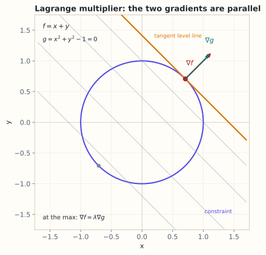

# 8.8 拉格朗日乘子与约束优化

> **本节位置**：模块 8 · 微积分与优化 ｜ **前置**：[8.2 梯度下降](02-方向导数与梯度下降.md)、[8.6 凸性](06-凸性.md) ｜ **预计**：35 分钟
>
> **一句话**：在约束曲面上找最优点，梯度不再为零，而是与约束的梯度平行；乘子就是「放松一点约束，目标能改善多少」的价格。

## 0. 场景引入

一条钢板表面质检线，每分钟过 **30 块** 2 m² 的热轧板。视觉系统把每块板压成 **512 维**特征，要判「有缺陷 / 无缺陷」。训练集有 **12 万** 个标注样本，缺陷样本只占 3%，标注很贵。

你决定用线性 SVM：

$$
\min_{\mathbf{w},b}\ \tfrac12\|\mathbf{w}\|^2
\quad\text{s.t.}\quad y_i(\mathbf{w}^\top\mathbf{x}_i+b)\ge1,\ i=1,\dots,12\times10^4
$$

它要在「分对」的前提下让间隔 $2/\|\mathbf{w}\|$ 尽量宽。约束有 12 万条，对应 12 万个乘子 $\alpha_i$。

上线时你发现：**真正起作用的乘子只有约 8%**，也就是 9600 个，其余 11 万个 $\alpha_i=0$——它们的约束根本没顶住边界。**如果误把所有样本都当支持向量**，推理要从 9600 次内积变成 12 万次，慢 **12.5 倍**；**如果反过来误删了真正起作用的样本**，间隔被破坏，漏检率上升，漏掉一块 2 m² 的缺陷板，按 3000 元/块算，一条线一天就赔几千元。

**哪些约束在顶住？哪些可以扔掉？** 这不是工程技巧，而是 KKT 里的互补松弛 $\mu_jh_j=0$ 直接告诉你的。乘子 $\alpha_i$ 还有第二个读法：**影子价格**——把第 $i$ 个样本的间隔要求放松 1 个单位，目标能改善多少。

同一个数学出现在 RLHF 里：把「KL 不超过 $\epsilon$」写成约束，乘子就是那个 $\beta$（§4.4、§8）。这就是约束优化（constrained optimization）要回答的问题。

读完本节，你应该能回答三件事：

1. 为什么最优点处 $\nabla f$ 一定与约束曲面垂直，乘子为什么是「价格」？
2. 互补松弛说的是什么，它凭什么能让你扔掉 92% 的样本？
3. SVM 的 $\alpha_i$ 和 RLHF 的 $\beta$ 是同一件事吗？

## 1. 直觉

### 1.1 沿着约束曲线找最低点

在 $f(x,y)$ 的等高线图上，约束 $g(x,y)=0$ 是一条曲线。你要在曲线上找 $f$ 的最低点。

沿着曲线走，如果还能让 $f$ 下降，就继续走；走到某点，沿曲线的**任何**方向 $f$ 都不再下降，就停。此时 $f$ 的梯度必须垂直于曲线的切线——而 $g$ 的梯度也垂直于切线。两个梯度只能平行。

*图：约束是单位圆 $g=x^2+y^2-1=0$，目标 $f=x+y$ 的等值线是一族平行线。最优点处等值线与圆相切，$\nabla f$ 与 $\nabla g$ 平行。*

### 1.2 乘子是「价格」

约束 $g(\mathbf{x})=0$ 稍微放松成 $g(\mathbf{x})=\epsilon$，最优值会改善多少？改善率就是乘子。

> 💡 **一句话直觉**：**在最优点，目标函数的梯度被约束的梯度「顶住」了；乘子衡量这个顶住的力度。**

类比边界：梯度平行是**必要条件**，不是充分条件；它也可能对应局部极大或鞍点。要确认最优，还要比较候选点或检查二阶条件。

### 1.3 它在现实世界里对应什么

在质检线这里，拉格朗日乘子有一个可以拿在手里的身份：

| 数学对象 | SVM 里的对应物 | 单位 |
|---|---|---|
| 目标 $\frac12\|\mathbf{w}\|^2$ | 间隔的倒数平方（越小间隔越宽） | 1/特征单位² |
| 约束 $g_i=y_i(\mathbf{w}^\top\mathbf{x}_i+b)-1$ | 「第 $i$ 个样本必须分对且留出 1 单位边距」 | 无量纲 |
| 乘子 $\alpha_i$ | 第 $i$ 个样本把边界「顶住」的力度 | 1/特征单位² |
| 影子价格 | 放松第 $i$ 个样本的边距，目标改善多少 | 同乘子 |

**单位要小心**：如果特征从「毫米」换成「米」，每个 $x$ 缩小 1000 倍，$\mathbf{w}$ 就要放大 1000 倍才能保持 $\mathbf{w}^\top\mathbf{x}$ 不变；于是 $\|\mathbf{w}\|^2$ 放大 $10^6$ 倍，乘子 $\alpha_i$ 相应缩小 $10^6$ 倍。**但支持向量的集合不变**——「谁在边界上」是几何事实，与单位无关。这是一次很好的自检：换单位后支持向量变了，代码里一定有 bug。

**量级直觉**：12 万样本里约 8% 是支持向量。硬间隔下，支持向量恰好落在 $y_i(\mathbf{w}^\top\mathbf{x}_i+b)=1$ 上；其余样本的边距可能远大于 1（比如 3），它们的乘子必须为 0。

**边界**：硬间隔要求数据线性可分，钢板数据几乎不可能——缺陷与正常样本在 512 维里仍有重叠。这时要换成软间隔（约束放松为 $\ge1-\xi_i$，乘子上界为 $C$），互补松弛的形式不变，但「顶住」的样本分成两类：边界上的（$0<\alpha_i<C$）和被截断的（$\alpha_i=C$）。**$C$ 越大越接近硬间隔，也越容易过拟合。**

**这个类比在哪里失效**：核 SVM 里 $\mathbf{w}$ 可能根本不存在于原始空间（无限维），乘子和支持向量的结论照样成立，但「$\mathbf{w}$ 的单位」这种说法就失效了——只剩内积 $K(\mathbf{x}_i,\mathbf{x}_j)$ 有意义。

## 2. 定义

### 2.1 等式约束问题

考虑 $\min_{\mathbf{x}}f(\mathbf{x})$，约束 $g_i(\mathbf{x})=0$（$i=1,\dots,k$）。拉格朗日函数（Lagrangian）定义为

$$
\mathcal{L}(\mathbf{x},\boldsymbol\lambda)
=f(\mathbf{x})+\sum_{i=1}^{k}\lambda_i g_i(\mathbf{x})
$$

$\lambda_i$ 称为[拉格朗日乘子（Lagrange multiplier）](#ref-lagrange-1788)。

### 2.2 一阶必要条件

在最优点 $\mathbf{x}^\star$（且约束梯度线性无关）处，存在 $\boldsymbol\lambda^\star$ 使 $\nabla f(\mathbf{x}^\star)+\sum_i\lambda_i^\star\nabla g_i(\mathbf{x}^\star)=\mathbf{0}$，且 $g_i(\mathbf{x}^\star)=0$。第一条说「目标梯度是约束梯度的线性组合」，第二条说「点必须可行」。

### 2.3 不等式与 KKT

对 $\min f$ s.t. $h_j(\mathbf{x})\le0$，构造 $\mathcal{L}=f+\sum_j\mu_jh_j$。[KKT 条件（Karush–Kuhn–Tucker conditions）](#ref-kuhn-tucker-1951)是：

$$
\nabla f+\sum_j\mu_j\nabla h_j=\mathbf{0},\qquad
h_j\le0,\qquad
\mu_j\ge0,\qquad
\mu_jh_j=0
$$

最后一条叫互补松弛（complementary slackness）：约束不起作用时（$h_j<0$），乘子必须为 0；乘子为正时，约束一定取等号。

## 3. 为什么这样定义

无约束时，最优点要求「所有方向都不能下降」，即梯度为零。有约束时，可行方向变少了：只剩与约束曲面相切的方向。

只要**沿可行方向**不能下降就够了，不需要全空间梯度为零。于是梯度可以有一个「法向分量」，被约束的梯度抵消——这正是 $\nabla f=-\sum\lambda_i\nabla g_i$。

为什么不直接把约束代入消元？有时可行（例如 $x+y=1$ 解出 $y=1-x$），但很多时候约束是非线性的、多个的，解不出来。乘子法把「约束」变成「目标的一部分」，可以用无约束的方法处理，还能顺便得到乘子的经济含义。

### 3.1 反事实：不写互补松弛，会多留 92% 的样本

取一维硬间隔问题，三个点：

$$
x_1=1\ (y=+1),\qquad x_2=-1\ (y=-1),\qquad x_3=3\ (y=+1)
$$

最优解可以直接看出来：$w=1$、$b=0$，间隔边界在 $x=\pm1$，间隔宽 $2/\lvert w\rvert=2$。第三个点稳稳在边界外。

对偶函数是

$$
D(\boldsymbol\alpha)=\sum_i\alpha_i-\tfrac12\Big\|\sum_i\alpha_iy_i\mathbf{x}_i\Big\|^2
$$

互补松弛要求 $\alpha_3\,[y_3(wx_3+b)-1]=0$，而括号里是 $3-1=2>0$，所以 **$\alpha_3=0$**。取 $\alpha_1=\alpha_2=0.5$、$\alpha_3=0$：$w=0.5+0.5=1$，$D=1-0.5=0.5$，正好等于原问题最优值 $\tfrac12\|\mathbf{w}\|^2=0.5$。

**反事实：不管互补松弛，给三个点都分配 $\alpha_i=0.5$。** 那么

$$
w=0.5+0.5+3\times0.5=2.5,\qquad
D=1.5-\tfrac12(2.5)^2=1.5-3.125=-1.625
$$

对偶是**最大化** $D$，而 $-1.625\ll0.5$——这组乘子离最优极远。换成原问题的语言：$\tfrac12\|\mathbf{w}\|^2$ 从 $0.5$ 涨到 $3.125$（6.25 倍），规范间隔 $2/\|\mathbf{w}\|$ 从 $2$ 掉到 $0.8$。**$x_3$ 这个本来对边界毫无影响的样本，把整个分类器往它那边拉了。**

这就是互补松弛的作用：**它是一张「谁在顶住」的名单**。名单外的约束（$g_i<0$）乘子必须为 0，可以整条丢掉；名单内的（$g_i=0$）乘子才可能非零。12 万条约束里只有 8% 在名单上——**扔掉 92% 不是近似，是精确的代数结论。**

**另一个反事实：去掉「约束梯度线性无关」这个前提。** 考虑 $\min x$ s.t. $x^2=0$。可行集只有 $x=0$，它就是唯一最优解。但拉格朗日函数 $\mathcal{L}=x+\lambda x^2$ 的驻点条件是 $1+2\lambda x=0$，在 $x=0$ 处变成 $1=0$——**根本不存在乘子**。原因是约束的梯度 $2x$ 在最优点处为零，法空间退化了。这就是「约束品性（constraint qualification）」为什么要单独假设：它不是技术性凑数，而是乘子存在的门票。

## 4. 性质与推导

### 4.1 几何推导

设约束曲面 $g(\mathbf{x})=0$ 在 $\mathbf{x}^\star$ 处的切空间为 $T=\{\mathbf{d}\mid\nabla g(\mathbf{x}^\star)^\top\mathbf{d}=0\}$。若 $\nabla f$ 在 $T$ 上有非零分量，沿该方向（或反方向）走一小步仍可行，且 $f$ 会下降，矛盾。所以 $\nabla f$ 必须与 $T$ 正交，即 $\nabla f=-\lambda^\star\nabla g$。

多个约束时，法空间由所有 $\nabla g_i$ 张成，于是写成线性组合。

### 4.2 乘子作为敏感度

考虑扰动问题 $g(\mathbf{x})=b$，最优值记为 $p^\star(b)$。可以证明 $\mathrm{d}p^\star/\mathrm{d}b=-\lambda^\star$。读法：约束右端每增加 1 个单位，最优值变化 $-\lambda^\star$。所以乘子也叫影子价格（shadow price）。这个解释在资源分配、RLHF 的 KL 预算里都成立。

### 4.3 对偶（duality）

定义对偶函数 $d(\boldsymbol\lambda)=\inf_{\mathbf{x}}\mathcal{L}(\mathbf{x},\boldsymbol\lambda)$。对任意可行 $\mathbf{x}$ 和任意 $\boldsymbol\lambda$（不等式情形要求 $\mu\ge0$），有 $d(\boldsymbol\lambda)\le f(\mathbf{x})$，所以 $d(\boldsymbol\lambda)\le p^\star$，这叫弱对偶（weak duality）。

若原问题是凸的且满足约束品性（如 Slater 条件），则强对偶成立：$\max_{\boldsymbol\lambda}d(\boldsymbol\lambda)=p^\star$。此时 KKT 不仅必要，而且充分。**完整证明不展开，记住结论与适用条件即可。**

### 4.4 KL 正则目标的闭式解

对 $\max_\pi\;\sum_a\pi(a)r(a)-\beta\sum_a\pi(a)\log\frac{\pi(a)}{\pi_{\text{ref}}(a)}$，加上 $\sum_a\pi(a)=1$ 的约束，构造

$$
\mathcal{L}=\sum_a\pi(a)r(a)-\beta\sum_a\pi(a)\log\frac{\pi(a)}{\pi_{\text{ref}}(a)}
+\lambda\Big(\sum_a\pi(a)-1\Big)
$$

对 $\pi(a)$ 求偏导并令其为零，得 $r(a)-\beta\big(\log\frac{\pi(a)}{\pi_{\text{ref}}(a)}+1\big)+\lambda=0$，解出 $\pi(a)\propto\pi_{\text{ref}}(a)\exp\big(r(a)/\beta\big)$。$\beta$ 越大，指数越平，策略越接近参考模型；$\beta\to0$ 时退化为「只挑奖励最高的动作」。

## 5. 例子

### 5.1 手算：圆上离直线最近的点

$\min_{x,y}x^2+y^2$ s.t. $x+y=1$。$\nabla f=(2x,2y)$，$\nabla g=(1,1)$，条件 $2x=\lambda$、$2y=\lambda$，所以 $x=y$。代入约束 $2x=1$，得 $x=y=1/2$，$\lambda=1$，最优值 $f=1/2$。

几何验证：$\nabla f=(1,1)$ 与 $\nabla g=(1,1)$ 平行；原点（无约束最优）到直线 $x+y=1$ 的距离是 $1/\sqrt2$，平方正好是 $1/2$。

### 5.2 手算：两动作的 KL 正则策略

设两个动作，$r=(1,0)$，$\pi_{\text{ref}}=(0.5,0.5)$，$\beta=1$。由 §4.4，$\pi\propto(0.5e^{1},\;0.5e^{0})=(1.3591,\;0.5)$，归一化得 $\pi=(0.7311,\;0.2689)$。

KL 为 $0.7311\ln(0.7311/0.5)+0.2689\ln(0.2689/0.5)\approx0.7311(0.3800)+0.2689(-0.6201)\approx0.1110$。目标值：$0.7311-0.1110=0.6201$。

对照：不约束时最优是 $\pi=(1,0)$，奖励 1，但 KL 无穷大；$\beta=0.1$ 时会更靠近 $(1,0)$。**β 就是「奖励」与「别走太远」之间的汇率。**

### 5.3 场景闭环：12 万样本、9600 个支持向量、每分钟 30 块板

**输入**：$X$ 是 $12\times10^4$ 行、512 列（fp32 约 245 MB），外加标签。对偶问题里的核矩阵是 $12\text{ 万}\times12\text{ 万}=1.44\times10^{10}$ 个元素、fp32 下 **57.6 GB**，存不下。

**计算**：用 SMO 分解，每步只更新两个 $\alpha$，需要现算一列核。一次内积 $O(512)$，一列 12 万个内积约 $12\times10^4\times512\times2\approx1.2\times10^8$ FLOP；一万步左右合计约 $1.2\times10^{12}$ FLOP。

**输出**：$\mathbf{w}=\sum_i\alpha_iy_i\mathbf{x}_i$，以及支持向量清单（约 9600 个）。上线时只保留这 9600 个：推理从 12 万次内积降到 9600 次，**快 12.5 倍**，模型从 245 MB 降到 19.6 MB。

**成本**：训练 $1.2\times10^{12}$ FLOP，内存不存核矩阵（按列现算，只多 12 万个数）；推理单样本 $9600\times512\times2\approx9.8\times10^6$ FLOP，在 30 块/分钟的节拍下绰绰有余。

**失败条件与兜底**：

- **数据不可分**：硬间隔无解，SMO 不收敛。兜底：软间隔，加 $C$ 并允许 $\xi_i>0$，$C$ 用验证集选。
- **支持向量判定不稳**：$\alpha_i$ 在 $10^{-8}$ 附近时，浮点误差会让「是不是支持向量」抖动。兜底：阈值取 $10^{-6}$，边界附近的样本按「保留」处理（多留不少删）。
- **特征尺度差 1000 倍**：核矩阵条件数变差，SMO 收敛慢。兜底：标准化到单位方差。

## 6. 常见误区

1. **误区**：乘子 $\lambda$ 就是约束的值。
   **纠正**：$\lambda$ 是敏感度（影子价格），量纲是「目标 / 约束」。约束值在 $g(\mathbf{x})=0$ 里，不在 $\lambda$ 里。

2. **误区**：拉格朗日函数的驻点就是原问题的最优解。
   **纠正**：驻点只是候选。要检查可行性、二阶条件；不等式问题还要检查互补松弛与 $\mu\ge0$。

3. **误区**：KKT 总是充分条件。
   **纠正**：一般问题里 KKT 只是必要条件（在约束品性下）。凸问题 + Slater 条件下才是充分必要条件。

4. **误区**：有约束就直接代入消元最省事。
   **纠正**：消元会改变问题的几何、丢失乘子的敏感度信息，而且很多约束解不出显式表达式。乘子法保留了结构。

## 7. 概念网络

- 前置：[8.2 梯度下降](02-方向导数与梯度下降.md) —— 无约束时的「梯度为零」。
- 前置：[8.6 凸性](06-凸性.md) —— 凸 + 约束品性 ⇒ 强对偶，KKT 充分。
- 后续：11.x RLHF 与对齐 —— KL 约束下的策略优化。
- 关联：[8.5 矩阵求导](05-矩阵求导与链式法则.md) —— 对 $\pi$ 求偏导用的是同一套规则。
- 关联：[3.2 矩阵乘向量] —— 约束 $A\mathbf{x}=\mathbf{b}$ 是线性等式约束。

## 8. 通往大模型：RLHF 里的 β 就是乘子

**出现位置**：RLHF/DPO 的目标函数。策略 $\pi_\theta(\cdot\mid x)$ 是词表 $V$ 上的分布（$V\approx5\times10^4$），序列级 KL 是对 $T$ 个 token 的 KL 求和。

**约束形式**：把「KL 不超过 $\epsilon$」写成硬约束，拉格朗日函数是 $\mathbb{E}[r]-\beta(\operatorname{KL}(\pi\|\pi_{\text{ref}})-\epsilon)$。由互补松弛，起作用的 KL 约束对应 $\beta>0$；$\beta$ 就是「每多花一单位 KL，能换多少奖励」的价格。工程上通常直接扫 $\beta$（如 0.01–0.1），而不是扫 $\epsilon$，因为 $\beta$ 更好调。

**为什么需要**：没有 KL 约束，策略会利用奖励模型的漏洞（reward hacking）：奖励高但文本退化。KL 项把策略锚在参考模型附近，保住语言能力。

**可检验结论**：由 §4.4 的闭式解，$\log\pi^\star(a)=\log\pi_{\text{ref}}(a)+r(a)/\beta-\text{常数}$，即**隐式奖励** $r(a)=\beta\log\frac{\pi^\star(a)}{\pi_{\text{ref}}(a)}+\text{常数}$。DPO 正是把这个关系代回偏好损失，从而跳过显式奖励模型——这是「乘子/闭式解」直接变成一个训练算法的例子。

**如果 $\beta$ 选错，你会看到什么**：$\beta\to0$ 时奖励分数持续上涨，但人工抽检的文本质量下降——重复、谄媚、格式怪异，因为策略找到了奖励模型的漏洞（reward hacking）；$\beta$ 太大时策略几乎不动，训练曲线平得像没训。这两种现象不需要外部 benchmark 就能观察到：前者看「奖励涨、人工评跌」的背离，后者看 KL 估计值贴着 0。

## 9. 练习

1. **概念**：为什么最优点处 $\nabla f$ 要与约束曲面垂直？如果 $\nabla f$ 有切向分量，会发生什么？
2. **计算**：$\min x^2+y^2$ s.t. $x+2y=5$，求最优点、乘子与最优值。
3. **计算**：$\max xy$ s.t. $x+y=1$（$x,y>0$），用拉格朗日乘子求解。
4. **计算**：两动作，$r=(0,1)$，$\pi_{\text{ref}}=(0.5,0.5)$，$\beta=2$，求最优 $\pi$、KL 与目标值（保留三位小数）。
5. **开放**：如果把 RLHF 的 KL 约束去掉，只最大化奖励，会发生什么？为什么「奖励模型」本身会让问题更糟？

参考答案

1. 若 $\nabla f$ 有切向分量，沿该方向（或反方向）走一小步仍在约束曲面上，且 $f$ 会变化；取下降的那个方向就得到更优的可行点，矛盾。因此 $\nabla f$ 只能沿法向，即与 $\nabla g$ 平行。
2. $2x=\lambda$，$2y=2\lambda$，所以 $x=\lambda/2$，$y=\lambda$；代入 $x+2y=\lambda/2+2\lambda=5\lambda/2=5$，得 $\lambda=2$，$x=1$，$y=2$，$f=5$。
3. $\nabla f=(y,x)$，$\nabla g=(1,1)$，得 $y=\lambda$，$x=\lambda$，所以 $x=y=1/2$，$xy=1/4$。
4. $\pi\propto(0.5e^{0},\,0.5e^{1/2})=(0.5,\,0.8244)$，归一化得 $(0.3775,\,0.6225)$。KL $\approx0.0303$，目标 $=0.6225-0.0303=0.5922$。
5. 策略会收敛到奖励模型的最高分点，通常是重复、谄媚或乱码——因为奖励模型只是人类偏好的**近似**，其误差在无约束优化下会被放大。奖励模型越强，越容易被找到对抗样本；KL 约束限制了搜索范围，但只是缓解，不能根治。

## 10. 一页速记

- 等式约束：$\nabla f+\sum_i\lambda_i\nabla g_i=\mathbf{0}$，且 $g_i=0$。
- 几何：最优点处 $\nabla f$ 与约束法空间平行。
- 乘子 = 影子价格：$\mathrm{d}p^\star/\mathrm{d}b=-\lambda$。
- 不等式：KKT = 驻点 + 可行 + $\mu\ge0$ + 互补松弛。
- RLHF：KL 约束的乘子 $\beta$ 给出 $\pi^\star\propto\pi_{\text{ref}}e^{r/\beta}$。
- **物理意义 / 现实对应**：乘子是影子价格——SVM 里它是「每个样本把边界顶住多大力」，RLHF 里它是「每单位 KL 换多少奖励」的汇率；互补松弛则是一张「谁在顶住」的名单。

## 11. 参考文献与致谢

这一页的知识不是凭空来的。下面列出本页直接借用的原始工作与权威整理；正文中的人名、定理名已链接到对应条目。链接优先指向 DOI、arXiv 或可长期访问的原文存档。

- **Lagrange（1788）**：*Mécanique Analytique*。拉格朗日乘子法的源头；本页 §2 的 Lagrangian 与驻点条件由此得名。[Cambridge University Press 重印本](https://doi.org/10.1017/CBO9780511701788)
- **Kuhn & Tucker（1951）**：*Nonlinear Programming*。KKT 条件的经典论文；本页 §2.2 的不等式约束与互补松弛条件直接来自这里。[University of California Press](https://doi.org/10.1525/9780520411586-036)
- **Boyd & Vandenberghe（2004）**：*Convex Optimization*。对偶、Slater 条件与 KKT 充分性的开放教材，对应本页 §4 的强对偶讨论。[Cambridge University Press](https://doi.org/10.1017/CBO9780511804441)

---

下一篇 → 模块 M09 概率与统计（尚未发布）
