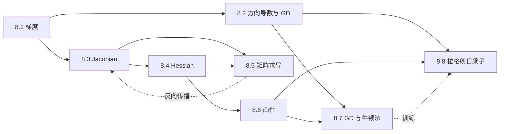

# M08 · 微积分与优化

> **一句话**：线性代数告诉你「模型长什么样」，微积分告诉你「怎么让它变好」；梯度、Jacobian、Hessian 是同一件事在标量、向量、二阶三个尺度上的展开。

## 这个模块解决什么

前七个模块都在描述「静态」的对象：向量、空间、矩阵、特征值、SVD。但大模型不是静态的——它通过一次次更新参数，把损失压下去。

于是出现一串新问题：

- 70 亿个参数，怎么知道每个该往哪调？——**梯度**（8.1）。
- 「最陡方向」为什么是梯度？步子迈多大？——**方向导数与学习率**（8.2、8.7）。
- 一层网络是向量到向量的映射，它的导数是什么？——**Jacobian**（8.3）。
- 梯度为零就一定是谷底吗？曲面有多弯？——**Hessian**（8.4）。
- 手写反向传播时，矩阵的导数怎么排版、怎么转置？——**矩阵求导**（8.5）。
- 什么条件下「局部最优」就是「全局最优」？——**凸性**（8.6）。
- 有约束（比如「别偏离参考模型太远」）时怎么优化？——**拉格朗日乘子**（8.8）。

一句话：**M08 把 M01–M07 的线性代数工具，接到「训练」这条流水线上。**

## 本模块的现实问题

1. 24 个航点坐标、阵风每秒在变，怎么知道往哪个方向挪一点能省时间？（[8.1](01-多元函数与梯度.md)）
2. 3600 万维的天气状态、2000 万个观测，Jacobian 根本存不下，同化怎么做？（[8.3](03-Jacobian.md)）
3. 12 万个有限元单元的拓扑优化，Hessian 是 12 万 × 12 万，怎么算得动？（[8.4](04-Hessian与二阶近似.md)）
4. 200 个组合、3000 只股票、60 个因子，风险归因怎么在收盘后两小时内算完？（[8.5](05-矩阵求导与链式法则.md)）

## 概念地图



读图方式：左边是「一阶信息」，右边是「二阶与约束」；8.5 是把所有导数规则落成代码的枢纽，8.7 与 8.8 是两种不同的「怎么走到最优点」。

## 学习顺序

| 顺序 | 文档 | 时间 | 读完你应该能…… |
|---|---|---|---|
| 1 | [8.1 多元函数、偏导与梯度](01-多元函数与梯度.md) | 35 min | 算偏导、写梯度、用一阶近似估计函数值 |
| 2 | [8.2 方向导数与梯度下降](02-方向导数与梯度下降.md) | 35 min | 证明最陡方向，手算 GD 的每一步 |
| 3 | [8.3 Jacobian：多元映射的导数](03-Jacobian.md) | 40 min | 写出 $m\times n$ Jacobian，做链式形状检查 |
| 4 | [8.4 Hessian 与二阶近似](04-Hessian与二阶近似.md) | 40 min | 用特征值判断极小/极大/鞍点 |
| 5 | [8.5 矩阵求导与链式法则](05-矩阵求导与链式法则.md) | 45 min | 手推线性层与两层网络的反向传播 |
| 6 | [8.6 凸性与优化](06-凸性.md) | 35 min | 用一阶/二阶判据判断凸性 |
| 7 | [8.7 梯度下降、牛顿法与学习率](07-梯度下降与牛顿法.md) | 35 min | 推出 $\eta<2/\lambda_{\max}$，解释条件数 |
| 8 | [8.8 拉格朗日乘子与约束优化](08-拉格朗日乘子.md) | 35 min | 解等式约束，理解 KKT 与 RLHF 的 $\beta$ |

**建议**：8.1–8.5 是主线，必须按顺序；8.6 可以与 8.5 并行；8.7、8.8 是两条应用分支，先读 8.7 再读 8.8 更顺。

## 本模块的大模型钩子

| 钩子 | 出现在 | 对应章节 |
|---|---|---|
| 反向传播 | 每个 `loss.backward()`，梯度与参数同形 | 8.1、8.3、8.5 |
| 优化器 | SGD/Adam 的逐元素更新，$\eta$ 与曲率 | 8.2、8.7 |
| 损失曲面 | Hessian 特征值、锐利/平坦极小 | 8.4 |
| 条件数 | 病态方向收敛慢，warmup 与归一化 | 8.7 |
| 凸性 | 最后一层分类头、KL 正则；LLM 整体非凸 | 8.6 |
| KL 约束 | RLHF/DPO 的 $\beta$，奖励与偏离的汇率 | 8.8 |

## 自测（读完再做）

1. 设 $L(\boldsymbol\theta)$ 是损失，$\boldsymbol\theta\in\mathbb{R}^{P}$。$\nabla_{\boldsymbol\theta}L$ 是什么形状？如果某一层权重 $W\in\mathbb{R}^{4096\times4096}$，它的梯度是什么形状？
2. $f(x,y)=x^2+2y^2$，在 $(1,1)$ 处沿单位方向 $\mathbf{u}=(3/5,4/5)$ 的方向导数是多少？最陡上升方向的变化率是多少？
3. $F:\mathbb{R}^4\to\mathbb{R}^2$ 的 Jacobian 是什么形状？若 $F(\mathbf{x})=A\mathbf{x}$，$A$ 是什么形状，$J_F$ 等于什么？
4. $f(x,y)=x^2+3xy+y^2$ 在原点的 Hessian 特征值是什么？原点是极小、极大还是鞍点？
5. 对 $f(\mathbf{x})=\frac12\mathbf{x}^\top A\mathbf{x}$，$A$ 的最大特征值为 8。梯度下降的学习率必须小于多少？取到上界会怎样？
6. 用拉格朗日乘子求 $\min x^2+y^2$ s.t. $x+y=1$，写出最优点、乘子与最优值。

<details>
<summary>自测答案</summary>

1. 都是 $[P]$ 与 $[4096,4096]$，**与参数同形**。这是优化器能逐元素更新的前提。
2. $\nabla f=(2,4)^\top$，$D_{\mathbf{u}}f=(2\cdot3+4\cdot4)/5=22/5=4.4$；最陡方向为 $(2,4)/\sqrt{20}$，变化率 $\sqrt{20}\approx4.472$。
3. $[2,4]$；$A\in\mathbb{R}^{2\times4}$，$J_F=A$（线性映射是自身的导数）。
4. $H=\begin{bmatrix}2&3\\3&2\end{bmatrix}$，特征值 $5$ 与 $-1$，一正一负，原点是鞍点。
5. $\eta<2/8=0.25$。取到上界时，最大特征值方向每步乘 $-1$，误差不衰减，数值上会持续震荡。
6. $2x=\lambda$、$2y=\lambda$，所以 $x=y$；代入 $x+y=1$ 得 $(1/2,1/2)$，$\lambda=1$，最优值 $1/2$。

</details>

## 动手与练习

- **Lab**：[lab08 梯度与反向传播](../labs/lab08_梯度与反向传播.py)。数值梯度对照解析梯度、验证 $\nabla(\mathbf{x}^\top A\mathbf{x})=(A+A^\top)\mathbf{x}$、画二维 GD 轨迹、用 Hessian 特征值解释学习率上界、手写两层网络反向传播。
- **习题**：[m08-习题](../exercises/m08-习题.md)（A 概念 / B 计算 / C 大模型 / D 开放），做完再对 [答案](../exercises/m08-答案.md)。

```bash
uv run --with numpy python labs/lab08_梯度与反向传播.py
```

## 约定与提醒

- 本模块统一：**标量对变量求导，梯度与变量同形**；**向量对向量求导，Jacobian 为 $[m,n]$，行是输出、列是输入**。8.5 节把这个约定讲透，并说明它与其它教材的差异。
- 手算例子都可以用 lab08 的数值梯度复核。若你的推导和代码不一致，先检查索引与转置。
- 本模块不展开测度论、完整 KKT 证明与随机优化收敛分析；这些属于进阶阅读。

---

上一篇 → M07 SVD（模块导览尚未发布） ｜ 下一篇 → 模块 M09 概率与统计（尚未发布）
