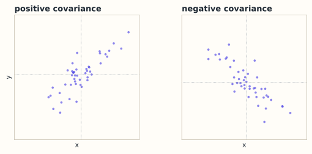

# 9.1 概率与随机变量：从样本到分布

> **本节位置**：模块 9 · 概率与统计 ｜ **前置**：[1.4 范数与距离](../01-向量与几何/04-范数与距离.md) ｜ **预计**：35 分钟
>
> **一句话**：分布是生成数据的规则，样本是规则吐出的一张牌；期望和方差用两个数概括牌堆的中心与胖瘦。

## 0. 场景引入

一家电商的实验平台每周同时跑 **40 个** A/B 实验。这周要判的是「一键下单」改版：**210 万**用户随机对半分，对照组 105 万人转化率 **4.31%**，实验组 105 万人转化率 **4.34%**。

差 0.03 个百分点，折算成订单是 **315 单**。可按二项分布估算，即使两组真实转化率完全相同，这个差值本身的波动（标准差）也有 **0.028 个百分点**，约 295 单——信号只比噪声高一点点，$z$ 约为 1.1。

产品经理要在 24 小时内决定：立刻全量上线，还是再等一周把样本翻倍？如果效应是真的，每天多 315 单、客单价 180 元，一年约 2 070 万元；如果它是噪声，上线后要回滚、发版、培训客服，代价远不止等一周少赚的 40 万元。

他手里只有一个数：两个转化率之差。要判断它是不是真的，先得把「一个用户会不会下单」看成**随机变量**，把 210 万次曝光看成**样本**，再用期望与方差说清楚「差多少才算不一样」。

读完你能回答的三个问题：

1. 4.34% 与 4.31% 的差，正常波动有多大？
2. 为什么能用 105 万个样本的方差，去代替「全体用户」的方差？
3. 如果同时看转化率与客单价，协方差告诉你什么？

## 1. 直觉

一维直方图里，**均值（mean）** 是点云重心，**方差（variance）** 是绕重心的转动惯量。二维点云则多了一个「往哪斜」的信息：



*图：虚线是两维各自的均值。同向偏离时协方差为正，反向为负；点云接近正圆时接近 0。*

同向偏离时协方差为正，反向为负，云团像正圆时接近 0。

> 💡 **一句话直觉**：**方差量点云有多胖，协方差量点云往哪个斜方向胖。**

### 1.1 它在现实世界里对应什么

回到实验平台。那些抽象符号在这里都有一张具体的脸：

| 数学对象 | A/B 实验里的对应物 |
|---|---|
| 随机变量 $X$ | 一个用户「是否下单」，取值 0 或 1 |
| 分布 $p(x)$ | 全体用户的下单倾向，由真实转化率 $p$ 决定 |
| 样本均值 $\hat{\boldsymbol\mu}$ | 105 万人的实测转化率 4.34% |
| 方差 $\sigma^2=p(1-p)$ | 用户之间的差异：伯努利变量的方差 |
| 标准误（standard error）$\sigma/\sqrt n$ | 这个 4.34% 自身的抖动，约 $0.028$ 个百分点 |
| 协方差 $\operatorname{Cov}(X,Y)$ | 「下单」与「客单价」是否同涨同落 |

均值是「这批人的典型表现」，方差是「个体之间的分歧有多大」，而样本量 $n$ 决定「把分歧平均掉之后还剩多少抖动」。三者合起来，才构成「可信」这个词的数学内容。

**量级直觉**（经验值）：$p\approx4\%$、$n=10^6$ 时，标准误 $\sqrt{p(1-p)/n}\approx0.02$ 个百分点。也就是说，转化率这个数字写到小数点后第二位就开始抖了；想分辨 0.01 个百分点的提升，样本量要再加一个数量级。

### 1.2 这个类比在哪里失效

均值和方差只描述**前两阶**信息。两个双峰分布可以有相同的均值和方差，形状却完全不同；完整描述需要整个概率函数。

第二个失效点更要紧：A/B 实验里「样本独立」这个前提常被破坏。同一台手机会下两单、同一个家庭的两个账号会一起收到优惠券、社交裂变会让实验组互相影响——这时真实的方差比二项公式大，$\sigma/\sqrt n$ 会把噪声低估，你算出的 $z$ 就虚高。公式没错，是那条「独立同分布」的假设在这里断了。

## 2. 定义

### 2.1 随机变量与分布

**[随机变量](#ref-kolmogorov-1933)（random variable）** 是映射 $X:\Omega\to\mathbb{R}$。离散情形用**概率质量函数（probability mass function, pmf）** $p(x)=\Pr(X=x)$，满足 $p(x)\ge0$、$\sum_x p(x)=1$；连续情形用**概率密度函数（probability density function, pdf）** $f(x)\ge0$、$\int f(x)\,dx=1$。注意 $f(x)$ 可以大于 1，只有积分才是概率。

### 2.2 期望、方差、标准差

**期望（expectation）** $\mathbb{E}[X]=\sum_x x\,p(x)$（离散）或 $\int x f(x)\,dx$（连续）；**方差（variance）** $\operatorname{Var}(X)=\mathbb{E}[(X-\mathbb{E}[X])^2]=\mathbb{E}[X^2]-\mathbb{E}[X]^2$。这里 $\sigma_X=\sqrt{\operatorname{Var}(X)}$ 是**标准差（standard deviation）**，与 $X$ 同单位；后一个等号是计算时最常用的形式。

### 2.3 协方差与相关系数

两个随机变量的**协方差（covariance）**：

$$
\operatorname{Cov}(X,Y)=\mathbb{E}[(X-\mathbb{E}[X])(Y-\mathbb{E}[Y])]=\mathbb{E}[XY]-\mathbb{E}[X]\mathbb{E}[Y]
$$

读法：各自减去均值再相乘求期望。**[相关系数](#ref-pearson-1896)（correlation coefficient）** $\rho_{XY}=\operatorname{Cov}(X,Y)/(\sigma_X\sigma_Y)\in[-1,1]$ 去掉了量纲。

对随机向量 $\mathbf{x}=(X_1,\dots,X_D)^\top$，**协方差矩阵（covariance matrix）** $\Sigma=\mathbb{E}[(\mathbf{x}-\boldsymbol\mu)(\mathbf{x}-\boldsymbol\mu)^\top]$，其中 $\Sigma_{ij}=\operatorname{Cov}(X_i,X_j)$。对角元是各维方差，$\Sigma=\Sigma^\top$。

### 2.4 样本估计

$$
\hat{\boldsymbol\mu}=\frac1n\sum_{i=1}^n\mathbf{x}_i,\qquad
\hat\Sigma=\frac{1}{n-1}\sum_{i=1}^n(\mathbf{x}_i-\hat{\boldsymbol\mu})(\mathbf{x}_i-\hat{\boldsymbol\mu})^\top
$$

式中前者是**样本均值（sample mean）**，后者是**样本协方差（sample covariance）**；分母 $n-1$ 使 $\mathbb{E}[\hat\Sigma]=\Sigma$（无偏）；除以 $n$ 是最大似然估计，样本多时几乎一样。

### 2.5 大数定律

**大数定律（law of large numbers）**：若 $X_1,\dots,X_n$ 独立同分布、期望 $\mu$、方差有限，则样本均值依概率收敛：$\bar X_n=\frac1n\sum_iX_i\xrightarrow{P}\mu$。这就是「样本多时频率稳定」的数学版本，保证上面的估计在 $n$ 变大时靠谱。

## 3. 为什么这样定义

**协方差为什么减 $\mathbb{E}[X]\mathbb{E}[Y]$？** 不减的话，$\mathbb{E}[XY]$ 会把两个变量各自的整体水平算进去。身高体重都为正，$\mathbb{E}[XY]$ 天然很大，却不说明相关；减去均值后只看「同时偏离中心」的部分。

**为什么用平方而不是绝对值？** 平方可导、与欧氏几何一致，还带来可加性：不相关时方差直接相加。绝对值是另一种风险度量，但在 0 点不可导。

**为什么协方差矩阵半正定？** 把中心化样本堆成 $X_c\in\mathbb{R}^{n\times D}$，则 $\hat\Sigma=\frac{1}{n-1}X_c^\top X_c$，是 Gram 矩阵（第 2.7 节）。于是它半正定，且 $\operatorname{rank}(\hat\Sigma)\le\min(n-1,D)$。样本数少于维度时，协方差必然奇异——这条事实后面反复出现。

**为什么除 $n-1$？** $\hat{\boldsymbol\mu}$ 来自同一批数据，用掉一个自由度：离差满足 $\sum_i(x_i-\hat\mu)=0$，$n$ 个离差只有 $n-1$ 个自由。除以 $n-1$ 正好补偿。

### 3.1 反事实：不减均值、或者不用平方，会坏在哪

**反事实 A：直接用 $\mathbb{E}[XY]$ 当「关联度」，不减均值。**

取 $X\in\{1,3\}$、$Y\in\{1,3\}$（可以想成「价格档位」与「成交量档位」），比较三种搭配：

| 搭配 | $\mathbb{E}[XY]$ | $\mathbb{E}[X]\mathbb{E}[Y]$ | 协方差 |
|---|---|---|---|
| 同向 $(1,1),(3,3)$ 各 $1/2$ | $5$ | $4$ | $+1$ |
| 独立四种组合各 $1/4$ | $4$ | $4$ | $0$ |
| 反向 $(1,3),(3,1)$ 各 $1/2$ | $3$ | $4$ | $-1$ |

三个 $\mathbb{E}[XY]$ 只差 $\pm1$，而 $4$ 这个「整体水平」占了八成的份量。若 $Y$ 改用「分」而不是「元」，$\mathbb{E}[XY]$ 整体放大 100 倍，差值也跟着放大——**判读结果完全取决于量纲**。减掉均值后，$+1,0,-1$ 才干净地只说出「同向、无关、反向」。

**反事实 B：用绝对值的期望 $\mathbb{E}\lvert X-\mu_X\rvert\,\lvert Y-\mu_Y\rvert$ 代替协方差。**

取 $X\in\{-1,0,1\}$ 等概率、$Y=X^2$，则 $\mathbb{E}[Y]=2/3$、$\mathbb{E}[X]=0$：

$$
\operatorname{Cov}(X,Y)=\mathbb{E}[X^3]-\mathbb{E}[X]\mathbb{E}[X^2]=0
$$

但绝对值版本给出

$$
\mathbb{E}\big[\lvert X\rvert\,\lvert X^2-2/3\rvert\big]
=\frac13\Big(\frac13+0+\frac13\Big)=\frac29\approx0.222>0
$$

真相是 $Y$ 完全由 $X$ 决定，协方差却报 0，绝对值版本报「有关联」。**两个都不算错，各有各的用途**：绝对值版本对非线性依赖更敏感，但它不再双线性，于是 $\operatorname{Var}(X+Y)=\operatorname{Var}(X)+\operatorname{Var}(Y)+2\operatorname{Cov}(X,Y)$ 这条可加性直接作废——而后者正是误差按平方和累加的全部基础。这就是协方差为什么必须是「乘起来再求期望」：只有双线性，才能被矩阵和矩阵分解接管，才有后面 9.2、9.3、9.4 的整条链。

## 4. 性质与推导

### 4.1 期望的线性性

$\mathbb{E}[aX+bY+c]=a\mathbb{E}[X]+b\mathbb{E}[Y]+c$。这条**不需要独立性**，是概率里最容易被低估的工具。

### 4.2 方差公式

$\operatorname{Var}(X)=\mathbb{E}[(X-\mu)^2]=\mathbb{E}[X^2]-2\mu\mathbb{E}[X]+\mu^2=\mathbb{E}[X^2]-\mu^2$。

### 4.3 协方差的双线性

$\operatorname{Cov}(aX+bY,Z)=a\operatorname{Cov}(X,Z)+b\operatorname{Cov}(Y,Z)$，且 $\operatorname{Cov}(X,X)=\operatorname{Var}(X)$。于是 $\operatorname{Var}(X+Y)=\operatorname{Var}(X)+\operatorname{Var}(Y)+2\operatorname{Cov}(X,Y)$：只有不相关时方差才直接相加，这就是误差按平方和累加的来源。

### 4.4 协方差矩阵半正定

对任意 $\mathbf{a}$，$\mathbf{a}^\top\Sigma\mathbf{a}=\mathbb{E}\big[(\mathbf{a}^\top(\mathbf{x}-\boldsymbol\mu))^2\big]\ge0$，它正是标量 $\mathbf{a}^\top\mathbf{x}$ 的方差。等号成立当且仅当数据在 $\mathbf{a}$ 方向上没有波动。

### 4.5 相关系数的范围

对中心化变量用[柯西–施瓦茨不等式](#ref-cauchy-1821)（第 1.3 节）：$|\operatorname{Cov}(X,Y)|\le\sigma_X\sigma_Y$，故 $|\rho|\le1$。$\rho=1$ 表示 $Y$ 是 $X$ 的正线性函数，$-1$ 表示负线性函数；非线性依赖可以做到 $\rho=0$。

### 4.6 无偏性与收敛

由 $\sum_i(X_i-\bar X)^2=\sum_i(X_i-\mu)^2-n(\bar X-\mu)^2$，取期望得 $n\sigma^2-n\cdot\sigma^2/n=(n-1)\sigma^2$。所以除以 $n-1$ 后期望正好是 $\sigma^2$。又 $\operatorname{Var}(\bar X)=\sigma^2/n\to0$，切比雪夫不等式给出依概率收敛。

## 5. 例子

### 5.1 手算：一个联合分布

设 $X\in\{0,1,2\}$，概率 $0.2,0.5,0.3$，令 $Y=X^2$：

| $x$ | 0 | 1 | 2 |
|---|---|---|---|
| $p(x)$ | 0.2 | 0.5 | 0.3 |
| $y=x^2$ | 0 | 1 | 4 |

$X$ 的矩：$\mathbb{E}[X]=0+0.5+0.6=1.1$，$\mathbb{E}[X^2]=0+0.5+1.2=1.7$，故 $\operatorname{Var}(X)=1.7-1.21=0.49$。

$Y$ 的矩：$\mathbb{E}[Y]=0+0.5+1.2=1.7$，$\mathbb{E}[Y^2]=0+0.5+4.8=5.3$，故 $\operatorname{Var}(Y)=5.3-2.89=2.41$。

协方差：

$$
\mathbb{E}[XY]=\mathbb{E}[X^3]=0+0.5+2.4=2.9,\quad
\operatorname{Cov}(X,Y)=2.9-1.1\cdot1.7=1.03,\quad
\rho_{XY}=\frac{1.03}{\sqrt{0.49\cdot2.41}}\approx0.948
$$

$Y$ 完全由 $X$ 决定，相关系数却只有 $0.948$：$Y=X^2$ 不是线性函数，$\rho$ 只捕捉线性部分。

### 5.2 手算：样本方差为什么除 $n-1$

样本 $(1,2,4)$：$\bar x=7/3\approx2.333$，离差 $-4/3,-1/3,5/3$，平方和 $=14/3$。于是 $s^2=\frac{14/3}{2}=\frac73\approx2.333$，除以 $n$ 则得 $\frac{14/3}{3}=\frac{14}{9}\approx1.556$。比值 $3/2=n/(n-1)$；$n=1000$ 时只差 0.1%。

### 5.3 场景：一层激活的协方差

$D=4096$、$n=8000$，$\hat\Sigma$ 是 $[4096,4096]$，共 $16{,}777{,}216$ 个数，fp32 下 64 MiB。对角元是各维方差（该特征活不活跃），非对角元是两维是否同涨同落。若 $\rho_{ij}=0.3$，只有中等线性同步；相关不等于冗余，更不等于因果。

### 5.4 场景闭环：210 万人、一次上线决策

把开头那场实验从头算到尾。

**输入**：两组各 $1{,}050{,}000$ 条曝光记录，每条只需 `(group:int8, converted:int8, gmv:float32)`，共 $2.1\times10^6\times6\ \text{B}\approx12.6\ \text{MB}$。扫描一遍是 $O(n)$ 的，单核十几毫秒。

**计算**：两组转化率之差

$$
\hat\Delta=\hat p_1-\hat p_0=0.0434-0.0431=0.0003
$$

标准误按两组独立、二项方差 $\hat p(1-\hat p)$ 估：

$$
\widehat{\operatorname{se}}(\hat\Delta)=\sqrt{\frac{2\hat p(1-\hat p)}{n}}
=\sqrt{\frac{2\times0.0431\times0.9569}{1.05\times10^6}}\approx2.8\times10^{-4}
$$

于是 $z=\hat\Delta/\widehat{\operatorname{se}}\approx1.07$，95% 置信区间

$$
0.0003\pm1.96\times0.00028=[-0.00025,\ 0.00085]
$$

**这个式子说的是**：真实效应可能为负——**区间跨过了 0**。

**输出**：决策是「不显著，不上线；把样本跑到下周」。下周每组样本翻倍，$\widehat{\operatorname{se}}$ 按 $1/\sqrt2$ 降到约 $0.020$ 个百分点；若真实效应真是 0.03 个百分点，届时 $z$ 会升到约 1.5，还不够；要到每组 400 万人才比较稳（按 $\Delta/\operatorname{se}\ge2$ 反解 $n\approx2\hat p(1-\hat p)(2/\Delta)^2\approx3.7\times10^6$）。

第二件事：同时看客单价 $Y$。若 $\widehat{\operatorname{Cov}}(\text{下单},\text{客单价})\approx-12$ 元，读法是「下单的人客单价平均低了 12 元」——转化率涨 0.03 个百分点带来的人，可能被客单价的下滑抵消掉，这时该看的是 GMV 而不是转化率。

**成本**：12.6 MB 访存、一遍 $O(n)$ 求和，十几毫秒。若改用逐日 bootstrap 1000 次重采样来估 $p$ 值，代价是 $1000\times2.1\times10^6\approx2\times10^9$ 次抽样，分钟级——这也是为什么线上平台默认用解析公式而不是重采样。

**失败条件与兜底**：

- **用户不独立**：同一人多设备、家庭共享账号、社交裂变，会让真实方差大于二项公式，$z$ 虚高。兜底：按用户聚类做 delta method，或用 cluster bootstrap。
- **多重比较**：一周 40 个实验、每个看 3 个指标，就是 120 次检验；在 5% 水平下期望 6 个假阳性。兜底：Bonferroni 收紧阈值，或改用 FDR 控制。
- **偷看与早停**：每天看一次、显著就停，会让假阳性率从 5% 涨到 20% 以上（可选停止偏差）。兜底：事先定样本量与检验时点。
- **指标不独立**：转化率与客单价协方差非零时，单指标决策会漏掉另一边的损失。兜底：把 GMV 作为唯一主指标，或做多指标联合检验。

## 6. 常见误区

1. **误区**：协方差为 0 就是独立。**纠正**：只说明没有线性关系。取 $X$ 在 $\{-1,0,1\}$ 均匀、$Y=X^2$，则 $\operatorname{Cov}(X,Y)=\mathbb{E}[X^3]-\mathbb{E}[X]\mathbb{E}[X^2]=0$，但 $Y$ 完全由 $X$ 决定。只有联合高斯时，不相关才等价于独立。
2. **误区**：样本协方差就是真实协方差。**纠正**：它是估计量，本身有波动；$n$ 个样本的协方差秩不超过 $n-1$，$n<D$ 时必然奇异。
3. **误区**：方差可以直接相加。**纠正**：$\operatorname{Var}(X+Y)=\operatorname{Var}(X)+\operatorname{Var}(Y)+2\operatorname{Cov}(X,Y)$，不相关时后一项才消失。
4. **误区**：相关系数 0.9 说明强因果或高度冗余。**纠正**：它只说明线性同向程度，可能有共同原因或数据泄漏。

## 7. 概念网络

- 前置：[1.4 范数与距离](../01-向量与几何/04-范数与距离.md) —— 方差是中心化向量长度平方的平均。
- 前置：[6.5 二次型与正定](../06-特征值/05-二次型与正定.md) —— $\mathbf{a}^\top\Sigma\mathbf{a}$ 是二次型，非负即半正定。
- 后续：[9.2 多元高斯](02-多元高斯.md) —— 用 $\boldsymbol\mu,\Sigma$ 完整描述一类分布。
- 后续：[9.3 PCA](03-PCA.md) —— 对 $\Sigma$ 做特征分解，找方差最大的方向。
- 后续：[9.4 白化](04-白化.md) —— 把 $\Sigma$ 变成单位阵。
- 关联：[11.11 logits、softmax、温度](../11-大模型专题/11-logits与采样.md) —— 从 logits 到采样分布。

## 8. 通往大模型：激活统计与采样

**出现位置**：每层激活的协方差、LayerNorm 的均值/方差、参数初始化的方差推导，以及从 logits 采样下一个 token。

**形状**：隐藏状态 $X\in\mathbb{R}^{B\times T\times D}$，摊平成 $N=BT$ 个样本；$\hat{\boldsymbol\mu}\in\mathbb{R}^{D}$，$\hat\Sigma\in\mathbb{R}^{D\times D}$。$D=4096$ 时 $\hat\Sigma$ 有 1677 万个数（fp32 64 MiB）；$N<D$ 时它必然奇异。

**为什么需要**：线性层 $\mathbf{y}=W\mathbf{x}$ 在独立假设下 $\operatorname{Var}(y_i)=\sum_jW_{ij}^2\operatorname{Var}(x_j)$。取 $W_{ij}\sim\mathcal{N}(0,1/D)$、输入方差 1，输出方差约 1；若误用 $\mathcal{N}(0,1)$，$D=4096$ 时输出方差约 4096，深网络会指数爆炸。LayerNorm 则直接除以当前 token 的标准差。

**可检验结论**：用 $n$ 个样本估计均值的误差量级是 $\sigma/\sqrt{n}$；$\sigma=1,n=1000$ 时约 3.2%，这解释了大 batch 的统计为什么更稳。

```python
import numpy as np
rng = np.random.default_rng(0)
X = rng.normal(size=(8000, 4096))          # [N, D]
mu = X.mean(axis=0)                         # [D]
Xc = X - mu
Sigma = Xc.T @ Xc / (len(X) - 1)            # [D, D]
print(Sigma.shape, np.trace(Sigma) / 4096)  # 平均方差 ≈ 1
```

**采样温度**：$p_i\propto\exp(z_i/T)$。$T\to0$ 退化为 one-hot（贪心），$T\to\infty$ 趋于均匀。温度改变的是概率质量集中的范围，不是 logits 的方差；这正好接上 9.2 与 11.11。

**如果这一步算错，下游看到什么现象**：均值、方差这类统计量出错，通常**不会报错**，只会让下游悄悄变差。

- 忘记减均值直接算二阶矩 $X^\top X/n$：PCA 的第一主成分会偏到「均值方向」，散点图上所有样本得分同号，看起来「结构很强」，其实是整体偏移。
- 初始化时把方差写成标准差（或漏掉 $1/D$）：$D=4096$ 的线性层输出方差会差 4 096 倍，深网络的 loss 在前几十步就出现尖峰或直接 NaN。
- 用 $1/n$ 与 $1/(n-1)$ 混用：解释方差比不受影响（比值的常数约掉了），但重建误差与似然阈值会差 $n/(n-1)$ 倍，跨模型比较时会出现「同样的数据，两个脚本给出两个误差」。

这些错误的共同特征是：**数值都有限、曲线都连续，只有指标在慢慢偏**。所以排查时要先对齐统计量的定义，再怀疑模型。

## 9. 练习

1. **概念**：一句话区分「概率分布」与「样本」，并说明 3 个样本为什么估不出 4096 维协方差。
2. **计算**：$X\in\{1,2,3\}$，概率 $0.2,0.5,0.3$，令 $Y=2X+1$。求 $\mathbb{E}[X],\operatorname{Var}(X),\operatorname{Cov}(X,Y),\rho_{XY}$。
3. **计算**：样本 $(2,4,6)$，分别用 $n-1$ 与 $n$ 作分母求方差。
4. **场景**：$n=100$、$D=4096$ 时样本协方差的秩最多是多少？哪些下游计算会失效？
5. **开放**：举一个「协方差为 0 但明显不独立」的例子，并说明激活维度「不相关」为什么不能当作「信息不重叠」。

<details>
<summary>参考答案</summary>

1. 分布是生成样本的规则，样本是按规则抽出的点。3 个样本的中心化矩阵秩最多 2，协方差秩也最多 2，远小于 4096。
2. $\mathbb{E}[X]=2.1$，$\mathbb{E}[X^2]=4.9$，$\operatorname{Var}(X)=0.49$；$\operatorname{Cov}(X,Y)=2\operatorname{Var}(X)=0.98$，$\rho=1$。
3. 均值 4，离差平方和 8；$s^2=8/2=4$，除以 $n$ 得 $8/3\approx2.667$。前者无偏。
4. 秩 $\le99$。$\hat\Sigma$ 不可逆，密度没有定义；PCA 最多 99 个非零方向；白化、马氏距离、高斯似然都失效。
5. $X$ 在 $\{-1,0,1\}$ 均匀、$Y=X^2$。不相关只说明没有线性同步，仍可能通过非线性方式共享信息。

</details>

## 10. 一页速记

- 分布是规则，样本是抽样；用 $\hat{\boldsymbol\mu},\hat\Sigma$ 从样本估计分布。
- **物理意义 / 现实对应**：均值是点云重心，方差是绕重心的转动惯量；在实验平台上，它们就是「实测转化率」和「这个数字自身的抖动」，单位分别是「个」和「个²」。
- $\operatorname{Var}(X)=\mathbb{E}[X^2]-\mathbb{E}[X]^2$，$\operatorname{Cov}(X,Y)=\mathbb{E}[XY]-\mathbb{E}[X]\mathbb{E}[Y]$。
- $\hat\Sigma=\frac{1}{n-1}X_c^\top X_c$ 是 Gram 矩阵，半正定，秩 $\le\min(n-1,D)$。
- $\rho\in[-1,1]$ 只测线性关系；不相关不等于独立。
- 大数定律：$\bar X_n\to\mu$，误差量级 $\sigma/\sqrt{n}$。

## 11. 参考文献与致谢

这一页的知识不是凭空来的。下面列出本页直接借用的原始工作与权威整理；正文中的人名、定理名已链接到对应条目。链接优先指向 DOI、arXiv 或可长期访问的原文存档。

- <a id="ref-kolmogorov-1933"></a>**柯尔莫哥洛夫（Andrey N. Kolmogorov, 1933）**：*Grundbegriffe der Wahrscheinlichkeitsrechnung*。把概率论建立在测度论公理之上，本页的随机变量 $X:\Omega\to\mathbb{R}$、期望与分布都在这个框架里定义。[Springer（DOI）](https://doi.org/10.1007/978-3-642-49888-6)
- <a id="ref-pearson-1896"></a>**皮尔逊（Karl Pearson, 1896）**：*Mathematical Contributions to the Theory of Evolution. III. Regression, Heredity, and Panmixia*。把相关系数与回归做成可计算的统计量，本页 $\rho_{XY}=\operatorname{Cov}(X,Y)/(\sigma_X\sigma_Y)$ 的归一化定义沿用的就是这条线。[Royal Society（DOI）](https://doi.org/10.1098/rsta.1896.0007)
- <a id="ref-cauchy-1821"></a>**柯西（Augustin-Louis Cauchy, 1821）**：*Cauchy's Cours d'analyse: An Annotated Translation*（原著 *Cours d'analyse de l'École royale polytechnique*，1821）。柯西–施瓦茨不等式的有限和形式出自这部讲义；本页用它证明 $|\rho_{XY}|\le1$。[英译注本（Springer, 2009）](https://doi.org/10.1007/978-1-4419-0549-9)

---

下一篇 → [9.2 多元高斯](02-多元高斯.md)
