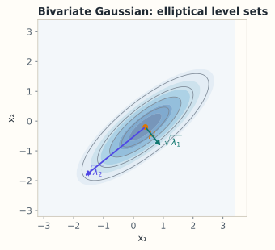

# 9.2 多元高斯：协方差矩阵的形状

> **本节位置**：模块 9 · 概率与统计 ｜ **前置**：[9.1 概率与随机变量](01-概率与随机变量.md)、[6.5 二次型与正定](../06-特征值/05-二次型与正定.md) ｜ **预计**：40 分钟
>
> **一句话**：知道均值向量和协方差矩阵，[高斯](#ref-gauss-1809)的形状就完全确定：特征向量给方向，特征值给轴长的平方。

## 0. 场景引入

凌晨两点的城市高架上，一辆无人配送车正在找自己。IMU 以 **100 Hz** 输出加速度与角速度，每 **10 ms** 给一次位姿增量；GNSS 每秒只给 **1 次**定位，单点解的标准差约 **1.5 m**。桥下丢星 5 秒，IMU 单独积分的位置漂移按 1 m/s 估算就是 **5 m**——车道宽只有 3.5 m，这一步就能压线。

融合器的核心只是几个数：位置估计写成均值 $\boldsymbol\mu\in\mathbb{R}^2$，不确定性写成协方差 $\Sigma$。IMU 预测时把 $\Sigma$ 沿行驶方向吹大，GNSS 到来时用条件高斯把它压回去。

决策：这一刻的位置该信谁、信多少？代价很具体：若 $\Sigma$ 估小了，滤波器会把一次多径反射（真实偏差 8 m）当成 1.5 m 的观测一口吞下，估计被拽到隔壁车道。

读完你能回答的三个问题：

1. 为什么 5 个数（均值 2 个 + 协方差 3 个）就足以描述一团二维点云？
2. $\Sigma$ 的特征值、特征向量分别对应「不确定性的哪一面」？
3. 观测到来时，条件高斯把方差压小了多少，凭什么算得出来？

## 1. 直觉

一元高斯由 $\mu$ 和 $\sigma^2$ 决定：钟形的中心和宽度。二元高斯是一个**倾斜的椭圆山包**：



*图：协方差矩阵的特征向量给出椭圆轴的方向，特征值给出轴长的平方。*

山顶在 $\boldsymbol\mu$；等高线是同心椭圆；长轴沿方差最大的特征向量，短轴沿方差最小的；轴长是 $\sqrt{\lambda_i}$。不相关时椭圆正放，相关系数为正时沿右上倾斜。

> 💡 **一句话直觉**：**$\Sigma$ 是一张「把单位圆揉成椭圆」的配方：先按 $\sqrt{\lambda_i}$ 拉伸坐标轴，再旋转到特征向量方向。**

### 1.1 它在现实世界里对应什么

在组合导航里，这个椭圆不是比喻，它就是仪表上那个圈：

| 数学对象 | 组合导航里的对应物 |
|---|---|
| 均值 $\boldsymbol\mu$ | 当前最可能的位置 $(x,y)$，单位米 |
| $\Sigma$ 的特征向量 | 不确定性被拉长的方向：沿车道方向最长 |
| 特征值 $\lambda_i$ | 该方向上的方差，单位 $\text{m}^2$ |
| 半轴 $\sqrt{\lambda_i}$ | 该方向的标准差，单位 $\text{m}$ |
| 95% 等高线 | 位置落在圈内的概率 95%，即「置信椭圆」 |

理解这张表的钥匙是**单位**：$\lambda$ 的单位是米平方，$\sqrt\lambda$ 才是米。没人会说「我的误差是 4 平方米」。

**量级直觉**：GNSS 单点定位 $\sigma=1.5$ m 时，$\Sigma=2.25I$。二维 95% 区域由 $\chi^2_2(0.95)=5.991$ 给出，半径

$$
r=\sqrt{5.991}\times1.5\approx2.448\times1.5\approx3.7\ \text{m}
$$

一枚 95% 置信圆比车道还宽——**单靠 GNSS 做不了车道级定位**，这就是必须融合 IMU、或上 RTK 的量级理由。

### 1.2 这个类比在哪里失效

**椭圆只画出「密度相同」的点，不表示概率在边界最大**。二维高斯的概率质量集中在椭圆的环带上——中心密度最高，但面积小。

**GNSS 的误差不是单峰高斯**。多径环境下误差是多峰的、有偏的（可能总是偏向某一侧的高楼）。用 $\Sigma$ 描述它，等于把「系统性偏差」当成「可平均掉的随机抖动」，滤波器会因此过度自信。

**IMU 的误差也不白**。零偏随温度漂移，是慢变状态而不是零均值噪声。真实系统要把零偏也放进状态一起估——这就是为什么工程上常见的是 15 维状态（位置 3 + 速度 3 + 姿态 3 + 加速度零偏 3 + 陀螺零偏 3），而不是本节这个 2 维玩具。

## 2. 定义

### 2.1 从标准正态到一般高斯

设 $\mathbf{z}\sim\mathcal{N}(\mathbf{0},I_D)$，各分量独立标准正态。取 $L\in\mathbb{R}^{D\times D}$、$\boldsymbol\mu$，令 $\mathbf{x}=\boldsymbol\mu+L\mathbf{z}$，则 $\mathbf{x}$ 是**多元高斯（multivariate Gaussian）** $\mathcal{N}(\boldsymbol\mu,\Sigma)$，其中 $\Sigma=LL^\top$。常用 $L=\Sigma^{1/2}$（对称平方根）或 Cholesky 因子。

### 2.2 概率密度

当 $\Sigma$ 正定时：

$$
f(\mathbf{x})=\frac{1}{(2\pi)^{D/2}|\Sigma|^{1/2}}
\exp\!\left(-\frac12(\mathbf{x}-\boldsymbol\mu)^\top\Sigma^{-1}(\mathbf{x}-\boldsymbol\mu)\right)
$$

指数里的二次型是**[马氏距离](#ref-mahalanobis-1936)（Mahalanobis distance）** 的平方，衡量「离中心几个标准差」；分母的 $|\Sigma|^{1/2}$ 是椭球体积缩放因子，保证积分为 1。

### 2.3 均值与协方差

$\mathbb{E}[\mathbf{x}]=\boldsymbol\mu$，$\operatorname{Cov}(\mathbf{x})=\mathbb{E}[(\mathbf{x}-\boldsymbol\mu)(\mathbf{x}-\boldsymbol\mu)^\top]=\Sigma$。对高斯来说，这两个量不只是前两阶矩，而是**全部信息**：所有高阶矩都能由它们算出（[Isserlis 定理](#ref-isserlis-1918)）。

### 2.4 等高线与椭圆轴

令 $\Sigma=V\Lambda V^\top$，$\Lambda=\operatorname{diag}(\lambda_1,\dots,\lambda_D)$，$\lambda_1\ge\cdots\ge\lambda_D>0$。做坐标变换 $\mathbf{y}=V^\top(\mathbf{x}-\boldsymbol\mu)$：

$$
(\mathbf{x}-\boldsymbol\mu)^\top\Sigma^{-1}(\mathbf{x}-\boldsymbol\mu)=\sum_{i=1}^{D}\frac{y_i^2}{\lambda_i}
$$

等高线 $\sum_i y_i^2/\lambda_i=c^2$ 是椭圆，第 $i$ 条半轴长为 $c\sqrt{\lambda_i}$，方向为 $\mathbf{v}_i$。

### 2.5 正定与退化

$\Sigma$ **正定（positive definite）**（$\Sigma\succ0$）等价于所有 $\lambda_i>0$，也等价于对任意 $\mathbf{a}\neq\mathbf{0}$ 有 $\mathbf{a}^\top\Sigma\mathbf{a}>0$。此时密度存在、$\Sigma^{-1}$ 存在。若某个 $\lambda_i=0$，概率质量落在一个低维子空间里：没有 $D$ 维密度，$\Sigma$ 不可逆，只能用伪逆描述。

### 2.6 独立与不相关

对**联合高斯**，$\operatorname{Cov}(X_i,X_j)=0$ 等价于 $X_i,X_j$ 独立，因为密度可分解为各维因子之积。对非高斯分布，这个等价关系不成立（9.1 的反例）。

## 3. 为什么这样定义

**为什么高斯只需要两个矩？** 高斯是给定均值与协方差时熵最大的分布。只知道「中心在哪、往哪散」而不假设更多结构时，它是最不武断的选择，这是它无处不在的原因之一。

**为什么指数里是 $\Sigma^{-1}$？** 因为要度量「沿每个主方向走了几个标准差」。在 $y_i$ 坐标里标准差是 $\sqrt{\lambda_i}$，归一化距离是 $y_i/\sqrt{\lambda_i}$，平方和为 $y_i^2/\lambda_i$，写成矩阵就是 $(\mathbf{x}-\boldsymbol\mu)^\top\Sigma^{-1}(\mathbf{x}-\boldsymbol\mu)$。

**为什么分母有 $|\Sigma|^{1/2}$？** 密度必须积分为 1。线性变换 $\mathbf{x}=\boldsymbol\mu+L\mathbf{z}$ 把体积放大 $|\det L|$ 倍，而 $|\det L|=\sqrt{|\Sigma|}$（第 5.1 节的体积视角），所以要除以它。

**为什么要求正定？** 若 $\Sigma$ 奇异，椭圆在某个方向被压成 0，密度在该方向是狄拉克函数，$\Sigma^{-1}$ 也不存在。工程上常加 $\epsilon I$ 正则化，把它变回正定。

### 3.1 反事实：用欧氏距离代替马氏距离会坏在哪

**反事实 A：各方向尺度不同。** 设 $\Sigma=\operatorname{diag}(100,1)$，即 $x$ 方向标准差 10 m、$y$ 方向 1 m。95% 圆锥椭圆的半轴是 $\sqrt{100\times5.991}\approx24.5$ 与 $\sqrt{5.991}\approx2.45$。

| 点 | 欧氏距离 | 马氏距离$^2$ | 判定 |
|---|---|---|---|
| $A=(12,0)$ | $12$ | $144/100=1.44$ | $1.2\sigma$，正常 |
| $B=(0,3)$ | $3$ | $9$ | $3\sigma$，超出 2.45 半轴，离群 |

欧氏距离把「沿长轴走了 12 m 的正常波动」判成最远的点，却把「垂直于车道偏了 3 m 的真异常」放进了正常区。同样是 3 m，在不同方向上含义完全不同——这正是 $\Sigma$ 要提供、而欧氏距离拿不到的信息。

**反事实 B：尺度相同但强相关。** 取 $\Sigma=\begin{bmatrix}1&0.95\\0.95&1\end{bmatrix}$，看 $\mathbf{p}=(1,-1)^\top$：

$$
\Sigma^{-1}=\frac{1}{0.0975}\begin{bmatrix}1&-0.95\\-0.95&1\end{bmatrix},
\qquad
\mathbf{p}^\top\Sigma^{-1}\mathbf{p}=\frac{3.9}{0.0975}=40
$$

欧氏距离只有 $\sqrt2\approx1.41$，看上去贴着中心；马氏距离是 $\sqrt{40}\approx6.3$ 个标准差，属于极端离群。原因很直白：$\rho=0.95$ 意味着这两维几乎必须一起变，你让它们反着走一步，本来就是极罕见的事。

**这就是「只保留对角线上的方差」的代价**：你知道每一维各自多胖，却说不出「两维反向偏离」有多离谱。异常检测、马氏距离、白化（9.4）都是从这条缝里长出来的。

## 4. 性质与推导

### 4.1 线性变换仍是高斯

设 $\mathbf{x}\sim\mathcal{N}(\boldsymbol\mu,\Sigma)$，$\mathbf{y}=A\mathbf{x}+\mathbf{b}$，则 $\mathbf{y}\sim\mathcal{N}(A\boldsymbol\mu+\mathbf{b},A\Sigma A^\top)$，因为 $\operatorname{Cov}(\mathbf{y})=\mathbb{E}[A(\mathbf{x}-\boldsymbol\mu)(\mathbf{x}-\boldsymbol\mu)^\top A^\top]=A\Sigma A^\top$。高斯族对线性变换封闭：投影、旋转、缩放之后还是高斯。

### 4.2 椭圆轴

令 $\mathbf{y}=V^\top(\mathbf{x}-\boldsymbol\mu)$。$V$ 正交，故 $\operatorname{Cov}(\mathbf{y})=V^\top\Sigma V=\Lambda$，各 $y_i$ 独立、方差 $\lambda_i$。密度中的二次型变为 $\sum_i y_i^2/\lambda_i$；令它等于 $c^2$，得标准椭球方程 $\sum_i y_i^2/\lambda_i=c^2$，第 $i$ 轴半长为 $c\sqrt{\lambda_i}$。

### 4.3 边缘与条件

把 $\mathbf{x}$ 分成 $(\mathbf{x}_1,\mathbf{x}_2)$，对应 $\boldsymbol\mu=(\boldsymbol\mu_1,\boldsymbol\mu_2)$ 与分块 $\Sigma=\begin{bmatrix}\Sigma_{11}&\Sigma_{12}\\\Sigma_{21}&\Sigma_{22}\end{bmatrix}$。**边缘分布（marginal）** $\mathbf{x}_1\sim\mathcal{N}(\boldsymbol\mu_1,\Sigma_{11})$，**条件分布（conditional）** 为

$$
\mathbf{x}_1\mid\mathbf{x}_2\sim\mathcal{N}\big(\boldsymbol\mu_1+\Sigma_{12}\Sigma_{22}^{-1}(\mathbf{x}_2-\boldsymbol\mu_2),\ \Sigma_{11}-\Sigma_{12}\Sigma_{22}^{-1}\Sigma_{21}\big)
$$

读法：知道 $\mathbf{x}_2$ 后，$\mathbf{x}_1$ 的均值沿回归方向移动，方差减少「$\mathbf{x}_2$ 能解释的部分」。

### 4.4 采样与熵

若 $LL^\top=\Sigma$，则 $\mathbf{x}=\boldsymbol\mu+L\mathbf{z}$ 的协方差为 $L\,\mathbb{E}[\mathbf{z}\mathbf{z}^\top]L^\top=LL^\top=\Sigma$。Cholesky 的 $L$ 是下三角，代价 $O(D^3)$；对角协方差时只需 $O(D)$。高斯的微分熵是 $H=\frac12\log\big((2\pi e)^D|\Sigma|\big)$：$|\Sigma|$ 越大，分布铺得越开，熵越大。

## 5. 例子

### 5.1 手算：$\Sigma=\begin{bmatrix}2&1\\1&2\end{bmatrix}$

特征分解：$\lambda_1=3$、$\mathbf{v}_1=(1,1)^\top/\sqrt2$；$\lambda_2=1$、$\mathbf{v}_2=(1,-1)^\top/\sqrt2$。且 $|\Sigma|=3$，$\Sigma^{-1}=\frac13\begin{bmatrix}2&-1\\-1&2\end{bmatrix}$。

$c=1$ 的等高线：长半轴 $\sqrt3\approx1.732$（沿 $(1,1)$），短半轴 1（沿 $(1,-1)$）。在 $\mathbf{x}=(1,1)$ 处，马氏距离平方为 $(2-1-1+2)/3=2/3$，故

$$
f(1,1)=\frac{1}{2\pi\sqrt3}\exp\!\left(-\frac12\cdot\frac23\right)=\frac{1}{10.883}e^{-1/3}\approx0.0658
$$

95% 等高线用 $\chi^2_2(0.95)\approx5.991$，半轴为 $\sqrt{3\cdot5.991}\approx4.239$ 与 $\sqrt{5.991}\approx2.448$。

### 5.2 手算：从标准正态采样

Cholesky 因子 $L=\begin{bmatrix}\sqrt2&0\\1/\sqrt2&\sqrt{3/2}\end{bmatrix}$，满足 $LL^\top=\Sigma$。取 $\mathbf{z}=(1,-1)^\top$：

$$
\mathbf{x}=L\mathbf{z}=\begin{bmatrix}\sqrt2\\1/\sqrt2-\sqrt{3/2}\end{bmatrix}\approx\begin{bmatrix}1.414\\-0.518\end{bmatrix}
$$

重复采样，样本协方差会逼近 $\Sigma$。

### 5.3 场景：两个传感器的条件预测

把 5.1 的 $\Sigma$ 看作两个读数（方差都是 2、相关系数 $0.5$）。若观测 $x_1=1$，对 $x_2$ 的最佳线性预测为

$$
\mathbb{E}[x_2\mid x_1=1]=\mu_2+\frac{\Sigma_{21}}{\Sigma_{11}}(1-\mu_1)=\frac12
$$

条件方差 $=2-\frac{1\cdot1}{2}=1.5<2$。知道 $x_1$ 后，对 $x_2$ 的不确定性下降，这就是相关性带来的信息。

### 5.4 场景闭环：一次 GNSS 更新，把 $4\ \text{m}^2$ 压到 $1.4\ \text{m}^2$

**输入**：状态 $\mathbf{x}=[x,y]^\top$（单位 m）。IMU 预测 1 秒后，先验协方差

$$
P^-=\begin{bmatrix}4&0\\0&1\end{bmatrix}
$$

读法：沿 $x$ 方向不确定 2 m，沿 $y$ 方向 1 m。GNSS 单点定位的噪声协方差 $R=\sigma^2I=2.25I$（$\sigma=1.5$ m）。

**计算**：卡尔曼增益就是对每个方向做一次「按方差分配信任」：

$$
K=P^-(P^-+R)^{-1}=\begin{bmatrix}0.64&0\\0&0.308\end{bmatrix},
\qquad
K_{xx}=\frac{4}{4+2.25}=0.64
$$

$0.64$ 读作「$x$ 方向这次更新的信息，64% 来自 GNSS」。后验方差

$$
P^+=(I-K)P^-=\begin{bmatrix}1.44&0\\0&0.692\end{bmatrix}
$$

等价写法 $P^+=( (P^-)^{-1}+R^{-1})^{-1}$ 在 $x$ 方向给出 $(0.25+0.444)^{-1}=1.44$，两边一致。标准差从 2 m 降到 1.2 m，$y$ 方向从 1 m 降到 0.83 m。

这一步与 5.1 的条件高斯是同一件事：两维独立时 $\Sigma_{12}=0$，条件公式退化为「先验 + 增益 × 新息」。卡尔曼滤波只是把它写成递推形式。

**输出**：95% 置信半径 $2.448\times1.2\approx2.94$ m。若「自动变道」要求该半径小于 1.5 m，这一个结论是「不允许」；再攒两次 GNSS，$x$ 方向方差压到 $1/(1/1.44+0.444)\approx0.88$，半径约 2.3 m，仍然不够——要么等 RTK，要么降速。

**成本**：$2\times2$ 求逆是 8 次乘加，可以忽略。状态升到 15 维（位置、速度、姿态、两组零偏）时每步 $O(D^3)\approx3.4\times10^3$，100 Hz 下也只有 $3.4\times10^5$ FLOP/s。真正的成本在**估计 $R$**：要几千个新息样本才能在多径环境下把 $\sigma$ 估准，而这一步没法在车上实时做。

**失败条件与兜底**：

- **$R$ 低估**（多径时真实 $\sigma$ 可能是 5 m 而不是 1.5 m）：$K$ 过大，位置被拽走且滤波器的 $\Sigma$ 越报越小——典型的**发散**，屏幕上看是位置突然横跳。兜底：用新息做卡方检验，$r^\top S^{-1}r\sim\chi^2_2$，阈值 5.991。
- **门限的算术**：新息 $\mathbf{r}=(1,2)$、$S=P^-+R=\operatorname{diag}(6.25,3.25)$ 时，$1/6.25+4/3.25=1.39<5.991$，接受；若某次 $\mathbf{r}=(6,4)$，得 $36/6.25+16/3.25=10.68>5.991$，这次观测直接被拒——比让它污染状态好。
- **$\Sigma$ 失去正定**：浮点误差累积会让对称性破掉，Cholesky 分解报错。兜底：用 Joseph 形式 $P^+=(I-K)P^-(I-K)^\top+KRK^\top$，它在数学上等价、数值上保正定。
- **模型不匹配**（转弯时加速度过大，IMU 模型没覆盖）：新息持续偏大。兜底：给 $P^-$ 加一个 inflation 因子，主动承认「我可能错了」。

## 6. 常见误区

1. **误区**：协方差矩阵对角就说明各维独立。**纠正**：只有联合高斯才成立；一般分布可以有不相关但强依赖的变量。
2. **误区**：特征值就是椭圆轴长。**纠正**：轴长是 $\sqrt{\lambda_i}$，$\lambda_i$ 的单位是原单位的平方。
3. **误区**：$\Sigma$ 奇异只是「方差小一点」，仍可写密度。**纠正**：奇异意味着分布在低维子空间，$D$ 维密度与 $\Sigma^{-1}$ 都不存在；加 $\epsilon I$ 是把退化模型改成近似模型。
4. **误区**：两个变量边缘都是高斯，联合一定是高斯。**纠正**：边缘高斯不足以保证联合高斯；联合高斯要求任意线性组合都是高斯。

## 7. 概念网络

- 前置：[9.1 概率与随机变量](01-概率与随机变量.md) —— 均值、协方差、半正定。
- 前置：[6.5 二次型与正定](../06-特征值/05-二次型与正定.md) —— $\mathbf{x}^\top\Sigma^{-1}\mathbf{x}$ 是二次型，正定才有椭圆。
- 前置：[5.1 行列式几何](../05-行列式/01-行列式几何.md) —— $|\Sigma|^{1/2}$ 是体积缩放。
- 后续：[9.3 PCA](03-PCA.md) —— 对 $\Sigma$ 做特征分解，就是找椭圆轴。
- 后续：[9.4 白化](04-白化.md) —— 用 $\Sigma^{-1/2}$ 把椭圆变回圆。
- 关联：[11.11 logits、softmax、温度](../11-大模型专题/11-logits与采样.md) —— 从分布到采样。

## 8. 通往大模型：先验、噪声与采样

**出现位置**：扩散模型的加噪、VAE 的隐变量先验、参数初始化、对数概率计算。它们都把高维向量建模成高斯，只保留均值与协方差。

**形状**：隐变量 $\mathbf{z}\in\mathbb{R}^{d}$，先验 $\mathcal{N}(\mathbf{0},I_d)$。扩散前向过程常写成 $\mathbf{x}_t=\sqrt{\bar\alpha_t}\,\mathbf{x}_0+\sqrt{1-\bar\alpha_t}\,\boldsymbol\epsilon$，$\boldsymbol\epsilon\sim\mathcal{N}(\mathbf{0},I)$。协方差是 $(1-\bar\alpha_t)I$，各向同性，采样只需逐元素乘法，代价 $O(d)$，而不是 Cholesky 的 $O(d^3)$。若协方差是满的 $[d,d]$，$d=4096$ 时要存 1677 万个数、分解 $O(d^3)$，在每步去噪中不可接受。

**为什么需要**：高斯的线性封闭性让「加噪—去噪」可以用矩阵和标量精确描述；条件高斯公式给出「已知观测时如何更新估计」，这是卡尔曼滤波与扩散后验采样的共同骨架。

**可检验结论**：若 $\mathbf{x}\sim\mathcal{N}(\mathbf{0},\Sigma)$，对任意单位向量 $\mathbf{u}$，投影 $\mathbf{u}^\top\mathbf{x}$ 的方差是 $\mathbf{u}^\top\Sigma\mathbf{u}\in[\lambda_{\min},\lambda_{\max}]$。若 $\lambda_{\max}/\lambda_{\min}=100$，那个方向的标准差是最小方向的 10 倍。

```python
import numpy as np
rng = np.random.default_rng(0)
Sigma = np.array([[2.0, 1.0], [1.0, 2.0]])
L = np.linalg.cholesky(Sigma)          # [2, 2]
z = rng.normal(size=(100000, 2))       # [n, 2]
x = z @ L.T                            # 协方差 = L L^T = Sigma
print(np.cov(x, rowvar=False))         # 应接近 [[2, 1], [1, 2]]
```

**与注意力的联系**：$QK^\top$ 的每个分数是 $d_k$ 个近似独立项之和。由中心极限定理它近似高斯，方差随 $d_k$ 线性增长，这正是除以 $\sqrt{d_k}$ 的理由（第 1.3 节、11.4）。高斯假设在这里解释了 softmax 为什么会饱和。

**如果这一步算错，下游看到什么现象**：协方差的错误很少当场报错，通常表现为「估计有偏，但曲线依然平滑」。

- **把 $\Sigma$ 当成对角**（丢掉相关）：卡尔曼增益在相关方向上偏大或偏小，估计不抖，却系统性偏向一侧。离线回放才看得出轨迹在转弯处「抄近道」。
- **$\Sigma$ 与 $\Sigma^{-1}$ 搞混**：马氏距离的尺度整个反过来，长轴方向的正常点被全判成离群，画出来的 95% 椭圆胖瘦颠倒。
- **$\lambda_{\min}$ 数值上算成负数**（样本协方差估计误差所致）：$\sqrt{\lambda}$ 得 NaN，整批密度变 NaN。这是「训练一夜，早上发现 loss 是 nan」最常见的物理来源之一。
- **样本量不足**：$N=1000$、$D=4096$ 时 $\hat\Sigma$ 的秩最多 999，求逆必然爆炸；兜底是先降到低维（9.3）或直接加 $\epsilon I$。

## 9. 练习

1. **概念**：为什么多元高斯的密度要求 $\Sigma$ 正定？若 $\Sigma$ 有一个零特征值，样本会落在哪里？
2. **计算**：$\Sigma=\begin{bmatrix}3&1\\1&3\end{bmatrix}$，求特征值、椭圆半轴长、$\Sigma^{-1}$，以及 $(1,1)$ 处的密度。
3. **计算**：$\mathbf{x}\sim\mathcal{N}(\mathbf{0},\begin{bmatrix}2&1\\1&2\end{bmatrix})$，令 $\mathbf{y}=\begin{bmatrix}1&1\\0&1\end{bmatrix}\mathbf{x}$，求 $\operatorname{Cov}(\mathbf{y})$。
4. **场景**：$D=4096$ 维激活，用对角协方差近似满协方差，存储从多少降到多少？代价是什么？
5. **开放**：扩散模型为什么用各向同性高斯 $\mathcal{N}(\mathbf{0},I)$ 作先验，而不是直接学习数据的满协方差？

<details>
<summary>参考答案</summary>

1. 正定保证 $\Sigma^{-1}$ 存在、二次型在所有方向为正，密度才能在 $\mathbb{R}^D$ 上归一化。零特征值意味着概率质量落在对应特征向量张成的低维子空间，$D$ 维密度不存在。
2. 特征值 $4,2$；半轴 $2,\sqrt2$，方向 $(1,1)/\sqrt2$、$(1,-1)/\sqrt2$；$\Sigma^{-1}=\frac18\begin{bmatrix}3&-1\\-1&3\end{bmatrix}$。$(1,1)$ 处二次型 $=4/8=0.5$，密度 $=\frac{1}{2\pi\sqrt8}e^{-0.25}\approx0.0438$。
3. $A\Sigma A^\top$：先 $A\Sigma=\begin{bmatrix}3&3\\1&2\end{bmatrix}$，再乘 $A^\top$ 得 $\begin{bmatrix}6&3\\3&2\end{bmatrix}$，行列式 $12-9=3$，仍正定。
4. 满协方差 $4096^2=16{,}777{,}216$ 个数（fp32 约 64 MiB），对角只需 4096 个数（16 KiB）。代价是丢掉所有维度间相关性；真实相关很强时会低估某些方向的方差。
5. 各向同性先验采样便宜（$O(D)$）、可解析、与「噪声独立同分布」一致；学习满协方差需要大量样本，$D^2$ 参数容易过拟合，还要保证正定。代价是网络必须把各向同性噪声变换成数据协方差——这正是生成模型要做的事。

</details>

## 10. 一页速记

- $\mathbf{x}=\boldsymbol\mu+L\mathbf{z}$，$LL^\top=\Sigma$，$\mathbf{z}\sim\mathcal{N}(\mathbf{0},I)$。
- 密度 $\propto\exp(-\frac12(\mathbf{x}-\boldsymbol\mu)^\top\Sigma^{-1}(\mathbf{x}-\boldsymbol\mu))$，归一化因子含 $|\Sigma|^{1/2}$。
- 等高线是椭圆：方向为特征向量，半轴为 $\sqrt{\lambda_i}$。
- **物理意义 / 现实对应**：$\Sigma$ 的椭圆就是定位误差的 95% 置信区域（半径 $2.448\sqrt{\lambda}$）；$\lambda_i$ 的单位是米²，$\sqrt{\lambda_i}$ 才是米。
- $\Sigma\succ0$ 等价于所有特征值为正；奇异则退化到低维子空间。
- 线性变换：$\mathbf{y}=A\mathbf{x}+\mathbf{b}$ 仍高斯，协方差 $A\Sigma A^\top$。

## 11. 参考文献与致谢

这一页的知识不是凭空来的。下面列出本页直接借用的原始工作与权威整理；正文中的人名、定理名已链接到对应条目。链接优先指向 DOI、arXiv 或可长期访问的原文存档。

- <a id="ref-gauss-1809"></a>**高斯（Carl Friedrich Gauss, 1809）**：*Theoria Motus Corporum Coelestium in Sectionibus Conicis Solem Ambientium*。正态误差与最小二乘的经典出处，本页「均值 + 协方差决定整个分布」的高斯模型由此得名。[Cambridge 影印版（2011）](https://doi.org/10.1017/CBO9780511841705)
- <a id="ref-mahalanobis-1936"></a>**马哈拉诺比斯（Prasanta Chandra Mahalanobis, 1936）**：*On the Generalised Distance in Statistics*（Sankhya A 2018 重印）。提出用 $\Sigma^{-1}$ 度量「离中心几个标准差」，本页密度指数里的 $(\mathbf{x}-\boldsymbol\mu)^\top\Sigma^{-1}(\mathbf{x}-\boldsymbol\mu)$ 就是马氏距离的平方。[Springer 重印版（DOI）](https://doi.org/10.1007/s13171-019-00164-5)
- <a id="ref-isserlis-1918"></a>**伊瑟利斯（Leon Isserlis, 1918）**：*On a Formula for the Product-Moment Coefficient of Any Order of a Normal Frequency Distribution in Any Number of Variables*。给出高斯高阶矩由均值与协方差完全决定的公式，即 Isserlis 定理；本页「这两个矩包含全部信息」的依据。[Biometrika（DOI）](https://doi.org/10.1093/biomet/12.1-2.134)
- <a id="ref-bishop-2006"></a>**Bishop（Christopher M. Bishop, 2006）**：*Pattern Recognition and Machine Learning*。第 2.3 节系统整理多元高斯的密度、边缘与条件分布，本页 4.2–4.3 的公式可在其中找到完整推导。[Springer（DOI）](https://doi.org/10.1007/978-0-387-45528-0)

---

下一篇 → [9.3 PCA](03-PCA.md)
