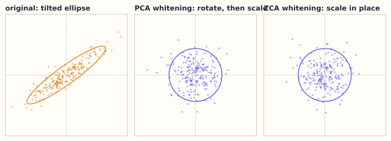

# 9.4 白化：去相关与尺度归一

> **本节位置**：模块 9 · 概率与统计 ｜ **前置**：[9.3 PCA](03-PCA.md) ｜ **预计**：35 分钟
>
> **一句话**：白化 = 先旋转到主成分方向，再把每个方向缩放到方差 1；它把协方差矩阵变成单位阵，而不只是把每一维除以自己的标准差。

## 0. 场景引入

手机修图 App 的「一键油画」在晚上 8 点迎来高峰，每分钟有 **1 200** 次导出。中端机上从点「开始」到出图只有 **150 ms** 预算，而一次网络前向就要 75 ms——留给「把内容变风格」的只剩一半。

做法是从一个轻量 VGG 的 relu3_3 取特征：**256** 个通道、**32×32** 个位置，记成 $F\in\mathbb{R}^{256\times1024}$。要传的不只是颜色，还有笔触的方向性——它藏在通道两两之间的协方差里。协方差是 $256\times256$，**65 536** 个数，fp32 占 **256 KiB**。

两条路摆在这里：

1. **AdaIN**：每个通道减均值、除标准差，$O(CHW)\approx2.6\times10^5$ 次运算；
2. **WCT**：估协方差，用 $\Sigma^{-1/2}$ 白化，再用风格图的 $\Sigma_s^{1/2}$ 上色；一层要做 3 次 $C^2HW$ 的矩阵乘（估协方差、白化、上色），约 $2.0\times10^8$ 次乘加，按中端机有效 20 GFLOP/s 估约 20 ms。

四层全做 WCT 是 80 ms，加上前向正好越过 150 ms；只做一层，输出是「上了色的模糊照片」，笔触的斜向相关传不过去。

决策：哪几层用 WCT、哪几层退回 AdaIN？代价很具体：超时，用户划走，这次推理白算；省过头，差评里全是「不像油画」。还有一层风险：白化矩阵 $W=\Sigma^{-1/2}$ 只在 $\Sigma$ 估得足够好时靠谱，估错了，画面会冒出彩色噪点。

读完本节，你能回答的三个问题是：

1. 为什么「每维除以标准差」不够，协方差还会斜？
2. PCA 白化与 ZCA 白化都得到 $I$，什么时候该用哪个？
3. 白化为什么在大模型里换成了 LayerNorm？

## 1. 直觉

白化分两步：先用 PCA 把坐标轴转到特征向量方向（此时各维不相关），再把每个方向除以自己的标准差 $\sqrt{\lambda_i}$，让方差都变成 1。



*图：PCA 白化先旋转再缩放；ZCA 白化只缩放，尽量少动原坐标方向。*

PCA 白化先把椭圆转正再压圆；[ZCA 白化](#ref-bell-sejnowski-1997)不转，直接把椭圆「揉」成圆，所以输出还保留原来的方向感。

> 💡 **一句话直觉**：**白化是「把协方差矩阵变成 $I$」的线性变换；PCA 白化负责转正，ZCA 白化负责少动原坐标。**

### 1.1 它在现实世界里对应什么

回到那个油画功能。白化在这里不是抽象的预处理，它是**把内容的「纹理配方」倒掉、换成风格的配方**：

| 数学对象 | 风格迁移里的对应物 |
|---|---|
| 特征图 $F\in\mathbb{R}^{C\times HW}$ | 一张图在 relu3_3 的响应：$C$ 种纹理模板，$HW$ 个位置 |
| 协方差 $\Sigma=\frac1{HW}F_cF_c^\top$ | 「哪些纹理同时出现」——比如斜笔触总伴着暖色 |
| 特征向量 $\mathbf{v}_i$ | 一组总是一起变强、一起变弱的通道组合；对应特征值大 = 这个模式占的方差多 |
| 白化 $W=\Sigma^{-1/2}$ | 把每种模式的强度拉平：只留「有没有这个方向」，不留「有多猛」 |
| 上色 $\Sigma_s^{1/2}$ | 把风格图的相关结构贴回内容图的位置上 |
| 只标准化（AdaIN） | 只对齐每个通道的均值和方差，通道之间怎么一起变，不管 |

图中那条从斜椭圆到正圆的变换，就是这里的 $\Sigma^{-1/2}$：内容的通道 1 变强时通道 2 也跟着变强，白化把这个「一起」拆掉，剩下两个各自独立、方差为 1 的方向。

### 1.2 这个类比在哪里失效

**白化只对齐二阶统计，不管位置。** 协方差把 $HW$ 个位置压成一个 $C\times C$ 矩阵，空间布局在这步全丢了。所以纯 WCT 的结果会「纹理对了、脸糊了」；工程上要保留 skip connection，或只在深层做白化。

**相关不等于风格。** 白化保证「通道一起变的程度」和风格图一致，但笔触的相位、笔画走向、留白节奏都在高阶统计里。两个人用同样的协方差，画出来的东西可以完全不同。

**白化不保证独立。** 只有数据本身是高斯时，不相关才等价于独立；对一般分布，白化后仍可能有高阶依赖。

### 1.3 量级直觉

$C=256$ 时协方差有 $65\,536$ 个数（256 KiB），$C=4096$ 时是 $1.68\times10^7$ 个数（64 MiB）——**协方差的规模是通道数的平方**，这是白化所有成本问题的源头。估计误差方面，单个相关系数的标准误约 $1/\sqrt{HW}$：$HW=1024$ 时约 3%，还算能忍；若换到大模型那种 $D=4096$、每个 batch 只有 1000 个 token 的情形，样本数比参数个数少两个数量级，$\hat\Sigma$ 直接奇异，白化矩阵根本估不出来。

## 2. 定义

### 2.1 目标

给定 $\mathbf{x}\in\mathbb{R}^{D}$，均值 $\boldsymbol\mu$、协方差 $\Sigma\succ0$。**白化（whitening）** 是找可逆矩阵 $W$，使

$$
\mathbf{z}=W(\mathbf{x}-\boldsymbol\mu),\qquad \operatorname{Cov}(\mathbf{z})=W\Sigma W^\top=I_D
$$

读法：变换后每个分量方差为 1，且两两协方差为 0。

### 2.2 PCA 白化

对 $\Sigma=V\Lambda V^\top$，令 $W_{\mathrm{PCA}}=\Lambda^{-1/2}V^\top$，即先旋转到主成分轴、再按 $1/\sqrt{\lambda_i}$ 缩放。输出坐标的含义是「沿第 $i$ 个主成分走了几个标准差」。

### 2.3 ZCA 白化

$W_{\mathrm{ZCA}}=V\Lambda^{-1/2}V^\top=\Sigma^{-1/2}$，即 $\Sigma$ 的对称逆平方根。它同样把协方差变成 $I$，但输出仍在原坐标系方向。两者只差一个旋转：$W_{\mathrm{ZCA}}=VW_{\mathrm{PCA}}$，$\mathbf{z}_{\mathrm{ZCA}}=V\mathbf{z}_{\mathrm{PCA}}$。

### 2.4 只标准化

**标准化（standardization）** 是只把每一维除以自己的标准差：$W_{\mathrm{std}}=\operatorname{diag}(1/\sigma_1,\dots,1/\sigma_D)$，$\sigma_i=\sqrt{\Sigma_{ii}}$。得到的是**相关系数矩阵**，不是单位阵：

$$
W_{\mathrm{std}}\Sigma W_{\mathrm{std}}^\top=
\begin{bmatrix}1&\rho_{12}&\cdots\\\rho_{21}&1&\cdots\\\vdots&&\ddots\end{bmatrix}
$$

非对角的相关性原封不动，这是白化与标准化最关键的区别。

### 2.5 正则化

若 $\Sigma$ 奇异或接近奇异，用**正则化（regularization）** $\Sigma_\epsilon=\Sigma+\epsilon I$，特征值变为 $\lambda_i+\epsilon$。这避免除以接近 0 的数，代价是低方差方向不再被完全压平。

## 3. 为什么这样定义

**为什么要求协方差为单位阵？** 许多算法的最优性分析假设各向同性：最小二乘误差、梯度下降曲率、高斯似然、距离度量。若协方差是 $I$，欧氏距离就是「标准差单位」下的距离，各方向权重相同。

**为什么有两种白化？** 白化的解不唯一：任何 $W$ 左乘正交矩阵 $Q$，$(QW)\Sigma(QW)^\top=QIQ^\top=I$ 仍成立。PCA 白化选 $Q$ 让输出轴对齐主成分；ZCA 白化选 $Q=V$，让 $W$ 对称、且离单位阵最近。

**为什么 ZCA 保留更多原方向？** 在所有白化矩阵中，$W_{\mathrm{ZCA}}$ 使 $\mathbb{E}\|\mathbf{x}-\mathbf{z}\|_2^2$ 最小（可以证明，直观上它不额外旋转）。所以图像预处理、卷积网络可视化常用 ZCA：白化后的图还像原图，只是对比度被拉平。

**为什么大模型不直接白化？** $\Sigma$ 是 $[D,D]$，$D=4096$ 时 1677 万个数，求逆/特征分解 $O(D^3)$，每 token 还要 $O(D^2)$ 矩阵乘法。LayerNorm 只算标量均值和方差，$O(D)$，便宜三个数量级；白化还依赖 batch 统计，训练/推理分布不一致时不稳定。

### 3.1 反事实：只除以方差不去相关，椭圆仍斜

「各维除以自己的标准差」听起来已经很像归一化了。用 5.1 那个 $\Sigma=\begin{bmatrix}2&1\\1&2\end{bmatrix}$ 走一遍，看它到底做了什么。

两维方差都是 2，所以 $W_{\mathrm{std}}=\operatorname{diag}(1/\sqrt2,1/\sqrt2)=\frac{1}{\sqrt2}I$——**它就是一个整体缩放**，把整个椭圆缩小 $\sqrt2$ 倍，形状、倾角、条件数一个都没变。验证一下协方差：

$$
W_{\mathrm{std}}\Sigma W_{\mathrm{std}}^\top
=\frac12\begin{bmatrix}2&1\\1&2\end{bmatrix}
=\begin{bmatrix}1&0.5\\0.5&1\end{bmatrix}
$$

非对角项 $0.5$ 原样留着，相关系数还是 $0.5$。这个矩阵的特征值是 $1.5$ 与 $0.5$，条件数仍是 3；它的 $1\sigma$ 等高线还是沿 $45^\circ$ 的斜椭圆，半轴 $\sqrt{1.5}\approx1.22$ 与 $\sqrt{0.5}\approx0.71$。

手算两个点就更清楚。原椭圆长轴上的 $1\sigma$ 点 $\mathbf{x}=\sqrt3\,(1,1)/\sqrt2\approx(1.225,1.225)$，标准化后是 $(0.866,0.866)$，长度 $1.225$；短轴上的 $\mathbf{x}=(1,-1)/\sqrt2\approx(0.707,-0.707)$，标准化后是 $(0.5,-0.5)$，长度 $0.707$。**两个同在 $1\sigma$ 等高线上的点，标准化后一个落在 1.22、一个落在 0.71**——椭圆只是被按比例缩了，斜还是斜的。这就是只标准化最典型的错觉：你以为在把椭圆压成圆，其实只是把画面整体调暗了一点。

**反事实 B：把 $\Sigma^{-1}$ 当成白化矩阵。** 白化因子是 $-\tfrac12$ 次方，不是 $-1$ 次方。对同一个 $\Sigma$，取 $W=\Sigma^{-1}=\frac13\begin{bmatrix}2&-1\\-1&2\end{bmatrix}$，则

$$
W\Sigma W^\top=\Sigma^{-1}=\frac13\begin{bmatrix}2&-1\\-1&2\end{bmatrix}
$$

它的特征值是 $1/3$ 与 $1$：长轴方向的方差从 3 变成 $1/3$，短轴方向反而保持 1。方差没被拉平，只是把长短轴**倒过来**，条件数还是 3。$\Sigma^{-1}$ 是「除以协方差」，$\Sigma^{-1/2}$ 才是「除以标准差」。

两个反例合起来说明：白化要同时做两件事——旋转去相关、按**平方根**缩放到方差 1；少一件，椭圆就还在。

## 4. 性质与推导

### 4.1 PCA 白化确实得到单位阵

$\operatorname{Cov}(\mathbf{z})=W_{\mathrm{PCA}}\Sigma W_{\mathrm{PCA}}^\top=\Lambda^{-1/2}V^\top(V\Lambda V^\top)V\Lambda^{-1/2}=\Lambda^{-1/2}\Lambda\Lambda^{-1/2}=I$，中间用到 $V^\top V=I$。只要 $\lambda_i>0$，白化就成立。

### 4.2 ZCA 是白化且对称

$W_{\mathrm{ZCA}}\Sigma W_{\mathrm{ZCA}}^\top=\Sigma^{-1/2}\Sigma\Sigma^{-1/2}=I$，且 $W_{\mathrm{ZCA}}^\top=W_{\mathrm{ZCA}}$。对称性意味着它不引入额外旋转。

### 4.3 条件数变为 1

协方差的条件数（condition number）$\kappa(\Sigma)=\lambda_{\max}/\lambda_{\min}$ 衡量「最胖方向比最瘦方向胖多少」。白化后所有特征值都是 1，$\kappa(I)=1$；二次型 $\mathbf{x}^\top\Sigma^{-1}\mathbf{x}$ 的等高线从椭圆变成圆，梯度下降不再被狭长方向拖慢。

### 4.4 噪声与高斯

$W$ 可逆，理论上不丢信息。但数值上，$\lambda_i$ 很小时 $1/\sqrt{\lambda_i}$ 很大，会把该方向噪声放大：若 $\lambda_{\min}=10^{-6}$，噪声被放大 1000 倍。这就是实践中要加 $\epsilon I$、或干脆不做全白化的原因。

若 $\mathbf{x}\sim\mathcal{N}(\boldsymbol\mu,\Sigma)$，白化后的 $\mathbf{z}\sim\mathcal{N}(\mathbf{0},I)$。这正是 9.2 中「把椭圆变回标准圆」的操作，也是生成模型「从标准正态采样、再乘 $L$ 变回数据分布」的逆过程。

## 5. 例子

### 5.1 手算：$\Sigma=\begin{bmatrix}2&1\\1&2\end{bmatrix}$

特征值 $3,1$，特征向量 $\mathbf{v}_1=(1,1)^\top/\sqrt2$、$\mathbf{v}_2=(1,-1)^\top/\sqrt2$。

**PCA 白化**：

$$
W_{\mathrm{PCA}}=\operatorname{diag}\!\left(\frac1{\sqrt3},1\right)V^\top
=\begin{bmatrix}1/\sqrt6&1/\sqrt6\\1/\sqrt2&-1/\sqrt2\end{bmatrix}
\approx\begin{bmatrix}0.408&0.408\\0.707&-0.707\end{bmatrix}
$$

对 $\mathbf{x}=(1,1)^\top$：$\mathbf{z}_{\mathrm{PCA}}=(2/\sqrt6,0)^\top\approx(0.816,0)^\top$。点在长轴上，所以第二坐标为 0。

**ZCA 白化**：$W_{\mathrm{ZCA}}=V\Lambda^{-1/2}V^\top=\begin{bmatrix}0.7887&-0.2113\\-0.2113&0.7887\end{bmatrix}$，故 $\mathbf{z}_{\mathrm{ZCA}}=\frac{1}{\sqrt3}(1,1)^\top$。方向仍是 $(1,1)$，只是长度从 $\sqrt2$ 缩到 1——这就是「ZCA 保留原方向」的具体含义。

**只标准化**：除以 $\sqrt2$ 得 $(0.707,0.707)$，协方差变为 $\begin{bmatrix}1&0.5\\0.5&1\end{bmatrix}$，相关性还在。

### 5.2 场景：WCT 的两步——先白化内容，再上色

假设某一层只有两个通道。内容特征图的协方差是 $\Sigma_c=\begin{bmatrix}2&1\\1&2\end{bmatrix}$；风格图那一层的两个通道几乎独立，协方差是 $\Sigma_s=\begin{bmatrix}3&0\\0&0.5\end{bmatrix}$。取内容特征图上的一个点 $\mathbf{x}=(1,1)^\top$，它正好在内容的长轴上。

**第一步，白化**：$\mathbf{y}=\Sigma_c^{-1/2}(\mathbf{x}-\boldsymbol\mu)$。用 5.1 的 $W_{\mathrm{ZCA}}$ 算得

$$
\mathbf{y}=\frac{1}{\sqrt3}\begin{bmatrix}1\\1\end{bmatrix}\approx\begin{bmatrix}0.577\\0.577\end{bmatrix}
$$

**第二步，上色**：$\mathbf{z}=\Sigma_s^{1/2}\mathbf{y}=\operatorname{diag}(\sqrt3,1/\sqrt2)\,\mathbf{y}\approx(1.0,\,0.408)^\top$。

读法：内容里那个「两通道一起变强」的模式，被整个搬到了风格的第 1 通道上，因为风格的第 1 通道方差大（3），是它的主笔触方向。上色后协方差正好是风格协方差：

$$
T\Sigma_cT^\top=\Sigma_s^{1/2}\Sigma_c^{-1/2}\,\Sigma_c\,\Sigma_c^{-1/2}\Sigma_s^{1/2}=\Sigma_s,
\qquad T=\Sigma_s^{1/2}\Sigma_c^{-1/2}
$$

**如果只做 AdaIN**：逐通道除以 $\sqrt2$，$\mathbf{x}=(1,1)$ 变成 $(0.707,0.707)$，协方差仍是 $\begin{bmatrix}1&0.5\\0.5&1\end{bmatrix}$。风格图里「第 1 通道强、第 2 通道弱」的结构根本没传过去——这就是「颜色像、笔触不像」的数学原因。

### 5.3 场景闭环：150 ms 里放几层白化

**输入**：512×512 照片，主干是 stride-16 的轻量 VGG，四层特征中最贵的 relu3_3 是 $C=256$、$HW=32\times32=1024$。一张特征图 fp32 占

$$
256\times1024\times4\ \text{B}=1\ \text{MiB},
$$

四层合计约 4 MiB——白化要处理的，就是这些 $[256,1024]$ 的矩阵。

**计算**：一层 WCT 有三笔 $C^2HW$ 的乘法——估协方差、白化、上色，各 $6.7\times10^7$ 次乘加，共 $2.0\times10^8$；特征分解 $256^3\approx1.7\times10^7$，只占 8%。按有效 20 GFLOP/s，一层约 20 ms。AdaIN 一层约 $2.6\times10^5$ 次乘加，可以忽略。

**输出**：决策是「哪几层用 WCT」。前两层 WCT、后两层 AdaIN：$2\times20+2\times0.03\approx40$ ms，加前向 75 ms 共 115 ms，落在 150 ms 内。四层全 WCT 是 $4\times20+75=155$ ms，超预算 5 ms——为了这 5 ms，要么砍掉一层白化，要么降到 448×448。

**成本**：每层多 256 KiB 协方差和一次 $256\times256$ 特征分解，峰值内存多约 1 MiB，中端机扛得住。真正的代价是 40 ms 的墙钟时间，它把「边拍边转」变成「拍完再等 0.1 秒」。

**失败条件与兜底**：

- **纯色区域**（天空、白墙）：某些通道方差接近 0，$1/\sqrt{\lambda}$ 把传感器噪声放大成彩色斑点。兜底：$\Sigma_\epsilon=\Sigma+\epsilon I$，$\epsilon$ 取 $\operatorname{tr}(\Sigma)/C\times10^{-3}$，或截断 $\lambda<\tau$ 的方向。
- **位置太少**：在 $8\times8$ 的特征图上估 256 维协方差，只有 64 个样本，$\hat\Sigma$ 的秩最多 63，必奇异。兜底：只在大特征图上做白化，小特征图退回 AdaIN。
- **对称性被浮点破坏**：$\hat\Sigma$ 轻微不对称时 `eigh` 仍能跑，但特征向量会成对翻转，相邻两帧的白化结果抖动。兜底：分解前先做 $(\hat\Sigma+\hat\Sigma^\top)/2$。
- **风格图本身接近纯色**：$\Sigma_s$ 近似奇异，「上色」这一步会把内容压扁。兜底：$\Sigma_s$ 也加 $\epsilon I$，或在前端检测到风格图方差过低时直接拒绝该风格。

## 6. 常见误区

1. **误区**：白化就是把每维除以标准差。**纠正**：那只是标准化，协方差仍是相关系数矩阵；白化还必须旋转去相关，需要特征分解。
2. **误区**：白化后各维独立。**纠正**：只保证不相关；非高斯数据白化后仍可能有高阶依赖。
3. **误区**：PCA 白化和 ZCA 白化结果一样。**纠正**：协方差都变成 $I$，但输出相差旋转 $V$；PCA 轴对齐主成分，ZCA 保留原方向。
4. **误区**：白化总能加速训练。**纠正**：它改善条件数，但放大低方差方向的噪声、增加 $O(D^2)$ 开销、依赖 batch 统计。

## 7. 概念网络

- 前置：[9.3 PCA](03-PCA.md) —— 特征分解给出旋转与缩放两个因子。
- 前置：[9.2 多元高斯](02-多元高斯.md) —— 白化把 $\mathcal{N}(\boldsymbol\mu,\Sigma)$ 变成 $\mathcal{N}(\mathbf{0},I)$。
- 前置：[7.2 SVD 的计算与性质](../07-SVD/02-SVD的计算与性质.md) —— $\Sigma^{-1/2}$ 可用 SVD 稳定计算。
- 关联：[8.7 梯度下降与牛顿法](../08-微积分与优化/07-梯度下降与牛顿法.md) —— 条件数决定收敛速度。
- 关联：[11.6 LayerNorm 与 RMSNorm](../11-大模型专题/06-LayerNorm与RMSNorm.md) —— 更便宜的部分归一化。
- 易混：[BatchNorm](#ref-ioffe-2015) —— 按特征维统计 batch，仍不做去相关。

## 8. 通往大模型：为什么是 LayerNorm 而不是全白化

**出现位置**：激活归一化。LayerNorm 在每个 token 的 $D$ 维向量上算一个标量均值和一个标量方差，再逐元素缩放；白化则要在整个数据集上估计 $[D,D]$ 协方差并做矩阵乘法。

**形状**：一个 token 的激活 $\mathbf{x}\in\mathbb{R}^{D}$，LayerNorm 为

$$
\mathbf{y}=\frac{\mathbf{x}-\mu}{\sqrt{\sigma^2+\epsilon}}\odot\boldsymbol\gamma+\boldsymbol\beta,
\qquad
\mu=\frac1D\sum_i x_i,\quad
\sigma^2=\frac1D\sum_i(x_i-\mu)^2
$$

$\mu,\sigma^2$ 是标量，成本 $O(D)$，与 batch 无关。全白化需要 $\Sigma\in\mathbb{R}^{D\times D}$ 与 $W\in\mathbb{R}^{D\times D}$，每 token 矩阵乘法 $O(D^2)$；$D=4096$ 时每 token 约 1677 万次乘加，而 LayerNorm 约 4096 次。

**为什么需要**：深层网络里激活尺度会漂移，LayerNorm 把每个 token 拉回单位尺度，稳定训练；它不消除特征间相关，但去掉了「整体过大/过小」这个最主要的病态来源。[RMSNorm](#ref-zhang-sennrich-2019)进一步省掉均值，只除以均方根。

**可检验结论**：对 $N$ 个样本做白化，经验协方差的单个元素与 $I$ 的偏差量级约为 $1/\sqrt{N}$。$N=1000$、$D=4096$ 时样本协方差严重欠采样，白化矩阵估计不可靠；这也是全白化在大模型里不实用的原因之一。

```python
import numpy as np
rng = np.random.default_rng(0)
D, N = 8, 20000
A = rng.normal(size=(D, D))
Sigma = A @ A.T + 0.1 * np.eye(D)
X = rng.multivariate_normal(np.zeros(D), Sigma, size=N)   # [N, D]
lam, V = np.linalg.eigh(Sigma)
W = V @ np.diag(1 / np.sqrt(lam)) @ V.T                   # ZCA
Z = (X - X.mean(0)) @ W.T
print(np.cov(Z, rowvar=False).round(2))                   # 接近 I
```

**与条件数的联系**：若激活协方差的条件数是 $10^4$，梯度下降在峡谷里要走很多步；LayerNorm 只能把整体尺度拉回 1，不能改变方向间的比例，所以条件数仍可能很大。真正把条件数变成 1 的是白化，代价是 $O(D^2)$ 与统计估计误差。

**如果这一步算错，下游看到什么现象**：白化不是一个会报错的步骤，它只会让下游的表现「说不上哪里不对」。

- **只做了标准化，却以为做了白化**：协方差里那 0.5 的相关还在，下游如果假设特征独立（比如朴素贝叶斯、对角协方差的高斯），它的概率估计会系统性偏；训练侧则表现为 loss 一路在抖，调小学习率能压住，但收敛慢一半。
- **用了 $\Sigma^{-1}$ 而不是 $\Sigma^{-1/2}$**：长轴方向被压过头（上面例子里方差从 3 变成 $1/3$），短轴却保持 1，各向异性没消掉、只是方向反了；下游的距离度量被扭曲，长轴方向的标准差被缩小 3 倍，微调时这部分特征基本「死掉」，验证集上看不出错，只是效果上不去。
- **$\epsilon$ 太小或没截断**：$\lambda_{\min}=10^{-6}$ 时放大 1000 倍，输出里出现成片的彩色噪点；如果 $\lambda$ 在数值上算成负数，$\sqrt{\lambda}$ 直接得 NaN，整批激活污染。
- **训练用 batch 统计、推理用滑动平均**：两边分布对不上，线上激活的尺度和训练时差一截，表现为离线指标漂亮、一上线就掉点。兜底是推理时用固定的 $\Sigma$，或干脆退回 LayerNorm。

## 9. 练习

1. **概念**：白化与标准化都能「让方差变成 1」，区别在哪？各适合什么场景？
2. **计算**：$\Sigma=\begin{bmatrix}4&0\\0&1\end{bmatrix}$，求 $W_{\mathrm{PCA}}$、$W_{\mathrm{ZCA}}$，并把 $(2,1)$ 白化。
3. **计算**：$\Sigma=\begin{bmatrix}3&1\\1&3\end{bmatrix}$，求 $W_{\mathrm{PCA}}$ 与 $W_{\mathrm{ZCA}}$，验证 $W\Sigma W^\top=I$。
4. **场景**：$[B,T,D]=[4,2048,4096]$ 的激活，比较 LayerNorm 与全白化的单 token 计算量与参数量。
5. **开放**：为什么白化会放大噪声？如果 $\lambda_{\min}=10^{-8}$，你会怎么处理？

<details>
<summary>参考答案</summary>

1. 标准化只除以各维标准差，得到相关系数矩阵，非对角相关仍在；白化还要旋转去相关，得到单位阵。标准化便宜、逐维、适合单位不同但相关性不强的特征；白化昂贵、需要协方差估计，适合确实需要各向同性的算法。
2. 特征值 $4,1$，方向为标准基。$W_{\mathrm{PCA}}=W_{\mathrm{ZCA}}=\operatorname{diag}(1/2,1)$；$(2,1)\mapsto(1,1)$。
3. 特征值 $4,2$，方向 $(1,1)/\sqrt2$、$(1,-1)/\sqrt2$。$W_{\mathrm{PCA}}=\begin{bmatrix}1/(2\sqrt2)&1/(2\sqrt2)\\1/\sqrt2&-1/\sqrt2\end{bmatrix}\approx\begin{bmatrix}0.354&0.354\\0.707&-0.707\end{bmatrix}$；$W_{\mathrm{ZCA}}=\begin{bmatrix}0.604&-0.104\\-0.104&0.604\end{bmatrix}$。直接乘可验证 $W\Sigma W^\top=I$。
4. LayerNorm：每 token 约 $2D$ 次运算、$2D$ 个参数（$\gamma,\beta$）；全白化：每 token $D^2\approx1.68\times10^7$ 次乘加、$D^2$ 个参数（16.7M），约是 LayerNorm 的 4000 倍。
5. 白化把每个方向除以 $\sqrt{\lambda_i}$；$\lambda_i$ 很小时因子巨大，该方向的观测噪声被同等放大。处理：加 $\epsilon I$（$10^{-6}$–$10^{-4}$）、截断小特征值（只保留 $\lambda_i>\tau$）、或改用对角近似/LayerNorm。

</details>

## 10. 一页速记

- 白化：$\operatorname{Cov}(W(\mathbf{x}-\boldsymbol\mu))=I$，即 $W\Sigma W^\top=I$；PCA 白化 $W=\Lambda^{-1/2}V^\top$，ZCA 白化 $W=V\Lambda^{-1/2}V^\top=\Sigma^{-1/2}$。
- 两者只差一个旋转 $V$：PCA 输出轴对齐主成分，ZCA 输出更接近原坐标，且 $W$ 对称、离 $I$ 最近。
- 标准化只除 $\sigma_i$，留下相关系数矩阵；在 $\Sigma=\begin{bmatrix}2&1\\1&2\end{bmatrix}$ 上它只是把椭圆整体缩到 $1/\sqrt2$，条件数仍是 3。用 $\Sigma^{-1}$ 当白化矩阵则会把长短轴倒过来。
- 代价：$O(D^2)$ 存储、$O(D^3)$ 分解、低方差方向放大噪声；大模型用 $O(D)$ 的 LayerNorm/RMSNorm 兜底。
- **物理意义 / 现实对应**：白化是「把椭圆形的噪声云揉成圆」；在风格迁移里，$\Sigma^{-1/2}$ 倒掉内容图的纹理相关性，$\Sigma_s^{1/2}$ 再把风格图的笔触相关性贴回去。

## 11. 参考文献与致谢

这一页的知识不是凭空来的。下面列出本页直接借用的原始工作与权威整理；正文中的人名、定理名已链接到对应条目。链接优先指向 DOI、arXiv 或可长期访问的原文存档。

- <a id="ref-bell-sejnowski-1997"></a>**Bell 与 Sejnowski（Anthony J. Bell & Terrence J. Sejnowski, 1997）**：*The "independent components" of natural scenes are edge filters*。在 ICA 预处理中提出零相位白化（ZCA），即本页 $W_{\mathrm{ZCA}}=\Sigma^{-1/2}$ 这种不额外旋转的对称白化。[Vision Research（DOI）](https://doi.org/10.1016/S0042-6989%2897%2900121-1)
- <a id="ref-ba-2016"></a>**Ba 等（Jimmy Lei Ba, Jamie Ryan Kiros & Geoffrey E. Hinton, 2016）**：*Layer Normalization*。提出在每个样本的特征维上做 $O(D)$ 归一化、不依赖 batch；本页第 8 节的 LayerNorm 公式与成本分析出自这里。[arXiv:1607.06450](https://arxiv.org/abs/1607.06450)
- <a id="ref-ioffe-2015"></a>**Ioffe 与 Szegedy（Sergey Ioffe & Christian Szegedy, 2015）**：*Batch Normalization: Accelerating Deep Network Training by Reducing Internal Covariate Shift*。按 batch 统计逐特征归一化，本页把它作为「仍然不去相关」的对照；它依赖 batch 统计，正是训练/推理不一致的来源。[arXiv:1502.03167](https://arxiv.org/abs/1502.03167)
- <a id="ref-zhang-sennrich-2019"></a>**Zhang 与 Sennrich（Biao Zhang & Rico Sennrich, 2019）**：*Root Mean Square Layer Normalization*。去掉 LayerNorm 的均值项、只除以均方根，本页提到的 RMSNorm 就是它，省掉一次 $O(D)$ 的均值计算。[arXiv:1910.07467](https://arxiv.org/abs/1910.07467)

---

下一篇 → [9.5 马尔可夫链](05-马尔可夫链.md)
