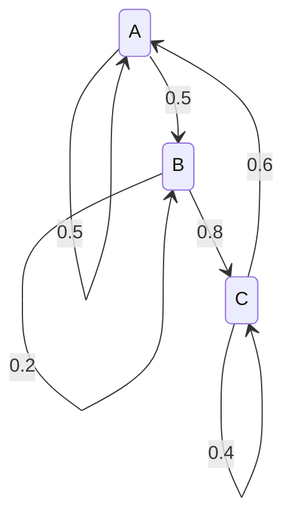

# 9.5 马尔可夫链与稳态分布

> **本节位置**：模块 9 · 概率与统计 ｜ **前置**：[6.6 幂迭代与 PageRank](../06-特征值/06-幂迭代与PageRank.md)、[9.1 概率与随机变量](01-概率与随机变量.md) ｜ **预计**：35 分钟
>
> **一句话**：把「下一步去哪」写成一张行和为 1 的转移矩阵，反复左乘当前分布，它就会收敛到与起点无关的稳态分布。

## 0. 场景引入

一只青蛙在三片荷叶间跳——这种「下一步只依赖当前状态」的随机过程叫**马尔可夫链（Markov chain）**。从 A 有 0.5 概率留在 A、0.5 去 B；从 B 有 0.2 留在 B、0.8 去 C；从 C 有 0.6 去 A、0.4 留在 C。

**问题**：跳 100 步后，青蛙在 A、B、C 的概率各是多少？这个答案和它最初在哪片叶子有关吗？长期来看哪片叶子被访问得最频繁？

同样的问题出现在网页链接（PageRank）、文本生成（下一个 token）、物理系统的热平衡。它们的共同结构是：**下一步只依赖当前状态**。

## 1. 直觉

把状态画成节点，把转移概率画成带权有向边：



站在某个节点，按出边的概率随机走一步。走很多步后，你在每个节点停留的时间比例会稳定下来——这就是**稳态分布（stationary distribution）**。

- 图强连通（从任何节点都能到任何节点）时，稳态唯一；
- 图有周期性（A→B→A→B）时，分布来回振荡，不收敛；
- 图分成几个互不连通的区域时，稳态不唯一，取决于起点。

> 💡 **一句话直觉**：**稳态是「流入每个节点的概率流量等于流出」的平衡；它不是某个吸引点，而是一种全局比例。**

类比边界：稳态描述长期**频率**，不描述「最终停在哪」。青蛙没有停下来，它只是按比例访问各叶子。

## 2. 定义

### 2.1 转移矩阵

状态空间大小为 $n$，**转移矩阵（transition matrix）** $P\in\mathbb{R}^{n\times n}$ 定义为 $P_{ij}=\Pr(X_{t+1}=j\mid X_t=i)$，要求 $P_{ij}\ge0$ 且 $\sum_{j=1}^nP_{ij}=1$（对每个 $i$）。

每行和为 1，称为**行随机矩阵（row-stochastic matrix）**。第 $i$ 行是「在状态 $i$ 时下一步去哪」的完整分布。

### 2.2 多步转移与分布演化

$k$ 步转移概率是 $P^k$ 的元素：$(P^k)_{ij}=\Pr(X_{t+k}=j\mid X_t=i)$。若当前分布是行向量 $\boldsymbol\pi_t$，则 $\boldsymbol\pi_{t+1}=\boldsymbol\pi_tP$，$\boldsymbol\pi_t=\boldsymbol\pi_0P^t$。

这里**左乘行向量**，与「每行是条件分布」的约定配套。若把分布写成列向量，则要写成 $\boldsymbol\pi_{t+1}=P^\top\boldsymbol\pi_t$。第 6.6 节用的是**列随机**矩阵 $Q$，满足 $Q\boldsymbol\pi=\boldsymbol\pi$；本节用行随机 $P=Q^\top$，满足 $\boldsymbol\pi P=\boldsymbol\pi$。两者互为转置，稳态相同。

### 2.3 稳态分布

若概率行向量 $\boldsymbol\pi$ 满足 $\boldsymbol\pi P=\boldsymbol\pi$、$\pi_i\ge0$、$\sum_i\pi_i=1$，则称 $\boldsymbol\pi$ 为**稳态分布（stationary distribution）**。等价地，$\boldsymbol\pi^\top$ 是 $P^\top$ 的特征值 1 对应的特征向量。

### 2.4 不可约与非周期

- **不可约（irreducible）**：从任意状态可以经若干步到达任意状态，即图强连通。
- **非周期（aperiodic）**：每个状态返回自身的步数最大公约数为 1；有自环（$P_{ii}>0$）通常就非周期。

有限状态链若不可约且非周期，则稳态唯一，且从任意初始分布出发都有 $\boldsymbol\pi_t\to\boldsymbol\pi$。

### 2.5 混合速度与 PageRank

收敛速度（混合速度，mixing）由第二大特征值的模 $|\lambda_2|$ 控制：$\|\boldsymbol\pi_t-\boldsymbol\pi\|_1\le C|\lambda_2|^t$。$|\lambda_2|$ 越接近 1，混合越慢；若 $P$ 所有行相同，则 $P$ 秩 1，$\lambda_2=\cdots=\lambda_n=0$，一步到位。

**PageRank（网页排名）** 把网页链接写成行随机 $P$，再加阻尼：$G=dP+\frac{1-d}{n}\mathbf{1}\mathbf{1}^\top$，其中 $d\in[0,1)$ 是**阻尼因子（damping factor）**（常用 $0.85$）。读法：以概率 $d$ 沿链接走，以概率 $1-d$ 随机跳到任意网页。$G$ 仍行随机，PageRank 向量是它的稳态。

## 3. 为什么这样定义

**为什么每行和为 1？** 在状态 $i$ 时，「下一步去某个状态」是一个概率分布，总和必须为 1。行和为 1 等价于 $P\mathbf{1}=\mathbf{1}$，即全 1 向量是 $P$ 的特征值 1 的右特征向量；这保证 $P$ 至少有一个稳态（左特征向量）。

**为什么稳态是左特征向量？** 分布演化是 $\boldsymbol\pi_{t+1}=\boldsymbol\pi_tP$；稳态要求 $\boldsymbol\pi P=\boldsymbol\pi$，即 $\boldsymbol\pi$ 在 $P$ 下不变。它不是右特征向量，而是左特征向量；转置后就是 $P^\top$ 的普通特征向量。

**为什么需要不可约和非周期？** 不可约保证「哪都能去」，避免多个封闭子集各自形成稳态；非周期避免奇偶震荡。反例：$P=\begin{bmatrix}0&1\\1&0\end{bmatrix}$ 不可约但周期 2，稳态是 $(1/2,1/2)$，从 $(1,0)$ 出发却永远在 $(1,0)$ 与 $(0,1)$ 间跳。

**为什么 PageRank 要加阻尼？** 真实网页图可能有悬挂节点（没有出链）和不连通分量。加「以 $1-d$ 概率随机跳转」的均匀项后，$G$ 的所有元素为正；由 Perron–Frobenius 定理，主特征值 1 唯一，且 $|\lambda_2|\le d<1$，幂迭代必收敛。

## 4. 性质与推导

### 4.1 二状态稳态方程

设 $P=\begin{bmatrix}1-a&a\\b&1-b\end{bmatrix}$，$0<a,b<1$，$\boldsymbol\pi=(\pi_1,\pi_2)$。由 $\boldsymbol\pi P=\boldsymbol\pi$ 的第一个分量得 $\pi_1(1-a)+\pi_2b=\pi_1$，即 $a\pi_1=b\pi_2$，故 $\pi_1:\pi_2=b:a$。归一化得

$$
\boldsymbol\pi=\left(\frac{b}{a+b},\ \frac{a}{a+b}\right)
$$

读法：稳态在状态 1 的份额，等于「从 2 流回 1 的概率」除以「两边来回概率之和」，即流量平衡。

### 4.2 收敛与特征值

把初始分布写成左特征向量的组合 $\boldsymbol\pi_0=\sum_i c_i\boldsymbol\ell_i^\top$，其中 $\boldsymbol\ell_i^\top P=\lambda_i\boldsymbol\ell_i^\top$，$\lambda_1=1$。则 $\boldsymbol\pi_t=\sum_i c_i\lambda_i^t\boldsymbol\ell_i^\top=c_1\boldsymbol\pi+\sum_{i\ge2}c_i\lambda_i^t\boldsymbol\ell_i^\top$。由于 $|\lambda_i|<1$（$i\ge2$），后一项按 $|\lambda_2|^t$ 衰减；归一化后 $c_1=1$，所以 $\boldsymbol\pi_t\to\boldsymbol\pi$。若链有吸收态，稳态不唯一，长期行为要用吸收概率描述。

### 4.3 PageRank 方程

设 $\boldsymbol\pi$ 是 $G$ 的稳态，则 $\boldsymbol\pi G=\boldsymbol\pi$，即 $\boldsymbol\pi=d\boldsymbol\pi P+\frac{1-d}{n}\mathbf{1}^\top$。读法：每个网页的分数 = 沿链接传来的分数 + 均匀随机跳转的分数。可写成迭代 $\boldsymbol\pi\leftarrow d\boldsymbol\pi P+(1-d)/n\cdot\mathbf{1}^\top$，就是幂迭代。

### 4.4 细致平衡与 MCMC

若存在 $\boldsymbol\pi$ 使 $\pi_iP_{ij}=\pi_jP_{ji}$ 对所有 $i,j$ 成立，则称链满足**细致平衡（detailed balance）**、**可逆（reversible）**，$\boldsymbol\pi$ 是稳态。读法：每条边上两个方向的概率流量相等。MCMC 的 Metropolis–Hastings 就是构造一个满足细致平衡的 $P$，让目标分布成为稳态，然后采样。

## 5. 例子

### 5.1 手算：两状态天气链

设状态 1 为晴、2 为雨，$P=\begin{bmatrix}0.9&0.1\\0.2&0.8\end{bmatrix}$。

**稳态**：$a=0.1,b=0.2$，由 4.1 得 $\boldsymbol\pi=(0.2/0.3,\ 0.1/0.3)=(2/3,1/3)$。

**特征值**：$\operatorname{tr}(P)=1.7$，$\det(P)=0.9\cdot0.8-0.1\cdot0.2=0.70$，所以特征值为 $1$ 与 $0.7$。

**从晴天出发**：$\boldsymbol\pi_0=(1,0)$，$\boldsymbol\pi_1=(0.9,0.1)$，$\boldsymbol\pi_2=(0.83,0.17)$，$\boldsymbol\pi_3=(0.781,0.219)$。通式

$$
\pi_{t,1}=\frac23+\frac13(0.7)^t
$$

$t=10$ 时 $(0.7)^{10}\approx0.0282$，$\pi_{10,1}\approx0.676$，已经离 $2/3$ 很近。若把 $P$ 改成 $\begin{bmatrix}0.99&0.01\\0.02&0.98\end{bmatrix}$，第二特征值约 $0.97$，要几百步才混合。

### 5.2 手算：三页的 PageRank（无阻尼）

三个页面 A、B、C，链接为 A→B、A→C、B→C、C→A。行随机矩阵（行顺序 A,B,C）：

$$
P=\begin{bmatrix}0&1/2&1/2\\0&0&1\\1&0&0\end{bmatrix}
$$

设 $\boldsymbol\pi=(\pi_A,\pi_B,\pi_C)$，解 $\boldsymbol\pi P=\boldsymbol\pi$：$\pi_A=\pi_C$，$\pi_B=\frac12\pi_A$，第三式自动成立。归一化得 $\pi_A=\pi_C=0.4$，$\pi_B=0.2$。C 被 A 和 B 同时链接，所以和 A 并列最高；B 只被 A 链接一半，分数最低。

### 5.3 场景：文本生成

把「已生成的 token 序列」当作状态，下一个 token 的分布由模型给出：$P_{i\to j}\propto\exp(z_j/T)$。温度 $T$ 改变转移矩阵，但不改变「给定当前状态，下一步只依赖当前状态」这一马尔可夫结构。

固定 prompt 反复采样时，长期 token 分布会趋于某个稳态；但自然语言没有全局稳态，所谓「稳态」只在固定上下文假设下有意义。这也是长文本会重复的原因：某些循环在转移矩阵里形成了高概率闭环。

## 6. 常见误区

1. **误区**：稳态就是 $\boldsymbol\pi=P\boldsymbol\pi$，和 $\boldsymbol\pi P=\boldsymbol\pi$ 一样。**纠正**：行随机约定下是 $\boldsymbol\pi P=\boldsymbol\pi$（左乘）；$P\boldsymbol\pi=\boldsymbol\pi$ 对应列随机，两者差一个转置。
2. **误区**：只要存在稳态，从任意初始分布都会收敛到它。**纠正**：还需要不可约且非周期；周期链有稳态，但从 $(1,0)$ 出发永远振荡。
3. **误区**：稳态与初始分布无关，所以可以随便设初值。**纠正**：不可约非周期时极限与初值无关；但有限步分布、混合速度、多稳态链的归宿都依赖初值。
4. **误区**：$P_{ij}$ 是「长期停留在 $j$ 的概率」。**纠正**：它只是一步转移概率；长期频率是稳态 $\pi_j$。例如 $P=\begin{bmatrix}0&1\\1&0\end{bmatrix}$ 的 $\pi=(1/2,1/2)$，但一步转移概率是 0 或 1。

## 7. 概念网络

- 前置：[9.1 概率与随机变量](01-概率与随机变量.md) —— 条件分布与期望。
- 前置：[6.6 幂迭代与 PageRank](../06-特征值/06-幂迭代与PageRank.md) —— 用矩阵乘向量逼近主特征向量；注意该节用列随机。
- 前置：[6.1 特征值与特征向量](../06-特征值/01-特征值与特征向量.md) —— 稳态是特征值 1 的特征向量。
- 后续：[11.11 logits、softmax、温度](../11-大模型专题/11-logits与采样.md) —— 温度改变转移概率。
- 关联：[6.6 PageRank](../06-特征值/06-幂迭代与PageRank.md) —— 阻尼项保证唯一稳态与收敛。
- 易混：马尔可夫决策过程（MDP）多了动作与奖励；隐马尔可夫模型（HMM）状态不可见。

## 8. 通往大模型：自回归生成就是一条马尔可夫链

**出现位置**：解码。给定 prompt，模型每一步输出词表上的分布，采样一个 token，把它接回输入，再算下一步。状态是「当前上下文」，转移是「下一个 token 的条件分布」。

**形状**：词表 $V$ 常见为 $10^5$ 量级，上下文长度 $T$。每一步 logits 形状 $[B,T,V]$，只取最后一个位置得到 $[B,V]$，softmax 后得到 $[B,V]$ 的概率行。完整的 $V\times V$ 转移矩阵不会显式存储——它由网络对每个上下文现算，参数量远小于 $V^2$。

**为什么需要**：马尔可夫结构让「逐步采样」成为可能：不需要一次算出整段文本的联合分布，只要反复条件采样。KV Cache 缓存历史 token 的 $K,V$，正是把「过去」压缩成足够统计量，使每一步的转移只依赖当前状态。

**可检验结论**：温度 $T\to0$ 时，$P_{i\to j}$ 退化为 one-hot，链变成确定性映射，容易陷入循环；$T\to\infty$ 时趋于均匀分布，混合最快但输出无意义。$T$ 不改变马尔可夫性，只改变转移矩阵的谱。若固定 prompt 且 $T=0$，同一输入总产生同一输出；$T>0$ 时输出是随机变量。

```python
import numpy as np
P = np.array([[0.9, 0.1],
              [0.2, 0.8]])          # 0=晴，1=雨
pi = np.array([1.0, 0.0])           # 行向量，从晴出发
for _ in range(50):
    pi = pi @ P
print(pi)                            # 接近 [2/3, 1/3]
print(np.linalg.eigvals(P))          # [1, 0.7]
```

**与 PageRank 的关系**：两者都是「行随机矩阵 + 幂迭代」。PageRank 在网页图上做随机游走，稳态是重要性分数；语言模型在 token 图上做条件随机游走，稳态（若存在）是长期 token 频率。区别在于 PageRank 的 $P$ 固定且稀疏，语言模型的转移随上下文变化，状态空间是序列而非单个 token。

## 9. 练习

1. **概念**：为什么行随机矩阵要求每行和为 1？如果某行和为 0.9，意味着什么？
2. **计算**：$P=\begin{bmatrix}0.8&0.2\\0.3&0.7\end{bmatrix}$，求稳态分布、特征值；从 $(0,1)$ 出发，求 5 步后的分布。
3. **计算**：用 5.2 的 $P$，验证 $\boldsymbol\pi=(0.4,0.2,0.4)$ 满足 $\boldsymbol\pi P=\boldsymbol\pi$，并解释为什么 C 的分数不低于 A。
4. **概念/计算**：$P=\begin{bmatrix}0&1\\1&0\end{bmatrix}$ 的稳态是什么？从 $(1,0)$ 出发，$\boldsymbol\pi_t$ 如何变化？这说明了什么？
5. **开放**：温度 $T$ 如何改变转移矩阵？为什么低温度更容易重复？截断上下文窗口后，马尔可夫性还严格成立吗？

<details>
<summary>参考答案</summary>

1. 在任一状态，下一步必然落到某个状态，所有出边概率之和必须为 1。若某行和为 0.9，说明有 0.1 的概率「消失」，模型不完整；和为 1.1 则概率超支。
2. $a=0.2,b=0.3$，$\boldsymbol\pi=(0.6,0.4)$；$\operatorname{tr}=1.5$，$\det=0.5$，特征值 $1,0.5$。从 $(0,1)$：$\pi_{t,1}=0.6-0.6(0.5)^t$，$t=5$ 时 $0.58125$。
3. $\boldsymbol\pi P=(0.4\cdot0+0.4\cdot1,\ 0.4\cdot0.5,\ 0.4\cdot0.5+0.2)=(0.4,0.2,0.4)$。C 被 A 和 B 各链接一次，A 只被 C 链接，但 C 还额外获得 B 的全部流量。
4. 稳态 $(1/2,1/2)$。从 $(1,0)$ 出发，奇数步为 $(0,1)$、偶数步为 $(1,0)$，不收敛。说明「有稳态」不等于「会收敛」；该链周期为 2。
5. $P_T(j\mid i)\propto\exp(z_j/T)$。$T$ 小则分布尖锐，高概率 token 被反复选中，链容易进入循环；$T$ 大则平坦，混合快但连贯性差。截断窗口后状态不含完整历史，严格马尔可夫性被破坏。

</details>

## 10. 一页速记

- 行随机：$P_{ij}\ge0$，$\sum_jP_{ij}=1$；分布左乘，$\boldsymbol\pi_{t+1}=\boldsymbol\pi_tP$。
- 稳态：$\boldsymbol\pi P=\boldsymbol\pi$，$\pi_i\ge0$，$\sum_i\pi_i=1$；是 $P^\top$ 的特征值 1 特征向量。
- 不可约 + 非周期 → 稳态唯一，且从任意初值收敛；速度由 $|\lambda_2|$ 控制。
- 二状态公式：$P=\begin{bmatrix}1-a&a\\b&1-b\end{bmatrix}$，$\boldsymbol\pi=(b,a)/(a+b)$。
- PageRank 加阻尼 $G=dP+(1-d)\mathbf{1}\mathbf{1}^\top/n$，保证唯一稳态与收敛。

---

下一篇 → [M10 数值线性代数](../10-数值线性代数/01-浮点数与误差.md)
