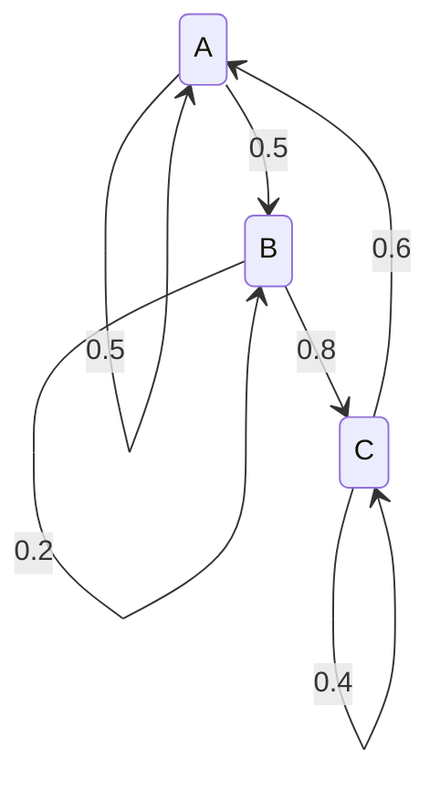

# 9.5 马尔可夫链与稳态分布

> **本节位置**：模块 9 · 概率与统计 ｜ **前置**：[6.6 幂迭代与 PageRank](../06-特征值/06-幂迭代与PageRank.md)、[9.1 概率与随机变量](01-概率与随机变量.md) ｜ **预计**：35 分钟
>
> **一句话**：把「下一步去哪」写成一张行和为 1 的转移矩阵，反复左乘当前分布，它就会收敛到与起点无关的稳态分布。

## 0. 场景引入

客服平台每天进 **4.2 万**张工单，平均在库 **12.6 万**张——每张平均活 3 天。把一张工单的旅程压成两个状态：处理中（P）、待客户确认（W）。过去 90 天的状态快照给出

$$
P=\begin{bmatrix}0.9&0.1\\0.2&0.8\end{bmatrix}
$$

读法：今天在处理中的工单，明天 90% 还在处理中、10% 转去等客户；在等客户的，每天 20% 被客户回信拉回处理中。

$P$ 的稳态是 $(2/3,1/3)$：长期有 **1/3** 的工单卡在 W，即 **4.2 万**张。运营总监周一要定：花 **18 万元**上「自动催办」，把 $W\to P$ 从 0.2 提到 0.3；还是花 **36 万元/月**加 30 名客服，每人每天处理 110 张。

前一个方案把 W 的份额从 33% 压到 25%，少 1.05 万张在库；后一个方案只加快处理速度，**不动** $W\to P$ 这个概率——稳态份额一点不变。

还要算时间账：第二特征值是 $|\lambda_2|=0.7$，从当前分布走到稳态、偏差降到 1 个百分点以内要 **10 天**。上线三天就评估，看到的还是过渡态。

读完本节，你能回答的三个问题是：

1. 为什么长期份额只由转移概率决定，与今天积压多少无关？
2. 不可约、非周期各排除了哪一种「算错」？
3. 混合时间怎么估，为什么它决定活动该等几天再评估？

## 1. 直觉

这种「下一步只依赖当前状态」的随机过程叫**马尔可夫链（Markov chain）**。把状态画成节点，把转移概率画成带权有向边，就是一个最小的三状态玩具——青蛙在三片荷叶间跳：



站在某个节点，按出边的概率随机走一步。走很多步后，你在每个节点停留的时间比例会稳定下来——这就是**稳态分布（stationary distribution）**。

- 图强连通（从任何节点都能到任何节点）时，稳态唯一；
- 图有周期性（A→B→A→B）时，分布来回振荡，不收敛；
- 图分成几个互不连通的区域时，稳态不唯一，取决于起点。

> 💡 **一句话直觉**：**稳态是「流入每个节点的概率流量等于流出」的平衡；它不是某个吸引点，而是一种全局比例。**

### 1.1 它在现实世界里对应什么

把青蛙换成工单，每个符号就都有一张具体的脸：

| 数学对象 | 客服工单系统里的对应物 |
|---|---|
| 状态 $i$ | 工单所处的阶段：处理中 / 待客户确认 / 已解决（可被重开） |
| 转移概率 $P_{ij}$ | 今天在 $i$ 的工单，明天转到 $j$ 的比例 |
| 行和为 1 | 每张工单第二天一定落在某个状态，不会凭空消失 |
| 分布 $\boldsymbol\pi_t$ | 第 $t$ 天在库工单里各状态占的比例 |
| 稳态 $\boldsymbol\pi$ | 长期看各状态的工单占比——排班与 SLA 的基数 |
| 第二特征值 $|\lambda_2|$ | 一次流程改动要几天才能在报表上显现 |
| 不可约 | 「已关闭」必须还能被重开，否则积压不会自己回来 |

青蛙的「停留时间比例」和工单的「在库占比」之所以是同一个量，是因为两者都在数**长期访问频率**。这就是为什么一张转移矩阵能同时回答「青蛙在哪片叶子多」和「该给哪个状态排多少人」。

### 1.2 这个类比在哪里失效

**「访问频率」变成「在库占比」需要一个额外假设。** 单张工单的链只告诉你它平均在每个状态待多久；要把份额换算成绝对张数，得假设到达率恒定、工单之间互不影响。旺季到达率翻倍时，占比不变，绝对数量却翻倍——人力需求是「到达率 × 停留时间」（Little 定律），不是只看份额。

**马尔可夫性本身是假设。** 客户可能记住「上次是谁把我气到了」，于是转移概率依赖更早的历史。这时要加状态（把「投诉过」单列）或换成半马尔可夫链，否则 $P$ 只是把不同人群的概率平均在一起。

**状态划分太粗会失真。** 把「已解决但等评价」和「待客户确认」混成一个状态，两种完全不同的停留时间被平均掉，$P_{ij}$ 也就失去了运营含义。

### 1.3 量级直觉

$|\lambda_2|=0.7$ 时，每步误差乘 0.7，10 步降到 1 个百分点以内；$|\lambda_2|=0.97$（流程几乎不动）时要 116 步。**混合速度和「流程有多黏」成正比，和状态数关系不大。**

状态数上到 1 万时，直接解 $\boldsymbol\pi P=\boldsymbol\pi$ 的线性方程组是 $O(n^3)$，走不通；幂迭代每步只要 $O(\mathrm{nnz})$，一次稀疏矩阵乘就够。网页图有几十亿个节点、边数约为节点数的 10 倍，一次迭代约 $10^{10}$ 次乘加——这正是 PageRank 必须用迭代、不能用消元的原因。

## 2. 定义

### 2.1 转移矩阵

状态空间大小为 $n$，**转移矩阵（transition matrix）** $P\in\mathbb{R}^{n\times n}$ 定义为 $P_{ij}=\Pr(X_{t+1}=j\mid X_t=i)$，要求 $P_{ij}\ge0$ 且 $\sum_{j=1}^nP_{ij}=1$（对每个 $i$）。

每行和为 1，称为**行随机矩阵（row-stochastic matrix）**。第 $i$ 行是「在状态 $i$ 时下一步去哪」的完整分布。

### 2.2 多步转移与分布演化

$k$ 步转移概率是 $P^k$ 的元素：$(P^k)_{ij}=\Pr(X_{t+k}=j\mid X_t=i)$。若当前分布是行向量 $\boldsymbol\pi_t$，则 $\boldsymbol\pi_{t+1}=\boldsymbol\pi_tP$，$\boldsymbol\pi_t=\boldsymbol\pi_0P^t$。

这里**左乘行向量**，与「每行是条件分布」的约定配套。若把分布写成列向量，则要写成 $\boldsymbol\pi_{t+1}=P^\top\boldsymbol\pi_t$。第 6.6 节用的是**列随机**矩阵 $Q$，满足 $Q\boldsymbol\pi=\boldsymbol\pi$；本节用行随机 $P=Q^\top$，满足 $\boldsymbol\pi P=\boldsymbol\pi$。两者互为转置，稳态相同。

### 2.3 稳态分布

若概率行向量 $\boldsymbol\pi$ 满足 $\boldsymbol\pi P=\boldsymbol\pi$、$\pi_i\ge0$、$\sum_i\pi_i=1$，则称 $\boldsymbol\pi$ 为**稳态分布（stationary distribution）**。等价地，$\boldsymbol\pi^\top$ 是 $P^\top$ 的特征值 1 对应的特征向量。

### 2.4 不可约与非周期

- **不可约（irreducible）**：从任意状态可以经若干步到达任意状态，即图强连通。
- **非周期（aperiodic）**：每个状态返回自身的步数最大公约数为 1；有自环（$P_{ii}>0$）通常就非周期。

有限状态链若不可约且非周期，则稳态唯一，且从任意初始分布出发都有 $\boldsymbol\pi_t\to\boldsymbol\pi$。

### 2.5 混合速度与 PageRank

收敛速度（[混合速度](#ref-levin-peres-2017)，mixing）由第二大特征值的模 $|\lambda_2|$ 控制：$\|\boldsymbol\pi_t-\boldsymbol\pi\|_1\le C|\lambda_2|^t$。$|\lambda_2|$ 越接近 1，混合越慢；若 $P$ 所有行相同，则 $P$ 秩 1，$\lambda_2=\cdots=\lambda_n=0$，一步到位。

**PageRank（网页排名）** 把网页链接写成行随机 $P$，再加阻尼：$G=dP+\frac{1-d}{n}\mathbf{1}\mathbf{1}^\top$，其中 $d\in[0,1)$ 是**阻尼因子（damping factor）**（常用 $0.85$）。读法：以概率 $d$ 沿链接走，以概率 $1-d$ 随机跳到任意网页。$G$ 仍行随机，PageRank 向量是它的稳态。

## 3. 为什么这样定义

**为什么每行和为 1？** 在状态 $i$ 时，「下一步去某个状态」是一个概率分布，总和必须为 1。行和为 1 等价于 $P\mathbf{1}=\mathbf{1}$，即全 1 向量是 $P$ 的特征值 1 的右特征向量；这保证 $P$ 至少有一个稳态（左特征向量）。

**为什么稳态是左特征向量？** 分布演化是 $\boldsymbol\pi_{t+1}=\boldsymbol\pi_tP$；稳态要求 $\boldsymbol\pi P=\boldsymbol\pi$，即 $\boldsymbol\pi$ 在 $P$ 下不变。它不是右特征向量，而是左特征向量；转置后就是 $P^\top$ 的普通特征向量。

**为什么需要不可约和非周期？** 不可约保证「哪都能去」，避免多个封闭子集各自形成稳态；非周期避免奇偶震荡。反例：$P=\begin{bmatrix}0&1\\1&0\end{bmatrix}$ 不可约但周期 2，稳态是 $(1/2,1/2)$，从 $(1,0)$ 出发却永远在 $(1,0)$ 与 $(0,1)$ 间跳。

**为什么 PageRank 要加阻尼？** 真实网页图可能有悬挂节点（没有出链）和不连通分量。加「以 $1-d$ 概率随机跳转」的均匀项后，$G$ 的所有元素为正；由 [Perron–Frobenius 定理](#ref-perron-1907)，主特征值 1 唯一，且 $|\lambda_2|\le d<1$，幂迭代必收敛。

### 3.1 反事实：列当成行、或忽略不可约性，稳态会算错

稳态的两个错误都能用 §0 的 $2\times2$ 矩阵手算出来。

**反事实 A：把转移矩阵的列当成行。**

正确写法是 $\boldsymbol\pi P=\boldsymbol\pi$。「列当成行」等于把方程写成 $\boldsymbol\pi P^\top=\boldsymbol\pi$，也就是 $P\boldsymbol\pi=\boldsymbol\pi$。仍取

$$
P=\begin{bmatrix}0.9&0.1\\0.2&0.8\end{bmatrix}
$$

设 $\boldsymbol\pi=(x,1-x)$。正确方程的第一个分量是 $0.9x+0.2(1-x)=x$，解得 $x=2/3$。错误方程的第一个分量是 $0.9x+0.1(1-x)=x$，解得 $x=1/2$。

两个答案差 16.7 个百分点。换算到 §0 的规模：$12.6\times10^4\times0.167\approx2.1\times10^4$，也就是把积压算成 6.3 万张（真值 4.2 万），**多出的 2.1 万张比自动催办省下的 1.05 万张还多一倍**。看到这个数，运营会以为「流程没救、只能加人」，18 万的改造预算直接被砍掉——一个转置就把决策方向带偏了。

**反事实 B：把「已关闭」当成吸收态，忽略不可约性。**

如果工单一旦关闭就永不重开，链条变成

$$
P_3=\begin{bmatrix}0.9&0.1&0\\0.2&0.8&0\\0&0&1\end{bmatrix}
$$

解 $\boldsymbol\pi P_3=\boldsymbol\pi$：前两行给出 $\pi_P=2\pi_W$，第三行 $\pi_C=\pi_C$ 对 $\pi_C$ 没有任何约束。也就是说**稳态不是唯一的，而是一整条直线** $\boldsymbol\pi=(2s,\ s,\ 1-3s)$，$s\in[0,1/3]$；取哪一点，取决于今天从哪个分布出发。若按「工单最终都会关闭」取 $s=0$，得到 $(0,0,1)$：报表上待客户确认归零，积压「自愈」。

现实里 8% 的关闭工单会被客户重开。把那条 $C\to W$ 的边补回去，链重新不可约，稳态才唯一，报表才有排班价值。**一个缺失的边，能让「稳态」退化成「随便哪个」。**

**反事实 C：忽略周期性。** $P=\begin{bmatrix}0&1\\1&0\end{bmatrix}$ 的稳态是 $(1/2,1/2)$，但从 $(1,0)$ 出发，偶数步是 $(1,0)$、奇数步是 $(0,1)$，永远不收敛。只看单日快照，会分别读出「100% 在处理中」和「100% 在待确认」，两个都不等于稳态。

三个反例共用一个教训：**稳态方程本身只保证「不变」，不保证「唯一」，也不保证「会到达」**。这三件事分别由不可约、归一化条件和周期性负责。

## 4. 性质与推导

### 4.1 二状态稳态方程

设 $P=\begin{bmatrix}1-a&a\\b&1-b\end{bmatrix}$，$0<a,b<1$，$\boldsymbol\pi=(\pi_1,\pi_2)$。由 $\boldsymbol\pi P=\boldsymbol\pi$ 的第一个分量得 $\pi_1(1-a)+\pi_2b=\pi_1$，即 $a\pi_1=b\pi_2$，故 $\pi_1:\pi_2=b:a$。归一化得

$$
\boldsymbol\pi=\left(\frac{b}{a+b},\ \frac{a}{a+b}\right)
$$

读法：稳态在状态 1 的份额，等于「从 2 流回 1 的概率」除以「两边来回概率之和」，即流量平衡。

### 4.2 收敛与特征值

把初始分布写成左特征向量的组合 $\boldsymbol\pi_0=\sum_i c_i\boldsymbol\ell_i^\top$，其中 $\boldsymbol\ell_i^\top P=\lambda_i\boldsymbol\ell_i^\top$，$\lambda_1=1$。则 $\boldsymbol\pi_t=\sum_i c_i\lambda_i^t\boldsymbol\ell_i^\top=c_1\boldsymbol\pi+\sum_{i\ge2}c_i\lambda_i^t\boldsymbol\ell_i^\top$。由于 $|\lambda_i|<1$（$i\ge2$），后一项按 $|\lambda_2|^t$ 衰减；归一化后 $c_1=1$，所以 $\boldsymbol\pi_t\to\boldsymbol\pi$。若链有吸收态，稳态不唯一，长期行为要用吸收概率描述。

### 4.3 PageRank 方程

设 $\boldsymbol\pi$ 是 $G$ 的稳态，则 $\boldsymbol\pi G=\boldsymbol\pi$，即 $\boldsymbol\pi=d\boldsymbol\pi P+\frac{1-d}{n}\mathbf{1}^\top$。读法：每个网页的分数 = 沿链接传来的分数 + 均匀随机跳转的分数。可写成迭代 $\boldsymbol\pi\leftarrow d\boldsymbol\pi P+(1-d)/n\cdot\mathbf{1}^\top$，就是幂迭代。

### 4.4 细致平衡与 MCMC

若存在 $\boldsymbol\pi$ 使 $\pi_iP_{ij}=\pi_jP_{ji}$ 对所有 $i,j$ 成立，则称链满足**细致平衡（detailed balance）**、**可逆（reversible）**，$\boldsymbol\pi$ 是稳态。读法：每条边上两个方向的概率流量相等。MCMC 的 Metropolis–Hastings 就是构造一个满足细致平衡的 $P$，让目标分布成为稳态，然后采样。

## 5. 例子

### 5.1 手算：两状态工单链

把 §0 的链写成状态 1 = 处理中、状态 2 = 待客户确认，$P=\begin{bmatrix}0.9&0.1\\0.2&0.8\end{bmatrix}$。

**稳态**：$a=0.1,b=0.2$，由 4.1 得 $\boldsymbol\pi=(0.2/0.3,\ 0.1/0.3)=(2/3,1/3)$。

**特征值**：$\operatorname{tr}(P)=1.7$，$\det(P)=0.9\cdot0.8-0.1\cdot0.2=0.70$，所以特征值为 $1$ 与 $0.7$。

**从处理中出发**：$\boldsymbol\pi_0=(1,0)$，$\boldsymbol\pi_1=(0.9,0.1)$，$\boldsymbol\pi_2=(0.83,0.17)$，$\boldsymbol\pi_3=(0.781,0.219)$。通式

$$
\pi_{t,1}=\frac23+\frac13(0.7)^t
$$

**混合时间**：要让偏差 $(\tfrac13)(0.7)^t$ 小于 1 个百分点，解 $(0.7)^t<0.03$，得 $t>9.8$，即第 10 天。$t=10$ 时 $(0.7)^{10}\approx0.0282$，$\pi_{10,1}\approx0.676$，离 $2/3$ 只差 0.9 个百分点。**所以 §0 那个自动催办项目，评估窗口至少 10 天。**

**改流程会同时改终点和速度**：把 $b$ 从 $0.2$ 提到 $0.3$，稳态变成 $(0.75,0.25)$，第二特征值变成 $1-0.1-0.3=0.6$。从 $(1,0)$ 出发，通式变为 $\pi_{t,1}=0.75+0.25(0.6)^t$；$t=5$ 时 $0.75+0.25\times0.0778\approx0.769$，只差 1.9 个百分点；同样降到 1 个百分点，7 天就够——评估窗口从 10 天缩到 7 天。

若把 $P$ 改成 $\begin{bmatrix}0.99&0.01\\0.02&0.98\end{bmatrix}$，第二特征值约 $0.97$，同样降到 1 个百分点要 116 步——流程越黏，评估窗口越长。

### 5.2 手算：三页的 PageRank（无阻尼）

三个页面 A、B、C，链接为 A→B、A→C、B→C、C→A。行随机矩阵（行顺序 A,B,C）：

$$
P=\begin{bmatrix}0&1/2&1/2\\0&0&1\\1&0&0\end{bmatrix}
$$

设 $\boldsymbol\pi=(\pi_A,\pi_B,\pi_C)$，解 $\boldsymbol\pi P=\boldsymbol\pi$：$\pi_A=\pi_C$，$\pi_B=\frac12\pi_A$，第三式自动成立。归一化得 $\pi_A=\pi_C=0.4$，$\pi_B=0.2$。C 被 A 和 B 同时链接，所以和 A 并列最高；B 只被 A 链接一半，分数最低。

### 5.3 场景：文本生成

把「已生成的 token 序列」当作状态，下一个 token 的分布由模型给出：$P_{i\to j}\propto\exp(z_j/T)$。温度 $T$ 改变转移矩阵，但不改变「给定当前状态，下一步只依赖当前状态」这一马尔可夫结构。

固定 prompt 反复采样时，长期 token 分布会趋于某个稳态；但自然语言没有全局稳态，所谓「稳态」只在固定上下文假设下有意义。这也是长文本会重复的原因：某些循环在转移矩阵里形成了高概率闭环。

### 5.4 场景闭环：18 万元的自动催办，10 天后才看得见

**输入**：12.6 万在库、每天 4.2 万新单；90 天状态快照约 $90\times4.2\times10^4=3.78\times10^6$ 条转移记录。矩阵只有 2 个自由参数（两行各一个），估起来很便宜——难的是确认它**这一周仍然成立**。

**计算**：$\boldsymbol\pi=(b,a)/(a+b)=(0.2/0.3,\,0.1/0.3)$，$|\lambda_2|=1-a-b=0.7$，10 天到 1 个百分点内。改造后 $b=0.3$：$\boldsymbol\pi=(0.75,0.25)$，$|\lambda_2|=0.6$，7 天到位。份额差 $1/3-1/4=1/12$，乘 12.6 万得 1.05 万张。

**输出**：决策——先上自动催办，10 天后 W 份额从 33% 降到 25%，在库少 1.05 万张；加 30 人只提高处理速度、不动 $b$，份额不变，除非同时把「客服主动回访」写进流程（那才是在改 $b$）。

**成本**：少 1.05 万张在库，按每张每天 0.5 分钟跟进算，$1.05\times10^4\times0.5/480\approx11$ 人天/天，折约 13 万元/月；18 万改造费约 1.4 个月回本。但前 10 天报表几乎不动，项目在第 3 天被砍，是最常见的死法。

**失败条件与兜底**：

- **非平稳**：大促时客户回信率 $b$ 从 0.2 掉到 0.12，稳态变成 $0.1/(0.1+0.12)=45.5\%$，在库 5.7 万张，比基线多 1.5 万张——比自动催办省下的还多 50%。兜底：按渠道、时段分群估 $P$，滚动 7 天窗口，别拿一份年度矩阵套所有场景。
- **吸收态**：把「已关闭」设成不可重开，稳态退化成一条直线，报表显示积压会自愈。兜底：强制保留 8% 的重开边，或给所有状态加一个小概率的随机跳转（PageRank 的阻尼就是这么干的）。
- **状态定义漂移**：新增「等待物流」状态后，旧矩阵不可比，$\boldsymbol\pi$ 的分子分母都变了。兜底：矩阵版本化，改状态就重估并重算历史基线。
- **单日快照**：周末与工作日的 $P$ 不同，用一天数据估出来的 $\boldsymbol\pi$ 只代表那一天。兜底：至少按周聚合并分「工作日/周末」两套。

## 6. 常见误区

1. **误区**：稳态就是 $\boldsymbol\pi=P\boldsymbol\pi$，和 $\boldsymbol\pi P=\boldsymbol\pi$ 一样。**纠正**：行随机约定下是 $\boldsymbol\pi P=\boldsymbol\pi$（左乘）；$P\boldsymbol\pi=\boldsymbol\pi$ 对应列随机，两者差一个转置。
2. **误区**：只要存在稳态，从任意初始分布都会收敛到它。**纠正**：还需要不可约且非周期；周期链有稳态，但从 $(1,0)$ 出发永远振荡。
3. **误区**：稳态与初始分布无关，所以可以随便设初值。**纠正**：不可约非周期时极限与初值无关；但有限步分布、混合速度、多稳态链的归宿都依赖初值。
4. **误区**：$P_{ij}$ 是「长期停留在 $j$ 的概率」。**纠正**：它只是一步转移概率；长期频率是稳态 $\pi_j$。例如 $P=\begin{bmatrix}0&1\\1&0\end{bmatrix}$ 的 $\pi=(1/2,1/2)$，但一步转移概率是 0 或 1。

## 7. 概念网络

- 前置：[9.1 概率与随机变量](01-概率与随机变量.md) —— 条件分布与期望。
- 前置：[6.6 幂迭代与 PageRank](../06-特征值/06-幂迭代与PageRank.md) —— 用矩阵乘向量逼近主特征向量；注意该节用列随机。
- 前置：[6.1 特征值与特征向量](../06-特征值/01-特征值与特征向量.md) —— 稳态是特征值 1 的特征向量。
- 后续：[11.11 logits、softmax、温度](../11-大模型专题/11-logits与采样.md) —— 温度改变转移概率。
- 关联：[6.6 PageRank](../06-特征值/06-幂迭代与PageRank.md) —— 阻尼项保证唯一稳态与收敛。
- 易混：马尔可夫决策过程（MDP）多了动作与奖励；隐马尔可夫模型（HMM）状态不可见。

## 8. 通往大模型：自回归生成就是一条马尔可夫链

**出现位置**：解码。给定 prompt，模型每一步输出词表上的分布，采样一个 token，把它接回输入，再算下一步。状态是「当前上下文」，转移是「下一个 token 的条件分布」。

**形状**：词表 $V$ 常见为 $10^5$ 量级，上下文长度 $T$。每一步 logits 形状 $[B,T,V]$，只取最后一个位置得到 $[B,V]$，softmax 后得到 $[B,V]$ 的概率行。完整的 $V\times V$ 转移矩阵不会显式存储——它由网络对每个上下文现算，参数量远小于 $V^2$。

**为什么需要**：马尔可夫结构让「逐步采样」成为可能：不需要一次算出整段文本的联合分布，只要反复条件采样。KV Cache 缓存历史 token 的 $K,V$，正是把「过去」压缩成足够统计量，使每一步的转移只依赖当前状态。

**可检验结论**：温度 $T\to0$ 时，$P_{i\to j}$ 退化为 one-hot，链变成确定性映射，容易陷入循环；$T\to\infty$ 时趋于均匀分布，混合最快但输出无意义。$T$ 不改变马尔可夫性，只改变转移矩阵的谱。若固定 prompt 且 $T=0$，同一输入总产生同一输出；$T>0$ 时输出是随机变量。

```python
import numpy as np
P = np.array([[0.9, 0.1],
              [0.2, 0.8]])          # 0=处理中，1=待客户确认
pi = np.array([1.0, 0.0])           # 行向量，从处理中出发
for _ in range(50):
    pi = pi @ P
print(pi)                            # 接近 [2/3, 1/3]
print(np.linalg.eigvals(P))          # [1, 0.7]
```

**与 PageRank 的关系**：两者都是「行随机矩阵 + 幂迭代」。PageRank 在网页图上做随机游走，稳态是重要性分数；语言模型在 token 图上做条件随机游走，稳态（若存在）是长期 token 频率。区别在于 PageRank 的 $P$ 固定且稀疏，语言模型的转移随上下文变化，状态空间是序列而非单个 token。

**如果这一步算错，下游看到什么现象**：马尔可夫链的错误不会让程序崩，它只会让报表「看起来很正常」。

- **矩阵转置**：排班按 $(1/2,1/2)$ 而不是 $(2/3,1/3)$ 算，W 队列少排约 $2.1\times10^4$ 张对应的人力（按每人每天 110 张算约 190 人），首响 SLA 立刻破。这个错不会在任何单元测试里暴露——矩阵形状对、行和也对。
- **忽略不可约性**：报表显示积压会自愈，预算被砍；实际上 8% 的重开率让积压稳在 1/3，越攒越多。
- **忽略混合时间**：改版第 3 天评估，偏差还有 11 个百分点，看起来要么「完全没效果」、要么「效果爆炸」，于是误判并回滚。
- **只在 $T=0$ 采样**：确定性链进入 2-周期循环，输出复读同一句——这不是「模型没学会」，是转移矩阵的谱退化成了 $\pm1$。
- **$|\lambda_2|$ 逼近 1**：幂迭代要上万步才收敛，看板刷新一次算不完；兜底是加阻尼把 $|\lambda_2|$ 压到 $d$，或直接解线性方程组。

## 9. 练习

1. **概念**：为什么行随机矩阵要求每行和为 1？如果某行和为 0.9，意味着什么？
2. **计算**：$P=\begin{bmatrix}0.8&0.2\\0.3&0.7\end{bmatrix}$，求稳态分布、特征值；从 $(0,1)$ 出发，求 5 步后的分布。
3. **计算**：用 5.2 的 $P$，验证 $\boldsymbol\pi=(0.4,0.2,0.4)$ 满足 $\boldsymbol\pi P=\boldsymbol\pi$，并解释为什么 C 的分数不低于 A。
4. **概念/计算**：$P=\begin{bmatrix}0&1\\1&0\end{bmatrix}$ 的稳态是什么？从 $(1,0)$ 出发，$\boldsymbol\pi_t$ 如何变化？这说明了什么？
5. **开放**：温度 $T$ 如何改变转移矩阵？为什么低温度更容易重复？截断上下文窗口后，马尔可夫性还严格成立吗？

<details>
<summary>参考答案</summary>

1. 在任一状态，下一步必然落到某个状态，所有出边概率之和必须为 1。若某行和为 0.9，说明有 0.1 的概率「消失」，模型不完整；和为 1.1 则概率超支。
2. $a=0.2,b=0.3$，$\boldsymbol\pi=(0.6,0.4)$；$\operatorname{tr}=1.5$，$\det=0.5$，特征值 $1,0.5$。从 $(0,1)$：$\pi_{t,1}=0.6-0.6(0.5)^t$，$t=5$ 时 $0.58125$。
3. $\boldsymbol\pi P=(0.4\cdot0+0.4\cdot1,\ 0.4\cdot0.5,\ 0.4\cdot0.5+0.2)=(0.4,0.2,0.4)$。C 被 A 和 B 各链接一次，A 只被 C 链接，但 C 还额外获得 B 的全部流量。
4. 稳态 $(1/2,1/2)$。从 $(1,0)$ 出发，奇数步为 $(0,1)$、偶数步为 $(1,0)$，不收敛。说明「有稳态」不等于「会收敛」；该链周期为 2。
5. $P_T(j\mid i)\propto\exp(z_j/T)$。$T$ 小则分布尖锐，高概率 token 被反复选中，链容易进入循环；$T$ 大则平坦，混合快但连贯性差。截断窗口后状态不含完整历史，严格马尔可夫性被破坏。

</details>

## 10. 一页速记

- 行随机：$P_{ij}\ge0$，$\sum_jP_{ij}=1$；分布左乘，$\boldsymbol\pi_{t+1}=\boldsymbol\pi_tP$。
- 稳态：$\boldsymbol\pi P=\boldsymbol\pi$，$\sum_i\pi_i=1$，是 $P^\top$ 的特征值 1 特征向量；二状态 $\boldsymbol\pi=(b,a)/(a+b)$。
- 不可约 + 非周期 → 稳态唯一、与初值无关；速度由 $|\lambda_2|$ 控制，$0.7^{10}\approx0.03$，10 天到 1 个百分点。
- 两个手算反例：转置给 $(1/2,1/2)$（真值 $(2/3,1/3)$）；把「已关闭」当吸收态，稳态退化成一条直线。
- **物理意义 / 现实对应**：稳态是「流入 = 流出」的流量平衡，像水箱水位；在工单系统里它就是各状态的长期占比，决定排班与 SLA 的基数。

## 11. 参考文献与致谢

这一页的知识不是凭空来的。下面列出本页直接借用的原始工作与权威整理；正文中的人名、定理名已链接到对应条目。链接优先指向 DOI、arXiv 或可长期访问的原文存档。

- <a id="ref-perron-1907"></a>**佩龙（Oskar Perron, 1907）**：*Zur Theorie der Matrices*。证明正矩阵的主特征值唯一且模严格大于其余特征值，这是 Perron–Frobenius 定理的正矩阵情形；本页用它说明 PageRank 的 $|\lambda_2|<1$ 与幂迭代收敛。[Mathematische Annalen（DOI）](https://doi.org/10.1007/BF01449896)
- <a id="ref-brin-page-1998"></a>**Brin 与 Page（Sergey Brin & Lawrence Page, 1998）**：*The Anatomy of a Large-Scale Hypertextual Web Search Engine*。给出 PageRank 的阻尼随机游走与幂迭代，本页的 $G=dP+(1-d)\mathbf{1}\mathbf{1}^\top/n$ 就是它的矩阵形式。[Computer Networks（DOI）](https://doi.org/10.1016/S0169-7552%2898%2900110-X)
- <a id="ref-levin-peres-2017"></a>**Levin 与 Peres（David A. Levin & Yuval Peres, 2017）**：*Markov Chains and Mixing Times*。系统给出混合时间的谱刻画，本页 $\|\boldsymbol\pi_t-\boldsymbol\pi\|_1\le C|\lambda_2|^t$ 的收敛界与「$|\lambda_2|$ 越接近 1 越慢」的判断来自这套理论。[AMS（DOI）](https://doi.org/10.1090/mbk/107)

---

下一篇 → [M10 数值线性代数](../10-数值线性代数/01-浮点数与误差.md)
