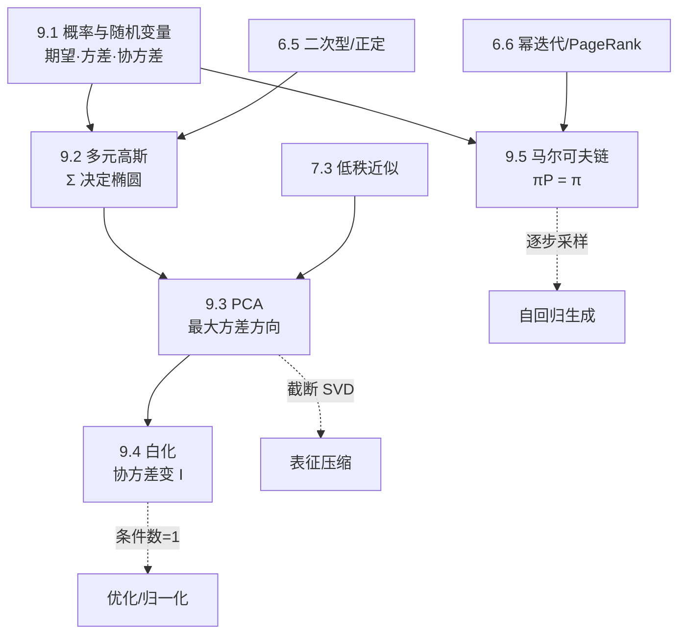

# M09 · 概率与统计

> **这一模块把「点云」翻译成矩阵。** 一旦数据被看成随机向量，均值就是中心、协方差就是形状；高斯的等高线、PCA 的主轴、白化的单位阵，都是同一个协方差矩阵的不同读法。

## 怎么读这个模块

- 先读 9.1 建立「分布 vs 样本」的区别，再读 9.2 把协方差矩阵几何化。
- 9.3、9.4 是一条线：PCA 找方向，白化把方向拉平；两节都要动手算 $2\times2$ 例子。
- 9.5 是独立分支，只依赖 9.1 与 [6.6 幂迭代](../06-特征值/06-幂迭代与PageRank.md)，可以最后读。
- 每篇的「通往大模型」都给了形状与量级，建议对照 [11.11 采样](../11-大模型专题/11-logits与采样.md) 一起看。

## 本模块的现实问题

1. 210 万用户的 A/B 实验，4.31% 与 4.34% 的差是真信号还是噪声？（[9.1](01-概率与随机变量.md)）
2. 桥下丢星 5 秒、IMU 漂了 5 米，GNSS 到来时该信谁、信多少？（[9.2](02-多元高斯.md)）
3. 8 万张人脸底图、512 MB 内存、300 ms 预算，怎么在本地完成比对？（[9.3](03-PCA.md)）
4. 20 QPS 的油画滤镜，150 ms 里能做几层白化？哪几层必须退回 AdaIN？（[9.4](04-白化.md)）
5. 4.2 万张工单、三分之一卡在「等客户」，该加客服还是上自动催办？（[9.5](05-马尔可夫链.md)）

## 概念地图

## 学习顺序

| 顺序 | 文档 | 时间 | 读完你应该能…… |
|---|---|---|---|
| 1 | [9.1 概率与随机变量](01-概率与随机变量.md) | 35 min | 从样本估出 $\hat{\boldsymbol\mu},\hat\Sigma$，解释 $n-1$ |
| 2 | [9.2 多元高斯](02-多元高斯.md) | 40 min | 由 $\Sigma$ 的特征值画出椭圆轴，判断正定 |
| 3 | [9.3 PCA](03-PCA.md) | 40 min | 手算 PCA，写出投影、重建与误差 |
| 4 | [9.4 白化](04-白化.md) | 35 min | 写出 PCA/ZCA 白化矩阵并验证 $\Sigma\mapsto I$ |
| 5 | [9.5 马尔可夫链](05-马尔可夫链.md) | 35 min | 解 $\boldsymbol\pi P=\boldsymbol\pi$，估计混合速度 |

## 一条主线

$$
\underbrace{X\in\mathbb{R}^{n\times D}}_{\text{样本}}
\xrightarrow{\ \hat{\boldsymbol\mu},\ \hat\Sigma\ }
\underbrace{\mathcal{N}(\boldsymbol\mu,\Sigma)}_{\text{椭圆}}
\xrightarrow{\ \text{特征分解}\ }
\underbrace{V,\Lambda}_{\text{主轴/方差}}
\xrightarrow{\ \Lambda^{-1/2}V^\top\ }
\underbrace{\operatorname{Cov}(\mathbf{z})=I}_{\text{白化}}
$$

**同一个 $\Sigma$：在 9.2 是等高线，在 9.3 是主轴，在 9.4 是要被消掉的对象。**

## 大模型钩子

| 位置 | 用到的数学 | 形状/量级 |
|---|---|---|
| 激活统计 | 样本均值、协方差 | $[N,D]\to[D,D]$，$D=4096$ 时 16.7M 个数 |
| LayerNorm / RMSNorm | 逐 token 的标量均值/方差 | 每个 token $O(D)$ |
| 表征可视化/压缩 | PCA、解释方差比 | $V_k\in[D,k]$ |
| KV Cache 低秩 | 截断 SVD / PCA | 压缩比由奇异值谱决定 |
| 扩散/VAE 采样 | 高斯先验、Cholesky | $\mathbf{x}=\boldsymbol\mu+L\mathbf{z}$ |
| 解码 | softmax 温度、马尔可夫链 | logits $[B,T,V]$，$V\sim10^5$ |

## 自测（读完再做）

1. 为什么样本协方差除以 $n-1$？$n<D$ 时会发生什么？
2. $\Sigma=\begin{bmatrix}2&1\\1&2\end{bmatrix}$ 的特征值、椭圆半轴、相关系数各是多少？
3. PCA 为什么必须先中心化？若第一主成分解释 90% 方差，相对重建误差是多少？
4. 白化与标准化有什么区别？PCA 白化与 ZCA 白化又差在哪？
5. 行随机矩阵的稳态方程是什么？为什么是 $\boldsymbol\pi P=\boldsymbol\pi$ 而不是 $P\boldsymbol\pi=\boldsymbol\pi$？
6. 温度 $T\to0$ 时，语言模型的转移矩阵变成什么？为什么容易重复？

自测答案

1. 样本均值用掉一个自由度，离差平方和的期望是 $(n-1)\sigma^2$，除 $n-1$ 才无偏。$n<D$ 时中心化矩阵秩 $\le n-1$，协方差奇异，不能求逆、写密度或做全白化。
2. 特征值 $3$ 与 $1$；半轴 $\sqrt3\approx1.732$ 与 $1$，方向 $(1,1)/\sqrt2$、$(1,-1)/\sqrt2$；相关系数 $\rho=1/(\sqrt2\cdot\sqrt2)=0.5$。
3. 不中心化时第一主成分偏向均值方向，整体偏移被误当成方差。相对重建误差是 $\sqrt{1-0.9}\approx0.316$（Frobenius 意义）。
4. 标准化只除以各维标准差，得到相关系数矩阵；白化还要旋转去相关，得到单位阵。PCA 白化输出轴对齐主成分，ZCA 白化保留原坐标方向，两者相差旋转 $V$。
5. $\boldsymbol\pi P=\boldsymbol\pi$，$\pi_i\ge0$，$\sum_i\pi_i=1$。因为本节约定每行是「从该状态出发的去向分布」，分布左乘行向量；列随机的 6.6 写作 $P\boldsymbol\pi=\boldsymbol\pi$，本质是转置。
6. $P_{i\to j}\propto\exp(z_j/T)$ 在 $T\to0$ 时退化为 one-hot，链变成确定性映射；高概率 token 被反复选中，容易进入「A→B→A→B」式循环。

## 配套材料

- 习题：[m09-习题](../exercises/m09-习题.md) ｜ 答案：[m09-答案](../exercises/m09-答案.md)
- 实验：[lab09_PCA与马尔可夫.py](../labs/lab09_PCA与马尔可夫.py)，运行 `uv run --with numpy python labs/lab09_PCA与马尔可夫.py`

## 前置与后续

- 前置：[1.4 范数](../01-向量与几何/04-范数与距离.md)、[6.5 二次型与正定](../06-特征值/05-二次型与正定.md)、[6.6 幂迭代](../06-特征值/06-幂迭代与PageRank.md)、[7.3 低秩近似](../07-SVD/03-低秩近似.md)。
- 后续：[11.6 LayerNorm](../11-大模型专题/06-LayerNorm与RMSNorm.md)、[11.11 采样](../11-大模型专题/11-logits与采样.md)。

---

开始阅读 → [9.1 概率与随机变量](01-概率与随机变量.md)
