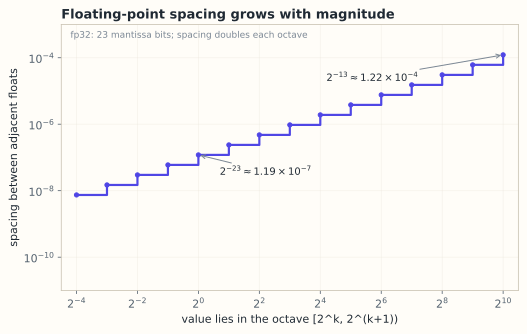

# 10.1 浮点数、舍入与误差
> **本节位置**：模块 10 · 数值线性代数 ｜ **前置**：[1.4 范数与距离](../01-向量与几何/04-范数与距离.md) ｜ **预计**：35 分钟
>
> **一句话**：计算机里的实数是一张「相对精度固定」的刻度尺；理解刻度间距，才能知道哪些误差是算法造成的、哪些是数字本身没被存下来。

## 0. 场景引入

某清算机构日终要把 **5 000 万笔** 交易轧差成一个净额。单笔平均 $1.2$ 万元，日总额约 **$6\times10^{11}$ 元**。工程师图省事，用 fp32 累加器逐笔相加。

fp32 在 $6\times10^{11}$ 附近的间距是 $2^{16}=65\,536$ 元：单笔 $1.2$ 万元不到半个间距，**加进去等于没加**。按随机游走估算，一天下来误差约 $1.3\times10^8$ 元。

更隐蔽的是：这笔误差不会被任何异常捕获——没有 `inf`、没有 `nan`，只有一张对不上的报表。审计时你只能看到「明细之和 ≠ 总额」，而且差额恰好是 $65\,536$ 的整数倍。`0.1 + 0.2 = 0.30000000000000004` 只是同一件事的小规模版本。

**决定**：累加器换成「整数分」（int64，精确），还是 fp64（误差约 $0.5$ 元）？

**代价**：差一分钱，对账就平不了，整批挂起人工调账；差一亿元，是监管报送事故。

问题的核心不是「浮点数不准」，而是：**误差随规模怎么长、长到哪一步就不可接受**。

读完本节，你应该能回答三件事：

1. 浮点数保存的是相对精度还是绝对精度，fp16 到底有几位十进制有效数字？
2. 为什么 $n$ 项求和的经典误差界在 $n>1/u$ 时会失效，届时该用什么估计？
3. 同样一组数，换一个相加顺序，结果为什么会不同？

## 1. 直觉
浮点数是「指数伸缩」的尺子：刻度间距随数量级变化，而不是固定的小数位数。fp32 在 $[1,2)$ 区间的间距是 $2^{-23}$，在 $[1024,2048)$ 区间是 $2^{-13}$。

在 1 附近，相邻可表示数的间距是 $2^{-23}\approx1.19\times10^{-7}$；在 1024 附近变成 $2^{-13}\approx1.22\times10^{-4}$。**绝对值越大，绝对精度越粗，相对精度基本不变。**

*图：fp32 的相邻可表示数间距按 $2$ 的幂逐段翻倍；在 $1$ 附近是 $2^{-23}$，在 $1024$ 附近变成 $2^{-13}$。相对精度基本不变，绝对间距随数量级增长。*

> 💡 **一句话直觉**：浮点数保证的是「大约 7 位有效数字」（fp32），不是「小数点后 7 位」。

### 1.1 它在现实世界里对应什么
它对应一本**科学计数法的账页**：每页只留固定个数的格子写有效数字，数量级另记在指数栏。格子数就是尾数位 $p$，而**账页的宽度决定你能记到第几位**。

| 格式 | 尾数位 $p$ | 十进制有效位数 $\approx(p+1)\log_{10}2$ | 现实读法 |
|---|---|---|---|
| fp16 | 10 | $3.3$ | 只够记「3 位半」，$1234$ 存成 $1230$ 量级 |
| bf16 | 7 | $2.4$ | 只够记 2 位多，适合记数量级，不适合记账 |
| fp32 | 23 | $7.2$ | 一张 7 位的账页 |
| fp64 | 52 | $16.0$ | 一张 16 位的账页 |

这张表就是选型依据：**fp16 只有约 3 位十进制有效数字**。用它累加 $10^8$ 笔金额，等于每笔只记到千分之一。

### 1.2 这个类比在哪里失效
「相对精度固定」只在正常数范围成立。接近下溢时进入次正规数（subnormal），相对精度变差；接近上溢时直接变成 `inf`。

更关键的失效点在**累加**：账页类比假设「一笔一页」，而求和是把所有笔数压进同一页。累计值越大，间距越宽，后面的小额就再也写不进去——这是 §4.4 的误差累积，单看一页看不出来。

误差分两种：**表示误差**（$0.1$ 存进 fp32 就已不是 $0.1$）与**运算误差**（结果每一次都要再舍入）。前者无法消除，后者靠算法控制。

## 2. 定义
### 2.1 IEEE 754 的四个常用格式
| 格式 | 符号位 | 指数位 | 尾数位 | 机器精度 $\varepsilon$ | 最小正规数 | 最大有限值 |
|---|---|---|---|---|---|---|
| fp16（half） | 1 | 5 | 10 | $9.77\times10^{-4}$ | $6.10\times10^{-5}$ | $65504$ |
| bf16（bfloat16） | 1 | 8 | 7 | $7.81\times10^{-3}$ | $1.18\times10^{-38}$ | $3.39\times10^{38}$ |
| fp32（single） | 1 | 8 | 23 | $1.19\times10^{-7}$ | $1.18\times10^{-38}$ | $3.40\times10^{38}$ |
| fp64（double） | 1 | 11 | 52 | $2.22\times10^{-16}$ | $2.23\times10^{-308}$ | $1.80\times10^{308}$ |

关键对比：**bf16 与 fp32 的指数位一样多**，动态范围相同；但 bf16 尾数只有 7 位，精度比 fp16 的 10 位还低。

### 2.2 一个浮点数代表什么
对正常数（normal number），

$$
x=(-1)^s\left(1+\frac{m}{2^p}\right)2^{e-\text{bias}}
$$

其中 $p$ 是尾数位数，$m\in\{0,\dots,2^p-1\}$ 是存下的整数尾数，$\text{bias}$ 让指数可正可负（fp32 为 127）。那个「$1+$」是隐含的前导 1，不占存储位，相当于白赚一位精度。

### 2.3 机器精度与单位舍入误差
**机器精度（machine epsilon）** $\varepsilon$ 是 1 与下一个可表示数的间距：

$$
\varepsilon=2^{-p}
$$

fp32 的 $p=23$，$\varepsilon=2^{-23}\approx1.192\times10^{-7}$；fp16 约 $9.77\times10^{-4}$；bf16 约 $7.8\times10^{-3}$。

**单位舍入误差（unit roundoff）** 是 $u=\varepsilon/2=2^{-(p+1)}$，它才是一次舍入的相对误差上界：

$$
\operatorname{fl}(x)=x(1+\delta),\qquad |\delta|\le u
$$

这里 $\operatorname{fl}(x)$ 表示 $x$ 舍入到浮点数的结果。fp32 的 $u\approx5.96\times10^{-8}$。

### 2.4 舍入规则与灾难性抵消
[IEEE 754](#ref-ieee754-1985) 默认「就近舍入、平局取偶（round to nearest, ties to even）」，让大量舍入的偏差相互抵消。例：fp32 中 $1+2^{-24}$ 正好在中点，取偶后等于 1；$1+2^{-23}$ 才变成下一个数。

两个相近的数相减，结果的绝对误差仍由输入决定，**相对**误差却被放大：

$$
\frac{|\delta(a-b)|}{|a-b|}\le u\,\frac{|a|+|b|}{|a-b|}
$$

当 $|a-b|\ll|a|$ 时放大因子极大，这就是**灾难性抵消（catastrophic cancellation）**。

### 2.5 混合精度
**混合精度（mixed precision）** 指同一段计算里混用不同精度：矩阵乘用 fp16/bf16（快、省显存），累加与权重更新用 fp32（准）。常见实现保留一份 fp32 主权重（master weights），前向反向用低精度，更新前把梯度转回 fp32。

## 3. 为什么这样定义
**为什么是二进制？** 硬件用二进制表示和运算最便宜。代价是十进制里有限的小数（$0.1$、$0.2$）在二进制里是无限循环小数，存进去必有误差。

**为什么机器精度定义在 1 附近？** 它衡量相对精度。在任意正常数 $x$ 处，相邻间距约为 $\varepsilon|x|$，所以 $\varepsilon$ 与数量级无关。

**为什么 fp16 和 bf16 都要有？** fp16 用 10 位尾数换精度，适合推理和范围可控的运算；bf16 用 7 位尾数换回 fp32 的 8 位指数，适合训练——梯度的数量级跨度大，范围比精度更关键。

**为什么不全用 fp64？** 算力与带宽。fp64 矩阵乘在消费级 GPU 上常比 fp32 慢一个数量级，显存占用翻倍；大模型参数规模让 fp64 训练在经济上不可行。

### 3.1 反事实：换一种相加顺序，结果会坏在哪
浮点加法**不满足结合律**。取 fp32，$a=10^8$、$b=-10^8$、$c=1$。$10^8$ 落在 $[2^{26},2^{27})$，间距是 $2^{26-23}=8$：

$$
(a+b)+c:\quad 10^8-10^8=0\ (\text{同量级相减，精确}),\quad 0+1=1
$$

$$
a+(b+c):\quad b+c=1-10^8=-99\,999\,999\ \text{最近的可表示数是}\ -10^8,\quad 10^8-10^8=0
$$

$99\,999\,999$ 离 $-10^8$ 只差 1，比离下一档 $-99\,999\,992$ 的 7 更近，于是那 1 被舍掉了。同一个表达式，两种括号，答案一个 1、一个 0。**这不是精度不够，是加法本身不再结合。** 所以编译器默认不敢做浮点重排；`-ffast-math` 之所以危险，就是它允许这种重排。

第二层反事实：**求和顺序**。$n=10^7$ 个「正负交替、量级 $10^8$」的数，从左到右求和的确定性界是 $\gamma_n\sum|x_i|$，$\gamma_n=\frac{nu}{1-nu}$；此时 $nu\approx0.6$，界已经松到没有意义。实际用统计估计 $\sqrt{n}\,u\sum|x_i|$；先按绝对值从小到大加，误差还能再小一个数量级。Kahan 补偿求和（§4.4）则压到与 $u\sum|x_i|$ 同阶。

第三层反事实：**遍历顺序**。一个 $8192\times8192$ 的 fp32 矩阵按行主序存放，共 $268$ MB：

- 按行求和（$j$ 内层）：连续读，一条 64 B 的 cache line 用满 16 个数，DRAM 流量 $268$ MB；
- 按列求和（$i$ 内层，步长 $8192\times4=32$ KB）：每读一个数就换一条 cache line，64 B 只用到 4 B。如果「行数 × 64 B」超过 L2（约 $6\times10^5$ 行以上），line 在复用前就被换出，DRAM 流量变成 16 倍。

8192 行只有 512 KB 的 line 集，塞得进 L2，所以这里实测差距通常是几倍而不是 16 倍。**方向对，倍数要按缓存容量算，不能背。**

## 4. 性质与推导
### 4.1 相邻间距随指数增长
设 $x\in[2^e,2^{e+1})$。尾数每加 1，数值增加 $2^{e-p}$，所以该区间的间距是

$$
\operatorname{spacing}(x)=2^{e-p}
$$

在 $[1,2)$ 内 $e=0$，间距 $2^{-p}=\varepsilon$；在 $[1024,2048)$ 内 $e=10$，间距 $2^{-13}\approx1.22\times10^{-4}$。这就是「大数加小数会被吃掉」。

### 4.2 单位舍入误差为什么是 $\varepsilon/2$
舍入到最近刻度，最坏情况落在两个刻度正中间，误差为半个间距。相对误差上界是

$$
\frac{\text{半个间距}}{x}\le\frac{2^{e-p}/2}{2^e}=2^{-(p+1)}=\frac{\varepsilon}{2}
$$

这个上界在 $x$ 是 2 的幂时取到。它假设没有下溢。

### 4.3 抵消的放大倍数
设 $\operatorname{fl}(a)=a(1+\delta_a)$、$\operatorname{fl}(b)=b(1+\delta_b)$，$|\delta|\le u$。则

$$
\operatorname{fl}(a)-\operatorname{fl}(b)=(a-b)+(a\delta_a-b\delta_b)
$$

误差项绝对值不超过 $u(|a|+|b|)$，于是相对误差上界为 $u(|a|+|b|)/|a-b|$。**减法本身没有引入新误差，它只是把输入误差的相对重要性放大了。**

### 4.4 求和误差会累积
对 $n$ 个数做朴素从左到右求和，一阶误差界为 $\left|\operatorname{fl}(\sum_i x_i)-\sum_i x_i\right|\le\gamma_n\sum_i|x_i|$，其中 $\gamma_n=nu/(1-nu)$。

读作：误差与「所有数绝对值之和」成正比，而不是与结果的绝对值成正比。正负相消严重的求和，相对误差会很大。实际实现常用补偿求和（[Kahan summation](#ref-kahan-1965)）把误差压到与 $u\sum|x_i|$ 同阶。

## 5. 例子
### 5.1 手算：fp32 里减出 19% 的误差
计算 $x-1$，其中 $x=1.0000001$。1 附近的 fp32 间距是 $2^{-23}=1.1920928955\times10^{-7}$，$x$ 距离 1 只有 $1\times10^{-7}$，不到一个间距，最近的可表示数是 $\operatorname{fl}(x)=1.0000001192092896$。

两个数很接近，减法按 Sterbenz 引理是精确的，于是 $\operatorname{fl}(x)-1=1.1920928955\times10^{-7}$。

真值是 $1\times10^{-7}$，绝对误差 $1.92\times10^{-8}$，相对误差

$$
\frac{1.92\times10^{-8}}{1\times10^{-7}}\approx19.2\%
$$

一个 7 位有效数字的输入，减完只剩**不到 1 位**可信数字。不是减法算错了，而是 $1.0000001$ 的末位信息在存储时就丢了。

### 5.2 手算：8 位十进制下的二次方程
解 $x^2-10^8x+1=0$，求根公式给出 $x_{1,2}=(10^8\pm\sqrt{10^{16}-4})/2$。

在 8 位有效数字的算术里，$10^{16}-4$ 被舍入成 $10^{16}$，开方得 $10^8$，于是 $x_2=(10^8-10^8)/2=0$。

但两根之积等于 $c/a=1$，正确的 $x_2=1/10^8=10^{-8}$。**稳定写法**是用韦达定理从大根反推小根：$x_2=c/(a x_1)=1/10^8=10^{-8}$。

同一道题，只改变公式的组织方式，结果从 0 变成正确答案。这就是数值稳定：不是算得更快，而是避免把有效信息减没。

### 5.3 场景：0.1 在三种格式里
fp32 存成 $0.100000001490116$（相对误差 $1.49\times10^{-8}$），fp16 存成 $0.0999755859375$（$-2.44\times10^{-4}$），bf16 存成 $0.10009765625$（$9.77\times10^{-4}$）。

bf16 的误差接近千分之一。若 4096 维向量的每个分量都带这种误差，点积的相对误差仍在同一量级；但若后面接一个条件数很大的矩阵，就会被放大（第 10.2 节）。

### 5.4 场景闭环：5 000 万笔交易的日终净额
**输入**：$n=5\times10^7$ 笔，单笔均值 $1.2\times10^4$ 元，总和 $S\approx6\times10^{11}$ 元，fp32 累加器。

**计算**：$S$ 落在 $[2^{39},2^{40})$，间距 $\operatorname{spacing}=2^{39-23}=2^{16}=65\,536$ 元。单笔 $1.2\times10^4$ 元小于半个间距（$32\,768$），所以每一次加法都可能原地不动。

- 随机游走估计：$\sqrt{n}\cdot(\text{间距}/2)/\sqrt3\approx1.3\times10^8$ 元；
- 确定性界：$\gamma_n\sum|x_i|$，而 $nu=5\times10^7\times5.96\times10^{-8}\approx3>1$，$\gamma_n$ 无定义——**这个界在 $n>1/u\approx1.7\times10^7$ 时就已经失效**。

**输出**：一份净额报送。fp32 的结果与逐笔明细对不上，差额上亿元。

**成本**（三种选择）：

| 方案 | 精度 | 代价 |
|---|---|---|
| fp32 累加 | 误差约 $10^8$ 元 | 无（但不可用） |
| fp64 累加 | 误差约 $\sqrt{n}\,u_{64}S\approx0.5$ 元 | 带宽不变、加法吞吐减半；到「分」仍不保证 |
| int64 记「分」 | 精确，$6\times10^{13}$ 分 $<9.2\times10^{18}$ | 要改 schema，乘法与除法要单独处理 |

**失败条件**：fp64 的 $0.5$ 元来自随机游走模型；若金额重尾、或存在大量正负抵消，误差会更大。兜底做法是「整数分 + 独立复算」：第二套代码用不同顺序再算一遍，两个结果必须逐分相等。

## 6. 常见误区
1. **误区**：机器精度是最小的正浮点数。
   **纠正**：$\varepsilon$ 是 1 附近的刻度间距。fp32 的最小正规数是 $1.18\times10^{-38}$，最小次正规数约 $1.4\times10^{-45}$，都远小于 $\varepsilon$。
2. **误区**：bf16 比 fp16 精度高，因为它「更新」。
   **纠正**：bf16 只有 7 位尾数，精度低于 fp16 的 10 位；它的优势是 8 位指数带来的动态范围。选型要看「范围不够」还是「精度不够」。
3. **误区**：用 fp64 就能消除灾难性抵消。
   **纠正**：抵消放大的是输入误差。若输入本身只有 7 位有效数字（例如来自 fp32 数据），换成 fp64 相减仍然只有 7 位。
4. **误区**：bf16 训练也必须做 loss scaling。
   **纠正**：loss scaling 主要解决 fp16 的梯度下溢（最小正规数 $6.1\times10^{-5}$）。bf16 的指数范围与 fp32 相同，通常不需要；它的问题在精度而非范围。

## 7. 概念网络
- 前置：[1.4 范数与距离](../01-向量与几何/04-范数与距离.md) —— 误差的大小要用范数度量。
- 后续：[10.2 矩阵范数与条件数](02-矩阵范数与条件数.md) —— 把标量误差放进矩阵，看它被放大多少倍。
- 后续：[10.3 BLAS 与 GEMM](03-BLAS与GEMM.md) —— 低精度矩阵乘法为什么快，累加精度放在哪里。
- 关联：[4.6 条件数与病态](../04-线性方程组/06-条件数与病态.md) —— $\kappa$ 与 $u$ 共同决定解的有效位数。
- 关联：[11.9 量化](../11-大模型专题/09-量化.md) —— 把浮点换成定点，本质是另一种舍入误差。
- 关联：[11.7 KV Cache](../11-大模型专题/07-KVCache.md) —— 缓存张量的精度直接决定显存与带宽。

## 8. 通往大模型：精度决定谁能被训练
**出现位置一：混合精度训练。** 一层线性层是 $Y=XW$，$X\in\mathbb{R}^{BT\times D}$、$W\in\mathbb{R}^{D\times D}$。前向用 bf16 存 $X,W$，矩阵乘在张量核（tensor core）里以 fp32 累加，得到 fp32 的 $Y$。反向同理。优化器另存 fp32 主权重，更新 $w\leftarrow w-\eta g$ 后再舍入回 bf16。

**为什么必须留 fp32 副本。** 设 $w=1.0$，一次更新量 $\eta g=10^{-4}$。bf16 在 1 附近的间距是 $2^{-7}=7.8\times10^{-3}$，fp16 是 $9.77\times10^{-4}$，两者都会把 $10^{-4}$ 的更新吃掉；fp32 的间距是 $1.19\times10^{-7}$，能保住这次更新。每步更新都被舍入掉，训练会「看起来在跑，实际不动」。

**出现位置二：fp16 的 loss scaling。** fp16 的最小正规数 $6.1\times10^{-5}$，很多梯度小于它；小于 $5.96\times10^{-8}$ 的梯度直接下溢为 0。做法是反向传播前把 loss 乘 $S$（如 $2^{10}=1024$），梯度整体放大 $S$ 倍，避开下溢；更新前再除以 $S$。除回的一步必须在 fp32 里做，否则 $10^{-8}$ 量级又会掉回 0。

**出现位置三：KV Cache 量化。** 以 $L=32$ 层、$H=32$ 头、$T=4096$、$d_k=128$、batch 1 为例，K 和 V 共 $2LHTd_k=2\times32\times32\times4096\times128\approx1.07\times10^{9}$ 个元素。

fp16 占 $2.15$ GB，int8 占 $1.07$ GB，4-bit 约占 $0.54$ GB。每 token 的 KV 是 $2\times32\times32\times128\times2$ 字节 $=512$ KB（fp16）。这就是长上下文推理先被显存卡住的原因。

**可检验结论**：在 fp32 里算 $1+\varepsilon/2$ 仍然等于 1（平局取偶），$1+\varepsilon$ 才变成下一个数；在 bf16 里 $1+2^{-8}$ 就已经等于 1。用 `np.float32`、`np.float16` 和按位截断模拟的 bf16 各跑一遍，三种格式的 $\varepsilon$ 正好是 $2^{-23},2^{-10},2^{-7}$（见 [lab10](../labs/lab10_数值误差与GEMM.py) 第 2 节）。

**如果这一步算错，用户会看到什么。** 训练侧有三种典型现象：loss 前几百步「正常下降」然后卡在平台上（更新量小于半个 ulp，被舍成 0）；梯度出现 `inf` 或 `nan`（上溢）；同一个模型两次运行的 loss 曲线对不上（非确定性累加顺序）。清算侧更朴素：明细加起来不等于总额，差额恰好是「间距的整数倍」——看到差额是 $2^{16}$ 的整数倍，先怀疑 fp32 累加器，而不是业务逻辑。

## 9. 练习
1. **概念**：机器精度 $\varepsilon$ 与单位舍入误差 $u$ 的区别是什么？为什么误差界里用 $u$ 而不是 $\varepsilon$？
2. **计算**：fp32 中 1 附近与 1024 附近的相邻间距分别是多少？$1024+2^{-14}$ 存进 fp32 后等于多少？说明用到了哪条舍入规则。
3. **计算**：在只有 4 位小数的十进制算术里计算 $1.0002-1.0001$。每个输入的最大绝对误差是多少？结果的最大相对误差是多少？大约有几位可信数字？
4. **场景**：某 fp16 训练的梯度为 $3\times10^{-8}$。若 loss scale 取 $2^{10}$，缩放后的梯度是多少？为什么「除以 $S$」这一步要在 fp32 里完成？
5. **开放**：如果只能用一种低精度格式训练 70B 模型，你选 fp16 还是 bf16？从动态范围、精度、是否需要 loss scaling 三个角度说明。

参考答案

1. $\varepsilon=2^{-p}$ 是 1 与下一个可表示数的间距；$u=\varepsilon/2=2^{-(p+1)}$ 是「就近舍入」一次的最大相对误差。舍入误差最多半个间距，所以界里用 $u$。平时说「fp32 有 7 位有效数字」用的是 $\varepsilon$ 的量级。
2. 1 附近 $2^{-23}\approx1.19\times10^{-7}$；1024 附近 $2^{-13}\approx1.22\times10^{-4}$。$2^{-14}$ 正好是半个间距，落在中点，按「平局取偶」舍入到 1024（1024 的尾数是偶数）。若加 $2^{-13}$，得到 $1024.0001220703125$。
3. 每个输入的绝对误差至多 $0.5\times10^{-4}$，差的绝对误差至多 $10^{-4}$。真差是 $10^{-4}$，所以相对误差可达 $100\%$，结果可能一位可信数字都没有。正确做法是提高输入精度，或避免用两个大数相减去求小量。
4. $3\times10^{-8}\times1024=3.072\times10^{-5}$，略小于 fp16 最小正规数 $6.1\times10^{-5}$，但作为次正规数仍可表示（最小次正规数 $5.96\times10^{-8}$），不会归零；若 $S=2^{12}$ 则到 $1.23\times10^{-4}$，完全进入正规数范围。除以 $S$ 若在 fp16 里做，$3\times10^{-8}$ 仍是精度很差的次正规数；在 fp32 里除则保留全部有效位，再累加到 fp32 主权重。
5. 选 bf16。70B 模型的梯度/激活数量级跨度大，fp16 的 $65504$ 上限和 $6.1\times10^{-5}$ 下限都容易越界，需要 loss scaling 与溢出监控；bf16 的指数范围与 fp32 相同，基本不会上溢/下溢。代价是 7 位尾数舍入更粗，通常靠 fp32 主权重缓解。若任务对精度极敏感且范围可控，才考虑 fp16。

## 10. 一页速记
- 浮点数是「相对精度固定」的刻度：fp32 $\varepsilon\approx1.19\times10^{-7}$，fp16 $\approx9.77\times10^{-4}$，bf16 $\approx7.8\times10^{-3}$。
- 一次舍入的相对误差 $\le u=\varepsilon/2$；相邻间距 $=2^{e-p}$，随数量级增长。
- 减法不制造误差，但把输入的绝对误差放大成结果的相对误差：$\le u(|a|+|b|)/|a-b|$。
- 求和误差与 $\sum|x_i|$ 成正比，不是与结果成正比；抵消越多越危险。
- 混合精度 = 低精度矩阵乘 + fp32 累加/主权重；fp16 需 loss scaling，bf16 通常不需要。
- **物理意义 / 现实对应**：浮点数是「相对精度固定的账页」，误差是格子宽度；灾难性抵消就是「两笔大额相减后，差额只剩格子宽度的分辨率」。

## 11. 参考文献与致谢

这一页的知识不是凭空来的。下面列出本页直接借用的原始工作与权威整理；正文中的人名、定理名已链接到对应条目。链接优先指向 DOI、arXiv 或可长期访问的原文存档。

- **IEEE 754 工作组（1985）**：*IEEE Standard for Binary Floating-Point Arithmetic*。二进制浮点数的格式、舍入与特殊值，本页 §2.1 的四个格式都来自这份标准。[IEEE Xplore](https://doi.org/10.1109/IEEESTD.1985.82928)
- **Goldberg（1991）**：*What Every Computer Scientist Should Know About Floating-Point Arithmetic*。把舍入误差、抵消与精度损失讲透的经典综述，本页 §4 的误差界可直接对照。[ACM Computing Surveys](https://doi.org/10.1145/103162.103163)
- **Kahan（1965）**：*Further Remarks on Reducing Truncation Errors*。补偿求和（Kahan summation）的出处；它把朴素求和的误差从随 $n$ 增长压到与 $u\sum|x_i|$ 同阶。[Communications of the ACM](https://doi.org/10.1145/363707.363723)
- **Higham（2002）**：*Accuracy and Stability of Numerical Algorithms*（2nd ed.）。数值线性代数误差分析的标准参考，本页的 $\gamma_n$ 界与后向误差讨论都在其中。[SIAM](https://doi.org/10.1137/1.9780898718027)

---

下一篇 → [10.2 矩阵范数与条件数](02-矩阵范数与条件数.md)
