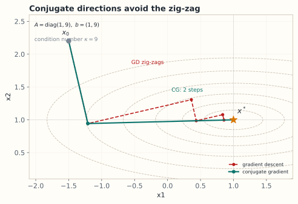

# 10.4 迭代法与共轭梯度
> **本节位置**：模块 10 · 数值线性代数 ｜ **前置**：[4.5 伪逆与最小范数解](../04-线性方程组/05-伪逆与最小范数解.md)、[10.2 矩阵范数与条件数](02-矩阵范数与条件数.md) ｜ **预计**：40 分钟
>
> **一句话**：不必求逆，也不必消元——只要反复做「矩阵乘向量」，就能一步步逼近解；共轭梯度是这件事在对称正定情形下的最优做法。
## 0. 场景引入

凌晨 00 UTC，全球模式要起报 10 天预报。网格 $1024\times1024\times48$，约 **5 000 万**个格点；半隐式时间步每 15 分钟一步，10 天共 **960 步**，每步都要解一个 7 点差分格式的 Helmholtz 方程。业务窗口 **60 分钟**，即每步只有 **3.75 s**。

矩阵每行 7 个非零元，$\operatorname{nnz}=3.5\times10^8$，CSR 约 3 GB。一次 SpMV 在 $300$ GB/s 的节点上约 **10 ms**，算术强度只有 $0.23$ FLOP/byte——瓶颈从来不是算力。

用 Jacobi 预条件 CG，Poisson 算子的 $\kappa\approx4\times10^5$，经验上要约 $10^3$ 步，单步 $10$ s，超时 2.7 倍。几何多重网格把预条件后的 $\kappa$ 压到 $10$ 量级，约 $21$ 步，单步 $0.31$ s。

$2.7$ 小时与 $5$ 分钟的差距不是「快一点」，而是「能不能按时出产品」：前者意味着 10 天预报只能隔天起报一次，或者砍掉集合预报的成员数；后者才留得出时间做集合与后处理。

**决定**：投 2 人月实现多重网格，还是扩 3 倍机器？

**代价**：赶不上起报时次，产品晚 6 小时；或降分辨率到 $512\times512\times48$，预报技巧直接下降。

**问题**：迭代法凭什么收敛，为什么 CG 的迭代数随 $\sqrt\kappa$ 而不是 $\kappa$ 增长？

读完本节，你应该能回答三件事：

1. Jacobi 与 CG 的收敛速度分别由什么决定，各要多少步？
2. CG 凭什么在 $n$ 步内精确解出 $n$ 维系统，实际为什么远早于 $n$ 步就停？
3. 预条件改的是矩阵还是「坐标系」，为什么它能把 $\kappa$ 降两个数量级？
## 1. 直觉
### 1.1 拆分矩阵：把「难解的部分」挪到右边
把 $A$ 拆成对角、下三角、上三角：$A=D-L-U$。Jacobi 说：用对角部分直接解，非对角部分留在右边：

$$
D\mathbf{x}^{(k+1)}=\mathbf{b}+(L+U)\mathbf{x}^{(k)}
$$

这相当于把「耦合项」当作已知量，反复修正。Gauss-Seidel 更贪心：算第 $i$ 个分量时，立刻用上刚算出的第 $1,\dots,i-1$ 个分量。

> 💡 **一句话直觉**：**迭代法 = 用当前猜测算残差，再沿某个方向修正；CG = 每次修正都与之前所有方向「共轭」，不重复走回头路。**

类比边界：Jacobi 的收敛依赖 $A$ 的对角占优或谱半径条件；对角元很小或为 0 时它会发散，CG 则要求 $A$ 对称正定。

*图：同一个二次函数、同一个起点：GD 在狭长山谷里之字形前进，CG 用两个共轭方向两步到达解。*

### 1.2 CG 在地形上走「最陡且不回头」的路
解 $A\mathbf{x}=\mathbf{b}$（$A$ 对称正定）等价于最小化二次函数

$$
\phi(\mathbf{x})=\tfrac12\mathbf{x}^\top A\mathbf{x}-\mathbf{b}^\top\mathbf{x}
$$

它的等高线是椭球，最优点就是解。梯度下降沿负梯度走，容易在狭长山谷里来回震荡；CG 每步选一个与之前所有搜索方向 $A$-正交（共轭）的方向，保证每个方向只走一次。
### 1.3 它在现实世界里对应什么
在天气预报里，$A$ 是「气压 → 散度趋势」的离散算子，迭代法就是**反复做局部、便宜的修正，让全局错配一点点被抹平**。

条件数在这里有直接的物理读数。Poisson 算子的特征值是 $4\sin^2(k\pi h/2)/h^2$：最小特征值对应**波长最长**的模态，最大特征值对应**网格最细**的模态。于是

$$
\kappa(A)=\frac{\lambda_{\max}}{\lambda_{\min}}\approx\frac{4/h^2}{\pi^2}=\frac{4}{\pi^2h^2}\propto\frac{1}{h^2}
$$

读作：网格加密一倍，条件数涨 4 倍，CG 的迭代次数涨 2 倍。$h=1/1024$ 时 $\kappa\approx4.3\times10^5$，$\sqrt\kappa\approx650$。

| 网格 | $h$ | $\kappa\approx4/(\pi^2h^2)$ | 迭代数 $\propto\sqrt\kappa$ |
|---|---|---|---|
| $256^2$ | $1/256$ | $2.7\times10^4$ | $164$ |
| $1024^2$ | $1/1024$ | $4.3\times10^5$ | $650$ |
| $4096^2$ | $1/4096$ | $6.9\times10^6$ | $2600$ |

最后一行是「换更细网格」被迭代法惩罚的地方：物理分辨率提高 4 倍，每步贵 16 倍、步数多 4 倍，合计约 64 倍；多重网格能把「步数」这一项变成常数。

### 1.4 这个类比在哪里失效
「抹平」的直觉容易让人以为迭代法是**局部平滑器**。Jacobi 确实是：高频误差抹得快，低频误差几乎不动。CG 不是平滑器，它在 Krylov 子空间里做全局最优逼近，靠的是谱信息。

所以两者的收敛指数不同：Jacobi 的 $\rho(G)\approx1-\pi^2h^2/2$，迭代数是 $O(h^{-2})$；CG 由 $\sqrt\kappa$ 控制，是 $O(h^{-1})$。**「加密网格会变慢」对两者都成立，但慢的指数不同**——这正是多重网格（真正在多尺度上同时处理高低频）存在的理由。

## 2. 定义
### 2.1 定常迭代：Jacobi、Gauss-Seidel、SOR
设 $A=D-L-U$，$D$ 是对角部分，$L,U$ 分别是严格下、上三角部分。

**Jacobi 迭代**：

$$
\mathbf{x}^{(k+1)}=D^{-1}\big(\mathbf{b}+(L+U)\mathbf{x}^{(k)}\big)
=\mathbf{x}^{(k)}+D^{-1}\mathbf{r}^{(k)},\qquad \mathbf{r}^{(k)}=\mathbf{b}-A\mathbf{x}^{(k)}
$$

**Gauss-Seidel 迭代**：用最新分量，矩阵形式是 $(D-L)\mathbf{x}^{(k+1)}=\mathbf{b}+U\mathbf{x}^{(k)}$。

**SOR（successive over-relaxation）** 在 Gauss-Seidel 上加速：$\mathbf{x}^{(k+1)}=(1-\omega)\mathbf{x}^{(k)}+\omega\,\mathbf{x}_{\text{GS}}^{(k+1)}$，$\omega\in(0,2)$。
### 2.2 收敛判据
把迭代写成 $\mathbf{x}^{(k+1)}=G\mathbf{x}^{(k)}+\mathbf{c}$，则误差满足

$$
\mathbf{e}^{(k)}=G^k\mathbf{e}^{(0)},\qquad \text{收敛}\iff\rho(G)<1
$$

其中 $\rho(G)$ 是**谱半径（spectral radius）**，即特征值绝对值的最大值。收敛速度由 $\rho(G)$ 决定：每步误差大约乘以 $\rho(G)$。
### 2.3 Krylov 子空间
从初始猜测 $\mathbf{x}^{(0)}$ 出发，令 $\mathbf{r}^{(0)}=\mathbf{b}-A\mathbf{x}^{(0)}$。第 $k$ 个 **Krylov 子空间（Krylov subspace）** 是

$$
\mathcal{K}_k(A,\mathbf{r}^{(0)})=\operatorname{span}\{\mathbf{r}^{(0)},A\mathbf{r}^{(0)},\dots,A^{k-1}\mathbf{r}^{(0)}\}
$$

CG 在第 $k$ 步从 $\mathbf{x}^{(0)}+\mathcal{K}_k$ 中挑出使 $\|\mathbf{x}-\mathbf{x}^*\|_A$ 最小的解，其中 $\|\mathbf{v}\|_A=\sqrt{\mathbf{v}^\top A\mathbf{v}}$。
### 2.4 CG 算法
给定对称正定 $A$、右端 $\mathbf{b}$、初值 $\mathbf{x}_0$：

$$
\begin{aligned}
&\mathbf{r}_0=\mathbf{b}-A\mathbf{x}_0,\quad \mathbf{p}_0=\mathbf{r}_0,\quad \rho_0=\mathbf{r}_0^\top\mathbf{r}_0\\
&\text{for } k=0,1,2,\dots:\\
&\qquad \alpha_k=\rho_k/(\mathbf{p}_k^\top A\mathbf{p}_k)\\
&\qquad \mathbf{x}_{k+1}=\mathbf{x}_k+\alpha_k\mathbf{p}_k\\
&\qquad \mathbf{r}_{k+1}=\mathbf{r}_k-\alpha_k A\mathbf{p}_k\\
&\qquad \beta_k=\rho_{k+1}/\rho_k,\quad \mathbf{p}_{k+1}=\mathbf{r}_{k+1}+\beta_k\mathbf{p}_k
\end{aligned}
$$

每次迭代只做一次矩阵乘向量 $A\mathbf{p}_k$、两次内积和几次向量更新，代价 $O(\operatorname{nnz}(A))$，内存 $O(n)$。
### 2.5 预条件
**预条件（preconditioning）** 是找一个容易求逆的 $M\approx A$，改为解 $M^{-1}A\mathbf{x}=M^{-1}\mathbf{b}$，使条件数从 $\kappa(A)$ 降到 $\kappa(M^{-1}A)$。常见选择：Jacobi（$M=\operatorname{diag}(A)$）、不完全 Cholesky、代数多重网格（AMG）。
## 3. 为什么这样定义
- **为什么不直接消元？** 消元代价 $O(n^3)$、内存 $O(n^2)$，且稀疏矩阵会被填充（fill-in）成稠密；迭代法每步 $O(\operatorname{nnz})$，只要能收敛，稀疏性就能保住。
- **为什么 CG 要求对称正定？** 只有 SPD 矩阵才定义内积 $\langle\mathbf{x},\mathbf{y}\rangle_A=\mathbf{x}^\top A\mathbf{y}$，才能谈「$A$-范数最小」与「$A$-共轭方向」。非对称时短递推会崩溃，要换 GMRES/BiCGStab。
- **为什么 Krylov 子空间是自然的选择？** 你唯一能方便算的向量就是 $\mathbf{r},A\mathbf{r},A^2\mathbf{r},\dots$；Krylov 子空间正是「用矩阵乘向量能到达的所有方向」，在上面做最优逼近是自然的。
- **为什么预条件能大幅加速？** CG 的收敛率由 $\sqrt{\kappa}$ 控制；好的预条件把 $\kappa$ 降下来，迭代次数可以从 $10^4$ 降到 $10^2$。
### 3.1 反事实：换一种矩阵、一个参数，会坏在哪
**反事实一：把 CG 用在对称但不定的矩阵上。** 取

$$
A=\begin{bmatrix}0&1\\1&0\end{bmatrix},\qquad \mathbf{b}=\begin{bmatrix}1\\0\end{bmatrix},\qquad \mathbf{x}_0=\mathbf{0}
$$

真解是 $\mathbf{x}^*=(0,1)^\top$。CG 第一步：$\mathbf{r}_0=\mathbf{p}_0=(1,0)^\top$，于是

$$
\mathbf{p}_0^\top A\mathbf{p}_0=(1,0)\begin{bmatrix}0&1\\1&0\end{bmatrix}\begin{bmatrix}1\\0\end{bmatrix}=0
$$

$\alpha_0=\rho_0/0$——**第一步就除以零**。$A$ 对称、可逆，特征值 $\pm1$ 也都不为零，唯一的问题是它不定，$A$-内积不是内积。这不是数值精度问题，是定义域问题；对称不定该用 MINRES。

**反事实二：把 SOR 的松弛因子推出 $(0,2)$。** 对 $A=\begin{bmatrix}2&-1\\-1&2\end{bmatrix}$、$\omega=3$：

$$
G=(D-\omega L)^{-1}\big((1-\omega)D+\omega U\big)
=\begin{bmatrix}-2&1.5\\-3&0.25\end{bmatrix}
$$

特征值是 $\big(-1.75\pm\sqrt{3.0625-16}\big)/2$，模长 $\sqrt{\lvert\det G\rvert}=\sqrt4=2$。**每步误差乘 2**：20 步放大 $10^6$，看起来「在算」，实际在爆炸。$\omega\in(0,2)$ 不是保守的工程习惯，是收敛的必要条件。

**反事实三：用绝对残差当停止准则。** 取 $\|\mathbf{b}\|=10^6$ 的系统，阈值 $\|\mathbf{r}\|\le10^{-3}$ 意味着相对精度 $10^{-9}$，很好；但同一个物理问题换成更小的单位，$\mathbf{b}$ 缩小 $10^3$，同样的绝对阈值只剩相对精度 $10^{-6}$——**三位的差距来自单位，不来自算法**。所以停止准则要用 $\|\mathbf{r}\|/\|\mathbf{b}\|$。

## 4. 性质与推导
### 4.1 定常迭代的收敛率
误差递推 $\mathbf{e}^{(k+1)}=G\mathbf{e}^{(k)}$ 展开得 $\mathbf{e}^{(k)}=G^k\mathbf{e}^{(0)}$。若 $G$ 可对角化，$\|G^k\|$ 的量级是 $\rho(G)^k$，所以 $\rho(G)<1$ 是充要条件。对 Jacobi，$G_J=D^{-1}(L+U)=I-D^{-1}A$；若 $A$ 严格对角占优（$|a_{ii}|>\sum_{j\neq i}|a_{ij}|$），则 $\rho(G_J)<1$。对 SPD 的 $A$，Gauss-Seidel 也收敛，且 $\rho(G_{GS})=\rho(G_J)^2$（一致次序情形）。
### 4.2 CG 的收敛界
对 SPD 的 $A$，CG 的误差满足

$$
\|\mathbf{e}_k\|_A\le2\left(\frac{\sqrt{\kappa}-1}{\sqrt{\kappa}+1}\right)^{k}\|\mathbf{e}_0\|_A
$$

读作：条件数越小，括号越小，收敛越快。$\kappa=1$ 时括号为 0，一步到位（$A$ 是单位阵的倍数）。这个界是**最坏情况**，实际常更快；它也说明 CG 的迭代次数大约与 $\sqrt{\kappa}$ 成正比，而不是 $\kappa$。

推导思路：CG 的误差可写成 $\mathbf{e}_k=p_k(A)\mathbf{e}_0$，其中 $p_k$ 是满足 $p_k(0)=1$ 的 $k$ 次多项式；在所有这样的多项式中，CG 选的那个使 $\|p_k(A)\mathbf{e}_0\|_A$ 最小。用 Chebyshev 多项式在 $[\lambda_{\min},\lambda_{\max}]$ 上逼近 0，就得到上面的界。Krylov 子空间 $\mathcal{K}_k$ 的维数每步至多增加 1，最多到 $n$；$k=n$ 时 $\mathcal{K}_n=\mathbb{R}^n$，CG 在精确算术下必得精确解。实际因舍入误差，通常远早于 $n$ 步就达到机器精度；病态时则可能退化。
### 4.3 每步代价
| 运算 | 稠密 $A$ | 稀疏 $A$（nnz 个非零） |
|---|---|---|
| $A\mathbf{p}$ | $2n^2$ FLOPs | $2\operatorname{nnz}$ FLOPs |
| 内积 $\mathbf{p}^\top A\mathbf{p}$ | $2n$ | $2n$ |
| 向量更新 | $O(n)$ | $O(n)$ |
| 内存 | $O(n^2)$ | $O(\operatorname{nnz})$ |

所以稀疏 CG 一次迭代是 $O(\operatorname{nnz})$，总代价是「迭代次数 × nnz」。
## 5. 例子
### 5.1 手算：Jacobi 在 $2\times2$ 系统上慢慢爬
取

$$
A=\begin{bmatrix}4&1\\1&3\end{bmatrix},\qquad \mathbf{b}=\begin{bmatrix}1\\2\end{bmatrix}
$$

精确解是 $\mathbf{x}^*=(1/11,\,7/11)\approx(0.0909,0.6364)$。从 $\mathbf{x}^{(0)}=\mathbf{0}$ 开始：

$$
\mathbf{x}^{(1)}=\begin{bmatrix}(1-0)/4\\(2-0)/3\end{bmatrix}=\begin{bmatrix}0.25\\0.6667\end{bmatrix},\quad
\mathbf{x}^{(2)}=\begin{bmatrix}(1-0.6667)/4\\(2-0.25)/3\end{bmatrix}=\begin{bmatrix}0.0833\\0.5833\end{bmatrix},\quad
\mathbf{x}^{(3)}=\begin{bmatrix}(1-0.5833)/4\\(2-0.0833)/3\end{bmatrix}=\begin{bmatrix}0.1042\\0.6389\end{bmatrix}
$$

三步之后仍在 $0.01$ 量级附近晃。Jacobi 迭代矩阵

$$
G_J=D^{-1}(L+U)=\begin{bmatrix}0&-1/4\\-1/3&0\end{bmatrix}
$$

特征值是 $\pm1/\sqrt{12}=\pm0.2887$，所以每步误差约乘 $0.2887$。要减小 $10^6$ 倍需要约 $\log(10^{-6})/\log(0.2887)\approx11$ 步；看起来不多，但换成 $n=10^6$ 的稀疏矩阵，收敛因子会接近 1，步数可能上万。
### 5.2 手算：CG 两步解出同一个系统
仍取上面的 $A,\mathbf{b}$，$\mathbf{x}_0=\mathbf{0}$。

**第 0 步**：$\mathbf{r}_0=\mathbf{p}_0=(1,2)^\top$，$\rho_0=1^2+2^2=5$。
$$
A\mathbf{p}_0=\begin{bmatrix}4+2\\1+6\end{bmatrix}=\begin{bmatrix}6\\7\end{bmatrix},\qquad
\mathbf{p}_0^\top A\mathbf{p}_0=6+14=20
$$

$$
\alpha_0=\frac{5}{20}=\frac14,\qquad
\mathbf{x}_1=\frac14\begin{bmatrix}1\\2\end{bmatrix}=\begin{bmatrix}0.25\\0.5\end{bmatrix}
$$

**第 1 步**：$\mathbf{r}_1=\mathbf{b}-A\mathbf{x}_1=(1,2)^\top-(1.5,1.75)^\top=(-0.5,0.25)^\top$，$\rho_1=0.3125$。

$$
\beta_0=\frac{0.3125}{5}=\frac{1}{16},\qquad
\mathbf{p}_1=\mathbf{r}_1+\frac1{16}\mathbf{p}_0=\begin{bmatrix}-7/16\\3/8\end{bmatrix}
$$

$$
A\mathbf{p}_1=\begin{bmatrix}-11/8\\11/16\end{bmatrix},\qquad
\mathbf{p}_1^\top A\mathbf{p}_1=\frac{55}{64}
$$

$$
\alpha_1=\frac{5/16}{55/64}=\frac{4}{11},\qquad
\mathbf{x}_2=\mathbf{x}_1+\frac{4}{11}\mathbf{p}_1
=\begin{bmatrix}1/11\\7/11\end{bmatrix}
$$

**恰好等于精确解**。$n=2$ 的系统，CG 在 2 步内收敛，与理论一致。
### 5.3 场景：稀疏系统上的真实收益
一个二维泊松方程离散后有 $n=10^6$ 个未知数、每行 5 个非零元。稠密消元需要 $O(n^3)$，不可能；Jacobi 每步 $O(n)$ 但可能要 $10^5$ 步；预条件 CG 每步约 $5\times10^6$ 次运算，通常几百步收敛，总计约 $10^9$ 次运算——在笔记本上几秒量级。这就是迭代法在科学计算里的地位。

### 5.4 场景闭环：10 天预报的 960 次求解
**输入**：$1024\times1024\times48$ 网格，$n=5.03\times10^7$，7 点格式，$\operatorname{nnz}=3.52\times10^8$，CSR 约 3 GB；单步预算 $3.75$ s。

**计算**（每步一次 Helmholtz 求解）：

| 方案 | 预条件后的 $\kappa$ | 迭代数（按 §4.2 的界） | 单步时间 |
|---|---|---|---|
| 无预条件 CG | $4.3\times10^5$ | $4500$ | $45$ s |
| Jacobi-PCG | $4.3\times10^5$（量级不变） | 界 $4500$，经验约 $10^3$ | $10$ s |
| 几何多重网格预条件 | $\approx10$ | $21$ | $0.31$ s |

迭代数用 §4.2 的界反解：$k\ge\ln(10^{-6})\big/\ln\frac{\sqrt\kappa-1}{\sqrt\kappa+1}$。$\kappa=4.3\times10^5$ 时括号是 $0.9969$，$k\ge4500$；$\kappa=10$ 时括号是 $0.52$，$k\ge21$。

**输出**：960 步的总时间——Jacobi 约 $2.7$ h，多重网格约 $5$ min，业务窗口 $60$ min。

**成本**：多重网格每步 setup 约 $0.1$ s（几次 SpMV 量级），换来 $30$ 倍加速。代价有两件事：实现复杂度（粗化、插值、光滑子都要按问题调），以及**强扩展性变差**（网格太小时粗层通信占比上升）。

**失败条件**：系数矩阵随天气状态变化（变系数、对流主导）时，「粗网格仍刻画低频」的假设变弱，收敛可能退化到几十步；此时 AMG 更稳但 setup 更贵。兜底是「多重网格 + 几步 CG 抛光」，并监控残差是否在预算步数内达标。
## 6. 常见误区
1. **误区**：CG 对任何矩阵都能用。
   **纠正**：CG 要求 $A$ 对称正定。非对称系统要用 GMRES/BiCGStab；对称但不定的系统要用 MINRES。
2. **误区**：迭代法一定比直接法快。
   **纠正**：稠密、小规模、良态的系统，LAPACK 的直接法往往更快更稳；迭代法的优势在稀疏、大规模。
3. **误区**：CG 一定在 $n$ 步内精确收敛，所以不用预条件。
   **纠正**：$n$ 步是精确算术的上界；浮点误差会让实际收敛变慢，病态时可能几百步还不如预条件后几十步。
## 7. 概念网络
- 前置：[4.5 伪逆与最小范数解](../04-线性方程组/05-伪逆与最小范数解.md) —— 最小二乘与正规方程提供了 SPD 系统的来源。
- 前置：[10.2 矩阵范数与条件数](02-矩阵范数与条件数.md) —— $\kappa$ 决定 CG 的收敛率。
- 后续：[10.5 稀疏矩阵](05-稀疏矩阵.md) —— 稀疏存储让每步 $A\mathbf{p}$ 变便宜。
- 关联：[8.7 梯度下降与牛顿法](../08-微积分与优化/07-梯度下降与牛顿法.md) —— 牛顿步内部可以用 CG 解线性系统。
## 8. 通往大模型：不形成 Hessian 的二阶优化
**出现位置一：Newton-CG。** 牛顿法要解 $H\mathbf{p}=-\mathbf{g}$，其中 $H=\nabla^2L\in\mathbb{R}^{P\times P}$。70B 模型的 $P\approx7\times10^{10}$，显式存 $H$ 需要 $O(P^2)$，绝无可能。但 Hessian-向量乘积 $H\mathbf{v}$ 可以通过一次额外反向传播近似得到（Pearlmutter 技巧：对 $\nabla L$ 再做一次方向导数），代价约等于一次前向+反向。CG 只需要 $H\mathbf{v}$，于是可以在**不形成 $H$** 的情况下求近似牛顿步。这就是 Newton-CG / trust-region Newton 的核心。

**出现位置二：为什么只跑几十步。** 每个 CG 迭代都要一次 HVP，成本约等于一次训练 step。实际实现用**截断 CG（truncated CG）**：最多跑 20–50 步，或用残差范数阈值提前停。因为 Hessian 本身有噪声、且远离极小点时二次模型不准，精确解 $H\mathbf{p}=-\mathbf{g}$ 反而没有意义。

**出现位置三：损失曲面的条件数。** CG 的收敛界含 $\sqrt{\kappa(H)}$。若某层 Hessian 的 $\kappa$ 是 $10^4$，CG 需要约 $100$ 步量级才能显著降低误差；若 $\kappa$ 是 $10^2$，约 $10$ 步。预条件（如对角预条件、K-FAC 的块对角近似）能把 $\kappa$ 拉低，这也是二阶优化在大模型上仍被研究的原因。

**出现位置四：Adam 与对角预条件。** Adam 的更新是 $\mathbf{m}/(\sqrt{\mathbf{v}}+\epsilon)$，其中 $\mathbf{v}$ 是梯度平方的滑动平均。把它看成 $M^{-1}\mathbf{g}$，$M=\operatorname{diag}(\sqrt{\mathbf{v}})$ 就是一个对角预条件器：它按每个参数的梯度尺度缩放步长，粗略地降低了各方向的条件数差异。这不是严格的 CG，但动机相同——**让不同曲率方向上的有效步长接近**。
**可检验结论**：在二次损失上，CG 的迭代次数大致随 $\sqrt{\kappa}$ 增长；把预条件从「无」换成「对角」后，若 $\kappa$ 从 $10^4$ 降到 $10^2$，达到同样精度所需的步数约从 $100$ 降到 $10$。你可以用 lab10 之外的小实验验证：构造对角缩放差异很大的 SPD 矩阵，比较 CG 与 Jacobi 预条件 CG 的残差曲线。

**如果这一步算错，用户会看到什么。** 数值天气预报的失败很少表现为「程序崩溃」，而是预报场出现**格点尺度的棋盘花纹**（椭圆型求解没收敛，高频残差留在场里），或者 6 小时预报的位势高度场大范围漂移。业务上有个笨办法很有效：每步记录 CG 的实际迭代数与最终相对残差，任何一步残差没到 $10^{-6}$ 就直接告警——**迭代法最危险的失败是「跑完了但没收敛」**。

## 9. 练习
1. **概念**：为什么 CG 要求 $A$ 对称正定？如果 $A$ 只是对称但不定，哪个性质会失效？
2. **计算**：对 $A=\begin{bmatrix}4&1\\1&3\end{bmatrix}$、$\mathbf{b}=(1,2)^\top$，写出 Jacobi 迭代矩阵 $G_J$，求 $\rho(G_J)$，并估计误差缩小 $10^3$ 倍需要多少步。
3. **计算**：对 $A=\begin{bmatrix}3&1\\1&2\end{bmatrix}$、$\mathbf{b}=(1,1)^\top$，从 $\mathbf{x}_0=\mathbf{0}$ 出发跑两步 CG，验证得到精确解。
4. **开放**：为什么大模型训练主流仍然用 Adam 而不是 Newton-CG？从存储、噪声、非凸性、实现复杂度四个角度说明。

参考答案

1. SPD 保证 $\mathbf{x}^\top A\mathbf{y}$ 是内积，从而有 $A$-范数与 $A$-共轭方向；同时保证 $\mathbf{p}^\top A\mathbf{p}>0$，步长 $\alpha$ 不会变成负数或零。对称但不定时，$A$-范数不是范数，CG 可能除以负数或崩溃；应改用 MINRES。
2. $D=\operatorname{diag}(4,3)$，$G_J=D^{-1}(L+U)=\begin{bmatrix}0&-1/4\\-1/3&0\end{bmatrix}$，特征值 $\pm1/\sqrt{12}$，$\rho=0.2887$。误差每步乘 $0.2887$，缩小 $10^3$ 倍需要 $k\ge\ln(10^{-3})/\ln(0.2887)\approx5.56$，即 6 步。
3. $\mathbf{r}_0=\mathbf{p}_0=(1,1)$，$\rho_0=2$；$A\mathbf{p}_0=(4,3)$，$\mathbf{p}_0^\top A\mathbf{p}_0=7$，$\alpha_0=2/7$，$\mathbf{x}_1=(2/7,2/7)$。$\mathbf{r}_1=(-1/7,1/7)$，$\rho_1=2/49$，$\beta_0=1/49$，$\mathbf{p}_1=(-6/49,8/49)$。$A\mathbf{p}_1=(-10/49,10/49)$，$\mathbf{p}_1^\top A\mathbf{p}_1=140/2401$，$\alpha_1=7/10$。$\mathbf{x}_2=(2/7,2/7)+0.7(-6/49,8/49)=(1/5,2/5)$，正是 $A^{-1}\mathbf{b}$。
4. 存储上 $H$ 是 $P^2$，不可能；噪声上小批量梯度让 $H$ 估计不准，精确牛顿步会放大噪声；非凸性上 $H$ 可能不定，牛顿方向不保证下降；实现上 HVP、线搜索、预条件都复杂。Adam 用一阶信息与对角缩放，便宜、鲁棒，是工程上的最优折中。

## 10. 一页速记
- 定常迭代 $\mathbf{x}^{(k+1)}=G\mathbf{x}^{(k)}+\mathbf{c}$ 收敛 $\iff\rho(G)<1$；Jacobi 要求对角占优。
- CG 用于对称正定系统，在 Krylov 子空间 $\mathcal{K}_k=\operatorname{span}\{\mathbf{r}_0,A\mathbf{r}_0,\dots\}$ 上最小化 $A$-范数误差。
- 每步只做一次 $A\mathbf{p}$：稠密 $O(n^2)$、稀疏 $O(\operatorname{nnz})$，内存 $O(n)$ 或 $O(\operatorname{nnz})$。
- 收敛界 $\|\mathbf{e}_k\|_A\le2\big(\frac{\sqrt{\kappa}-1}{\sqrt{\kappa}+1}\big)^k\|\mathbf{e}_0\|_A$，迭代次数约随 $\sqrt{\kappa}$ 增长。
- 预条件把 $\kappa$ 降下来；Newton-CG 用 HVP 避免显式构造 Hessian。
- **物理意义 / 现实对应**：条件数是算子谱的「扁度」；$\kappa\propto1/h^2$ 意味着网格越细、山谷越扁，迭代次数 $\propto1/h$。

## 11. 参考文献与致谢

这一页的知识不是凭空来的。下面列出本页直接借用的原始工作与权威整理；正文中的人名、定理名已链接到对应条目。链接优先指向 DOI、arXiv 或可长期访问的原文存档。

- **Hestenes & Stiefel（1952）**：*Methods of Conjugate Gradients for Solving Linear Systems*。共轭梯度法（CG）的原始论文，本页 §2–§4 的算法与 $A$-共轭方向都来自这里。[NIST Journal of Research](https://doi.org/10.6028/jres.049.044)
- **Lanczos（1950）**：*An Iteration Method for the Solution of the Eigenvalue Problem of Linear Differential and Integral Operators*。Krylov 子空间迭代的经典起点，也是 CG 与 Lanczos 算法的共同祖先。[NIST Journal of Research](https://doi.org/10.6028/jres.045.026)
- **Saad（2003）**：*Iterative Methods for Sparse Linear Systems*（2nd ed.）。Krylov 方法、预条件与收敛分析的权威教材，本页的收敛界可在其中找到完整推导。[SIAM](https://doi.org/10.1137/1.9780898718003)

---

下一篇 → [10.5 稀疏矩阵](05-稀疏矩阵.md)
