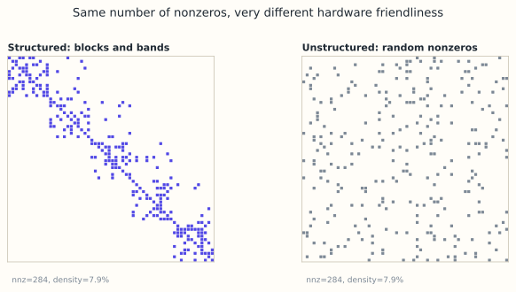

# 10.5 稀疏矩阵与结构化计算
> **本节位置**：模块 10 · 数值线性代数 ｜ **前置**：[10.3 BLAS 与 GEMM](03-BLAS与GEMM.md) ｜ **预计**：30 分钟
>
> **一句话**：当矩阵里绝大多数元素是 0 时，「存下来再乘」是巨大的浪费；稀疏矩阵的全部技巧，就是只存非零元、只算非零元。
## 0. 场景引入

一个网页图：**20 亿**个节点、平均出度 20，共 $4\times10^{10}$ 条有向边。PageRank 每轮迭代就是一次 SpMV。CSR 存下来：列索引 int32 占 $160$ GB，行指针 int64 占 $16$ GB——光结构就 $176$ GB。

如果再存一份 fp32 的权重（每条边 $1/\text{outdeg}$），要多 $160$ GB。每轮多读 $160$ GB：一轮 $88$ ms 变 $168$ ms，$120$ 轮就是 $10.6$ s 变 $20$ s。

$176$ GB 只是「结构」，还没算每轮要读写的向量：$\mathbf{x}$ 与 $\mathbf{y}$ 各 $2\times10^9\times4$ B $=8$ GB，相对 $176$ GB 可以忽略。这正是 SpMV 的特点：**开销全在边上，不在点上**。

**决定**：把均匀权重折进一个长度 $n$ 的 `invdeg` 向量（省 $160$ GB），还是保留 `values` 数组（支持加权 PageRank）？

顺带一个迭代数的量级：误差按 $\alpha^k$ 衰减，$\alpha=0.85$ 时每轮只降 $15\%$，要 $1$ 位精度得跑 $15$ 轮，要 $10^{-8}$ 得跑 $113$ 轮。

**代价**：省下的是内存与带宽，换掉的是「个性化、加权」的表达能力；而直接法解 $(I-\alpha P^\top)\mathbf{x}=\mathbf{b}$ 更不可能——消元会把图填成稠密，$n^2=4\times10^{18}$ 个元素。

**问题**：怎么存？怎么乘？为什么「有很多 0」不等于「算得快」？

读完本节，你应该能回答三件事：

1. COO 与 CSR 的差别不只是「省不省内存」，那么差在哪？
2. 为什么「很多 0」不等于「算得快」，SpMV 的算术强度是多少？
3. 消元顺序如何决定 fill-in，为什么它能把稀疏问题变成稠密问题？
## 1. 直觉
### 1.1 零是「不存在」
稠密矩阵把 0 也当成一个数：占内存、参与乘加、消耗带宽。稀疏矩阵换一个视角：**0 表示「这条边不存在」**。

把矩阵看成图：行和列是节点，非零元 $a_{ij}$ 是一条从 $j$ 到 $i$ 的带权边。$10^7$ 个非零元就是 $10^7$ 条边，很多图算法只关心边，不关心「哪些位置没有边」。

> 💡 **一句话直觉**：**稀疏矩阵 = 只记录存在的边；稀疏计算 = 只沿边传播。**

类比边界：这个图视角只对「结构稀疏」有用。若零是算出来的（如 ReLU 后的激活），位置不固定，仍然要付出索引开销。
### 1.2 结构稀疏 vs 非结构稀疏
- **非结构稀疏（unstructured sparsity）**：零的位置任意，逐元素剪枝得到。压缩率高，但索引不规则。
- **结构稀疏（structured sparsity）**：零按块、按行、按固定模式出现。例如每 4 个元素保留 2 个（[2:4 稀疏](#ref-mishra-2021)）、整行整列剪掉、$128\times128$ 的块剪掉。压缩率低一些，但硬件能高效跳过。

GPU 喜欢规则：同样 50% 的零，按 $2{:}4$ 模式排列能被张量核直接加速，随机排列则可能因为索引与负载不均而变慢。



*图：两个 $60\times60$ 矩阵的非零元位置，非零数相同（284，密度 7.9%）。左边按块/带排列，硬件能跳过整块；右边随机分布，索引不规则。*

### 1.3 它在现实世界里对应什么
网页图是最标准的对应物：**节点是页面，非零元是链接，值是链接权重**。PageRank 的一轮迭代就是一次 SpMV：

$$
\mathbf{x}\leftarrow\alpha P^\top\mathbf{x}+\frac{1-\alpha}{n}\mathbf{1}
$$

其中 $P$ 是列随机的转移矩阵，$\alpha\approx0.85$。$P^\top$ 的每一列只有一个非零块（某个页面的所有出链），所以 SpMV 的代价是「沿着每条边传一次值」。

**量级**：$n=2\times10^9$、$\operatorname{nnz}=4\times10^{10}$，只存结构的 SpMV 算术强度是

$$
\frac{2\operatorname{nnz}}{4\operatorname{nnz}+8(n+1)}\approx0.45\ \text{FLOP/byte}
$$

对比第 10.3 节 $n=4096$ GEMM 的 $683$ FLOP/byte——**差了三个数量级**。稀疏计算的宿命是访存受限：每读 4 字节的列索引，只做 2 次浮点运算。

### 1.4 这个类比在哪里失效
图视角假设「零是结构性的、永远不变」。真实系统里零会变：剪枝后为零的权重，训练会把它长回来；ReLU 产生的激活零，每批数据位置都不同。**结构性稀疏能省存储，动态稀疏只能省计算，且要付索引开销。**

第二个失效点：GPU 的并行单位是 warp（32 个线程）。图的度分布是重尾的——少数节点有上百万条边，多数只有几条。同一个 warp 处理 32 行，行长差几个数量级，快的那 31 个只能等最慢的那个。**平均每行 20 个非零元，不代表每次 SpMV 都按 20 计费。**

## 2. 定义
### 2.1 稀疏度
设 $A\in\mathbb{R}^{m\times n}$ 有 $\operatorname{nnz}(A)$ 个非零元。**稀疏度（sparsity）** 常定义为

$$
\text{sparsity}=1-\frac{\operatorname{nnz}(A)}{mn}
$$

有的文献把 $\operatorname{nnz}/(mn)$ 叫密度（density）。读的时候看清定义：本文用「零的比例」。
### 2.2 COO：三元组列表
**COO（coordinate format）** 用三个等长数组描述矩阵：

```
row  = [0, 0, 1, 3, 3]
col  = [0, 3, 1, 0, 2]
data = [1, 2, 3, 4, 5]
```

第 $k$ 个非零元在 `(row[k], col[k])`，值为 `data[k]`。优点是构造简单、可乱序、易合并重复项；缺点是每个元素都要存行列索引，且随机访问慢。
### 2.3 CSR：按行压缩
**CSR（compressed sparse row）** 用三个数组：

- `values`：长度 $\operatorname{nnz}$，按行优先排列的非零值；
- `col_indices`：长度 $\operatorname{nnz}$，对应的列号；
- `indptr`：长度 $m+1$，第 $i$ 行的数据在 `values[indptr[i]:indptr[i+1]]`。

对上面的矩阵（$4\times4$）：

```
values  = [1, 2, 3, 4, 5]
col_idx = [0, 3, 1, 0, 2]
indptr  = [0, 2, 3, 3, 5]
```

第 0 行是 `values[0:2]`，列 `[0,3]`，值 `[1,2]`；第 2 行是 `values[3:3]`，空行。CSR 适合「按行遍历」，SpMV 与行切片都快。**CSC（compressed sparse column）** 把行与列对调，适合按列访问。
### 2.4 稀疏矩阵乘法
稀疏 $C=AB$ 的代价不是 $2mnk$，而是「沿着 $A$ 的每条非零边，把 $B$ 的对应行按系数累加」：

$$
\text{work}(C)=\sum_{i=1}^m\ \sum_{k\in\operatorname{row}_i(A)}\operatorname{nnz}(B_{k,:})
$$

读作：$A$ 第 $i$ 行的每个非零元 $a_{ik}$，都要把 $B$ 的第 $k$ 行整体加到 $C$ 的第 $i$ 行上。若 $A,B$ 每行平均 $d$ 个非零元，则代价约 $m d^2$，而 $\operatorname{nnz}=md$，所以约等于 $\operatorname{nnz}\cdot d$——当 $d\ll n$ 时远小于稠密的 $mnk$。
## 3. 为什么这样定义
**为什么不直接存稠密矩阵、把 0 跳过？** 跳过 0 需要先判断它是不是 0，这个判断本身就要读内存、花分支；在 GPU 上还会造成同一 warp 内线程走不同路径（warp divergence）。稀疏格式把这个判断提前到「存储结构」里，运行时不需要再判断。

**为什么需要 COO 和 CSR 两种？** 构造阶段用 COO 方便（可以直接 append、允许重复），计算阶段转成 CSR（按行连续、缓存友好）。这是「写时用 COO、算时用 CSR」的常见流水线。

**为什么稀疏矩阵乘法可能不省时间？** 若 $A$ 的行很稠密（$d$ 接近 $n$），$md^2$ 接近 $mn^2$，与稠密乘法同阶；而且索引开销、负载不均、无法用张量核，实际可能更慢。

**为什么剪枝要看结构？** 硬件的加速单位是「块/向量指令」，不是单个元素。非结构稀疏在 GPU 上很难获得与稀疏率成正比的加速；2:4 这类结构稀疏才有专用指令支持。
### 3.1 反事实：换一个消元顺序，稀疏问题会变成稠密问题
取一个「星形」图：1 个中心节点连 999 个叶子，共 1000 个节点、999 条边。两种消元顺序：

- **先消叶子**：每个叶子的度是 1，消掉它只是删一条边，中心节点的度减 1，**不产生任何新非零元**。整个过程填充为 0。
- **先消中心**：中心的度是 999。消掉它时，它的邻居两两相连，新增

$$
\binom{999}{2}=\frac{999\times998}{2}=498\,501
$$

条边——而 1000 个节点的对称矩阵一共才 $\binom{1000}{2}=499\,500$ 个上三角位置。**填充几乎把矩阵填满。**

同一个矩阵、同一个算法（高斯消元），只换顺序，填充从 0 变成 $5\times10^5$。这就是稀疏直接法里「消元顺序」比「消元本身」更重要的原因，也是嵌套剖分、最小度排序值得单独研究的原因。

第二个反事实：**用 COO 做 SpMV**。COO 每个非零元要存行号、列号、值三个 4 字节（int32 + int32 + fp32），CSR 只存列号与值。$n=2\times10^9$、$\operatorname{nnz}=4\times10^{10}$ 时，COO 是 $4.8\times10^{11}$ B $=480$ GB，CSR 是 $3.36\times10^{11}$ B $=336$ GB。**同样一次 SpMV，COO 多读 144 GB，慢 1.4 倍**；若权重还能折进 `invdeg`，CSR 再省 160 GB（§5.4）。

第三个反事实：**用 CSC 去算 $A\mathbf{x}$**。CSR 按行扫，列索引连续；CSC 按列扫，输出 $\mathbf{y}$ 的写入变成随机的——每写一个 $y_i$ 都可能命中不同的 cache line，并行时还会写冲突。**格式要匹配遍历方向，不能随便挑一个稀疏格式。**

## 4. 性质与推导
### 4.1 CSR 的行切片的代价
访问第 $i$ 行是 $O(1)$ 定位（读 `indptr[i]`、`indptr[i+1]`），遍历是 $O(\operatorname{nnz}_i)$。这就是 CSR 适合 SpMV 的原因：每个输出 $y_i$ 只扫一遍第 $i$ 行的非零元。

SpMV（$A\mathbf{x}$）的总代价：

$$
\text{FLOPs}=2\operatorname{nnz},\qquad
\text{访存}\approx(4+4)\operatorname{nnz}+4(m+1)\ \text{字节（int32 + fp32）}
$$

它是**访存受限**的：每读一个非零元只做 2 次浮点运算，算术强度约 $0.25$。
### 4.2 存储量对比
以 $m=n=10^6$、$\operatorname{nnz}=10^7$、int32 索引、fp32 数值为例：

| 格式 | 存储 | 说明 |
|---|---|---|
| 稠密 | $4\times10^{12}$ B $=4$ TB | 根本存不下 |
| COO | $3\times10^7\times4=120$ MB | 值、行、列各一份 |
| CSR | $10^7\times4+10^7\times4+10^6\times4\approx84$ MB | 值、列索引、行指针 |

CSR 比 COO 省掉一整个行索引数组，代价是构造时要做一次排序/计数。
### 4.3 稀疏乘稀疏的填充
两个稀疏矩阵相乘，结果可能比输入稠密得多。极端例子：$A$ 是下三角（含对角线），$B$ 是上三角，则 $AB$ 一般是稠密矩阵。这叫**填充（fill-in）**，也是稀疏直接法（如稀疏 LU/Cholesky）最头疼的问题——消元会不断产生新的非零元。
### 4.4 结构稀疏：2:4
**2:4 稀疏**指每 4 个连续元素中恰好保留 2 个非零元。它把稀疏率固定为 50%，硬件可以用固定模式的稀疏张量核，理论吞吐是稠密的两倍；代价是需要额外的元数据记录「哪两个位置被保留」，且精度恢复通常要靠再训练/蒸馏。
## 5. 例子
### 5.1 手算：CSR 构造与 SpMV
$$
A=\begin{bmatrix}1&0&0&2\\0&3&0&0\\0&0&0&0\\4&0&5&0\end{bmatrix},\qquad
\mathbf{x}=\begin{bmatrix}1\\2\\3\\4\end{bmatrix}
$$

按行扫描，得到 `values=[1,2,3,4,5]`、`col_idx=[0,3,1,0,2]`、`indptr=[0,2,3,3,5]`。

逐行计算：

- 第 0 行：$1\times1+2\times4=9$；
- 第 1 行：$3\times2=6$；
- 第 2 行：空行，结果 $0$；
- 第 3 行：$4\times1+5\times3=19$。

所以 $A\mathbf{x}=(9,6,0,19)^\top$。用稠密乘法核对：第一行 $1\cdot1+2\cdot4=9$ ✓，最后一行 $4\cdot1+5\cdot3=19$ ✓。这个 $4\times4$ 矩阵只有 5 个非零元，存储反而不如稠密划算；稀疏的收益要到 $n$ 很大、每行非零元远小于 $n$ 时才显现。
### 5.2 手算：稀疏乘稀疏
$$
A=\begin{bmatrix}1&1&0\\0&0&2\\0&0&0\end{bmatrix},\qquad
B=\begin{bmatrix}0&0&1\\1&0&0\\0&3&0\end{bmatrix}
$$

按「$A$ 的每个非零元把 $B$ 的对应行加到 $C$」：

- $A$ 第 0 行有 $a_{00}=1,a_{01}=1$：$1\times B_0+1\times B_1=(0,0,1)+(1,0,0)=(1,0,1)$；
- $A$ 第 1 行有 $a_{12}=2$：$2\times B_2=(0,6,0)$；
- $A$ 第 2 行全零：结果 $(0,0,0)$。

$$
C=\begin{bmatrix}1&0&1\\0&6&0\\0&0&0\end{bmatrix}
$$

$\operatorname{nnz}(A)=\operatorname{nnz}(B)=3$，结果 $\operatorname{nnz}(C)=3$。这个例子里没有填充；但若 $A$ 的下三角与 $B$ 的上三角「错位」相乘，非零元会迅速增多，这就是 §4.3 的填充。
### 5.3 场景：MoE 的「条件计算」
一个专家（expert）是一个两层 FFN：$W_1\in\mathbb{R}^{4D\times D}$、$W_2\in\mathbb{R}^{D\times 4D}$。$D=4096$ 时，单个专家每 token 的 FLOPs 是

$$
2D\cdot4D+2\cdot4D\cdot D=16D^2=2.68\times10^{8}
$$

若有 $E=8$ 个专家、每个 token 只激活 top-2，则每 token 计算 $2\times2.68\times10^8=5.37\times10^8$ FLOPs，而参数要存 $8$ 份。**计算量按「激活的专家数」增长，参数量按「专家总数」增长**——这正是稀疏激活的核心 trade-off。

### 5.4 场景闭环：20 亿节点的 PageRank
**输入**：$n=2\times10^9$、$\operatorname{nnz}=4\times10^{10}$、$\alpha=0.85$、目标相对残差 $10^{-8}$。

**计算**：

1. **存储**：CSR 的 `col_idx`（int32）$160$ GB + `indptr`（int64）$16$ GB $=176$ GB；若再存 `values`（fp32）则 $336$ GB。
2. **迭代数**：误差按 $\alpha^k$ 衰减，$k\ge\ln(10^{-8})/\ln0.85\approx113$，取 $120$ 轮。
3. **每轮 SpMV**：结构-only 版读 $176$ GB，在 $2$ TB/s 聚合带宽下约 $88$ ms。

**输出**：$120$ 轮约 $10.6$ s（结构-only）或 $20$ s（带 values）。dangling 节点的质量再分配与 L1 归一化各是 $O(n)$ 的向量扫描（$2\times10^9\times4$ B $=8$ GB，约 $4$ ms），可以忽略。

**决策**：均匀 PageRank 用结构-only（省 $160$ GB、快一倍）；一旦要个性化（每个用户一组 $\mathbf{v}$）或加权（按点击率给边权），`values` 就必须存在——**省下来的内存是用表达能力换的**。

**失败条件与兜底**：

- **悬挂节点**（出度为 0）：$P$ 的列不是随机的，质量会漏掉。兜底是把这些节点的质量均分全网，等价于给 $P$ 加一个秩一修正。
- **收敛判据用错**：$\alpha^k$ 是**最坏**衰减率，实际谱隙可能更大，也可能因为双分结构（两个大站互相链接）更小。兜底是同时监控残差与相邻两轮的 L1 变化量。
- **单机放不下**：$176$ GB 超过单卡，要按行分块（每台机器存一段 `indptr` 区间），每轮做一次 all-to-all 交换边界向量——**瓶颈从带宽变成网络**。
## 6. 常见误区
1. **误区**：矩阵里有很多 0，用稀疏格式一定更快。
   **纠正**：小矩阵或高密度矩阵，稠密 BLAS 更快；稀疏格式有索引开销、负载不均、无法用张量核。通常密度低于几个百分点才考虑稀疏。
2. **误区**：稀疏矩阵的乘法代价与 $\operatorname{nnz}$ 成正比。
   **纠正**：SpMV 是 $O(\operatorname{nnz})$，但稀疏乘稀疏是 $O(\operatorname{nnz}\cdot d)$，$d$ 是每行平均非零元数；结果还可能填充。
3. **误区**：COO 和 CSR 只是存储方式不同，性能一样。
   **纠正**：COO 适合构造与合并，CSR 适合按行遍历与 SpMV；选错格式会让缓存命中率大幅下降。
4. **误区**：非结构剪枝 90% 就能让 GPU 快 10 倍。
   **纠正**：GPU 的加速依赖规则模式。非结构稀疏的索引与负载不规则，实际加速往往远低于稀疏率；结构化稀疏（2:4、块稀疏）才有硬件支持。
## 7. 概念网络
- 前置：[10.3 BLAS 与 GEMM](03-BLAS与GEMM.md) —— 稠密 GEMM 的高复用假设在稀疏时失效。
- 前置：[2.6 秩](../02-向量空间/06-秩.md) —— 稀疏与低秩是两种不同的结构。
- 后续：无（本模块收束）。
- 关联：[11.10 MoE 路由与专家矩阵](../11-大模型专题/10-MoE路由.md) —— 条件计算是稀疏激活的工程实现。
- 关联：[11.7 KV Cache](../11-大模型专题/07-KVCache.md) —— 长上下文的稀疏注意力减少 $T^2$ 项。
- 关联：[11.9 量化](../11-大模型专题/09-量化.md) —— 剪枝与量化常一起用于压缩。
## 8. 通往大模型：稀疏激活与结构化剪枝
**出现位置一：MoE 路由。** 输入 $X\in\mathbb{R}^{BT\times D}$，门控 $W_g\in\mathbb{R}^{E\times D}$ 算出 $S=XW_g^\top\in\mathbb{R}^{BT\times E}$，每个 token 取 top-$k$ 个专家。被选中的 token 按专家分组，做 grouped GEMM：每个专家处理「分到自己的 token 子集」$\times[4D,D]$。$D=4096$、$E=8$、$k=2$ 时，每 token 的 FFN FLOPs 是稠密的 $2$ 倍，但参数量是 $8$ 倍；显存必须容下所有专家，负载还可能不均（某些专家被更多 token 选中），需要 capacity factor 与丢弃/溢出机制。

**出现位置二：2:4 结构化稀疏。** 把权重 $W\in\mathbb{R}^{D\times4D}$ 剪成每 4 个元素保留 2 个，配合稀疏张量核，矩阵乘的理论吞吐翻倍。代价是精度下降，通常要再训练恢复；而且「哪两个位置保留」的元数据也要存。与非结构剪枝相比，它牺牲了压缩率，换来了可预测的硬件加速。

**出现位置三：稀疏注意力。** 标准注意力矩阵是 $T\times T$，$T=4096$ 时有 $1.68\times10^7$ 个元素。滑动窗口注意力只保留对角线附近 $w$ 条带，每行 $w$ 个非零元，总计算从 $O(T^2d)$ 降到 $O(Twd)$；$w=256$ 时约省 $16$ 倍。块稀疏注意力（如按 $64\times64$ 块选择）更适合 GPU，因为块内仍是稠密 GEMM，块间才跳过。

**出现位置四：Embedding 与稀疏梯度。** 词表 $V=50000$、$D=4096$ 的 embedding 表有 $2\times10^8$ 个参数；一个 batch 只碰几千行，梯度是稀疏的。稀疏 Adam 只更新被触碰的行，省掉对整表的读写；但稀疏优化器的状态管理与稠密实现不同，工程上要专门处理。

**可检验结论**：MoE 的「每 token 计算量」由 top-$k$ 决定，而「显存占用」由 $E$ 决定；$E=8,k=2$ 时计算是稠密的 2 倍、参数是 8 倍。稀疏注意力的计算量约与窗口 $w$ 成正比，而不是 $T$。这两条都能用形状直接算出来，不依赖具体论文。

**如果这一步算错，用户会看到什么。** 搜索与推荐侧：排序结果「莫名其妙地抖动」，同一个 query 两次请求的 top-10 不一样（稀疏遍历顺序不确定 + 浮点累加顺序不同）；或者冷门页面分数恒为零（悬挂节点没处理，质量没有回流）。训练侧：MoE 的某些专家长期空转（top-$k$ 在负载不均时把 token 集中到少数专家），表现为「参数很多但大部分没被训练」。这些都是稀疏结构的问题，不是模型容量的问题。

## 9. 练习
1. **概念**：COO 与 CSR 各自适合什么操作？为什么「构造用 COO、计算用 CSR」是常见组合？
2. **计算**：对 $A=\begin{bmatrix}2&0&1\\0&0&0\\0&3&0\end{bmatrix}$ 写出 CSR 的三个数组，并计算 $A\mathbf{x}$，其中 $\mathbf{x}=(1,2,3)^\top$。
3. **计算**：设稀疏矩阵每行平均 $d=8$ 个非零元、$n=10^6$。SpMV 与稀疏乘稀疏的代价分别约为多少？与稠密 $O(n^2)$ 比较。
4. **场景**：$D=4096$、$E=16$、top-$k=2$ 的 MoE 层，每 token 的 FFN FLOPs 是多少？参数量是单个专家的几倍？
5. **开放**：非结构剪枝能达到更高压缩率，为什么工业界仍偏爱 2:4 或块稀疏？从硬件、精度、部署三个角度说明。

<details>
<summary>参考答案</summary>

1. COO 用三个等长数组，追加与合并重复项方便，适合从数据构造矩阵；CSR 按行连续存储，行切片与 SpMV 缓存友好，适合计算。构造时坐标是乱序的，CSR 需要先排序/计数；构造完转一次 CSR，之后的迭代都在 CSR 上跑。
2. `values=[2,1,3]`、`col_idx=[0,2,1]`、`indptr=[0,2,2,3]`。$A\mathbf{x}=(2\cdot1+1\cdot3,\ 0,\ 3\cdot2)^\top=(5,0,6)^\top$。
3. SpMV：$2\operatorname{nnz}=2\times8\times10^6=1.6\times10^7$ FLOPs；稀疏乘稀疏约 $\operatorname{nnz}\cdot d=8\times10^6\times8=6.4\times10^7$ 次累加。稠密 SpMV 是 $2n^2=2\times10^{12}$，稀疏乘稀疏稠密版是 $2n^3=2\times10^{18}$，差距是数量级的。
4. 单个专家每 token 是 $16D^2=2.68\times10^8$ FLOPs；top-2 是 $5.37\times10^8$。参数量是单个专家的 $E=16$ 倍（每个专家 $8D^2$ 个权重，共 $16\times8D^2$）。
5. 硬件上只有结构化稀疏有张量核/块指令支持，非结构稀疏的索引与不规则访存很难转化为实际加速；精度上 2:4 通过再训练通常能恢复到接近稠密，块稀疏对大模型更友好；部署上结构化模式可预测、易做 kernel 与编译优化，非结构稀疏的负载均衡与元数据开销在服务端不划算。

</details>

## 10. 一页速记
- 稀疏度 = 零的比例；只存 $\operatorname{nnz}$ 个非零元，SpMV 代价 $O(\operatorname{nnz})$。
- COO = 行、列、值三个数组，适合构造；CSR = 值、列索引、行指针，适合按行计算。
- 稀疏乘稀疏的代价约 $\operatorname{nnz}\cdot d$，且结果可能填充（fill-in）。
- 结构稀疏（2:4、块）能被硬件加速；非结构稀疏的加速比通常远低于稀疏率。
- MoE 的计算随 top-$k$ 增长、显存随专家数 $E$ 增长；稀疏注意力把 $O(T^2)$ 降到 $O(Tw)$。
- **物理意义 / 现实对应**：稀疏矩阵是「图的邻接表」；SpMV 是沿每条边传一次值，算术强度约 $0.45$ FLOP/byte，注定访存受限。

## 11. 参考文献与致谢

这一页的知识不是凭空来的。下面列出本页直接借用的原始工作与权威整理；正文中的人名、定理名已链接到对应条目。链接优先指向 DOI、arXiv 或可长期访问的原文存档。

- <a id="ref-davis-2006"></a>**Davis（2006）**：*Direct Methods for Sparse Linear Systems*。稀疏 LU/Cholesky、填充（fill-in）与消元顺序的系统教材，本页 §4.3 的填充问题直接相关。[SIAM](https://doi.org/10.1137/1.9780898718881)
- <a id="ref-davis-hu-2011"></a>**Davis & Hu（2011）**：*The University of Florida Sparse Matrix Collection*。真实稀疏矩阵的公共测试集，做稀疏算法实验时的标准数据源。[ACM Transactions on Mathematical Software](https://doi.org/10.1145/2049662.2049663)
- <a id="ref-mishra-2021"></a>**Mishra 等（2021）**：*Accelerating Sparse Deep Neural Networks*。2:4 结构化稀疏与硬件加速的代表性工作，对应本页 §1.2 的结构稀疏讨论。[arXiv:2104.08378](https://arxiv.org/abs/2104.08378)

---

下一篇 → 回到 [模块导览](README.md)
