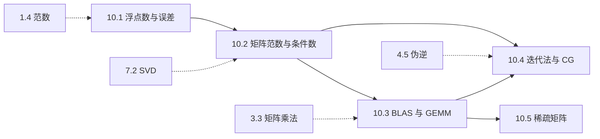

# M10 · 数值线性代数

> **一句话**：数学上的线性代数在纸上是精确的，在计算机里却是「有限精度 + 有限带宽」的游戏；这一模块讲清楚误差、速度与稀疏性从哪来。

## 这个模块解决什么

前九个模块把线性代数的概念搭完了：向量、矩阵、方程组、特征值、SVD。但真实的计算发生在浮点数上、发生在 GPU 上、发生在「大部分元素是 0」的矩阵上。

M10 补上这三层：

- **精度层**（10.1–10.2）：一个数怎么存、误差怎么累积、矩阵把误差放大多少倍。核心量是机器精度 $\varepsilon$ 与条件数 $\kappa$。
- **速度层**（10.3）：为什么 GPU 为矩阵乘法而生。核心量是算术强度与 Roofline 拐点。
- **规模层**（10.4–10.5）：当 $n$ 大到无法求逆、无法稠密存储时怎么办。核心工具是迭代法与稀疏格式。

一句话串起来：**误差告诉你「能信几位」，GEMM 告诉你「算得多快」，迭代与稀疏告诉你「大规模怎么算」。**

## 概念地图

实线是模块内的主依赖，虚线是模块外的前置。10.2 是枢纽：往上承接浮点误差，往下同时喂给 GEMM 与迭代法。

## 学习顺序

| 顺序 | 文档 | 时间 | 读完你应该能…… |
|---|---|---|---|
| 1 | [10.1 浮点数、舍入与误差](01-浮点数与误差.md) | 35 min | 说出 fp16/bf16/fp32 的精度与范围差异，手算一次灾难性抵消 |
| 2 | [10.2 矩阵范数与条件数](02-矩阵范数与条件数.md) | 40 min | 算 1/2/$\infty$/Frobenius 范数，用 $\kappa$ 给出误差上界 |
| 3 | [10.3 BLAS 与 GEMM](03-BLAS与GEMM.md) | 40 min | 用 $2MNK$ 与访存量估算 GEMM 时间，解释分块为什么有用 |
| 4 | [10.4 迭代法与共轭梯度](04-迭代法与共轭梯度.md) | 40 min | 手算一步 Jacobi/CG，说明收敛率与 $\sqrt{\kappa}$ 的关系 |
| 5 | [10.5 稀疏矩阵](05-稀疏矩阵.md) | 30 min | 写出 CSR 三个数组，估算稀疏乘法与 MoE 的计算量 |

建议按顺序读。若时间紧，10.1 → 10.2 → 10.3 是「理解大模型推理成本」的最短路径；10.4 偏科学计算与二阶优化，10.5 偏系统与架构。

## 本模块的大模型钩子

- **fp16/bf16 训练**（10.1）：fp16 需要 loss scaling，bf16 用范围换精度；主权重必须留 fp32，否则小更新会被舍入吃掉。
- **KV Cache 量化**（10.1、10.2）：缓存张量的精度直接决定显存与带宽，长上下文先被显存卡住。
- **量化误差放大**（10.2）：$\|\delta\mathbf{y}\|/\|\mathbf{y}\|\le\kappa(W)\|\delta W\|/\|W\|$，条件数大的层不适合低精度。
- **prefill vs decode**（10.3）：prefill 是计算受限的大 GEMM，decode 是访存受限的 GEMV；decode 速度上界约为带宽除以每步读取字节数。
- **Newton-CG 与二阶优化**（10.4）：用 Hessian-向量乘积 + 截断 CG，不显式构造 $H$；Adam 可看作对角预条件。
- **MoE 与结构化剪枝**（10.5）：MoE 的计算随 top-$k$ 增长、显存随专家数增长；2:4 稀疏与块稀疏能被硬件加速。

## 自测（读完再做）

1. fp32 的机器精度是多少？1 附近与 1024 附近的相邻间距各是多少？为什么 1024 附近更粗？
2. 为什么 $1.0000001-1$ 在 fp32 里只剩不到 1 位可信数字？二次方程 $x^2-10^8x+1=0$ 的小根应该怎么稳定地算？
3. 对 $A=\begin{bmatrix}1&2\\3&4\end{bmatrix}$，$\|A\|_2$ 与 $\kappa_2(A)$ 各是多少？若右端相对扰动 $10^{-6}$，解的相对误差上界是多少？
4. $M=N=K=4096$ 的 GEMM 有多少 FLOPs？算术强度约多少？为什么 decode 时同样的权重矩阵会变成访存受限？
5. CG 适用于什么矩阵？收敛率与 $\kappa$ 的什么函数有关？对 $A=\begin{bmatrix}4&1\\1&3\end{bmatrix}$，CG 几步能精确解出 $2\times2$ 系统？
6. 写出 §10.5 例子的 CSR 三个数组。MoE 的 $E=8$、top-$k=2$ 时，每 token 的计算量与参数量分别是单个专家的几倍？

自测答案

1. $\varepsilon=2^{-23}\approx1.19\times10^{-7}$。1 附近间距 $2^{-23}\approx1.19\times10^{-7}$，1024 附近 $2^{-13}\approx1.22\times10^{-4}$；指数每大 1，间距翻倍。
2. $1.0000001$ 存进 fp32 变成 $1.0000001192\ldots$，减去 1 得 $1.192\times10^{-7}$，真值是 $1\times10^{-7}$，相对误差约 $19\%$。小根用韦达定理：$x_2=c/(a x_1)=1/10^8=10^{-8}$，避免两个相近大数相减。
3. $A^\top A=\begin{bmatrix}10&14\\14&20\end{bmatrix}$，$\sigma_{\max}=5.465$、$\sigma_{\min}=0.366$，所以 $\|A\|_2=5.465$、$\kappa_2=14.93$；相对误差上界 $14.93\times10^{-6}\approx1.49\times10^{-5}$。
4. $2MNK=1.374\times10^{11}$ FLOPs；最小访存 $4\times3\times4096^2=201$ MB，AI 约 $683$ FLOP/byte。decode 时 $M=1$，权重仍要整块读，FLOPs 只有 $3.36\times10^7$，AI 约 1，远低于拐点。
5. CG 要求 $A$ 对称正定；收敛因子约 $(\sqrt{\kappa}-1)/(\sqrt{\kappa}+1)$，迭代次数约随 $\sqrt{\kappa}$ 增长。$2\times2$ 系统在精确算术下 2 步收敛（第 5.2 节手算验证）。
6. `values=[1,2,3,4,5]`、`col_idx=[0,3,1,0,2]`、`indptr=[0,2,3,3,5]`。MoE：每 token 计算是单专家的 $k=2$ 倍，参数量是 $E=8$ 倍。

## 本模块文档

- [10.1 浮点数、舍入与误差](01-浮点数与误差.md)
- [10.2 矩阵范数与条件数](02-矩阵范数与条件数.md)
- [10.3 BLAS 与 GEMM：GPU 为什么快](03-BLAS与GEMM.md)
- [10.4 迭代法与共轭梯度](04-迭代法与共轭梯度.md)
- [10.5 稀疏矩阵与结构化计算](05-稀疏矩阵.md)

配套材料：

- 习题：[m10-习题](../exercises/m10-习题.md) ｜ 答案：[m10-答案](../exercises/m10-答案.md)
- 实验：[lab10 数值误差与 GEMM](../labs/lab10_数值误差与GEMM.py)

---

上一篇 → [9.1 概率与随机变量](../09-概率与统计/01-概率与随机变量.md) ｜ 下一篇 → [10.1 浮点数、舍入与误差](01-浮点数与误差.md)
