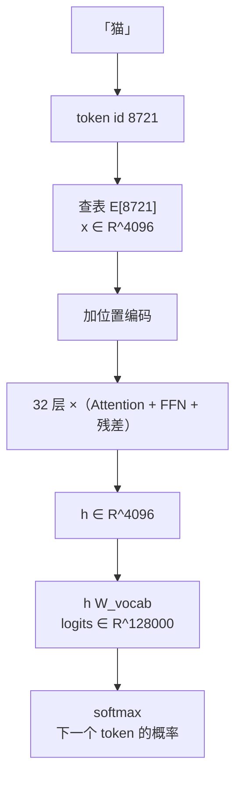

# 11.1 Token、Embedding 与隐藏状态

> **本节位置**：模块 11 · 大模型专题 ｜ **前置**：[1.1](../01-向量与几何/01-向量是什么.md) ｜ **预计**：30 分钟
>
> **一句话**：模型先把离散符号查表变成向量，再让这个向量在几十层里不断被改写；「同一个词在不同句子里不同」发生在改写阶段，而不是查表阶段。

## 0. 场景引入

凌晨一点，一个 IDE 插件为一个 38 万行的混合仓库（Python 6 万行、Java 22 万行、Go 10 万行）打开补全。它同时干两件事：补全光标处的代码，以及在侧栏做「跨语言找相似函数」。

两套数字先摆在桌上：

- 补全模型：词表 $V=128000$、隐藏维 $D=4096$，fp16 的 embedding 表占 $128000\times4096\times2\text{ B}\approx1.05$ GB，必须常驻显存；
- 检索索引：12 万个函数块，每块压成 768 维 fp32 向量，共 $120000\times768\times4\text{ B}\approx352$ MB。

开发机只有 8 GB 显存，补全模型已经吃掉 7.2 GB。于是要做一个决策：把检索向量表塞进显存，还是放在 CPU 内存、每次检索再搬一遍？

搬一次的量级很直白：352 MB 走 20 GB/s 的 PCIe 约 18 毫秒，而用户的输入延迟预算是 50 毫秒。最初的方案选了 CPU，代价是每次检索多花 18 毫秒，并且必须把这 18 毫秒藏进用户打字的间隙。

还有一个隐性成本：12 万个候选没法一次比完，要拆成 8 批点积，每批都得重新搬一遍那 352 MB；批数越多，尾延迟越难压进 50 毫秒。

读完本节，你能回答的三个问题是：

1. 为什么查表能把一个整数变成方向，而不需要做一次矩阵乘？
2. 同一张 embedding 表，为什么 1 GB 显存在 batch 变大时会突然不够用？
3. 补全开始答非所问时，如何判断是 tokenizer 错位，还是上下文改写出了问题？

## 1. 直觉

把 embedding 表想成一本**字典**：

- 字典有 $V$ 页（词表大小）；
- 每页写着一行 $D$ 个数（该词的向量）；
- 查一个词，就是取出对应那一行。

查表之后，每个 token 都变成一个箭头。句子就变成一串箭头，排成 `[T, D]`；一批句子就是 `[B, T, D]`。

> 💡 **一句话直觉**：**embedding = 把离散 ID 翻译成连续向量；隐藏状态 = 这个向量被上下文改写后的结果。**

类比边界：embedding 的每一维**没有**天然语义（不像「第 3 维代表动物性」）；语义分布在方向的组合里。

### 1.1 它在现实世界里对应什么

一句话对应：**embedding 查表就是「按行号取一段连续内存」的 gather 操作**——和数据库按主键取记录、电话簿按页码翻页是同一件事：给一个整数，取回一段字节。

量级算式（这节最值得记住的工程数字）：

$$
\underbrace{4096}_{D}\times\underbrace{2\text{ B}}_{\text{fp16}}=8\text{ KiB/行},\qquad
16384\text{ token}\times8\text{ KiB}=128\text{ MiB}
$$

$B=8$、$T=2048$ 的 batch 共 16384 个 token，就算每一行都不重复，读满也只有 128 MiB；3 TB/s 的 HBM 上理论约 45 µs。对比同一批 token 过一层 FFN 的 $2\times16384\times8\times4096^2\approx4.4\times10^{12}$ FLOPs：查表几乎不费算力，**它只吃带宽，而且吃得很少**。

**这个类比在哪里失效**：电话簿相邻的页至少内容相关，embedding 相邻的两行（ID $k$ 与 $k+1$）在内存里紧挨着，语义上却毫无关系——BPE 合并出来的相邻 ID 尤其如此，所以「按 ID 排序后就近访问更快」是错觉。更常见的误判是：真实瓶颈往往不在 gather 本身，而在它后面紧跟着的 GEMM 与同步；把 18 ms 全归给「查表慢」，会让你优化错地方。

## 2. 定义

### 2.1 词表与 token

分词器把文本切成 token，并映射为整数 ID：

$$
\text{文本}\ \xrightarrow{\text{tokenizer}}\ (t_1,\dots,t_T),\qquad t_i\in\{0,\dots,V-1\}
$$

$V$ 是词表大小。token 不一定是词，可能是子词、字符或字节（最常见的子词切分是 [BPE](#ref-sennrich-2016)）。

### 2.2 Embedding 表

$$
E\in\mathbb{R}^{V\times D}
$$

第 $k$ 行 $E[k,:]$ 是 token $k$ 的向量。查表：

$$
\mathbf{x}_i=E[t_i,:]\in\mathbb{R}^{D}
$$

对 batch：

$$
X=E[T]\in\mathbb{R}^{B\times T\times D}
$$

其中 $T\in\mathbb{N}^{B\times T}$ 是 ID 矩阵（这里用 $T$ 同时表示序列长度，注意上下文）。

### 2.3 隐藏状态

经过第 $l$ 层后的表示：

$$
H^{(l)}\in\mathbb{R}^{B\times T\times D}
$$

$H^{(0)}=X+(\text{位置信息})$。最终层 $H^{(L)}$ 用于预测下一个 token。

### 2.4 与 one-hot 的等价

若 $\mathbf{e}_k\in\mathbb{R}^V$ 是 one-hot，则

$$
E^\top\mathbf{e}_k=E[k,:]^\top
$$

**查表 = one-hot 向量乘 embedding 矩阵**。这解释了为什么 embedding 层本质上是一个线性层，只是输入是 one-hot、计算被优化成索引。

## 3. 为什么这样定义

离散符号无法直接做加减、求导。[word2vec](#ref-mikolov-2013) 之后的标准做法，是用一张可学习的 embedding 表把符号映射到连续空间，带来三个好处：

1. **可学习**：向量随梯度更新，模型自己决定「猫」应该靠近「狗」还是「汽车」；
2. **可组合**：向量能相加、投影、算相似度；
3. **可微**：从损失到 embedding 的梯度可以回传（尽管查表只更新被用到的行）。

为什么不用 one-hot 直接喂给模型？因为 one-hot 维度是 $V$（可达几十万），且任意两个词正交，无法表达相似性。embedding 把维度压到 $D$，并让相似词共享方向。

### 3.1 反事实：不做查表、改用 one-hot 会坏在哪

先破一个直觉：**参数量一点没省**。one-hot 喂进第一层，权重矩阵仍是 $V\times D=128000\times4096$，和 $E$ 是同一个矩阵（第 2.4 节的 $E^\top\mathbf{e}_k=E[k,:]$ 已经说明两条路算出同一个数）。差别全在**怎么算**。

取 $B=8$、$T=2048$，共 16384 个 token：

| 量 | 查表 | one-hot 乘矩阵 |
|---|---|---|
| 每 token 的输入 | 4096 个 fp16 = 8 KiB | 128000 个 fp32 = 500 KiB |
| 激活内存 | $16384\times8\text{ KiB}=128$ MiB | $16384\times500\text{ KiB}=8$ GiB |
| 首层 FLOPs | $\approx0$（gather） | $2\times16384\times128000\times4096\approx1.7\times10^{13}$ |
| 反向梯度 | 只写被采样的行 | 稠密 $128000\times4096$ |

**单 token 就差 64 倍**（$128000\times4$ B 对 $4096\times2$ B）。那 $1.7\times10^{13}$ FLOPs 在 300 TFLOP/s 上要 57 ms，只为了算出一个「查表」的结果。反向更糟：Adam 要存一阶、二阶矩，稠密梯度意味着每步额外 $5.24\times10^8\times8\text{ B}\approx4.2$ GB 优化器状态，而查表版本只更新被采样到的几百行。

再放大一档：$B=32$、$T=4096$ 时是 13.1 万个 token，one-hot 激活要 $13.1\times10^4\times500\text{ KiB}\approx62$ GiB，直接 OOM；embedding 只要 1 GiB。**等价的是数学，不是成本**——「embedding 层就是一个线性层」这句话必须补上后半句：工程上它被换成了索引。

## 4. 性质与推导

### 4.1 参数量

$$
\#\text{params}=V\times D
$$

对 $V=128000,D=4096$：约 5.24 亿。小模型里 embedding 占比很高；大模型里占比下降。

### 4.2 权重共享（weight tying）

输出层把隐藏状态映射到词表 logits：

$$
\text{logits}=H W_{\text{vocab}},\qquad W_{\text{vocab}}\in\mathbb{R}^{D\times V}
$$

若令 $W_{\text{vocab}}=E^\top$，则输入 embedding 与输出 unembedding 共享参数（[weight tying](#ref-press-wolf-2017)），省下 $V\times D$ 参数。很多语言模型这样做。

### 4.3 位置信息

纯 embedding 没有顺序感：「猫追狗」和「狗追猫」的 token 集合相同。因此要加位置编码（第 11.5 节）：

$$
H^{(0)}=E[T]+P
$$

其中 $P\in\mathbb{R}^{T\times D}$ 是位置编码（可学习或固定）。

### 4.4 上下文相关

同一 token 在不同位置的初始向量相同；经过 attention 后，

$$
\mathbf{h}_i^{(l)}=\mathbf{h}_i^{(l-1)}+\sum_j \alpha_{ij}W_V\mathbf{h}_j^{(l-1)}
$$

其中 $\alpha_{ij}$ 依赖整句。因此「猫」在「猫坐在垫子上」与「猫在键盘上」中的最终表示不同。

## 5. 例子

### 5.1 手算：小词表查表

设 $V=5$，$D=3$，词表 `["<pad>", "猫", "狗", "汽车", "苹果"]`，

$$
E=\begin{bmatrix}
0&0&0\\
0.9&0.1&0.1\\
0.8&0.2&0.1\\
0.1&0.9&0.1\\
0.1&0.1&0.9
\end{bmatrix}
$$

句子「猫 狗」的 ID 是 $[1,2]$，查表得

$$
X=\begin{bmatrix}0.9&0.1&0.1\\0.8&0.2&0.1\end{bmatrix}\in\mathbb{R}^{2\times3}
$$

### 5.2 场景：一个 token 的旅程



**注意**：$E$ 只在第 0 层使用；后面每层都有新的权重矩阵，但隐藏维度始终是 $D$。

### 5.3 场景：logit lens

把中间层 $H^{(l)}$ 直接乘以 unembedding，可以得到「这一层倾向于预测什么」。这是一种粗略的可解释性工具，前提是各层表示空间大致对齐——这个前提并不总成立，所以结果只能当线索。

### 5.4 场景闭环：一次补全请求的账

把 §0 那个插件的一次 Tab 补全完整算一遍。模型 $V=128000$、$D=4096$、$L=32$，$B=1$，上下文 $T=2048$。

**输入规模**：2048 个整数 ID（`int32` 约 8 KiB）；查表得到 $2048\times4096$ 个 fp16，即 16 MiB 的 `[1,2048,4096]`。

**计算**：

- 查表：$2048\times8\text{ KiB}=16$ MiB 随机读，3 TB/s 下约 5 µs，算力为 0；
- 位置编码相加：$2048\times4096=8.4\times10^6$ 次加法，不到 0.01 ms；
- 之后 32 层：每层 $\approx2\times2048\times12\times4096^2\approx8.2\times10^{11}$ FLOPs，共 $2.6\times10^{13}$ FLOPs，按 300 TFLOP/s 估约 **88 ms**。

**输出决策**：在词表上取 top-5 候选交给补全 UI；若最高概率低于 $0.3$，改成灰色幽灵文本而不是直接插入。

**成本**：显存 1.05 GB（embedding 表）+ 1.07 GB（KV Cache，$2\times2048\times4096\times2\text{ B}\times32$）+ 激活。查表只占延迟的 $5\ \mu s/88\text{ ms}\approx0.006\%$——**把 embedding 优化得再快也没用**；真正的成本是那 1 GB 常驻显存，它挤掉了本来能给更大 batch 用的空间。

**失败条件与兜底**：

- **tokenizer 版本漂移**：词表顺序变了而权重没重训，ID 整体平移，查表命中「别人的行」。兜底：把 tokenizer 的哈希写进权重元数据，启动时比对，不一致拒绝加载。
- **长尾 token 膨胀**：仓库内部缩写被切成 3–4 个 byte 级 token，$T$ 从 2048 涨到 3000 以上，attention 的 $T^2$ 项涨 2 倍多。兜底：监控「每字符 token 数」，超过 0.8 就退回字符级缓存。
- **检索那 18 ms 太紧**：把检索向量 int8 量化到 88 MB，$88\text{ MB}/20\text{ GB/s}\approx4.4$ ms，代价是召回率按同类量化方案估算会掉一小截，必须用仓库自己的标注集复测。

## 6. 常见误区

1. **误区**：embedding 的某一维对应某个语义特征。
   **纠正**：通常不是。语义分布在多个维度的组合方向上；单维往往不可解释。

2. **误区**：同一个词的 embedding 在所有语境下相同。
   **纠正**：**初始** embedding 相同，最终隐藏状态不同。

3. **误区**：embedding 参数量 = 模型参数量的大部分。
   **纠正**：小模型可能如此；大模型中 $12D^2L$ 主导，embedding 占比下降。

4. **误区**：token 就是词。
   **纠正**：token 可能是子词/字节；一个词可能被切成多个 token，这会影响模型对拼写、罕见词的处理。

## 7. 概念网络

- 前置：[1.1 向量](../01-向量与几何/01-向量是什么.md) —— 向量是数据点。
- 前置：[3.2 矩阵乘向量](../03-矩阵与线性映射/02-矩阵乘向量.md) —— 查表 = one-hot 乘矩阵。
- 后续：[11.2 线性层](02-线性层.md) —— 隐藏状态如何被变换。
- 后续：[11.3 Attention](03-Attention-上-QKV.md) —— 上下文如何混合。
- 后续：[11.11 logits 与采样](11-logits与采样.md) —— 隐藏状态如何变回词。

## 8. 通往大模型：形状与参数

**形状链**：

$$
[B,T]\xrightarrow{E}[B,T,D]\xrightarrow{+P}[B,T,D]
$$

**参数量**：$V\times D$（可选择性绑定输出层）。

**可检验结论**：若两个 token 的 ID 相同，它们的初始 embedding 逐元素相等；若不同，则不一定正交（取决于训练）。对随机初始化的 $E$，两行近似正交；训练后相似词会靠近。

```python
import numpy as np
V, D, B, T = 5, 3, 2, 4
E = np.random.randn(V, D)
ids = np.array([[1, 2, 1, 0], [3, 4, 0, 0]])
X = E[ids]                 # [B, T, D]
print(X.shape)             # (2, 4, 3)
print(np.allclose(X[0, 0], E[1]))  # True
```

**算错时用户看到什么**：如果 tokenizer 与权重来自不同版本（例如给词表新增 4 个特殊 token 却插在中间而不是末尾），所有 ID 整体平移，查表命中「隔壁那行」。症状很有欺骗性——不是崩溃，而是**补全突然只输出语法正确、语义荒谬的代码**：变量名似是而非（`user_id` 写成 `user_idx`），注释和代码对不上，模型对 prompt 里的关键词毫无反应。排查先看 loss：错位后第一个 batch 的 loss 会从 2 附近跳到 8 以上，而随机猜的基线是 $\ln128000\approx11.8$。另一类错误是位置编码漏加或加错层：模型对顺序不敏感，用户看到的是「复制光标附近的 token、参数顺序被打乱」，但单 token 补全完全正常——这个「短正常、长出错」的分界，基本可以把位置信息锁定为嫌疑人。

## 9. 练习

1. **概念**：为什么 embedding 比 one-hot 更适合表达语义相似？
2. **计算**：$V=32000$，$D=1024$，embedding 参数量是多少？若输出层绑定权重，总共省了多少参数？
3. **计算**：一个 batch 有 $B=4$、$T=512$、$D=768$，隐藏状态张量有多少个元素？fp16 下占多少 MiB？
4. **场景**：为什么「同一个词在不同句子中表示不同」不能由 embedding 表解释？
5. **开放**：如果词表里有 10 万个 token，但实际训练只用到 5 万个，未使用 token 的 embedding 会怎样？有什么风险？

<details>
<summary>参考答案</summary>

1. one-hot 两两正交，无法表达相似；embedding 是低维连续向量，可通过训练让相似词方向接近。
2. $32000\times1024=32{,}768{,}000$；绑定后省同样的 3276.8 万（输入输出共享一份）。
3. $4\times512\times768=1{,}572{,}864$ 个元素；fp16 约 $3$ MiB。
4. embedding 表是静态查表，同一 ID 永远同一行；上下文差异来自 attention/FFN 对隐藏状态的改写。
5. 未使用 token 的 embedding 可能停留在初始化附近，若被采样到会产生无意义输出；也可能被 weight decay 拉向零。风险是罕见 token 表示质量差。

</details>

## 10. 一页速记

- token → ID → 查 $E\in\mathbb{R}^{V\times D}$ → `[B,T,D]`。
- **物理意义 / 现实对应**：embedding 表是一本「符号 → 向量」的对照表，查表就是按行号取一段内存（gather）；$VD$ 是这张表的存储账，它只负责翻译，不负责理解。
- 查表 = one-hot 乘 $E$；参数量 $VD$。
- 初始 embedding 与上下文无关；隐藏状态与上下文相关。
- 位置编码在 embedding 之后加入。
- 输出层可绑定 $E^\top$，省 $VD$ 参数。

## 11. 参考文献与致谢

这一页的知识不是凭空来的。下面列出本页直接借用的原始工作与权威整理；正文中的人名、方法名已链接到对应条目。链接优先指向 DOI、arXiv 或可长期访问的原文存档。

- <a id="ref-mikolov-2013"></a>**Mikolov 等（2013）**：*Efficient Estimation of Word Representations in Vector Space*。用 word2vec 把词训练成稠密向量，让「语义相近 = 方向相近」第一次成为可学习的查表；本页的 $E\in\mathbb{R}^{V\times D}$ 与「向量可做相似度、可微」都建立在这个做法上。[arXiv:1301.3781](https://arxiv.org/abs/1301.3781)
- <a id="ref-sennrich-2016"></a>**Sennrich 等（2016）**：*Neural Machine Translation of Rare Words with Subword Units*。把 BPE 用于子词切分，罕见词被拆成可复用的片段，词表 $V$ 因此可以固定下来——这就是本页「token 不一定是词」的出处。[arXiv:1508.07909](https://arxiv.org/abs/1508.07909)
- <a id="ref-press-wolf-2017"></a>**Press 与 Wolf（2017）**：*Using the Output Embedding to Improve Language Models*。weight tying：让输出层的 unembedding 直接复用输入 embedding 的转置，省下 $V\times D$ 参数并改善小数据下的训练，对应本页第 4.2 节。[arXiv:1608.05859](https://arxiv.org/abs/1608.05859)

---

下一篇 → [11.2 线性层：一次矩阵乘法](02-线性层.md)
