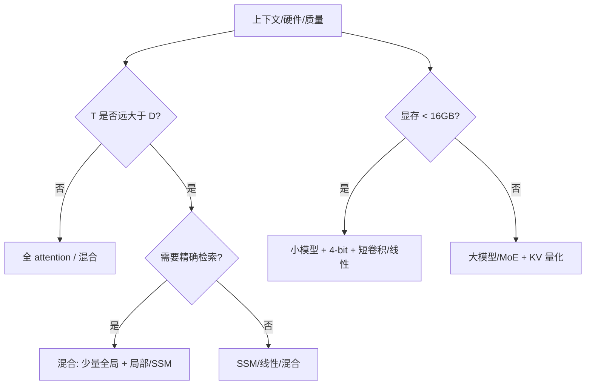

# 11.18 架构选型：从序列建模到推理账单

> **本节位置**：模块 11 · 大模型专题 ｜ **前置**：[11.13 架构全景](13-架构全景.md)、[11.16 混合架构](16-混合架构.md)、[11.17 长上下文外推](17-长上下文外推.md) ｜ **预计**：45 分钟
>
> **一句话**：架构选型不是“哪个模型最强”，而是**在给定上下文、质量、硬件、预算下，算清 FLOPs、KV/状态、训练/推理复杂度，再做取舍**。

## 0. 场景引入

三个产品，三种架构问题：

1. **256k 文档问答**：需要精确引用/跨段推理；7B 全 attention 的 KV 约 128 GiB，80 GB 卡放不下。
2. **手机离线助手**：内存 8 GB，功耗敏感；全 attention 的 KV 和权重都太重。
3. **1M 流式日志**：要一直读、一直总结；不能每 token 读 1M 的 KV。

同一个“大模型”，三种答案：

- 文档问答：全 attention/混合 + KV 量化 + 检索；
- 手机：小模型 + 短卷积/线性/混合 + 4-bit；
- 流式：SSM/RWKV/混合 + 固定状态。

**问题**：怎样用一张表把“架构—上下文—硬件—质量”放在一起比较？

## 1. 直觉

架构选型像给一栋楼配电梯：

- **全 attention**：每层都装“直达所有楼层”的电梯，快但井道（KV）占地方；
- **SWA**：只停最近几层，井道小，但去不了远处；
- **SSM/线性**：一部“记忆电梯”，只记摘要，不保证到每一层；
- **混合**：大多数楼层用局部电梯，少数楼层装直达；
- **MoE**：楼层很多，但每次只开几部电梯（稀疏激活）。

> 💡 **一句话直觉**：**架构不是“越新越好”，而是“用哪种预算买哪种能力”。**

这个类比在哪里失效：电梯可以后加，模型架构训练后就固定；电梯的容量是物理的，模型的“回看能力”是学出来的；MoE 的稀疏激活还会带来通信/负载均衡问题。

## 2. 定义

### 2.1 四个账单

| 账单 | 看什么 | 公式/量级 |
| --- | --- | --- |
| 训练算力 | FLOPs/token、并行度 | attention $O(T^2D)$；线性/SSM $O(TD^2)$ 或 $O(TDN)$ |
| 推理算力 | prefill/decode | prefill 大 GEMM；decode 瘦 GEMM |
| 显存 | 权重 + KV/状态 + 激活 | KV $2L H_{kv}d_kTb$；状态 $O(DN)$ |
| 质量 | 检索/长文/流式 | 评测，不是参数量 |

### 2.2 参数与活跃参数

- **dense**：每 token 用全部参数；
- **MoE**：总参数大，每 token 只激活一部分（$N_{\text{active}}$）；
- **hybrid**：层类型混合，参数/状态/计算都分层。

### 2.3 关键指标

- **TTFT/TPOT**：首 token/每 token 延迟；
- **吞吐**：tokens/s；
- **KV/状态 bytes per token**：长上下文成本；
- **质量**：needle、长文 QA、代码、工具调用；
- **训练成本**：GPU 小时、数据、稳定性。

## 3. 为什么这样定义

因为不同架构的“贵”在不同地方：

- 全 attention：训练/长上下文 KV 贵；
- SSM/线性：状态固定，但精确检索弱、kernel 不成熟；
- 混合：KV 省，但实现/训练复杂；
- MoE：算力省，但显存/通信/负载均衡贵。

只看“参数量”或“benchmark 分数”，会忽略这些账单。

## 4. 性质与推导

### 4.1 attention vs 线性/SSM 的交叉点

全 attention 每层约：

$$
\text{FLOPs}_{\text{attn}}\approx 4T^2D
$$

线性 attention/[Mamba](#ref-gu-2023) 每层约：

$$
\text{FLOPs}_{\text{linear}}\approx 8TD^2
$$

令两者相等：

$$
4T^2D\approx 8TD^2\Rightarrow T\approx 2D
$$

当 $T<2D$ 时，线性/SSM 不一定更省；当 $T\gg D$ 时，优势明显。**“线性”不是无条件更快。**

### 4.2 KV/状态

[Mamba-2](#ref-dao-2024) 的 SSD 也遵循同样的“固定状态”账本。

- 全 attention：$KV=2L H_{kv}d_kTb$，随 $T$ 线性；
- SWA：把 $T$ 换成 $\min(T,w)$；
- SSM/线性：状态 $O(DN)$ 或 $O(D^2)$，与 $T$ 无关；
- 混合：只对 attention 层算 KV。

### 4.3 MoE 的账

总参数 $N$、每 token 激活 $N_a$：

- 权重显存按 $N$ 算；
- 每 token 计算/读取按 $N_a$ 算；
- 通信/负载均衡按路由算。

**MoE 省算力，不省显存。**

### 4.4 质量维度

| 能力 | 更依赖 |
| --- | --- |
| 精确检索/复制 | 全 attention/全局层 |
| 长流式摘要 | SSM/线性/混合 |
| 局部语法/代码 | 短卷积/SWA |
| 容量/知识 | 参数/MoE/数据 |
| 长文跨段 | 全局层 + 位置外推 + 训练数据 |

## 5. 例子

### 5.1 7B 全 attention vs 7B Mamba（假设同参数量）

| 维度 | 7B attention | 7B Mamba |
| --- | --- | --- |
| 32k KV/状态 | 16 GiB | 约几 MiB |
| 精确检索 | 强 | 弱 |
| 长流式 | 贵 | 便宜 |
| 训练工具 | 成熟 | 较新 |

### 5.2 [LFM3-1.7B](#ref-lfm3-2026)

24 层：13 shortconv + 5 SWA + 6 global；256k；32k KV 约 0.38 GiB。它用“小模型 + 混合”换长上下文/边缘部署，而不是靠参数量。

### 5.3 125B-A6B MoE

总参数 125B、每 token 激活约 6B；权重显存大，但每 token 算力小。它适合“容量大、算力/带宽可接受”的场景；不适合 8 GB 手机。混合架构（如 [Jamba](#ref-liebert-2024)、[Griffin](#ref-de-2024)）则用少量 attention 补回看。

### 5.4 选型决策树



### 5.5 场景闭环：8 GB 手机、128k 摘要

**输入**：8 GB 手机，128k 上下文，离线摘要；不能全 attention。

**计算**：7B 全 attention 128k KV 约 64 GiB；1–2B 线性/混合状态几 MiB + 4-bit 权重。

**输出**：小模型 + 短卷积/线性/混合 + 4-bit；摘要可用，精确检索用本地检索。

**成本**：内存/功耗可控；质量/长文能力有限。

**失败条件**：模型太大；KV 没省；量化掉点；任务需要精确引用。

## 6. 常见误区

1. **“新架构一定全面更好”**  
   不同架构在不同 $T/D$/任务上各有胜负；要按账单选。

2. **“线性/SSM 一定更快”**  
   $T<2D$ 时不一定；kernel/并行度也影响。

3. **“MoE 省显存”**  
   省算力，不省权重显存；通信/负载均衡另算。

4. **“参数量大 = 能力强”**  
   数据、架构、训练配方、激活参数都影响。

5. **“支持长上下文 = 长文能力”**  
   位置外推、训练数据、评测缺一不可。

## 7. 概念网络

- 前置：[11.13 架构全景](13-架构全景.md) —— mixer 分类。
- 前置：[11.16 混合架构](16-混合架构.md) —— 层配比。
- 前置：[11.17 长上下文外推](17-长上下文外推.md) —— 位置/窗口。
- 后续：[M13 推理服务与运行时](../13-推理服务/README.md) —— 把架构放进服务。
- 易混：[11.10 MoE](10-MoE路由.md) —— MoE 是 channel mixer 的稀疏化，不是 token mixer。

- 服务侧：[13.5 选型与部署](../13-推理服务/05-选型与部署.md) —— FLOPs/KV/质量/成本四本账。
## 8. 通往大模型

**出现位置**：模型选型、`config.json`（`layer_types`、`num_experts`、`sliding_window`、`rope_scaling`）、推理引擎的 KV/state 预算。

**形状**：`[B,T,D]`；KV `[L,H,T,d]`；SSM 状态 `[D,N]`；MoE 权重 `[E,D,4D]`。

**为什么需要**：不懂架构账单，你会用 7B 全 attention 跑 256k，或用 125B MoE 跑手机；前者 OOM，后者放不下。

**可检验结论**：$T\approx2D$ 是 attention 与线性/SSM 的粗略交叉点；$T\gg D$ 时线性/SSM 的 $O(T)$ 优势才明显。

一个 5 行的选型器：

```python
def choose(T, D, kv_gib, need_recall=True):
    if T < 2*D and kv_gib < 40: return "full attention"
    if need_recall: return "hybrid (global + local/SSM)"
    return "SSM/linear/hybrid"
print(choose(32768, 4096, 16))
```

## 9. 练习

1. 写出 attention 与线性/SSM 的每层 FLOPs 近似，求交叉点。
2. 为什么 MoE 省算力不省显存？
3. 7B 全 attention 32k KV 16 GiB；7B Mamba 状态几 MiB。各自适合什么任务？
4. 混合架构的“全局层比例”如何影响质量/成本？
5. 给定 8 GB 手机、128k 上下文、离线摘要，选什么架构？说明理由。

<details>
<summary>参考答案</summary>

1. $4T^2D$ vs $8TD^2$；交叉 $T\approx2D$。
2. 权重按总参数存；每 token 只激活一部分，省的是计算/读取，不是显存。
3. attention：精确检索/短上下文；Mamba：长流式/常数内存。
4. 全局层多：回看强、KV/计算贵；少：便宜、精确回看弱。
5. 小模型 + 短卷积/线性/混合 + 4-bit；128k 不能全 attention，摘要任务可用状态/混合。

</details>

## 10. 一页速记

- 四个账单：训练算力、推理算力、显存（KV/状态）、质量。
- attention $O(T^2D)$；线性/SSM $O(TD^2)$/$O(TDN)$；交叉约 $T\approx2D$。
- KV 随 $T$ 涨；SSM/线性状态固定；混合只对 attention 层算 KV。
- MoE 省算力不省显存；混合省 KV 不省工程复杂度。
- 选型先问：多长、要多准、什么硬件、多少预算。

## 11. 参考文献与致谢

- <a id="ref-gu-2023"></a>**Gu 与 Dao（2023）**：*Mamba: Linear-Time Sequence Modeling with Selective State Spaces*。SSM 的计算/状态权衡。[arXiv:2312.00752](https://arxiv.org/abs/2312.00752)
- <a id="ref-dao-2024"></a>**Dao 与 Gu（2024）**：*Transformers are SSMs: Generalized Models and Efficient Algorithms Through Structured State Space Duality*。Mamba-2/SSD 的效率。[arXiv:2405.21060](https://arxiv.org/abs/2405.21060)
- <a id="ref-lfm3-2026"></a>**Liquid AI（2026）**：*Introducing LFM3*。小模型 + 混合架构 + 256k 的工程取舍。[博客](https://www.liquid.ai/blog/lfm3)
- <a id="ref-liebert-2024"></a>**Lieber 等（2024）**：*Jamba: A Hybrid Transformer-Mamba Language Model*。Mamba + attention + MoE 的配比。[arXiv:2403.19887](https://arxiv.org/abs/2403.19887)
- <a id="ref-de-2024"></a>**De 等（2024）**：*Griffin: Mixing Gated Linear Recurrences with Local Attention for Efficient Language Models*。线性递归 + 局部 attention 的取舍。[arXiv:2402.19427](https://arxiv.org/abs/2402.19427)

---

上一篇 → [11.17 长上下文外推](17-长上下文外推.md) ｜ 下一篇 → [M12 进阶与全景](../12-进阶/README.md)
