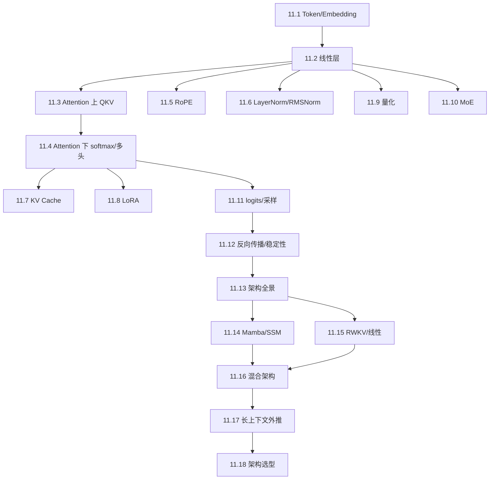

# M11 · 大模型中的线性代数

> **这一模块是整门课的汇合点。** 前面所有概念——向量、基、矩阵、秩、特征值、SVD、梯度——会在一次 Transformer forward 里同时出现。

## 怎么读这个模块

- 不要把它当「新数学」；每一节都会指回前面的概念。
- 每节都给出**形状链**与**参数量/计算量**，请拿纸跟着推。
- 建议先读完 M01–M03、M07.1–7.3，再读 11.1–11.6；M08 之后读 11.12。
- 11.13–11.18 是架构扩展：读完 11.4/11.7 后读 11.13，再按顺序读 11.14–11.18。
- 代码片段是 NumPy 伪代码，不依赖深度学习框架，目的是验证形状与公式。

## 本模块的现实问题

1. 一张 80 GB 卡上跑 24 路、每路 6000 token 的客服会话，为什么 15 GB 权重还没坐稳，KV Cache 就先撑爆了？（[11.7](07-KVCache.md)）
2. 7B 全参数微调单任务要 90 GB，LoRA 为什么能把它压到 20 GB？省下的到底是哪几项？（[11.8](08-LoRA.md)）
3. 47B 的 MoE 每 token 只激活 13B，为什么还会被通信与尾部延迟卡住？（[11.10](10-MoE路由.md)）
4. 训练到第 10 040 步 loss 从 2.1 跳到 8.7，怎么判断是 Jacobian 连乘放大，还是某个 batch 数值溢出？（[11.12](12-反向传播与稳定性.md)）
5. 256k 上下文下，为什么全 attention 的 KV 会爆，而 LFM3/Mamba 不会？架构到底在买什么？（[11.13](13-架构全景.md)）

## 概念地图

## 学习顺序

| 顺序 | 文档 | 时间 | 读完你应该能…… |
|---|---|---|---|
| 1 | [11.1 Token、Embedding 与隐藏状态](01-Token与Embedding.md) | 30 min | 说清一句话如何变成 `[B,T,D]` |
| 2 | [11.2 线性层：一次矩阵乘法](02-线性层.md) | 35 min | 手算参数量与 FLOPs |
| 3 | [11.3 Attention（上）：QKV](03-Attention-上-QKV.md) | 45 min | 徒手推导 attention 形状链 |
| 4 | [11.4 Attention（下）：softmax 与多头](04-Attention-下-softmax与多头.md) | 40 min | 解释缩放、mask、多头拼接 |
| 5 | [11.5 位置编码与 RoPE](05-位置编码与RoPE.md) | 35 min | 写出 RoPE 的旋转矩阵 |
| 6 | [11.6 LayerNorm 与 RMSNorm](06-LayerNorm与RMSNorm.md) | 30 min | 解释归一化的几何 |
| 7 | [11.7 KV Cache](07-KVCache.md) | 30 min | 估算显存与带宽 |
| 8 | [11.8 LoRA](08-LoRA.md) | 35 min | 解释低秩适配的参数量 |
| 9 | [11.9 量化](09-量化.md) | 35 min | 写出量化/反量化公式与误差 |
| 10 | [11.10 MoE 路由](10-MoE路由.md) | 30 min | 解释稀疏激活的形状 |
| 11 | [11.11 logits、softmax、温度](11-logits与采样.md) | 30 min | 从向量得到概率分布 |
| 12 | [11.12 反向传播与训练稳定性](12-反向传播与稳定性.md) | 40 min | 说清梯度形状与谱的作用 |
| 13 | [11.13 架构全景](13-架构全景.md) | 40 min | 说清 attention/SSM/线性/混合的取舍 |
| 14 | [11.14 Mamba 与 SSM](14-Mamba与SSM.md) | 45 min | 写出状态转移与选择性 |
| 15 | [11.15 RWKV 与线性注意力](15-RWKV与线性注意力.md) | 45 min | 推导线性 attention 的状态 |
| 16 | [11.16 混合架构](16-混合架构.md) | 45 min | 解释 LFM3/Jamba 的层配比 |
| 17 | [11.17 长上下文外推](17-长上下文外推.md) | 45 min | 区分 linear/NTK/YaRN/SWA |
| 18 | [11.18 架构选型](18-架构选型.md) | 45 min | 用 FLOPs/KV/质量做选择 |

## 一条主线

$$
\underbrace{[B,T]}_{\text{token id}}
\xrightarrow{\text{查表}}
\underbrace{[B,T,D]}_{X}
\xrightarrow{\text{Attention + FFN}}
\underbrace{[B,T,D]}_{H^{(L)}}
\xrightarrow{\text{unembedding}}
\underbrace{[B,T,V]}_{\text{logits}}
\xrightarrow{\text{softmax}}
\underbrace{[B,T,V]}_{\text{概率}}
$$

**每一层都在做「矩阵乘 + 非线性 + 残差」；每个形状都来自第 0.3 节的轴观点。**

## 自测（读完再做）

1. 一个 $D=4096$ 的模型，词表 $V=128000$，embedding 参数量是多少？
2. Attention 的参数量为什么约为 $4D^2$？FFN 为什么约为 $8D^2$？
3. 为什么 attention 要除以 $\sqrt{d_k}$？不除会怎样？
4. RoPE 为什么能表达相对位置？
5. KV Cache 缓存的是什么？为什么能省计算却更费显存？
6. LoRA 的参数量为什么是 $2Dr$，而不是 $D^2$？

自测答案

1. $128000\times4096=524{,}288{,}000$，约 5.24 亿。
2. $W_Q,W_K,W_V,W_O$ 各 $D\times D$，共 $4D^2$；FFN $D\to4D\to D$，$4D^2+4D^2=8D^2$。
3. 点积方差随 $d_k$ 增大，softmax 会饱和、梯度变小；除以 $\sqrt{d_k}$ 把方差拉回 1。
4. 旋转角度与位置成正比，两个位置的相对旋转只依赖位置差，内积因此只依赖相对距离。
5. 缓存历史 token 的 K、V；避免重复计算，但需存储 $2BHTd_k$ 个元素。
6. $\Delta W=BA$，$B\in\mathbb{R}^{D\times r}$、$A\in\mathbb{R}^{r\times D}$，参数 $Dr+rD=2Dr$。

## 架构扩展自测（读完 11.13–11.18 再做）

1. 全量 attention、SWA、Mamba、线性 attention 的每层计算/状态复杂度各是什么？
2. LFM3 的 24 层怎么分配 shortconv/SWA/global？为什么 32k KV 只有约 0.38 GiB？
3. RoPE 外推失败的根本原因是什么？linear/NTK/YaRN 各改了什么？
4. 为什么 $T\approx2D$ 是 attention 与线性/SSM 的粗略交叉点？
5. MoE 省算力还是省显存？混合架构省什么、不省什么？

架构扩展自测答案

1. 全量 $O(T^2D)$/KV $O(TD)$；SWA $O(TwD)$/KV $O(wD)$；Mamba $O(TDN)$/状态 $O(DN)$；线性 $O(TD^2)$/状态 $O(D^2)$。
2. 13 shortconv + 5 SWA + 6 global；只有 6 层 global + 5 层 SWA 产生 KV，且 SWA 被窗口截断。
3. 训练没见过的角度/相对距离组合；linear 缩放位置，NTK 改 base/频率分配，YaRN 加 NTK-by-parts/温度/注意力缩放。
4. $4T^2D\approx8TD^2\Rightarrow T\approx2D$；小于它时线性/SSM 的 $TD^2$ 不一定更省。
5. MoE 省算力/每 token 读取，不省权重显存；混合省 KV/计算，不省工程复杂度。

---

下一篇 → [11.1 Token、Embedding 与隐藏状态](01-Token与Embedding.md)

下一步 → [M13 推理服务与运行时](../13-推理服务/README.md)
