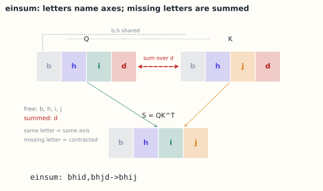

# 12.1 张量与 einsum：把形状写成公式

> **本节位置**：模块 12 · 进阶 ｜ **前置**：[0.3](../00-准备/03-标量向量矩阵张量.md)、[11.3](../11-大模型专题/03-Attention-上-QKV.md) ｜ **预计**：40 分钟
>
> **一句话**：einsum 用「给每个轴起名字」的方式写张量运算；只要名字对得上，形状就不会错，代码也能直接读出数学。

## 0. 场景引入

凌晨 1 点，你在给一个 7B 模型接 flash-attention 的兼容路径。$Q,K,V$ 的形状都是 `[B,H,T,d] = [8,32,2048,128]`，fp16。你按老习惯写 `reshape + transpose + matmul`，跑通了；同事用一行 `einsum("bhid,bhjd->bhij")` 得到同样结果，还顺手指出你的 `transpose` 顺序在另一种头数下会静默错位。你翻出上周的小模型单测——那里恰好 $H=T=8$，两种写法形状相同，测试一路绿灯；换成 $H=32,T=2048$ 才露馅。

先算两个数：$Q$ 有 $8\times32\times2048\times128\approx6.7\times10^7$ 个元素，fp16 占 134 MB；打分矩阵 $S$ 是 `[B,H,T,T]`，$8\times32\times2048^2\approx1.07\times10^9$ 个元素，fp16 占 2.15 GB。一次 $QK^\top$ 是 275 GFLOP，按 300 TFLOP/s 算约 0.9 ms；把 $S$ 写进显存再读出来（4.3 GB 往返）按 2 TB/s 算要 2.1 ms。

**决策**：先用 einsum 写「参考实现」，再用 `bmm` 写「快实现」，两者对拍。**代价**是参考实现多占 4.3 GB 激活，32 层全留就是 137 GB，80 GB 卡直接 OOM，所以它只能活在单元测试里；换来的是对拍一次几秒钟，而重跑一次 8 卡 3 天的训练是 576 卡·时。

**问题**：einsum 的规则是什么？为什么它能统一矩阵乘、转置、求和、外积？形状对了为什么还可能语义错？

读完本节，你应该能回答三件事：

1. einsum 的字母规则，以及它如何统一矩阵乘、转置、迹、外积；
2. 为什么「输出形状对了」不等于「语义对了」，怎么用 $2\times2$ 例子抓住转置 bug；
3. 收缩顺序如何让同一个式子的乘加次数差 100 倍。

## 1. 直觉

einsum 的核心是「轴的名字」：

- 每个输入张量的每个轴起一个字母；
- 输出里出现的字母 = 要保留的轴；
- 输入里出现、输出里没出现的字母 = 要求和的轴；
- 同一个字母在不同输入里出现 = 这些轴必须对齐（同一种索引）。

> 💡 **一句话直觉**：**einsum = 「保留哪些轴、求和哪些轴」的声明式写法；字母就是轴的身份证。**



*图：`bhid,bhjd->bhij` 的轴对应关系。$b,h$ 两边共享并保留；$d$ 在输入中出现但输出没有，被求和；$i,j$ 是输出保留的自由轴。*

类比边界：einsum 不是万能的——它不表达非线性、广播规则也不如 `+`/`*` 灵活；复杂算子仍要手写。

### 1.1 它在现实世界里对应什么：一条 SQL

把每个输入张量想成一张表，字母就是列名：

- 两个输入里同名的字母 = JOIN 条件（`ON Q.b=K.b AND Q.h=K.h`）；
- 输出里没出现的字母 = `GROUP BY` 之后被 `SUM` 掉的列；
- 输出的字母顺序 = `SELECT` 的列顺序。

`"bhid,bhjd->bhij"` 读成 SQL 就是：按 $b,h$ 对齐两张表，对 $d$ 求和，输出按 $b,h,i,j$ 排列。这也解释了它为什么读起来像数学——einsum 本来就是「关系代数 + 求和」的稠密数组版本。

### 1.2 这个类比在哪里失效

SQL 可以只读索引、流式地吐结果；einsum 在多数实现里会把中间张量整个物化到显存——`"bhid,bhjd->bhij"` 的中间结果就是那 2.15 GB 的 $S$。SQL 的 JOIN 顺序由查询优化器按统计信息挑，einsum 的收缩顺序在 NumPy/PyTorch 里只是启发式（§4.3）。此外它不表达非线性、条件与稀疏结构，也基本不做广播。

### 1.3 量级

同一层，$B=8,H=32,T=2048,d=128$：275 GFLOP，$S$ 占 2.15 GB fp16。按 300 TFLOP/s 与 2 TB/s 估，计算 0.9 ms、写回 1.1 ms——在这个尺寸下，einsum 的写法直接决定你是算力受限还是带宽受限。

## 2. 定义

### 2.1 张量

$n$ 阶张量是带 $n$ 个索引的数组：

$$
X_{i_1 i_2\cdots i_n}\in\mathbb{R}^{d_1\times\cdots\times d_n}
$$

标量 0 阶，向量 1 阶，矩阵 2 阶。深度学习里常见 4 阶：`[B,H,T,d]`。把张量写成多索引数组、并系统整理它的运算与分解，可以接着读 [Kolda 与 Bader](#ref-kolda-bader-2009) 的综述。

### 2.2 einsum 语法

$$
\texttt{"input1, input2, ... -> output"}(A, B, \dots)
$$

einsum 的语法是[爱因斯坦求和约定](#ref-einstein-1916)的程序化版本，规则：

1. 输入中重复的字母（同一张量内）表示对角线；
2. 跨输入重复的字母表示对应轴相乘；
3. 输出中未出现的字母求和；
4. 输出中字母顺序可任意，决定结果轴的顺序；
5. 省略 `-> output` 时进入隐式模式：只出现一次的字母按字母序自动成为输出，重复出现的字母被求和（不推荐，容易出错）。

### 2.3 常见运算

| 运算 | einsum |
|---|---|
| 矩阵乘 | `"ik,kj->ij"` |
| 批量矩阵乘 | `"bik,bkj->bij"` |
| 转置 | `"ij->ji"` |
| 迹 | `"ii->"` |
| 外积 | `"i,j->ij"` |
| 逐元素乘求和（内积） | `"i,i->"` |
| 行和 | `"ij->i"` |
| 注意力分数 | `"bhid,bhjd->bhij"` |
| 注意力加权 | `"bhij,bhjd->bhid"` |

## 3. 为什么这样定义

普通矩阵乘要求「左矩阵的列 = 右矩阵的行」，这个约束在批量、多头、多维时被 reshape 打乱。einsum 把「哪个轴对哪个轴」显式写出来，消除了 reshape 的顺序歧义。

它也把「求和」显式化：`"ij->i"` 明确是对 $j$ 求和。读代码时，数学公式与实现一一对应，减少「形状对了但语义错了」的 bug。

### 3.1 反事实一：下标顺序写反，形状不变、语义全错

取 $T=2,d=2$（$B=H=1$），$Q=\begin{bmatrix}1&0\\1&0\end{bmatrix}$，$K=\begin{bmatrix}1&0\\0&1\end{bmatrix}$，$V=I_2$。正确写法 `"bhid,bhjd->bhij"` 给

$$
S=QK^\top=\begin{bmatrix}1&0\\1&0\end{bmatrix}\begin{bmatrix}1&0\\0&1\end{bmatrix}^{\!\top}
=\begin{bmatrix}1&0\\1&0\end{bmatrix}
$$

按行 softmax：$A=\begin{bmatrix}0.731&0.269\\0.731&0.269\end{bmatrix}$；输出 $O=AV$ 两行都是 $(0.731,0.269)$——两个 token 都以 73% 的权重取 key 1。

若把输出写成 `"bhid,bhjd->bhji"`，拿到的是 $S^\top=\begin{bmatrix}1&1\\0&0\end{bmatrix}$。再对最后一维 softmax，$A'=\begin{bmatrix}0.5&0.5\\0.5&0.5\end{bmatrix}$，$O'$ 两行都是 $(0.5,0.5)$。**形状仍是 $2\times2$，不抛异常，行和也仍是 1**：所有「形状检查」都通过，但注意力从「query 挑 key」变成了「query 之间平均」。第二个 token 原本 73% 看 key 1，现在只看 50%。

抓它的办法只有一个：保留一个三行的循环版参考实现，在 $T=2$ 的非对称例子上对拍。这就是 §5.4 要把 einsum 版留在单测里的原因。

### 3.2 反事实二：收缩顺序换一下，乘加次数差 100 倍

`"ij,jk,kl->il"`，取 $i=1000,j=10,k=1000,l=10$：

- 先算 $AB$：中间张量 $[1000,1000]$，乘加 $1000\cdot10\cdot1000+1000\cdot1000\cdot10=2\times10^7$ 次，中间数组 $10^6$ 个元素（fp32 占 4 MB）；
- 先算 $BC$：中间张量 $[10,10]$，乘加 $10\cdot1000\cdot10+1000\cdot10\cdot10=2\times10^5$ 次，中间数组 100 个元素。

同一个数学表达式，快的顺序省 100 倍乘加、1 万倍中间内存。einsum 只看得到字母、看不到维度大小，所以维度悬殊时要么手动分步，要么交给 `opt_einsum` 搜路径。

## 4. 性质与推导

### 4.1 自由索引与求和索引

- **自由索引**（free）：出现在输出中，保留；
- **求和索引**（summed/contracted）：只出现在输入中，求和。

输出形状 = 自由索引对应维度的笛卡尔积。

### 4.2 同一张量内重复索引 = 对角线

`"ii->i"` 取出对角线；`"ii->"` 取迹。这与「跨输入重复」不同，后者是乘法对齐。

### 4.3 结合顺序影响性能

einsum 可能有多种 contraction order。`"ij,jk,kl->il"` 可以先算 $ij,jk$ 再乘 $kl$，也可以先算 $jk,kl$。不同顺序的 FLOPs 可能差很多；NumPy/PyTorch 会尝试优化，但复杂表达式建议手动分步或用 [`opt_einsum`](#ref-smith-gray-2018) 搜索最优收缩路径。

### 4.4 与广播的区别

广播是「形状不同的数组按规则扩展」，einsum 是「索引对齐与求和」。二者可以组合，但不要混为一谈。

## 5. 例子

### 5.1 手算：矩阵乘

$$
A=\begin{bmatrix}1&2&3\\4&5&6\end{bmatrix},\qquad
B=\begin{bmatrix}1&0\\0&1\\1&1\end{bmatrix}
$$

`"ik,kj->ij"`：

$$
(AB)_{11}=1\cdot1+2\cdot0+3\cdot1=4,\quad
(AB)_{12}=1\cdot0+2\cdot1+3\cdot1=5
$$

$$
AB=\begin{bmatrix}4&5\\10&11\end{bmatrix}
$$

### 5.2 手算：注意力分数

$T=3,d_k=2$，$Q=K=I_3$ 的前两列（仅示意）：

$$
Q=\begin{bmatrix}1&0\\0&1\\0&0\end{bmatrix}
$$

`"bhid,bhjd->bhij"` 在 $B=H=1$ 时就是 $QK^\top$：

$$
QK^\top=\begin{bmatrix}1&0&0\\0&1&0\\0&0&0\end{bmatrix}
$$

第 3 个 token 与谁都正交，分数全 0。

### 5.3 场景：多头 attention 的完整 einsum

```python
# Q,K,V: [B,H,T,d]
S = np.einsum("bhid,bhjd->bhij", Q, K) / np.sqrt(d)
A = softmax(S, axis=-1)
O = np.einsum("bhij,bhjd->bhid", A, V)       # [B,H,T,d]
Y = np.einsum("bhtd,de->bhte", O.transpose(0,2,1,3).reshape(B,T,D), Wo)
```

**注意**：`"bhij,bhjd->bhid"` 中 $j$ 是求和索引，正是「对所有 key 加权」。

### 5.4 场景闭环：一层 attention 的形状账

**输入**：$B=8,H=32,T=2048,d=128$，fp16；$Q,K,V$ 各 134 MB。

**计算**：`"bhid,bhjd->bhij"` 做 $2BHT^2d=2.75\times10^{11}$ FLOP，得到 2.15 GB 的 $S$；softmax 后 `"bhij,bhjd->bhid"` 再做 275 GFLOP，得到 134 MB 的 $O$。

**输出决策**：这条路径当「参考实现」还是「上线实现」？如果 profile 显示 attention 超过总时间的 30%、且 HBM 读写占主导，就换 fused kernel（第 11.4 节），einsum 版降级为单测基准。

**成本**：单层前向要写 2.15 GB 的 $S$；反向若同时保留 $S$ 与 $A$ 是 4.3 GB；32 层全留 137 GB，80 GB 卡放不下，必须重算或分块。

**失败条件**：① 下标顺序写反（§3.1）——形状全对、语义错，只能靠对拍发现；② 隐式模式把 `b` 当求和轴，输出少一维；③ 维度悬殊时按字母序收缩，乘加数涨 100 倍（§3.2）。兜底：显式写 `->`、对每个 einsum 断言输出形状、单测里保留循环版参考实现。

## 6. 常见误区

1. **误区**：einsum 一定比 matmul 快。
   **纠正**：einsum 可能产生临时数组、走通用路径；简单矩阵乘用 `@` 往往更快（底层 GEMM）。

2. **误区**：输出字母顺序无所谓。
   **纠正**：顺序决定结果轴的排列；`"ij->ji"` 与 `"ij->ij"` 不同。

3. **误区**：同一张量内重复字母和跨张量重复是一回事。
   **纠正**：前者是对角线，后者是对齐相乘。

4. **误区**：省略 `->` 更简洁。
   **纠正**：隐式模式把只出现一次的轴按字母序放进输出，对重复出现的轴求和；例如 `"ij,jk"` 得到 `"ik"`，而 `"ii"` 得到标量。容易产生意外结果，生产代码建议显式写出输出。

## 7. 概念网络

- 前置：[0.3 张量轴](../00-准备/03-标量向量矩阵张量.md) —— 形状语言。
- 前置：[11.3 Attention](../11-大模型专题/03-Attention-上-QKV.md) —— QKᵀ 与加权。
- 关联：[10.3 GEMM](../10-数值线性代数/03-BLAS与GEMM.md) —— 底层矩阵乘。
- 关联：[11.4 多头](../11-大模型专题/04-Attention-下-softmax与多头.md) —— 头维度的拆分。

## 8. 通往大模型：形状调试

**用 einsum 读 attention**：

$$
S_{bhij}=\sum_d Q_{bhid}K_{bhjd},\qquad
O_{bhid}=\sum_j A_{bhij}V_{bhjd}
$$

这两个式子直接对应两行 einsum；比 `transpose().reshape().matmul()` 更难写错。

**性能提示**：

- 简单的 `"bik,bkj->bij"` 用 `torch.bmm`/`@` 更快；
- 大 einsum 用 `opt_einsum` 找最优收缩顺序；
- 注意中间张量 $[B,H,T,T]$ 的显存（第 11.4 节）。

**可检验结论**：`"bhid,bhjd->bhij"` 的输出形状是 `[B,H,T,T]`；若你把 `d` 写进输出（`->bhijd`），会得到一个 5 阶张量，通常是 bug。

**学错/选错时，下游看到什么**：

- 写成 `->bhji`：loss 照常下降（模型会适应），但长文检索、复制类任务先掉点，排查时通常先怀疑数据而不是下标；
- 隐式模式漏写 `->`：输出少一维，下一层 `matmul` 才报错，栈里已经看不到 einsum；
- 该 fuse 却保留物化 $S$：显存先 OOM，或者 kernel 利用率只有 20%，profile 上表现为「算得不多但很慢」。

## 9. 练习

1. **概念**：einsum 中「输出里没出现的字母」意味着什么？
2. **写出 einsum**：批量矩阵乘、转置、迹、外积、行和。
3. **计算**：用 `"ij,jk->ik"` 手算 $\begin{bmatrix}1&2\\3&4\end{bmatrix}\begin{bmatrix}0&1\\1&0\end{bmatrix}$。
4. **场景**：写出多头 attention 中 $AV$ 的 einsum，并说明哪个字母被求和。
5. **开放**：为什么 `"ij,jk,kl->il"` 的收缩顺序会影响性能？举一个数量级例子。

<details>
<summary>参考答案</summary>

1. 该轴被求和（contracted）；输出中不会保留它。
2. `"bik,bkj->bij"`；`"ij->ji"`；`"ii->"`；`"i,j->ij"`；`"ij->i"`。
3. $\begin{bmatrix}2&1\\4&3\end{bmatrix}$。
4. `"bhij,bhjd->bhid"`；$j$（key 位置）被求和。
5. 不同顺序的中间张量大小不同；例如 $i=j=k=l=1000$ 时，先算 $ij,jk$ 得 $1000^3$ 次运算，再乘 $kl$ 又 $1000^3$；若先算 $jk,kl$ 同理，但若维度差异大，中间结果可能爆炸或缩减，FLOPs 差几个数量级。

</details>

## 10. 一页速记

- einsum：字母命名轴；输出保留自由轴，其余求和。
- 同张量重复 = 对角线；跨张量重复 = 对齐相乘。
- 常见：`ik,kj->ij`、`bhid,bhjd->bhij`、`bhij,bhjd->bhid`。
- 显式写输出，避免隐式求和陷阱。
- 简单矩阵乘用 `@`，复杂表达式再考虑 einsum/opt_einsum。
- **现实对应**：einsum 像 SQL 的 JOIN + GROUP BY——字母是列名，输出里没出现的字母被 SUM 掉；边界是它会把中间结果整个物化，而 SQL 可以流式。
- **物理意义**：没有直接的物理量；它的「单位」是 FLOPs 与字节，写法决定算力受限还是带宽受限。

## 11. 参考文献与致谢

这一页的知识不是凭空来的。下面列出本页直接借用的原始工作与权威整理；正文中的人名、定理名已链接到对应条目。链接优先指向 DOI、arXiv 或可长期访问的原文存档。

- <a id="ref-einstein-1916"></a>**爱因斯坦（Albert Einstein, 1916）**：*Die Grundlage der allgemeinen Relativitätstheorie*。广义相对论里「同一指标重复即求和、不写 $\sum$」的书写约定，就是本页 §2.2 那五条规则的源头。[Annalen der Physik（Wiley）](https://doi.org/10.1002/andp.19163540702)
- <a id="ref-kolda-bader-2009"></a>**Kolda 与 Bader（2009）**：*Tensor Decompositions and Applications*。把张量定义为多索引数组、并统一其记法与乘法的综述，本页「$n$ 阶张量」的写法沿用它。[SIAM Review](https://doi.org/10.1137/07070111X)
- <a id="ref-smith-gray-2018"></a>**Smith 与 Gray（2018）**：*opt_einsum - A Python package for optimizing contraction order for einsum-like expressions*。本页 §4.3「收缩顺序影响 FLOPs」的工程答案：把 $n$ 个张量的收缩顺序当作路径搜索来优化。[JOSS](https://doi.org/10.21105/joss.00753)

---

下一篇 → [12.2 随机矩阵理论](02-随机矩阵理论.md)
