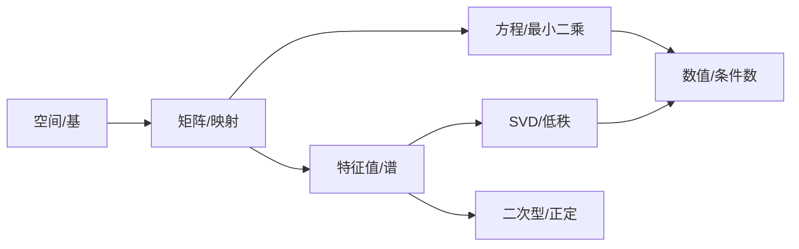

# 12.3 线性代数全景图：五条主线

> **本节位置**：模块 12 · 进阶 ｜ **前置**：[2.6](../02-向量空间/06-秩.md)、[6.4](../06-特征值/04-对称矩阵与谱定理.md)、[7.1](../07-SVD/01-SVD的几何.md) ｜ **预计**：30 分钟
>
> **一句话**：整门课可以压缩成五个问题——空间有多大、映射做了什么、方程有没有解、谱说明什么、怎么算得稳。

## 0. 场景引入

学完 80 篇文档，你可能记住了一堆定义，却说不清它们怎么串起来。

面试或读论文时，真正有用的是：看到一个矩阵，能立刻问出对的问题——

- 它的列空间多大？（秩）
- 它把哪些方向压没了？（零空间）
- 它有没有特殊方向？（特征值）
- 它最强/最弱的拉伸是多少？（奇异值）
- 数值上稳不稳？（条件数）

这五个问题就是五条主线。

## 1. 直觉

把线性代数想成一张地图，有五条主干道：

1. **空间**：向量、子空间、基、维数；
2. **映射**：矩阵、线性变换、复合、逆；
3. **方程**：$A\mathbf{x}=\mathbf{b}$、解的结构、最小二乘；
4. **谱**：特征值、对角化、SVD、二次型；
5. **计算**：消元、QR、迭代、浮点误差。

每条道都通向大模型的不同部分。

> 💡 **一句话直觉**：**空间回答「在哪」，映射回答「怎么变」，方程回答「能不能解」，谱回答「本质是什么」，计算回答「算得出来吗」。**

## 2. 定义

### 2.1 五个核心对象

| 对象 | 定义 | 关键量 |
|---|---|---|
| 向量空间 $V$ | 对加法和数乘封闭的集合 | 维数 $\dim V$ |
| 线性映射 $T$ | $T(a\mathbf{x}+b\mathbf{y})=aT\mathbf{x}+bT\mathbf{y}$ | 矩阵表示、秩 |
| 矩阵 $A$ | 线性映射在基下的表示 | 秩、行列式、谱 |
| 方程组 $A\mathbf{x}=\mathbf{b}$ | 求解/逼近 | 解集、残差 |
| 二次型 $\mathbf{x}^\top A\mathbf{x}$ | 标量函数 | 正定性、特征值 |

### 2.2 十个必须记住的式子

$$
\begin{aligned}
&\operatorname{rank}(A)+\dim\operatorname{null}(A)=n &&\text{秩-零化度}\\
&A\mathbf{x}=\mathbf{b}\ \text{有解}\iff \mathbf{b}\in\operatorname{col}(A) &&\text{可解性}\\
&A^\top A\hat{\mathbf{x}}=A^\top\mathbf{b} &&\text{正规方程}\\
&A\mathbf{v}=\lambda\mathbf{v} &&\text{特征值}\\
&A=PDP^{-1} &&\text{对角化}\\
&A=Q\Lambda Q^\top &&\text{谱定理}\\
&A=U\Sigma V^\top &&\text{SVD}\\
&A_k=\sum_{i=1}^k\sigma_i\mathbf{u}_i\mathbf{v}_i^\top &&\text{低秩近似}\\
&\mathbf{x}_{\parallel}=QQ^\top\mathbf{x} &&\text{正交投影}\\
&\frac{\partial L}{\partial W}=\boldsymbol{\delta}\mathbf{x}^\top &&\text{反向传播}
\end{aligned}
$$

## 3. 为什么这样定义

这五条主线不是人为分类，而是**同一个线性映射的五个侧面**：

- 定义域/值域 → 空间；
- 作用方式 → 映射；
- 逆问题 → 方程；
- 不变量 → 谱；
- 可计算性 → 数值。

理解其中一个，会反过来加深其它四个。例如：秩既是「列空间维数」，也是「非零奇异值个数」，也是「消元主元个数」——三个视角，同一个量。

## 4. 性质与推导

### 4.1 主线之间的桥梁

### 4.2 一个矩阵的五个问题

对 $A\in\mathbb{R}^{m\times n}$：

1. $\operatorname{rank}(A)=r$：列空间维数；
2. $\dim\operatorname{null}(A)=n-r$：被压没的维数；
3. 特征值：只有方阵才有，描述不变方向；
4. 奇异值：任意矩阵都有，描述拉伸；
5. 条件数 $\sigma_{\max}/\sigma_{\min}$：求解的敏感度。

### 4.3 为什么 SVD 是「终极分解」

- 特征分解只对方阵、且需可对角化；
- SVD 对任意矩阵存在，且 $U,V$ 正交，数值稳定；
- 特征值/SVD/秩/范数/伪逆/最小二乘都能从 SVD 读出。

### 4.4 计算视角

同一问题有多种算法：

| 问题 | 方法 | 稳定性 |
|---|---|---|
| 解方程 | 高斯消元 | 一般 |
| 最小二乘 | 正规方程 | 条件数平方 |
| 最小二乘 | QR | 较好 |
| 最小二乘 | SVD | 最好，最慢 |
| 特征值 | QR 迭代 | 好 |
| 主成分 | SVD | 好 |

## 5. 例子

### 5.1 一个矩阵走完五条主线

$$
A=\begin{bmatrix}2&1\\1&2\end{bmatrix}
$$

1. **空间/秩**：$\det=3\neq0$，秩 2，列空间 $\mathbb{R}^2$，零空间 $\{\mathbf{0}\}$。
2. **映射**：把 $(1,0)$ 映到 $(2,1)$，把 $(0,1)$ 映到 $(1,2)$。
3. **方程**：对任意 $\mathbf{b}$ 有唯一解 $\mathbf{x}=A^{-1}\mathbf{b}$。
4. **谱**：特征值 $3,1$，特征向量 $(1,1)/\sqrt2$、$(1,-1)/\sqrt2$；对称 ⇒ 正交对角化。
5. **计算**：条件数 $3/1=3$，数值良态。

### 5.2 SVD 视角

$$
A=Q\begin{bmatrix}3&0\\0&1\end{bmatrix}Q^\top,\qquad
Q=\frac{1}{\sqrt2}\begin{bmatrix}1&1\\1&-1\end{bmatrix}
$$

奇异值 $3,1$；最大拉伸 3，最小 1；低秩近似 $A_1=3\mathbf{q}_1\mathbf{q}_1^\top$ 保留最多能量。

### 5.3 大模型中的同一条链

$$
X\xrightarrow{W_Q,W_K,W_V}\text{attention}\xrightarrow{W_O}\text{FFN}\xrightarrow{W_{\text{vocab}}}\text{logits}
$$

每一步都是「矩阵乘 + 非线性」；每一层的谱、秩、条件数都影响训练/推理。

## 6. 常见误区

1. **误区**：线性代数就是矩阵计算。
   **纠正**：计算是手段；核心是空间、映射、不变量。

2. **误区**：特征值比奇异值更基本。
   **纠正**：特征值只对方阵、且可能不足；奇异值对任意矩阵都有，且数值稳定。

3. **误区**：公式之间互相独立。
   **纠正**：秩-零化度、SVD、最小二乘、伪逆是同一组事实的不同表述。

4. **误区**：学完课就懂了。
   **纠正**：能从一个具体矩阵出发，主动问出五个问题并算出来，才算掌握。

## 7. 概念网络

- 空间：[2.4 基与维数](../02-向量空间/04-基与维数.md)
- 映射：[3.1 矩阵的四种身份](../03-矩阵与线性映射/01-矩阵的四种身份.md)
- 方程：[4.4 最小二乘](../04-线性方程组/04-最小二乘.md)
- 谱：[6.4 谱定理](../06-特征值/04-对称矩阵与谱定理.md)、[7.2 SVD](../07-SVD/02-SVD的计算与性质.md)
- 计算：[10.2 条件数](../10-数值线性代数/02-矩阵范数与条件数.md)

## 8. 通往大模型：一次 forward 的全景

| 步骤 | 线性代数 | 关键量 |
|---|---|---|
| embedding | 查表/one-hot 乘 | $V\times D$ |
| QKV | 三个线性映射 | $3D^2$ |
| attention | $QK^\top$、softmax、$AV$ | $O(T^2d)$ |
| 输出投影 | 线性映射 | $D^2$ |
| FFN | 两个线性映射 + 非线性 | $8D^2$ |
| LayerNorm | 投影/缩放 | $O(D)$ |
| unembedding | 线性映射 | $D\times V$ |
| 反向传播 | Jacobian 连乘 | 谱范数 |

**可检验结论**：把任意一层的权重做 SVD，若奇异值快速衰减，说明该层近似低秩；若条件数很大，说明该层对输入扰动敏感，训练/量化时需更小心。

## 9. 练习

1. **概念**：用一句话解释「秩」在五个主线中分别是什么。
2. **计算**：$A=\begin{bmatrix}1&2\\2&4\end{bmatrix}$，求秩、零空间、特征值、奇异值、条件数。
3. **连接**：证明 $\operatorname{rank}(A)=\operatorname{rank}(A^\top A)$（用 SVD 或零空间）。
4. **场景**：为什么最小二乘用 SVD 比正规方程稳？从条件数解释。
5. **开放**：如果只能保留一个线性代数概念去读大模型论文，你选哪个？为什么？

参考答案

1. 空间：列空间维数；映射：像的维数；方程：独立约束数；谱：非零奇异值个数；计算：消元主元数。
2. 秩 1；零空间 $\operatorname{span}\{(2,-1)\}$；特征值 0,5；奇异值 $5,0$；条件数无穷（奇异）。
3. $\operatorname{null}(A)=\operatorname{null}(A^\top A)$；由秩-零化度，两者秩相同。
4. 正规方程把条件数平方，SVD 直接处理奇异值，截断小奇异值可稳定解。
5. 开放；建议选「秩/低秩」或「SVD」，因为它们贯穿 LoRA、压缩、注意力、PCA。

## 10. 一页速记

- 五主线：空间、映射、方程、谱、计算。
- 秩 = 列空间维数 = 非零奇异值数 = 主元数。
- 特征值看不变方向，奇异值看拉伸。
- SVD 是任意矩阵的终极分解。
- 条件数决定数值稳定性。

---

下一篇 → [12.4 从这门课到推理研究](04-研究路线.md)
