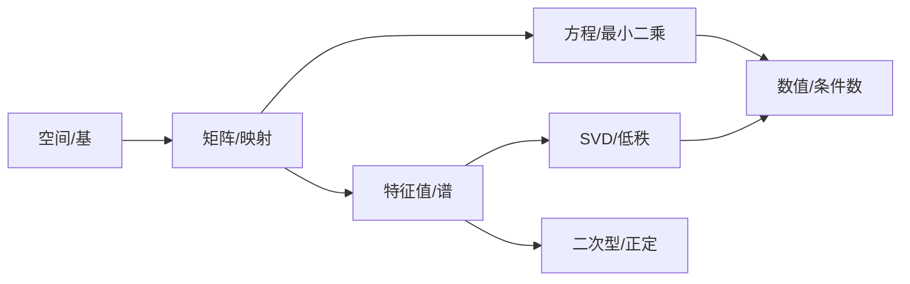

# 12.3 线性代数全景图：五条主线

> **本节位置**：模块 12 · 进阶 ｜ **前置**：[2.6](../02-向量空间/06-秩.md)、[6.4](../06-特征值/04-对称矩阵与谱定理.md)、[7.1](../07-SVD/01-SVD的几何.md) ｜ **预计**：30 分钟
>
> **一句话**：整门课可以压缩成五个问题——空间有多大、映射做了什么、方程有没有解、谱说明什么、怎么算得稳。

## 0. 场景引入

周五下午的技术评审，你要在 30 分钟内定下 7B 模型的部署方案：单卡 24 GB，上下文 4096，目标并发 16。

三个候选：fp16 原样、int8 权重、GQA（$H_{kv}=8$）配 int8 KV。你手上只有三个数：权重 fp16 14 GB；MHA 的 KV 每 token 0.5 MiB（$2\cdot32\cdot32\cdot128\cdot2$ B，$L=32$）；4096 token × 16 并发就是 32 GiB。14 GB 权重加 32 GiB KV，24 GB 卡上一个并发都放不下；换 GQA + int8 KV 后 KV 降到 4 GiB，$7+4+1\approx12$ GiB，方案才成立。

**决策**：先按「秩/谱」判断哪些层能压，还是先按「显存」硬算？**代价**是选错方向后两周适配白做，上线并发只有目标的 1/4。这两个问题看着分属「谱」和「计算」两条主线，其实必须一起回答——这就是全景图要解决的事。

学完 80 篇文档，你该能对一个矩阵立刻问出五个问题：列空间多大（秩）、哪些方向被压没（零空间）、有没有特殊方向（特征值）、最强/最弱拉伸多少（奇异值）、数值稳不稳（条件数）。这五个问题就是五条主线。

读完本节，你应该能回答三件事：

1. 五条主线各自回答什么问题，彼此如何换算；
2. 拿到一个具体矩阵或模型，先问哪三个问题最省时间；
3. 为什么「参数量相同」的两个模型，部署成本可以差 4 倍。

## 1. 直觉

把线性代数想成一张地图，有五条主干道：

1. **空间**：向量、子空间、基、维数；
2. **映射**：矩阵、线性变换、复合、逆；
3. **方程**：$A\mathbf{x}=\mathbf{b}$、解的结构、最小二乘；
4. **谱**：特征值、对角化、SVD、二次型；
5. **计算**：消元、QR、迭代、浮点误差。

每条道都通向大模型的不同部分。

> 💡 **一句话直觉**：**空间回答「在哪」，映射回答「怎么变」，方程回答「能不能解」，谱回答「本质是什么」，计算回答「算得出来吗」。**

### 1.1 它在现实世界里对应什么：一台机器的五个仪表

- 秩 = 有效零件数：有多少独立信息真的在干活；
- 零空间 = 空转的轴：哪些输入方向完全没反应；
- 特征值 = 固有频率：系统自己会怎么振；
- 奇异值 = 传动比：对外部刺激的增益范围；
- 条件数 = 误差的放大倍数：小扰动会被放大多少。

仪表的价值不是「全读一遍」，而是**按症状选两三个**：部署先看显存（秩/低秩）与量化误差（谱/条件数），训练发散先看谱，求解不准先看条件数。

### 1.2 这个类比在哪里失效

五个仪表并不独立：秩、奇异值、条件数都从同一个 SVD 读出来，特征值只对方阵有定义，所以「五项都正常」不等于矩阵好用——非正规矩阵的伪谱可以远离谱。仪表还是静态的，而推理时的同一层矩阵乘还受 batch、序列长度、kernel 影响；线性代数意义下的「健康」不等于系统意义上的「快」。

### 1.3 量级

一个 $T\times T$ 的 attention 打分矩阵，秩不超过 $d_k$：$T=2048,d_k=128$ 时秩最多 128，只占 6%。也就是说 $2048^2$ 个分数里绝大部分是线性相关的——低秩/稀疏优化才有空间；反过来也提醒你，别把「满矩阵」当成「满秩」。

## 2. 定义

### 2.1 五个核心对象

| 对象 | 定义 | 关键量 |
|---|---|---|
| 向量空间 $V$ | 对加法和数乘封闭的集合 | 维数 $\dim V$ |
| 线性映射 $T$ | $T(a\mathbf{x}+b\mathbf{y})=aT\mathbf{x}+bT\mathbf{y}$ | 矩阵表示、秩 |
| 矩阵 $A$ | 线性映射在基下的表示 | 秩、行列式、谱 |
| 方程组 $A\mathbf{x}=\mathbf{b}$ | 求解/逼近 | 解集、残差 |
| 二次型 $\mathbf{x}^\top A\mathbf{x}$ | 标量函数 | 正定性、特征值 |

### 2.2 十个必须记住的式子

$$
\begin{aligned}
&\operatorname{rank}(A)+\dim\operatorname{null}(A)=n &&\text{秩-零化度}\\
&A\mathbf{x}=\mathbf{b}\ \text{有解}\iff \mathbf{b}\in\operatorname{col}(A) &&\text{可解性}\\
&A^\top A\hat{\mathbf{x}}=A^\top\mathbf{b} &&\text{正规方程}\\
&A\mathbf{v}=\lambda\mathbf{v} &&\text{特征值}\\
&A=PDP^{-1} &&\text{对角化}\\
&A=Q\Lambda Q^\top &&\text{谱定理}\\
&A=U\Sigma V^\top &&\text{SVD}\\
&A_k=\sum_{i=1}^k\sigma_i\mathbf{u}_i\mathbf{v}_i^\top &&\text{低秩近似}\\
&\mathbf{x}_{\parallel}=QQ^\top\mathbf{x} &&\text{正交投影}\\
&\frac{\partial L}{\partial W}=\boldsymbol{\delta}\mathbf{x}^\top &&\text{反向传播}
\end{aligned}
$$

### 2.3 五条主线各自的一个现场问题

| 主线 | 具体问题 | 一个数字 | 失败模式 |
|---|---|---|---|
| 空间 | 这一层 4096 维里有多少是有效维？ | 用 SVD 数前多少个奇异值占 90% 能量 | 把满秩当满信息，压缩时一刀切掉有用方向 |
| 映射 | 这个线性层把哪些方向压没了？ | 零空间维数 $=D-r$ | LoRA 的秩落在零空间上，训练不动 |
| 方程 | 最小二乘用正规方程还是 QR？ | $\kappa=4\times10^3$ 时 $\kappa^2=1.6\times10^7$ | fp32 下相对误差到 $O(1)$，解不可用 |
| 谱 | 权重的最大奇异值多大？ | int8 量化时 $\sigma_{\max}$ 决定 clip 范围 | outlier 通道被截断，长文掉点 |
| 计算 | decode 是算力还是带宽受限？ | 算术强度约 1，屋脊点约 300 FLOP/byte | 在带宽瓶颈上做 FLOPs 优化，白忙 |

用法：评审时按「症状」挑一行，把数字算出来，再决定要不要往下挖。

## 3. 为什么这样定义

这五条主线不是人为分类，而是**同一个线性映射的五个侧面**：

- 定义域/值域 → 空间；
- 作用方式 → 映射；
- 逆问题 → 方程；
- 不变量 → 谱；
- 可计算性 → 数值。

理解其中一个，会反过来加深其它四个。例如：秩既是「列空间维数」，也是「非零奇异值个数」，也是「消元主元个数」——三个视角，同一个量。

这套「先问子空间、再问映射、最后问解」的讲法，与 [Strang](#ref-strang-2016) 教材围绕四个基本子空间展开的组织方式一脉相承。

### 3.1 反事实一：只按参数量选型，会漏掉 KV Cache

两个模型都是 7B、32 层、$D=4096$，参数量差不到 1%：

- A 用 MHA（$H=H_{kv}=32$）：每 token 的 KV $=2\cdot32\cdot32\cdot128\cdot2\ \text{B}=0.5$ MiB；
- B 用 GQA（$H=32,H_{kv}=8$）：每 token 的 KV $=2\cdot32\cdot8\cdot128\cdot2\ \text{B}=0.125$ MiB。

$T=4096$、并发 16：A 需要 $0.5\ \text{MiB}\times4096\times16=32$ GiB，B 只要 8 GiB。24 GB 卡上 A 只能 batch=1，B 能跑到目标并发。**参数表上几乎一样，部署容量差 4 倍。**

荒谬之处一眼可见：按参数量排名，两个模型并列；按显存排名，一个直接出局。

### 3.2 反事实二：只按「公式简单」选算法，条件数会平方

$$
A=\begin{bmatrix}1&1\\1&1.001\end{bmatrix},\qquad \det A=0.001
$$

它的 $\sigma_{\max}\approx2.0$，$\sigma_{\min}=\det A/\sigma_{\max}\approx5\times10^{-4}$，所以 $\kappa_2\approx4\times10^3$。

正规方程把条件数平方：$\kappa_2(A^\top A)\approx1.6\times10^7$。fp32 机器精度约 $6\times10^{-8}$，误差量级 $1.6\times10^7\times6\times10^{-8}\approx1$——**相对误差 100%**。换 QR 或 SVD，误差量级是 $\kappa\varepsilon\approx4\times10^3\times6\times10^{-8}\approx2.4\times10^{-4}$。

同样的数据、数学上等价的方程，换个算法差 4 个数量级。这就是「方程」和「计算」必须一起看的原因：**可解性不保证可算性**。

## 4. 性质与推导

### 4.1 主线之间的桥梁

### 4.2 一个矩阵的五个问题

对 $A\in\mathbb{R}^{m\times n}$：

1. $\operatorname{rank}(A)=r$：列空间维数；
2. $\dim\operatorname{null}(A)=n-r$：被压没的维数；
3. 特征值：只有方阵才有，描述不变方向；
4. 奇异值：任意矩阵都有，描述拉伸；
5. 条件数 $\sigma_{\max}/\sigma_{\min}$：求解的敏感度。

### 4.3 为什么 SVD 是「终极分解」

- 特征分解只对方阵、且需可对角化；
- SVD 对任意矩阵存在，且 $U,V$ 正交，数值稳定；
- 特征值/SVD/秩/范数/伪逆/最小二乘都能从 SVD 读出；
- 低秩近似 $A_k$ 在 Frobenius 范数下误差最小，这条最优性由 [Eckart–Young 定理](#ref-eckart-young-1936) 保证。

### 4.4 计算视角

同一问题有多种算法，稳定性差别很大（数值线性代数的系统处理见 [Trefethen & Bau](#ref-trefethen-bau-1997)）：

| 问题 | 方法 | 稳定性 |
|---|---|---|
| 解方程 | 高斯消元 | 一般 |
| 最小二乘 | 正规方程 | 条件数平方 |
| 最小二乘 | QR | 较好 |
| 最小二乘 | SVD | 最好，最慢 |
| 特征值 | QR 迭代 | 好 |
| 主成分 | SVD | 好 |

## 5. 例子

### 5.1 一个矩阵走完五条主线

$$
A=\begin{bmatrix}2&1\\1&2\end{bmatrix}
$$

1. **空间/秩**：$\det=3\neq0$，秩 2，列空间 $\mathbb{R}^2$，零空间 $\{\mathbf{0}\}$。
2. **映射**：把 $(1,0)$ 映到 $(2,1)$，把 $(0,1)$ 映到 $(1,2)$。
3. **方程**：对任意 $\mathbf{b}$ 有唯一解 $\mathbf{x}=A^{-1}\mathbf{b}$。
4. **谱**：特征值 $3,1$，特征向量 $(1,1)/\sqrt2$、$(1,-1)/\sqrt2$；对称 ⇒ 正交对角化（[谱定理](#ref-horn-johnson-1985)）。
5. **计算**：条件数 $3/1=3$，数值良态。

### 5.2 SVD 视角

$$
A=Q\begin{bmatrix}3&0\\0&1\end{bmatrix}Q^\top,\qquad
Q=\frac{1}{\sqrt2}\begin{bmatrix}1&1\\1&-1\end{bmatrix}
$$

奇异值 $3,1$；最大拉伸 3，最小 1；低秩近似 $A_1=3\mathbf{q}_1\mathbf{q}_1^\top$ 保留最多能量。

### 5.3 大模型中的同一条链

$$
X\xrightarrow{W_Q,W_K,W_V}\text{attention}\xrightarrow{W_O}\text{FFN}\xrightarrow{W_{\text{vocab}}}\text{logits}
$$

每一步都是「矩阵乘 + 非线性」；每一层的谱、秩、条件数都影响训练/推理。

### 5.4 场景闭环：一个团队按这张图做技术选型

**输入**：7B 模型，$L=32$，$D=4096$，$H=32$；上下文 4096；目标并发 16；单卡 24 GB；质量基线是 fp16 的评测分。

**计算**（按五条主线各走一步）：

1. 空间/谱：抽样几层权重做 SVD，看奇异值衰减，决定哪些层适合低秩；
2. 映射/方程：KV 字节数按 §3.1 算——MHA 32 GiB、GQA 8 GiB、int8 KV 4 GiB；
3. 计算：decode 算术强度约 1，带宽受限，所以「省字节」优先于「省 FLOPs」。

**输出决策**：int8 权重（14 → 7 GB）+ GQA + int8 KV（4 GiB）+ 激活 1 GiB ≈ 12 GiB，留 12 GiB 给并发与碎片；若质量回归不过，退回 GQA + fp16 KV（$7+8+1=16$ GiB）。

**成本**：量化校准与回归约 1–2 人天；显存从「装不下 16 并发」降到「装得下且有余量」，代价是 int8 权重的精度损失和一次完整评测。

**失败条件**：① 只按参数量选型、忽略 KV，上线 OOM（§3.1）；② 只看平均奇异值定 clip，outlier 通道被截，长文掉点；③ 卡在 24 GB 边界，碎片让实际并发只有 8。兜底：先在目标卡上跑 4K/32K 两档压测，按 p99 显存留余量，而不是按均值。

## 6. 常见误区

1. **误区**：线性代数就是矩阵计算。
   **纠正**：计算是手段；核心是空间、映射、不变量。

2. **误区**：特征值比奇异值更基本。
   **纠正**：特征值只对方阵、且可能不足；奇异值对任意矩阵都有，且数值稳定。

3. **误区**：公式之间互相独立。
   **纠正**：秩-零化度、SVD、最小二乘、伪逆是同一组事实的不同表述。

4. **误区**：学完课就懂了。
   **纠正**：能从一个具体矩阵出发，主动问出五个问题并算出来，才算掌握。

## 7. 概念网络

- 空间：[2.4 基与维数](../02-向量空间/04-基与维数.md)
- 映射：[3.1 矩阵的四种身份](../03-矩阵与线性映射/01-矩阵的四种身份.md)
- 方程：[4.4 最小二乘](../04-线性方程组/04-最小二乘.md)
- 谱：[6.4 谱定理](../06-特征值/04-对称矩阵与谱定理.md)、[7.2 SVD](../07-SVD/02-SVD的计算与性质.md)
- 计算：[10.2 条件数](../10-数值线性代数/02-矩阵范数与条件数.md)

## 8. 通往大模型：一次 forward 的全景

| 步骤 | 线性代数 | 关键量 |
|---|---|---|
| embedding | 查表/one-hot 乘 | $V\times D$ |
| QKV | 三个线性映射 | $3D^2$ |
| attention | $QK^\top$、softmax、$AV$ | $O(T^2d)$ |
| 输出投影 | 线性映射 | $D^2$ |
| FFN | 两个线性映射 + 非线性 | $8D^2$ |
| LayerNorm | 投影/缩放 | $O(D)$ |
| unembedding | 线性映射 | $D\times V$ |
| 反向传播 | Jacobian 连乘 | 谱范数 |

**可检验结论**：把任意一层的权重做 SVD，若奇异值快速衰减，说明该层近似低秩；若条件数很大，说明该层对输入扰动敏感，训练/量化时需更小心。

**学错/选错时，下游看到什么**：

- 五条线只背结论不会算：评审时说不出「为什么是 32 GiB」，只能拍脑袋加卡，成本翻倍；
- 只按参数量比较模型：选了一个 KV 大 4 倍的架构，上线并发只有目标的 1/4，吞吐不达标；
- 把「满秩」当「满信息」：剪掉看似很小、实则承载长尾语义的奇异方向，短 prompt 正常、长文崩。

## 9. 练习

1. **概念**：用一句话解释「秩」在五个主线中分别是什么。
2. **计算**：$A=\begin{bmatrix}1&2\\2&4\end{bmatrix}$，求秩、零空间、特征值、奇异值、条件数。
3. **连接**：证明 $\operatorname{rank}(A)=\operatorname{rank}(A^\top A)$（用 SVD 或零空间）。
4. **场景**：为什么最小二乘用 SVD 比正规方程稳？从条件数解释。
5. **开放**：如果只能保留一个线性代数概念去读大模型论文，你选哪个？为什么？

参考答案

1. 空间：列空间维数；映射：像的维数；方程：独立约束数；谱：非零奇异值个数；计算：消元主元数。
2. 秩 1；零空间 $\operatorname{span}\{(2,-1)\}$；特征值 0,5；奇异值 $5,0$；条件数无穷（奇异）。
3. $\operatorname{null}(A)=\operatorname{null}(A^\top A)$；由秩-零化度，两者秩相同。
4. 正规方程把条件数平方，SVD 直接处理奇异值，截断小奇异值可稳定解。
5. 开放；建议选「秩/低秩」或「SVD」，因为它们贯穿 LoRA、压缩、注意力、PCA。

## 10. 一页速记

- 五主线：空间、映射、方程、谱、计算。
- 秩 = 列空间维数 = 非零奇异值数 = 主元数。
- 特征值看不变方向，奇异值看拉伸。
- SVD 是任意矩阵的终极分解。
- 条件数决定数值稳定性。
- **物理意义/现实对应**：五条主线是一台机器的五个仪表——尺寸（秩）、传动（映射）、可解（方程）、共振（谱）、噪声（条件数）；边界是它们并非独立，都指向同一个 SVD。

## 11. 参考文献与致谢

这一页的知识不是凭空来的。下面列出本页直接借用的原始工作与权威整理；正文中的人名、定理名已链接到对应条目。链接优先指向 DOI、arXiv 或可长期访问的原文存档。

- **Strang（Gilbert Strang, 2016）**：*Introduction to Linear Algebra*（第 5 版）。用四个基本子空间串起「空间—映射—方程」三线的教材，本页 §3 的组织方式来自它。[MIT 教材主页](https://math.mit.edu/~gs/linearalgebra/)
- **Eckart 与 Young（1936）**：*The Approximation of One Matrix by Another of Lower Rank*。证明截断 SVD $A_k$ 是 Frobenius 范数下的最优秩 $k$ 近似，即本页 §4.3 与 §5.2 所说的「低秩近似保留最多能量」。[Psychometrika](https://doi.org/10.1007/BF02288367)
- **Trefethen 与 Bau（1997）**：*Numerical Linear Algebra*。把 QR、条件数、浮点误差与特征值算法放在同一条「稳定性」主线上的标准教材，对应本页 §4.4 的计算视角。[SIAM](https://doi.org/10.1137/1.9780898719574)
- **Horn 与 Johnson（1985）**：*Matrix Analysis*。对称矩阵谱定理、特征值变分刻画与正定性的系统整理，是本页「谱」主线的标准参考。[Cambridge University Press](https://doi.org/10.1017/CBO9780511810817)

---

下一篇 → [12.4 从这门课到推理研究](04-研究路线.md)
