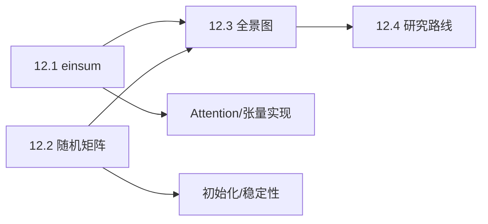

# M12 · 进阶与全景

> **这个模块不再引入新的核心概念**，而是把前面 80 篇的内容压缩成三样东西：一张全景图、一套张量写法、一条研究路线。

## 这个模块解决什么

- 学完了，但知识是散的——如何把它们串成「看到一个矩阵就知道问什么」？
- 代码里形状太多，`reshape/transpose` 老出错——有没有更不容易错的写法？
- 想读推理优化论文，但不知道数学和系统怎么接上——下一步学什么？

## 概念地图

## 学习顺序

| 顺序 | 文档 | 时间 | 读完你应该能…… |
|---|---|---|---|
| 1 | [12.1 张量与 einsum](01-张量与einsum.md) | 40 min | 用 einsum 写出 attention |
| 2 | [12.2 随机矩阵理论](02-随机矩阵理论.md) | 40 min | 解释初始化为什么除以 $\sqrt D$ |
| 3 | [12.3 线性代数全景图](03-线性代数全景图.md) | 30 min | 用五条主线复述整门课 |
| 4 | [12.4 从这门课到推理研究](04-研究路线.md) | 30 min | 制定下一步学习/项目计划 |

## 自测（读完再做）

1. `"bhid,bhjd->bhij"` 的输出形状是什么？哪个字母被求和？
2. 方差 $1/n$ 的 $n\times n$ 高斯矩阵，谱范数大约是多少？
3. 用五条主线描述 $A=\begin{bmatrix}1&2\\2&4\end{bmatrix}$。
4. 为什么 decode 阶段是带宽受限？
5. 如果只能保留一个概念读推理论文，你选什么？为什么？
6. 一个优化「理论上省 2 倍显存」，端到端一定快 2 倍吗？

自测答案

1. `[B,H,T,T]`；$d$ 被求和。
2. 约 2（最大奇异值），而非 1。
3. 秩 1；零空间一维；奇异；特征值 0,5；条件数无穷。
4. 每 token 只做瘦矩阵乘，FLOPs/bytes 低，瓶颈在读取权重与 KV。
5. 开放；推荐「秩/低秩」或「SVD」，贯穿 LoRA、压缩、注意力。
6. 不一定；还要看 kernel、带宽、反量化开销、质量损失。

---

下一篇 → [12.1 张量与 einsum](01-张量与einsum.md)
