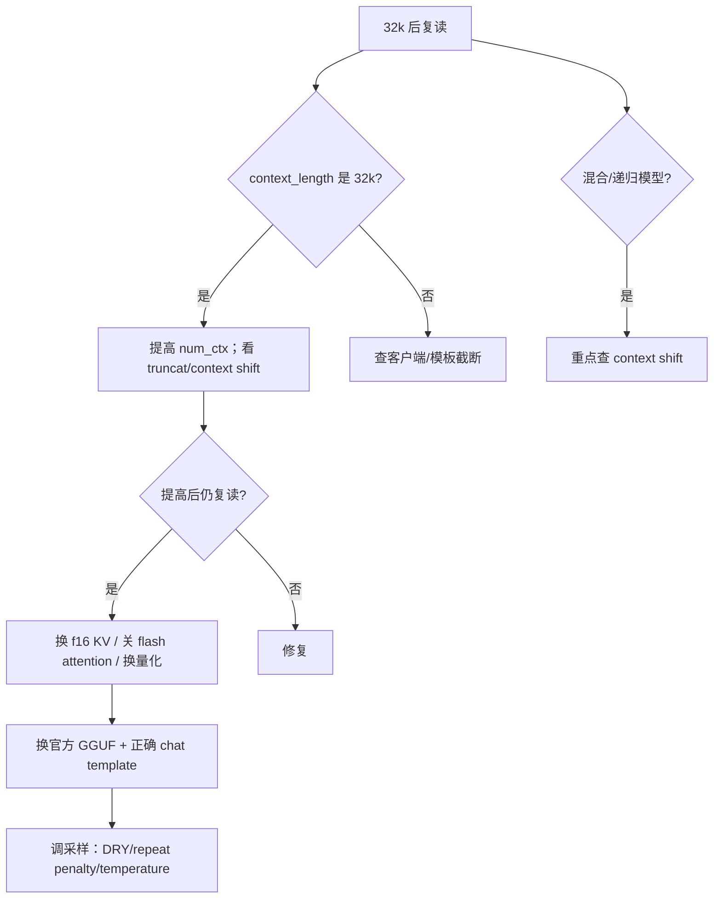

# 13.6 诊断实验：32k 复读、OOM、吞吐与质量

> **本节位置**：模块 13 · 从模型到服务 ｜ **前置**：[13.1](01-推理的数学.md)、[13.2](02-模型格式与量化.md)、[13.3](03-引擎解剖.md)、[13.4](04-调度与并发.md)、[13.5](05-选型与部署.md) ｜ **预计**：50 分钟
>
> **一句话**：排障不是“改参数试试”，而是**用最小实验把症状定位到某一层**：上下文、KV、调度、量化、模板，还是采样。

## 0. 场景引入

一周之内，你收到四张工单：

1. **复读**：LFM3 在 32k 后开始重复同一段话，换温度只能缓解。
2. **OOM**：7B Q4、32k、24 GB 卡，单请求能跑，开 4 并发就爆显存。
3. **吞吐上不去**：8×H100 跑 7B，64 并发，GPU 利用率只有 60%，P95 40 s。
4. **质量回退**：模型从 Q8 换到 Q4 后，长文问答准确率掉了 8 个点，但短问题看不出来。

四个症状看起来各不相同，但排障方法是同一套：

```text
症状 -> 先确认“运行时给的是什么” -> 再做单变量实验 -> 用数字定位 -> 修复 + 回归
```

## 1. 直觉

把排障想成医生分诊：

- **症状**是“发烧”，不是“病因”；
- **生命体征**是日志/指标：`n_ctx`、KV 占用、queue time、TTFT/TPOT、GPU 利用率；
- **化验**是单变量实验：只改一个东西，看数字怎么变；
- **回归**是治好后确认没有别的并发症。

> 💡 **一句话直觉**：**先问“运行时实际给了多少”，再问“模型实际看到了什么”，最后才问“模型本身行不行”。**

这个类比在哪里失效：人体有自愈，推理不会；医生的“经验”不能替代日志；一次改五个参数，看起来好了，但你不知道是哪一个起的作用。

## 2. 定义

### 2.1 症状、根因、复现

- **症状**：用户看到的（复读、超时、OOM、质量掉点）。
- **根因**：系统里真正的原因（上下文截断、KV 不足、模板错、量化误差）。
- **复现**：用固定模型/量化/硬件/prompt/采样，稳定重现。

没有复现，就没有诊断；只有“感觉”。

### 2.2 基线

基线是“已知正常”的配置：

- 同一模型，F16/Q8，短上下文；
- 同一引擎，默认采样；
- 同一硬件，单请求。

任何改动都和基线比，而不是和记忆比。

### 2.3 可观测性

| 层 | 看什么 |
| --- | --- |
| 运行时 | `ollama ps`、`/api/ps`、`nvidia-smi`、显存占用 |
| 引擎 | `n_ctx`、slot、queue、KV block、prefill/decode 时间 |
| 请求 | prompt tokens、output tokens、TTFT、TPOT、finish reason |
| 质量 | 任务准确率、困惑度、长文 needle、工具调用成功率 |

## 3. 为什么这样定义

因为 LLM 服务的故障经常“跨层”：

- 复读可能是上下文截断（运行时），也可能是采样/模板（模型侧）；
- OOM 可能是权重（格式），也可能是 KV（并发/上下文）；
- 吞吐低可能是 GPU（算力），也可能是 queue（调度）或 PCIe（卸载）；
- 质量回退可能是量化，也可能是模板/采样/评测集。

**不按层拆，就会在错误的层上改参数。** 例如：复读时先换模型，结果只是换了一个也会被截断的模型；OOM 时先加卡，结果 KV 还是按 32k 分配。

## 4. 性质与推导

### 4.1 复读的决策树



### 4.2 OOM 的账

$$
\text{显存} = W + KV + \text{activation} + \text{fragmentation}
$$

先算 KV：

$$
KV=2\cdot L\cdot H_{kv}\cdot d_k\cdot T\cdot b\cdot B
$$

7B、32k、$H_{kv}=32,d_k=128$、FP16：每序列 16 GiB；4 并发 = 64 GiB，24 GB 卡必爆。**不是模型太大，是 KV × 并发太大。**

### 4.3 吞吐低的三种常见原因

| 现象 | 可能原因 | 验证 |
| --- | --- | --- |
| GPU 利用率低、queue 高 | 并发超过 KV 预算/调度瓶颈 | 看 queue time、KV block、running/waiting |
| GPU 利用率高、TPOT 高 | batch 太大/KV 读取多 | 降 batch/上下文，看 TPOT |
| GPU 利用率低、CPU 高 | 权重/专家在 CPU、PCIe 瓶颈 | 看 CPU 占用、PCIe、offload 日志 |

### 4.4 质量回退的变量

| 变量 | 影响 | 验证 |
| --- | --- | --- |
| 权重量化 | 全任务/长文 | Q8 vs Q4 同 prompt |
| KV 量化 | 长文/注意力 | needle、长文 QA |
| chat template | 工具/格式/角色 | 对比官方模板 |
| 采样 | 复读/多样性 | 固定 seed，temp 0 |
| 评测集 | 结论是否可信 | 固定集、固定评分 |

## 5. 例子

### 5.1 LFM3 的 32k 复读

```bash
ollama ps
curl -s http://localhost:11434/api/ps | jq '.models[] | {name, context_length, size_vram}'
journalctl -u ollama -n 300 | grep -Ei "truncat|context shift|n_ctx"
```

如果 `context_length=32768`，先把 `num_ctx` 提到 64k/128k，`num_keep` 设到 system prompt 长度；再用 [llama.cpp](#ref-llamacpp-server-2026) `--no-context-shift` 对照。LFM3 的 32k KV 只有约 0.38 GiB，24 GB 卡完全放得下，**复读不是显存不够**。

### 5.2 7B、32k、24 GB、4 并发 OOM

- 权重 Q4 约 4 GB；
- 每序列 KV 16 GiB；4 条 = 64 GiB；
- 24 GB 卡即使 batch=1 也很紧（4+16+激活）。

修复顺序：

1. 降上下文到 8k/16k；
2. KV 量化到 FP8/int8（16→8 GiB）；
3. 降并发/排队；
4. 换 48/80 GB 卡。

**不要先加卡**：如果上下文和并发不变，加一张 24 GB 也不够 4×16 GiB。

### 5.3 8×H100、64 并发、P95 40 s

看三个数：

- queue time：如果很长，是调度/KV 不够；
- running/waiting：如果 waiting 堆积，是并发上限；
- GPU 利用率：如果 60%，不是算力不够，是“没活干/在等 KV”。

常见修复：降 `--max-model-len`、开 prefix cache、调 `--max-num-seqs`、加 TP/多机、把长文请求单独队列。

### 5.4 Q4 质量回退

不要只看“平均分”。固定评测集，比较：

- 短问答（可能没差异）；
- 长文 needle（KV/权重量化都敏感）；
- 工具调用（模板/格式敏感）；
- 代码（量化和采样都敏感）。

如果 Q4 在长文掉点，先试 Q5_K_M/Q6_K 或 FP8 KV；如果只有工具调用掉点，先查 chat template，不要怪量化。

### 5.5 场景闭环：一次 32k 复读的完整修复

**输入**：LFM3-1.7B Q4，Ollama，24 GB 卡，32k 后复读；用户希望“不换模型、不换卡”。

**计算**：权重 1.1 GB + 32k KV 0.38 GiB ≈ 1.5 GB，显存放得下；所以不是 OOM。查 `context_length` 是否为 32768，查日志是否有 `truncating input prompt`/`slot context shift`。

**输出**：把 `num_ctx` 提到 65536 或 131072，`num_keep` 设到 system prompt 长度；重载模型后用同一 prompt 复测；仍复读则用 llama.cpp `--no-context-shift` 对照。

**成本**：显存增加不到 1 GB；时间成本主要是重跑长文和对比输出；不需要换硬件。

**失败条件**：① 客户端覆盖 `num_ctx`；② GGUF 元数据/模型自带参数钳制；③ 模板/BOS 不一致；④ 混合模型的 shift 仍导致状态不一致。逐项排除后再怀疑模型质量。

## 6. 常见误区

1. **“复读 = 模型坏了”**  
   先查 `n_ctx`/截断/模板/采样；模型本身可能没问题。

2. **“OOM = 加卡”**  
   先算 KV × 并发；降上下文/KV 量化/降并发往往更便宜。

3. **“吞吐低 = GPU 差”**  
   可能是 queue、KV 不够、CPU offload、PCIe；看指标再换硬件。

4. **“量化一定掉点”**  
   Q8/FP8 通常很稳；Q4 在长文/工具上才明显。要分任务评测。

5. **“benchmark 就是我的负载”**  
   厂商的 batch/长度/量化/硬件不同；用自己的 prompt 和 SLO 复测。

## 7. 概念网络

- 前置：[13.1 推理的数学](01-推理的数学.md) —— 显存/带宽/延迟的账。
- 前置：[13.2 模型格式与量化](02-模型格式与量化.md) —— 量化/格式变量。
- 前置：[13.3 引擎解剖](03-引擎解剖.md) —— slot/scheduler/KV。
- 前置：[13.4 调度与并发](04-调度与并发.md) —— queue/batch/SLA。
- 前置：[13.5 选型与部署](05-选型与部署.md) —— 部署/网关/监控。
- 易混：[11.11 采样](../11-大模型专题/11-logits与采样.md) —— 复读既可能是采样，也可能是上下文。

- 架构侧：[11.7 KV Cache](../11-大模型专题/07-KVCache.md)、[11.9 量化](../11-大模型专题/09-量化.md)、[11.17 长上下文外推](../11-大模型专题/17-长上下文外推.md) —— 复读/OOM/质量回退。
## 8. 通往大模型

**出现位置**：线上告警、用户工单、模型升级、量化切换、上下文调整。

**形状**：诊断表是 `[症状, 指标, 实验, 判据, 修复]` 的矩阵；每条都要能复现。

**为什么需要**：没有这套表，你会把“32k 截断”当成“模型能力差”，把“KV 不够”当成“显卡坏了”，把“模板错”当成“量化掉点”。

**可检验结论**：7B/32k/4 并发需要 64 GiB KV，24 GB 卡不可能；LFM3/32k 只需约 0.38 GiB KV，复读应先查运行时。百B MoE 的专家缓存/CPU-GPU 并行可参考 [Strata](#ref-strata-2026)。两个结论都能用公式算出来。

一个 5 行的诊断记录器：

```python
def diagnose(ctx, kv_gib, gpu_gib, queue_ms, prefill_ms, tpot_ms):
    if kv_gib > gpu_gib * 0.8:
        return "KV 超预算：降上下文/KV 量化/降并发"
    if queue_ms > prefill_ms:
        return "排队为主：加并发上限/多卡/降请求"
    return f"prefill {prefill_ms} ms, TPOT {tpot_ms} ms：看 prefill/decode 谁大"

print(diagnose(32768, 64, 24, 100, 1000, 20))
```

常用命令：

```bash
# [Ollama](#ref-ollama-docs-2026)
ollama ps
journalctl -u ollama -n 300 | grep -Ei "truncat|context shift|n_ctx"

# llama.cpp
llama-server -m model.gguf -c 32768 -np 1 --verbose

# [vLLM](#ref-vllm-docs-2026)
vllm serve model --max-model-len 8192 --max-num-seqs 8
# 看 /metrics：queue、running、KV cache usage、TTFT/TPOT

# GPU
nvidia-smi
[nsys](#ref-nvidia-nsight-2026) profile --stats=true ...
```

## 9. 练习

1. 7B、32k、4 并发、24 GB 卡，为什么必 OOM？写出 KV 计算。
2. LFM3 32k 复读，为什么先查 `ollama ps` 而不是先换模型？
3. 8×H100、64 并发、GPU 利用率 60%、P95 40 s，先看哪三个指标？
4. Q4 后长文掉 8 个点，列出三个可能原因和对应实验。
5. 设计一个“上下文长度 vs 复读率”的实验：变量、控制、指标、判据。

<details>
<summary>参考答案</summary>

1. 每序列 16 GiB，4 条 64 GiB；24 GB 卡放不下权重+KV+激活。
2. 32k 正好是 Ollama 在 24–48 GB 显存档位的默认值；先确认运行时给了多少上下文，再怀疑模型。
3. queue time、running/waiting、KV cache usage/GPU 利用率。
4. 权重量化（Q4 vs Q8）、KV 量化（FP16 vs FP8）、模板/采样；分别做单变量 A/B，固定评测集。
5. 变量：上下文 8k/16k/32k/64k；控制：同模型/量化/采样/硬件；指标：复读率、困惑度、任务准确率；判据：复读率显著上升或准确率掉超过阈值。

</details>

## 10. 一页速记

- 排障顺序：先看运行时给了什么（`n_ctx`/KV/queue），再看模型看到了什么（模板/截断），最后才怀疑模型。
- OOM 先算 KV × 并发；复读先查 `num_ctx`/context shift；吞吐低先看 queue/KV/CPU offload。
- 质量回退分任务评测：短问答、长文、工具、代码；不要只看平均分。
- 单变量实验 + 固定基线 + 可复现，是诊断的三件套。
- 修复后跑回归：同一评测集、同一 SLO、同一硬件。

## 11. 参考文献与致谢

这一页的知识不是凭空来的。下面列出本页直接借用的文档。

- <a id="ref-ollama-docs-2026"></a>**Ollama 文档（2026）**：*Ollama Documentation*。上下文长度、`ollama ps` 与本地服务配置的官方说明。[docs.ollama.com](https://docs.ollama.com/)
- <a id="ref-llamacpp-server-2026"></a>**llama.cpp 维护者（2026）**：*llama-server*。`n_ctx`、slot、KV 类型与 context shift 的官方说明。[GitHub](https://github.com/ggml-org/llama.cpp/blob/master/tools/server/README.md)
- <a id="ref-vllm-docs-2026"></a>**vLLM 文档（2026）**：*vLLM Documentation*。调度、KV cache、prefix caching 与指标的官方说明。[docs.vllm.ai](https://docs.vllm.ai/)
- <a id="ref-strata-2026"></a>**Strata 作者（2026）**：*How does Strata work?*。专家缓存/CPU-GPU 并行的工程说明，用于诊断百B MoE 的瓶颈。[GitHub](https://github.com/Niko1221/Strata/blob/main/docs/HOW_IT_WORKS.md)
- <a id="ref-nvidia-nsight-2026"></a>**NVIDIA（2026）**：*Nsight Systems Documentation*。GPU/CPU 时间线与 kernel 级 profiling 的官方文档。[docs.nvidia.com](https://docs.nvidia.com/nsight-systems/)

---

上一篇 → [13.5 选型与部署](05-选型与部署.md) ｜ 下一篇 → [M13 导览](README.md)
