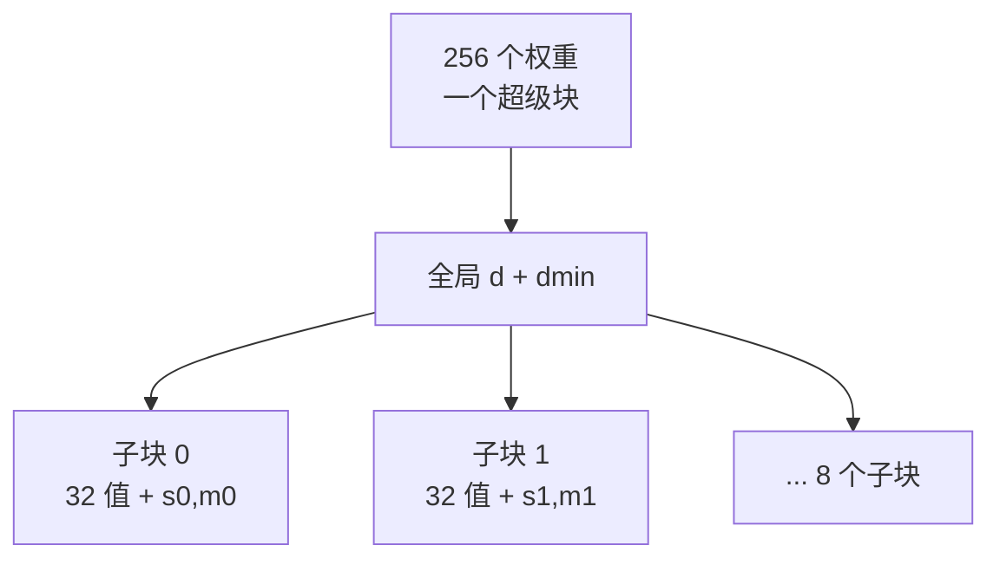
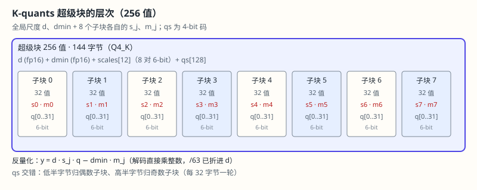

# 13.7 块与超级块量化：Q4_0 到 Q4_K

> **本节位置**：模块 13 · 从模型到服务 ｜ **前置**：[11.9 量化](../11-大模型专题/09-量化.md)、[13.2 模型格式与量化](02-模型格式与量化.md) ｜ **预计**：50 分钟
>
> **一句话**：Q4_0 用一把尺子量 32 个权重，Q4_K 用一把大尺子加 8 把小尺子量 256 个——同样 4.5 bpw，尺子不同，质量就不同。

## 0. 场景引入

你下载了一个 7B 模型，看见两个文件，体积几乎一样：

```text
model-Q4_0.gguf    约 3.9 GB
model-Q4_K_M.gguf  约 3.9 GB
```

下载页评论区说「Q4 都差不多」。你装上端侧盒子（8 GB 内存、50 GB/s），跑同一批 500 题中文问答（示意数字，按你的评测集估）：Q4_0 正确率约 61%，Q4_K_M 约 68%。体积差不到 1%，质量差 7 个点。换成 2-bit 的 Q2_K，体积降到约 2.3 GB，正确率掉到约 44%——压过头了。

问题不在「几 bit」，而在「这 4 bit 的尺子怎么切」。Q4_0 每 32 个权重共用一个尺度，遇到一块里大小混杂的权重，小值就被大值撑粗。Q4_K 把 256 个权重切成 8 个子块，每子块再修一次尺度。读完本节，你能回答：

1. 同为 4.5 bpw，Q4_0 与 Q4_K 的反量化公式差在哪，怎么手算？
2. 6-bit 尺度为什么在解码端「只乘不除」？除错了会发生什么？
3. 输出层为什么要升到 Q6_K，归一化为什么留 F32？

## 1. 直觉

把量化想成量身高。Q4_0 是全班共用一把刻度尺：你 190 cm 和同桌 150 cm 用同一把尺子，误差顶在同桌头上。Q4_K 先用一把大尺子量出全班身高段，再给每个小组配一把小尺子微调。



> 💡 **一句话直觉**：**Q4_K = 一把大尺子给量程，8 把小尺子修正局部。**

类比边界：真实权重分布不是身高那种单峰分布，有的通道全是小噪声、有的全是尖峰；子块修的是「分布不同」，不是「身高不同」。还有一个边界：尺子变多就是元数据变多，256 值摊 144 字节、32 值摊 18 字节，bpw 都是 4.5——**摊薄的前提是一个超级块够大**。

### 1.1 它在现实世界里对应什么

对应「体重秤量程 + 小刻度」：秤先按量程把指针打到 100 kg 段，再读小刻度增量。Q4_K 里全局 $d$ 是量程，子块 $s_j$ 是本段刻度；$d_{\min}$ 与 $m_j$ 负责平移（非对称的零点，见 [11.9 §3.1](../11-大模型专题/09-量化.md)）。

## 2. 定义

### 2.1 Q4_0：最简的块格式

每块 32 个权重，18 字节（[GGUF 规范](#ref-gguf-2024)）：

```text
块 = [d: fp16 2 字节] + [qs: 16 字节]，共 18 字节
```

16 字节装 32 个 4-bit 码（半字节 nibble 打包）：第 $j$ 个码是 `qs[j] & 0xF`，第 $j+16$ 个是 `qs[j] >> 4`。反量化：

$$
y_i = d\cdot(q_i-8),\qquad q_i\in[0,15]
$$

这个式子说的是：码字先减 8 回到 $[-8,7]$ 的对称整数，再乘全局尺度 $d$。减 8 不花额外字节，零点固定为 8。于是

$$
\text{bpw}=\frac{18\times8}{32}=4.5
$$

### 2.2 Q8_0：近无损基线

同结构，码为有符号 int8，32 个码直接存为 `qs[32]`：

$$
y_i = d\cdot q_i,\qquad q_i\in[-128,127]
$$

每块 34 字节，$\text{bpw}=34\times8/32=8.5$。8-bit 码的舍入误差明显更小，所以 Q8_0 常当「量化正确性」的参照：新格式的误差若比 Q8_0 还大，多半是解码写错了。

### 2.3 K-quants：超级块与统一骨架

K-quants 把 256 个权重绑成一个**超级块**（super-block），切成 8 个 32 值**子块**。两级尺度的叙事参考 [GGUF 量化内幕](#ref-datawhale-2026)（原创改写，字节数以 llama.cpp 源码为准）。统一反量化骨架是：

$$
y_i = d\cdot s_j\cdot q_i - d_{\min}\cdot m_j
$$

逐项读法：$j$ 是子块编号（0–7）；$q_i$ 是 4-bit 小码（0–15）；$s_j,m_j$ 是子块的 6-bit 整数尺度/最小值（0–63）；$d,d_{\min}$ 是超级块的 fp16 全局尺度与全局最小值尺度。解码时**直接乘整数 $s_j,m_j$，不再除以 63 或 64**——归一化已在量化端做完：量化端取 $d=\max s/63$、$d_{\min}=\max m/63$，把除法折进全局尺度（[llama.cpp 量化说明](#ref-llamacpp-quantize-2024)）。



Q4_K 的布局（144 字节/256 值）是：`d`(2) + `dmin`(2) + `scales[12]` + `qs[128]`。其中 `scales[12]` 装 8 对 6-bit 数（$8\times12=96$ bit $=12$ 字节），`qs[128]` 按「32 个低半字节 → 子块偶数号、32 个高半字节 → 子块奇数号」交错排布。$\text{bpw}=144\times8/256=4.5$。Q5_K 在此基础上多一个高位平面 `qh[32]`（176 字节，5.5 bpw）；Q6_K 用 16 个 16 值子块、去掉 $m$（210 字节，6.5625 bpw），更适合输出层。

## 3. 为什么这样定义

单一尺子的痛点在 [11.9 §4.5](../11-大模型专题/09-量化.md) 的尺度失配：一个 32 值块里若混着近零小值和大 outlier，最优的单一尺子被大值决定，小值只能落到 0 或同一码。256 值超级块 + 8 子块的折中是：

- **32 的子块**足够小，能跟踪局部分布（权重在通道间高度异质）；
- **256 的超级块**足够大，把全局尺度（$d,d_{\min}$ 共 4 字节）摊到约 $4/256$ 字节/权重，可忽略；
- 与 SIMD 宽度对齐，解码时两个子块可并行。

### 3.1 反事实：删掉子块修正会怎样

设超级块前 128 个权重在 $\pm0.01$ 附近，后 128 个在 $5.0$ 附近。用单一 $s=\max|x|/7$ 时，$s\approx0.71$，前半最大值 $0.01$ 只剩 $0.014$ 个刻度，四舍五入全为 0——半块权重凭空消失。K-quants 给前半子块 $s_j$ 小、后半 $s_j$ 大（或直接把 $d_{\min},m_j$ 抬高），前半的刻度细到 $0.001$，后半的刻度粗到 $0.5$。**同一 4-bit 码，在不同子块里代表不同的物理尺度。** 这正是 4.5 bpw 同价不同质的来源。

## 4. 性质与推导

### 4.1 6-bit 归一化的陷阱

量化端把子块的真实尺度 $\hat{s}_j$ 归一化成整数 $s_j=\operatorname{round}(63\hat{s}_j/\max\hat{s})$，并存 $d=\max\hat{s}/63$。解码时 $d\cdot s_j \approx \hat{s}_j$，误差只剩量化 $s_j$ 的舍入（$\le 0.5/63$）。**若解码端误加一次除以 63，$d\cdot s_j$ 会再小 63 倍**，重建值整体缩水，logits 分布垮掉——文件却能打开、`llama-cli` 也能吐字（错字）。跨实现读取时，先对的解码端公式再是「直接乘」。

### 4.2 bpw 家族地图

| 格式 | 每块权重 | 块字节 | bpw | 备注 |
|---|---|---|---|---|
| Q4_0 | 32 | 18 | 4.5 | 单尺度，减 8 |
| Q8_0 | 32 | 34 | 8.5 | 近无损基线 |
| Q2_K | 256 | 84 | 2.625 | 16 子块×16 值，2-bit 码 |
| Q3_K | 256 | 110 | 3.4375 | 16 子块×16 值，3-bit 码 |
| Q4_K | 256 | 144 | 4.5 | 8 子块×32 值，主体 4-bit |
| Q5_K | 256 | 176 | 5.5 | Q4_K 骨架 + 高位平面 |
| Q6_K | 256 | 210 | 6.5625 | 16 子块×16 值，无 $m$，输出层常用 |

Q2_K/Q3_K 把子块再切到 16 值，是因为 2/3-bit 码的自由度太低，只能靠更细的尺度补——但单个子块只有 16 个权重摊尺度，尺度位宽被挤到 4 bit。**这就是「粒度→质量」的最后一道边界**：再细就摊不住了。

### 4.3 尺度 fp16 的底噪

$d$ 以 fp16 存，相对误差 $\le 2^{-11}\approx4.9\times10^{-4}$。4-bit 码的舍入误差是满量程的约 $1/30$，$2^{-11}$ 可忽略；1–2 bpw 码本格式的码步已和它同阶，$2^{-11}$ 就成了底噪的一部分。只用公式算 bpw 时，把尺度字节计入即可，不要假设 $d$ 精确。

## 5. 例子

### 5.1 手算：Q4_0 的交错解码

设一位解码器给 $d=0.1$，`qs[0]=0x5C`（低半字节 12，高半字节 5）。于是

$$
y_0=(12-8)\times0.1=0.4,\qquad y_{16}=(5-8)\times0.1=-0.3
$$

读作：`0x5C` 的低 4 位是第 0 个权重，高 4 位是第 16 个权重；都在无符号码上减 8，再乘同一尺度。**位置错了（把高低半字节互换），一半权重符号翻转**，但字节数不变——这类 bug 只能靠字节级断言抓，不能靠「跑起来了」。

### 5.2 手算：K-quants 子块的直接乘

取超级块 $d=0.02$、$d_{\min}=0.01$，子块 0 的 $(s_0,m_0)=(10,5)$，子块 1 的 $(s_1,m_1)=(20,2)$，且 $q=7$（两子块同码）：

$$
y^{(0)}=0.02\times10\times7-0.01\times5=1.35,\quad
y^{(1)}=0.02\times20\times7-0.01\times2=2.78
$$

子块 0 的有效步长是 $0.2$，子块 1 是 $0.4$；同一整数码重建出不同物理值。若解码端误除以 63，$y^{(0)}$ 会变成 $0.021$，数值缩了一个数量级以上。**记忆点：$s_j$ 是整数，$d$ 里已含 $/63$。** 完整 144 字节的解码器见 [lab14](../labs/lab14_gguf量化.py)。

### 5.3 场景：解剖一份 Q4_K_M

```python
# 需 pip install gguf
from collections import Counter
from gguf import GGUFReader
reader = GGUFReader("model-Q4_K_M.gguf")
print(Counter(t.tensor_type.name for t in reader.tensors).most_common())
```

典型输出是金字塔：主体 Q4_K（数十到上百张量），输出嵌入层 Q6_K（1–2 张量），归一化及部分嵌入 F32。**结论：`_M` 是分配策略，不是新编码。** 输出层升到 Q6_K 是因为它直达 logits、无平滑（见 [13.2 §4.6](02-模型格式与量化.md#4-性质与推导)）；归一层留 F32 是因为省下的字节不值得。

### 5.4 场景闭环：8 GB 盒子上的 7B

**输入**：7B，8 GB 内存，50 GB/s，温度 0.2，上下文 2k。**计算**：Q4_0 与 Q4_K_M 都约 3.9 GB，文件大小几乎一样；但 Q4_0 的小尺度子块被大尺子撑粗（§3.1），回归 PPL 恶化更甚；换 Q2_K（2.625 bpw）约 2.3 GB，剩余预算可装更多 KV，但任务能力开始断崖。**输出**：选 Q4_K_M；若显存更紧，降到 IQ2/IQ3（另篇），不要退回单尺度 Q4_0。**成本与失败**：①解码端多除以 63，模型可跑但回答乱码；②只看文件大小，误把 Q4_0 当平替；③把输出层也打成 Q4，短问答无感、长文概率校准掉点。

## 6. 常见误区

1. **误区**：Q4_K_M 是一种新的 ggml 类型。**纠正**：GGUF 里只有 Q4_K、Q6_K、F32 等类型，`_M` 是逐张量分配策略的文件级名字（§5.3）。
2. **误区**：解码要把 6-bit 数除以 63（或 64）。**纠正**：除法已折进 $d,d_{\min}$，解码端直接乘整数（§4.1）。
3. **误区**：子块越小越好。**纠正**：子块小到 16 值时，尺度摊薄不足，只能压到 4-bit，Q2_K/Q3_K 的收益递减（§4.2）。
4. **误区**：尺度用 fp16 存，所以尺度没误差。**纠正**：有 $2^{-11}$ 相对底噪，4-bit 下可忽略，1–2 bpw 下不可（§4.3）。

## 7. 概念网络

- 前置：[11.9 量化](../11-大模型专题/09-量化.md) —— 仿射量化、$s/2$ 界与误差三分法。
- 前置：[13.2 模型格式与量化](02-模型格式与量化.md) —— GGUF 容器、bpw 与逐张量敏感度。
- 前置：[10.1 浮点数与误差](../10-数值线性代数/01-浮点数与误差.md) —— fp16 相对误差与舍入。
- 后续：[13.3 引擎解剖](03-引擎解剖.md) —— 谁按 `type` 分派、谁跑 `vec_dot` 内核。
- 易混：Q4_0 的 `-8` 是存储偏移（零点固定为 8），Q4_K 的 `d_min·m_j` 是逐子块真实偏移，别混为「都是减法」。

## 8. 通往大模型

**出现位置**：`llama-quantize model-f16.gguf model-Q4_K_M.gguf Q4_K_M` 生成的每个权重张量；`llama.cpp` 中 `type_traits[type]` 指向 `block_q4_K` 与其反量化函数。

**形状**：一个 $4096\times4096$ 权重矩阵按 256 值切片为 $65536$ 个超级块，每超级块内 $[256]$ 个码 + 8 对子块参数；反量化后形状不变，仍是 $[4096,4096]$ 浮点矩阵。

**为什么需要**：不知道统一骨架，你只会背「Q4_K 比 Q4_0 好」；知道骨架，你能在任何新格式上回答「它的子块多大、尺度在哪里、归一化在谁那边」。

**可检验结论**：手写一个 3 维验证——随机权重按子块统计方差，子块方差比越大，Q4_0 与 Q4_K 的重建误差差越大；方差均匀时，两者差距收窄（见 lab14 第 3 节）。

```python
import struct
# Q4_0 反量化：d 为 fp16、qs 为 nibble 打包
def deq_q4_0(block: bytes):
    d = struct.unpack("<e", block[:2])[0]
    y = [0.0] * 32
    for j in range(16):
        y[j] = d * ((block[2 + j] & 0xF) - 8)
        y[j + 16] = d * ((block[2 + j] >> 4) - 8)
    return y
```

## 9. 练习

1. **概念**：Q4_0 与 Q4_K 同为 4.5 bpw，为什么质量不同？用「尺度失配」一句话解释。
2. **计算**：Q4_0 块中位置 0 的 nibble 为 12，位置 16 的 nibble 为 5，$d=0.1$。求 $y_0,y_{16}$。
3. **计算**：超级块 $d=0.02$、$d_{\min}=0.01$，$(s_j,m_j)=(10,5)$，$q=7$。求 $y$；若误除以 63，结果是多少？
4. **计算**：Q4_K 块 144 字节/256 权重，bpw 是多少？Q6_K 210 字节 bpw 是多少？
5. **开放**：用 `GGUFReader` 统计一份 Q4_K_M 文件的张量类型分布，哪几类张量升降了精度？为什么？

<details>
<summary>参考答案</summary>

1. 同为 4.5 bpw，Q4_0 只有一个全局尺度，块内异质性变成尺度失配误差；Q4_K 用 8 个子块各配一对尺度/最小值，把失配摊到各子块，误差更小。
2. $y_0=(12-8)\times0.1=0.4$，$y_{16}=(5-8)\times0.1=-0.3$。交错位：低半字节是前 16 个，高半字节是后 16 个。
3. $y=0.02\times10\times7-0.01\times5=1.35$；误除 63 得 $1.35/63\approx0.021$。除法已折进 $d$，解码端只乘。
4. Q4_K：$144\times8/256=4.5$；Q6_K：$210\times8/256=6.5625$。
5. 主体 Q4_K，输出层 Q6_K，归一化等 F32。输出层直达 logits 无平滑需更高精度；归一化缩放敏感留 F32；中间层可承受主体精度。

</details>

## 10. 一页速记

- Q4_0：$y=d(q-8)$，18 B/32 值，4.5 bpw。
- K-quants 统一式：$y=d\cdot s_j\cdot q-d_{\min}\cdot m_j$，256 超级块 + 8 子块。
- 6-bit 不除：$d$ 已含 $/63$，解码直接乘整数。
- Q4_K 144 B/256 值，4.5 bpw；Q5_K 高位平面，Q6_K 输出层常用。
- Q4_K_M 是混合策略：输出升 Q6_K、归一留 F32。

## 11. 参考文献与致谢

这一页的知识不是凭空来的。下面列出本页直接借用的规范、工具与权威整理；正文中的人名、定理名已链接到对应条目。链接优先指向 DOI、arXiv 或可长期访问的原文存档。

- <a id="ref-gguf-2024"></a>**GGUF 维护者（2024）**：*GGUF File Format Specification*。GGUF 的 header、metadata、tensor 与量化类型定义，支撑本页 18/144 字节的块布局。[GitHub](https://github.com/ggml-org/ggml/blob/master/docs/gguf.md)
- <a id="ref-llamacpp-quantize-2024"></a>**llama.cpp 维护者（2024）**：*Quantize*。K-quants 与 `llama-quantize` 的说明，支撑本页两级尺度与 6-bit 直接乘约定的表述。[GitHub](https://github.com/ggml-org/llama.cpp/blob/master/tools/quantize/README.md)
- <a id="ref-datawhale-2026"></a>**DatawhaleChina（2026）**：*GGUF 量化内幕*。本页的「Q4_0→Q4_K 两级跃迁」叙事与块族谱图受本教程启发，为原创改写；字节数以 llama.cpp 源码为准。[GitHub](https://github.com/datawhalechina/gguf-quant-internals)

---

上一篇 → [13.6 诊断实验](06-诊断实验.md) ｜ 下一篇 → [13.8 码本与三值](08-码本与三值.md)
