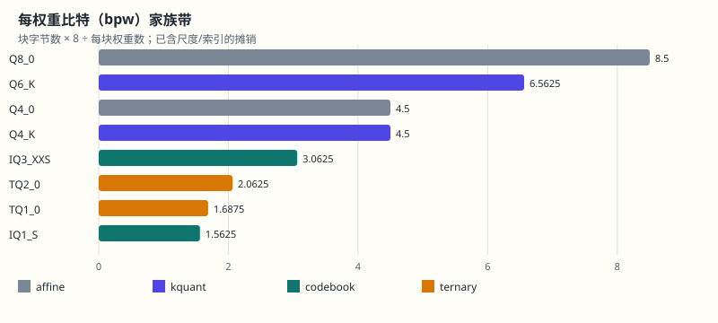
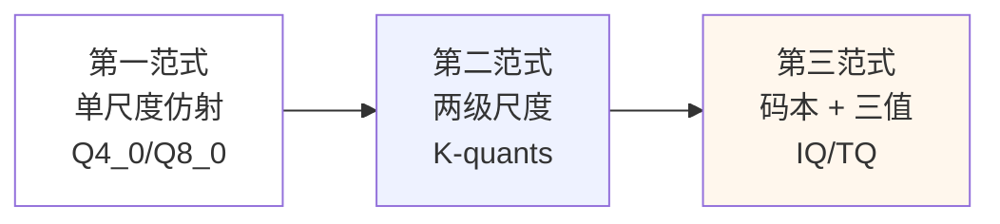

# 13.8 码本与三值：极低比特的范式跃迁

> **本节位置**：模块 13 · 从模型到服务 ｜ **前置**：[11.9 量化](../11-大模型专题/09-量化.md)、[13.7 块与超级块量化](07-块与超级块量化.md) ｜ **预计**：50 分钟
>
> **一句话**：4-bit 还在「用格子吸附」，1.5-bit 已在「用词典找句子」——范式变了，误差的来源也变了。

## 0. 场景引入

你已经会算 [13.7](07-块与超级块量化.md) 的 4.5 bpw 了。现在下载页又冒出两个更狠的选项（同一 7B 模型，示意体积）：

```text
Q4_K_M   约 3.9 GB（4.5 bpw）
IQ1_S    约 1.4 GB（1.5625 bpw，50 字节/256 值）
```

IQ1_S 只有 Q4_K 的四分之一体积。能不能直接替换？把 IQ1_S 灌进原来的 Q4_K 解码器，输出立刻乱码——不是模型坏了，是**码表错位**：它存的不是「整数码」，是「指向 2048 项码本的索引」。另一边，三值格式 TQ1_0 只用 1.6875 bpw，短问答无感，推理题却断崖。读完本节，你能回答：

1. 为什么仿射量化在 2 bpw 以下「失效」？失效的数学形状是什么？
2. imatrix 到底在加权什么？它和 [04 最小二乘](../04-线性方程组/04-最小二乘.md) 有什么关系？
3. TQ1_0 与 STQ1_0 有什么区别？为什么缺了 Hadamard 变换权重会「能解但解错」？

## 1. 直觉

把权重压缩想成翻译顺序。

- **仿射量化**：词典固定，把每个词都吸附到等距格子上；
- **码本量化**：词典是一张「8 词小短语」手册，压缩时要把 8 个权重当作一句话，找到最像的短语；
- **三值量化**：每个词只许三种答案——负、零、正——连短语都不敢多造。

> 💡 **一句话直觉**：**4-bit 在格子上就近，1.5-bit 在码本里找邻居；越低比特，越要靠「共同结构」换「单独精度」。**

这个类比在哪里失效：码本查找不是查字典单词，是在连续向量空间里做最近邻，算的是距离，不是字符串匹配；三值的「零」也不是删除词，而是把权重与激活压到同一点。还有一个边界：码本只管压缩，不管推理快慢——查表后还要反量化，低 bit 仍可能因解码复杂而变慢（见 [13.2 §4.4](02-模型格式与量化.md)）。

### 1.1 它在现实世界里对应什么

对应「体重秤 vs 零钱包」之外的另一种活法：钱包里只放有限种零钱组合（比如 1 元、5 元、1 元加 5 元这些组合），买东西时直接翻钱包找最接近的组合；IQ 码本就是可提前印好的一张组合表，量化时只存组合编号。边界是：钱包的零钱组合是固定的、可数的；码本的「最接近」仍要靠搜索（按激活重要性加权的距离），不是随便摊币。

## 2. 定义

### 2.1 仿射量化在 2 bpw 以下为什么失效

仿射量化的码字是 $2^b$ 个等距点。4-bit 有 16 个点，重尾权重分布的中间密集区还能分到 3–4 个点；降到 2-bit 时整网只有 4 个等距点，中间密集区只剩 1–2 个点，大量小权重塌缩到同一点，相对误差超过信号本身（见 [11.9 §4.5](../11-大模型专题/09-量化.md) 的尺度失配）。这不是算法没调好，是**均匀网格在低码率下信息论过粗**——等距点多一点也救不了。

### 2.2 码本与 imatrix

**码本（codebook）**：一张映射表，每一行是一只 8 维固定向量。量化时把一段 8 个权重当作向量 $\mathbf{w}$，找码表里最近的一行 $\mathbf{c}_{k^*}$：

$$
k^*=\arg\min_k\|\mathbf{w}-\mathbf{c}_k\|_2,\qquad \hat{\mathbf{w}}=\mathbf{c}_{k^*}
$$

解码后只算查表号，误差由「最近邻选错没有」决定，不再是连续的尺度失配（见 [QuIP 开源说明](#ref-chee-2023) 的向量量化思路）。文件里存的是索引而不是浮点数，IQ1_S 的每项索引指向 2048 项码本（每行 int8[8]）。

**重要性矩阵（imatrix）**：一个与权重同形、逐位置记录激活重要性的浮点集。加权搜索的目标从均匀均方误差改为：

$$
\min \sum_i \alpha_i(x_i-\hat x_i)^2
$$

这个式子说的是：激活越大的方向，估错的每一分钱越贵，预算要往这些位置倾斜。这是最小二乘的亲戚——经典最小二乘在所有位置一视同仁，这里按 $\alpha_i$ 给每个残差贴权（激活幅度通常由校准数据统计得到）。

### 2.3 三值、base-3 与 Hadamard 折叠

三值把每个权重只许取 $\{-d,0,+d\}$ 三种值。理论上每个权重只需 $\approx1.585$ bit（$\log_2 3$），但塞进字节需要打包：5 个 trit（$3^5=243<256$）刚好打进 1 字节，TQ1_0 即用此方案。**难点不在三值本身，在零的放置与坐标系。**

- **3:4 结构化稀疏（STQ1_0，fork）**：每 4 个权重恰好 1 个零、5 bit 组合值、32 种固定模式；零的位置是定的，适合硬件流式解码，但灵活性最低。
- **Hadamard 旋转（PTQ1_0，fork；TQ1_0/TQ2_0 主线用同一思想）**：把权重先在 Hadamard 基下旋转，把能量摊平、把离群值压低，再做三值舍入。折叠的要义是把旋转预乘进权重再存文件，推理时只剩三值查表；**若没折叠就当原始权重读，相当于用错坐标系，logits 全错**（[QuIP# 的 Hadamard 不相干讨论](#ref-tseng-2024)）。

| 组 | 格式 | 状态 | 结构 | 字节/权重数 | bpw |
|---|---|---|---|---|---|


| 仿射 | Q4_K | 主线 | 8 子块两级尺度 | 144/256 | 4.5 |
| 码本 | IQ1_S | 主线 | 2048 项码本查表 | 50/256 | 1.5625 |
| 码本 | IQ3_XXS | 主线 | 4 值/项码本 | 98/256 | 3.0625 |
| 三值 | TQ1_0 | 主线（type 34） | base-3 5 trit/字节 | 54/256 | 1.6875 |
| 三值 | TQ2_0 | 主线（type 35） | 2-bit 三值 | 66/256 | 2.0625 |
| 三值 | STQ1_0/PTQ1_0 | fork/PR | 3:4 稀疏/稠密 base-3 | ——/256 | 演进中 |

叙事参考 [GGUF 量化内幕](#ref-datawhale-2026)（原创改写，字节数以 llama.cpp 源码为准）。

## 3. 为什么这样定义



三范式的分界不是名字，是**失效模式变了**：单尺度失效在分布异质性（§13.7），两级尺度失效在 2 bpw 以下码率不足，第三范式失效在码本覆盖不足与任务阈值。而质量判断也必须跟换：仿射的 PPL 恶化是平滑曲线，三值劣化是断崖（阈值效应）——把断崖外推成平滑曲线，本身就是误读。

### 3.1 反事实：不用 imatrix 会怎样

设某通道与激活强相关（经常出现大量正输入），其权重量化误差会被 $\mathbf{x}$ 原样放大（见 [11.9 §4.2](../11-大模型专题/09-量化.md) 的 $E\mathbf{x}$）。均匀 MSE 会把预算平均分摊，强通道与弱通道的尺子一样粗；加权 MSE 把强通道的残差重量调大，量化器会自动在强通道上收紧尺度、给弱通道留几个刻度。**去掉 $\alpha_i$，加权就退回均匀，强通道的刻度变粗**——长文或特定 token 下才暴露，仿真 MSE 反而看不见。

## 4. 性质与推导

### 4.1 三个公式的谱系

| 范式 | 反量化要点 | 误差主导项 |
|---|---|---|
| Q4_0 | $y=d\cdot(q-8)$ | 尺度失配 |
| Q4_K | $y=d\cdot s_j\cdot q-d_{\min}\cdot m_j$ | 舍入 + 残余失配 |
| IQ1_S | $\hat{\mathbf{w}}=\mathbf{c}_k$ 查表 | 最近邻索引错 + 码本覆盖 |
| TQ1_0 | $\hat w\in\{-d,0,+d\}$ | 阈值/零位判定 |

读表顺序是自下而上：先看查表还是算式，再看误差在手算里该查到哪一项。

### 4.2 UD 是策略不是编码

`UD-IQ1_S` 拆开一看是金字塔：主体 IQ1_S、敏感张量升 IQ2_XXS/Q4_K、输出层 Q6_K、归一化 F32。它不改码的打法，只改「哪一层用哪个码」——外部搜索按敏感度逐张量分配。**同名不复现**：搜索依赖校准集，先验、温度、目标不同，就可能产出不同字节，所以同名字段亦可能不同。它与正常 Q4_K_M 是同一个思想：金字塔都由敏感度决定，见 [13.7 §5.3](07-块与超级块量化.md#5-例子)。

### 4.3 Hadamard 为什么必需

Hadamard 矩阵的元素是 $\pm1$ 构成的正交阵。旋转不改 L2 范数，却能把「少数尖峰 + 大片零」变成「能量摊平的均匀混合」。三值舍入给每个值只许三种去向，旋转后的尖峰摊平可以让每个分量都分到一级尺度，而不是一个分量撑大取整个量程。**无旋转的尖峰三值化**近乎全被零或 $\pm d$ 取代；**旋转后全是非零小值**，每个分量都有合法的 $\pm d$ 去向。折叠缺失时，解码器拿到的 $\hat{\mathbf{w}}$ 仍是旋转坐标系里的三值，却被当原始坐标系反量化，数值扭曲（ logits 全错）。

## 5. 例子

### 5.1 手算：8 维码本最近邻

设 8 维权重段 $\mathbf{w}=(2,0,0,0,0,0,0,0)$（只在首分量有峰）。码本两行：$\mathbf{c}_A=(1,0,0,0,0,0,0,0)$，$\mathbf{c}_B=(0,1,0,0,0,0,0,0)$。距离是 $\|\mathbf{w}-\mathbf{c}_A\|_2=1$ 对 $\sqrt{5}\approx2.24$，选 A。若不加权，残差是 $(1,0,\ldots)$；加权 MSE（设 $\alpha_1=4$，其余为 1）也选 A，但边际差更悬殊：加权距离 $4\times1$ 对 $8+1=9$。**换权重换信心的来源**：这里只看首分量对结果的放大，结论由加权决定。

### 5.2 手算：5 trit 打包

取 5 个三值 $\{0,1,2\}$（其中 0/1/2 代表 $-d,0,+d$ 种映射）：$(2,0,1,1,0)$。按 base-3 凑数字：

$$
N=2\cdot3^4+0\cdot3^3+1\cdot3^2+1\cdot3+0=162+0+9+3=174
$$

$174<256$ 刚好塞进 1 字节；解码时逐除 3 恢复。注意**每个权重理论上只值 $\log_2 3\approx1.585$ bit，但 5 个权重打进 1 字节是 $1.6$ bpw**——打包不能把余数省掉。3:4 稀疏方案则不用 base-3，而是让每组 4 个值恰好 1 个零，省的是位置编码；两者零的代价完全不同。

### 5.3 场景闭环：TQ1_0 在两个任务上的一刀两面

**输入**：同一 TQ1_0 权重，短问答集 + 长推理集（示意）。**计算**：短问答上 PPL 恶化小，正确率几乎不变；长推理（算术、代码、多跳）上显著下跌。**输出**：两项结果放在同一坐标下，TQ1_0 可看作短问答可用、推理不可用；**只用 PPL 平均给出一个分数，会超出可用范围**。**失败条件**：①把 TQ1_0 当思维链模型；②把 fork 的 STQ1_0 当准主线规格；③缺失折叠后仍当通用权重离线处理。

## 6. 常见误区

1. **误区**：IQ1_S 只是「更小的 Q4_K」。**纠正**：IQ1_S 存的是查表索引，不走 $y=d\cdot q$ 的算术；解码先查码本行（§2.2）。
2. **误区**：imatrix 越精细总越好。**纠正**：imatrix 依赖校准分布，分布一偏，强方向被错估，精度反而浪费（§3.1）。
3. **误区**：UD 是新的编码格式一次进化。**纠正**：UD 是逐张量分配策略，编码全是老格式（§4.2）。
4. **误区**：三值就是把更小数归到同一点所以总能跑。**纠正**：阈值效应是任务断崖，PTQ1_0 缺折叠会系统错；且 STQ/PTQ 未合入主线（§2.3、§5.3）。

## 7. 概念网络

- 前置：[11.9 量化](../11-大模型专题/09-量化.md) —— 仿射量化、误差传播 $E\mathbf{x}$。
- 前置：[13.7 块与超级块量化](07-块与超级块量化.md) —— 块级 bpw、两级尺度、混合策略。
- 前置：[04 最小二乘](../04-线性方程组/04-最小二乘.md) —— 加权残差的正规方程（$\alpha_i$ 权重版）。
- 后续：[13.3 引擎解剖](03-引擎解剖.md) —— 按 `type` 分派查表、新增格式的注册。
- 易混：**码本索引错 ≠ 尺度错**；前者是查错行，后者是刻度粗；PPL 好 ≠ 任务可用**（阈值效应）。

## 8. 通往大模型

**出现位置**：`llama-quantize` 选 IQ/TQ 格式时按激活统计生成 imatrix；`llama.cpp`、candle、transformers.js 等按 `type` 分派码本/三值解码。

**形状**：8 维权重块查表后形状不变；三值旋转前的 $[D,D]$ 矩阵乘 Hadamard 仍是 $[D,D]$，折叠只变坐标不降秩。

**为什么需要**：不知道加权，极低比特会错估激活影响；不知道查表，你会把 IQ1_S 当 Q4_K 的别名；不知道折叠，你会把 PTQ 字节解出来的三值直接喂给未旋转的激活。

**可检验结论**：把同一段权重分别做均匀 MSE 与加权 MSE，强激活通道上的舍入误差更小；且 TQ1_0 的短问答与长推理变化不会回归到同一曲线（见 lab14 第 6 节）。

```python
import math

def weighted_q_error(w, w_hat, alphas):
    return math.sqrt(sum(a * (x - y) ** 2 for x, y, a in zip(w, w_hat, alphas)) / sum(alphas))

# 校准：激活越大的方向，alpaha越大
w = [2.0, 0.1, -0.05, 0.02]
alphas = [4.0, 0.5, 0.5, 0.5]
print(weighted_q_error(w, [1.9, 0.0, 0.0, 0.0], alphas))
```

## 9. 练习

1. **概念**：IQ1_S 与 Q4_K 都叫「量化」，为什么一份 Q4_K 解码器打开 IQ1_S 会错？误差主导项各是什么？
2. **计算**：三值 $\{+d,0,-d\}$ 各出现 5 个，$d=0.1$。base-3 $N=102$（先存 $+d$ 的记 2、$0$ 记 0、$-d$ 记 1，判为 5 trit 是否足以塞满 1 字节？理论 $\log_2 3$ 是几？真实 bpw 是几？）
3. **计算**：IQ1_S 50 字节/256 值，bpw 是多少？TQ1_0 54 字节/256 值，bpw 是多少？
4. **场景**：TQ1_0 短问答 82%、推理 55%，Q4_K_M 短问答 84%、推理 78%。你会把 TQ1_0 用在什么场景？说明弃用理由。
5. **开放**：设计一个 TQ1_0 的上线门槛：要测哪两个任务、什么算「断崖」？

<details>
<summary>参考答案</summary>

1. IQ1_S 存索引、查码本行（$\hat{\mathbf{w}}=\mathbf{c}_k$），误差在最近邻选择与码本覆盖；Q4_K 存整数码、乘尺度，误差在舍入与尺度失配。前者用错解码器相当于把索引当码值。
2. $3^5=243<256$，5 trit 恰塞 1 字节；理论每值 $\log_2 3\approx1.585$ bit，真实 $8/5=1.6$ bpw（忽略 $d$），带 $d$ 摊销后约 1.6875（TQ1_0）。
3. IQ1_S：$50\times8/256=1.5625$；TQ1_0：$54\times8/256=1.6875$。
4. 短问答（事实检索、分类）可用；推理场景弃用，因为阈值效应只在高维推理上先断。客服短问答用，代码/数学等用 Q4_K_M 或 Q8。
5. 两任务并测：短问答基线 + 长推理基线；若推理掉幅度超过声明阈值（如 10 个点）即判断崖，未过则不上线。

</details>

## 10. 一页速记

- 仿射在 2 bpw 下因等距网格过粗失效，改查码本最近邻。
- imatrix = 加权最小二乘 $\min\sum\alpha_i(x_i-\hat x_i)^2$（激活大的方向更贵）。
- IQ1_S 50 B/256，1.5625 bpw；TQ1_0 54 B/256，1.6875 bpw（主线）。
- 三值 = $\{-d,0,+d\}$，$\log_2 3$ 下限、base-3 打包；缺 Hadamard 折叠即用错坐标系。
- UD 是逐张量策略，不是新编码；阈值效应：平滑外推会漏断崖。

## 11. 参考文献与致谢

这一页的知识不是凭空来的。下面列出本页直接借用的工作与权威整理；正文中的人名、定理名已链接到对应条目。链接优先指向 DOI、arXiv 或可长期访问的原文存档。

- <a id="ref-chee-2023"></a>**Chee 等（2023）**：*QuIP: 2-bit Quantization of Large Language Models With Guarantees*。向量量化与码本思想的理论先导，支撑本页 8 维最近邻的表述。[arXiv:2307.13304](https://arxiv.org/abs/2307.13304)
- <a id="ref-tseng-2024"></a>**Tseng 等（2024）**：*QuIP#: Even Better LLM Quantization with Hadamard Incoherence and Lattice Codebooks*。Hadamard 旋转与格码本，支撑本页折叠的表述。[arXiv:2402.04396](https://arxiv.org/abs/2402.04396)
- <a id="ref-datawhale-2026"></a>**DatawhaleChina（2026）**：*GGUF 量化内幕*。本页的「IQ/UD/三值跃迁」叙事与块族谱受本教程启发，为原创改写；字节数以 llama.cpp 源码为准。[GitHub](https://github.com/datawhalechina/gguf-quant-internals)

---

上一篇 → [13.7 块与超级块量化](07-块与超级块量化.md) ｜ 下一篇 → [M13 导览](README.md)
