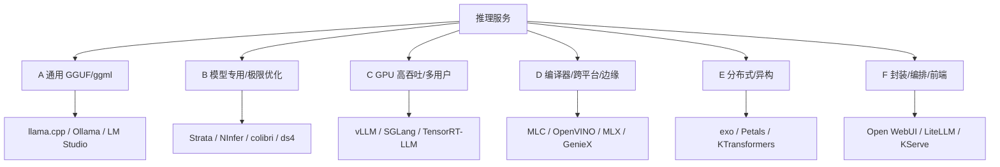
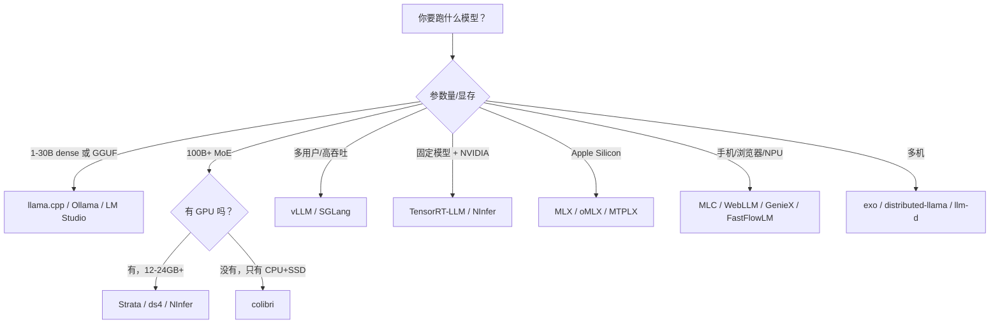

# M13 · 推理服务与运行时

> **这一模块回答**：一个已经训练好的模型，怎样变成你能调用、能并发、能省显存的服务？
>
> 它把 [M10 的 GEMM 与 Roofline](../10-数值线性代数/03-BLAS与GEMM.md)、[M11 的 KV Cache](../11-大模型专题/07-KVCache.md)、[量化](../11-大模型专题/09-量化.md)、[MoE](../11-大模型专题/10-MoE路由.md) 和 [M12 的研究路线](../12-进阶/04-研究路线.md)，接到真实的引擎、服务和部署上。
>
> **性质**：专题手册 + 课程 13.1–13.6 [推理的数学](01-推理的数学.md)、[模型格式与量化](02-模型格式与量化.md)、[引擎解剖](03-引擎解剖.md)、[调度与并发](04-调度与并发.md)、[选型与部署](05-选型与部署.md)、[诊断实验](06-诊断实验.md)。正文是六族系与选型导览。

---

## 0. 三个现场

### 现场一：24 GB 卡，想跑一个“服务器级”模型

你有一张 24 GB 显卡、64 GB 内存。有人告诉你 Qwen3.8-Flash-Next 很强，但它是百B级 MoE，权重文件动辄几十到上百 GB。常规做法是“显存不够，跑不了”；[Strata](https://github.com/Niko1221/Strata) 却能在 12–24 GB 卡上跑，代价是部分专家走 CPU、n-gram 表走 SSD，速度降到几到几十 token/s。

**问题**：这到底是在“跑模型”，还是在“跑一个内存调度器”？为什么有的引擎能跑，llama.cpp 直接加载却 OOM？

### 现场二：32k 之后开始复读

你用 Ollama 跑 LFM3-1.7B，前面 30k token 都正常，超过 32k 左右，输出开始反复出现同一段文字。你换温度、换量化、换 prompt，都只能缓解，不能根治。

**问题**：32k 是模型的能力上限，还是运行时给你分配的上下文上限？为什么“超限”的表现是复读，而不是报错？

### 现场三：选型表越看越乱

llama.cpp、Ollama、vLLM、SGLang、TensorRT-LLM、Strata、NInfer、MLX、MLC……每个都说自己快。你把 7B 模型放进 vLLM，单用户延迟反而不如 llama.cpp；你把 100B MoE 放进 llama.cpp，连加载都困难。

**问题**：这些项目到底在解决哪一层的问题？它们的“快”分别快在什么负载、什么硬件、什么阶段？

---

## 1. 这个模块在课程里的位置

| 前面学过 | 在推理服务里变成什么 |
| --- | --- |
| [10.3 BLAS 与 GEMM](../10-数值线性代数/03-BLAS与GEMM.md) | prefill 的大矩阵乘、decode 的瘦矩阵乘、Roofline、算术强度 |
| [11.7 KV Cache](../11-大模型专题/07-KVCache.md) | PagedAttention、prefix cache、KV 量化、上下文长度 |
| [11.9 量化](../11-大模型专题/09-量化.md) | GGUF K-quants/IQ、EXL2、NVFP4、FP8 KV、MLX 4-bit |
| [11.10 MoE 路由](../11-大模型专题/10-MoE路由.md) | 专家缓存、CPU/GPU 异构卸载、专家并行 |
| [11.11 logits 与采样](../11-大模型专题/11-logits与采样.md) | temperature/top-p/DRY、复读与采样参数 |
| [12.4 研究路线](../12-进阶/04-研究路线.md) | 从“读论文”到“选引擎、读日志、做 A/B” |

**一句话**：前面回答“模型内部发生了什么”，这一模块回答“模型外部怎么把它跑起来”。

## 1.1 学习顺序

| 顺序 | 内容 | 时间 | 读完你应该能…… |
| --- | --- | --- | --- |
| 1 | [13.1 推理的数学](01-推理的数学.md) | 45 min | 估算 TTFT/TPOT/显存，解释 32k 复读 |
| 2 | [13.2 模型格式与量化](02-模型格式与量化.md) | 50 min | 分清容器/权重精度/KV 精度，选对格式 |
| 3 | [13.3 引擎解剖](03-引擎解剖.md) | 50 min | 说清 llama.cpp/vLLM/Strata 的请求路径 |
| 4 | [13.4 调度与并发](04-调度与并发.md) | 50 min | 算 KV 预算、batch、Little 定律与 SLA |
| 5 | [13.5 选型与部署](05-选型与部署.md) | 45 min | 做容量/成本/网关/回滚方案 |
| 6 | [13.6 诊断实验](06-诊断实验.md) | 50 min | 诊断复读/OOM/吞吐/质量回退 |
| 7 | 本手册 §3–§11 | 60 min | 说出六个族系的差别，做一次选型 |

13.1–13.6 的习题见 [m13-习题](../exercises/m13-习题.md)，题库见 [quizbank/m13.yaml](https://github.com/kingfs/Linear-Algebra-to-LLM/blob/main/quizbank/m13.yaml)。

---

## 2. 六个族系



| 族系 | 核心问题 | 典型项目 | 你什么时候会用到 |
| --- | --- | --- | --- |
| A 通用 GGUF/ggml | 什么模型都能跑，怎么最省心 | llama.cpp、Ollama、LM Studio | 单机、低并发、快速验证 |
| B 模型专用 | 这个模型在我这台机器上怎么最快 | Strata、NInfer、colibri、ds4 | 100B+ MoE、消费级硬件、极限性能 |
| C GPU 高吞吐 | 多用户、多请求怎么打满 GPU | vLLM、SGLang、TensorRT-LLM | 生产 API、RAG、多租户 |
| D 编译器/边缘 | 同一模型怎么跨系统/手机/NPU | MLC、OpenVINO、MLX、GenieX | 浏览器、移动端、Intel/Apple/Qualcomm |
| E 分布式/异构 | 一台机器放不下，怎么把多台拼起来 | exo、Petals、KTransformers | 家庭集群、单机大 MoE |
| F 封装/编排/前端 | 模型怎么变成产品/工作流 | Ollama、Open WebUI、LiteLLM、KServe | 路由、鉴权、UI、K8s |

> **读表提醒**：stars 是 2026-10-31 的 GitHub 快照，只能说明“有多少人关注”，不能说明“有多成熟”。同一个项目可能在 5 周内从 0 涨到 36k，也可能两年没提交。

---

## 3. 族系 A：通用 GGUF/ggml

这一类共享 GGUF 格式、ggml 后端、CPU/GPU 混合卸载和大量量化格式。它们的共同目标是“让最多的模型，在最多的硬件上跑起来”。

| 项目 | Stars | 定位 | 主要系统/硬件 |
| --- | ---: | --- | --- |
| [llama.cpp](https://github.com/ggml-org/llama.cpp) | 132.9k | 参考引擎 | Linux/macOS/Windows/Android/WASM；CPU/CUDA/ROCm/Metal/Vulkan |
| [Ollama](https://github.com/ollama/ollama) | 185.4k | 服务化封装 | macOS/Linux/Windows；GGUF 模型库、自动卸载、API |
| [LM Studio](https://lmstudio.ai/) | 闭源 | 桌面 GUI | macOS/Windows/Linux；llama.cpp + macOS MLX |
| [GPT4All](https://github.com/nomic-ai/gpt4all) | 77.3k | 桌面对话 | macOS/Windows/Linux；llama.cpp |
| [textgen](https://github.com/oobabooga/textgen) | 47.7k | 实验 UI | Linux/Windows/macOS；多加载器 |
| [Jan](https://github.com/janhq/jan) | 45.2k | 桌面应用 | macOS/Windows/Linux；cortex.cpp/llama.cpp 系 |
| [LocalAI](https://github.com/mudler/LocalAI) | 50.1k | 自托管多后端 | Linux/macOS/Windows（Docker）；含 llama.cpp |
| [llamafile](https://github.com/mozilla-ai/llamafile) | 26.5k | 单文件分发 | Linux/macOS/Windows/BSD；Cosmopolitan + llama.cpp |
| [KoboldCpp](https://github.com/LostRuins/koboldcpp) | 12.1k | 创作/角色扮演 | Windows/Linux/macOS；llama.cpp |
| [llama-cpp-python](https://github.com/abetlen/llama-cpp-python) | 10.7k | Python 绑定 | 跨平台；把 llama.cpp 嵌进 Python |
| [llama-swap](https://github.com/mostlygeek/llama-swap) | 6.1k | 多模型代理 | Linux/macOS/Windows；按请求热切换 llama-server |
| [BitNet](https://github.com/microsoft/BitNet) | 41.4k | 1-bit 推理 | Linux/Windows；基于 llama.cpp 的 1-bit/ternary 分支 |
| [MNN](https://github.com/alibaba/MNN) | 16.3k | 端侧推理 | Android/iOS/桌面；阿里，移动端通用 |

**其他绑定/周边**：[LLamaSharp](https://github.com/SciSharp/LLamaSharp)、[Ramalama](https://github.com/containers/ramalama)、[node-llama-cpp](https://github.com/withcatai/node-llama-cpp)、[wllama](https://github.com/ngxson/wllama)、[cactus](https://github.com/cactus-compute/cactus)、[lemonade](https://github.com/lemonade-sdk/lemonade)、[shimmy](https://github.com/Michael-A-Kuykendall/shimmy)。

**怎么选**：

- 想要“一条命令跑起来” → Ollama / LM Studio。
- 想要“完全控制上下文、KV、采样、日志” → llama.cpp `llama-server`。
- 想把模型嵌进 Python/.NET/Node/浏览器 → llama-cpp-python、LLamaSharp、node-llama-cpp、wllama。
- 想研究量化/后端/内核 → 直接读 llama.cpp 的 `ggml` 与 `src/models/`。

**边界**：这一类的强项是“覆盖广、可移植、量化多”，弱项是“单卡极限性能”和“多用户吞吐”。同一张卡上，模型专用引擎可能快 1.5–3 倍；多用户场景，vLLM/SGLang 可能高一个数量级。

---

## 4. 族系 B：模型专用/单模型极限优化

这是 2026 年最值得关注的一条路线。它不追求“支持所有模型”，而是围绕少数 checkpoint、少数 GPU 和一套内存层级做端到端优化。

### 4.1 独立引擎

| 项目 | Stars | 目标模型 | 系统/硬件 | 核心手段 |
| --- | ---: | --- | --- | --- |
| [Strata](https://github.com/Niko1221/Strata) | 36.6k | Qwen3.8-Flash-Next、Qwen3.6-35B-A3B、DeepSeekV4.1-Flash | Windows/Linux/macOS；NVIDIA/AMD/Intel Arc/Apple/Strix Halo/DGX Spark | 专家缓存、CPU/GPU 并行、SSD n-gram、MTP 投机 |
| [NInfer](https://github.com/Neroued/ninfer) | 3.2k | Qwen3.6/3.8-27B、35B-A3B、Qwen3.8-Flash-Next、GLM-5.3-Flash | Linux；RTX 5090、DGX Spark 单机/双机 | 私有 `.ninfer`、CUDA Graph、MTP/DFlash、FP8 KV |
| [colibri](https://github.com/JustVugg/colibri) | 45.2k | GLM、Kimi K3、DeepSeek V4、Qwen3.8 等 13 个引擎 | Windows/Linux/macOS；CPU/Vulkan/CUDA，最低 8 GB RAM | 纯 C、专家从磁盘流式读取、safetensors |
| [ds4](https://github.com/antirez/ds4) | 24.2k | DeepSeek V4 Flash/Pro、GLM 5.x、Qwen3.8 | macOS/Linux；Metal/CUDA/ROCm | 自有 GGUF、多卡/RDMA、SSD streaming |
| [MTPLX](https://github.com/youssofal/MTPLX) | 2.7k | Qwen3.8-Flash-Next/27B、Ternary Bonsai、Gemma 4 | macOS Apple Silicon | MLX、模型自带 MTP head、精确拒绝采样 |
| [HyperQwen](https://github.com/syv-ai/HyperQwen) | 2.5k | Qwen3.8-27B | Linux/WSL2；单张 24 GB 卡 | vLLM 补丁、150k context、DFlash/MTP |
| [PolyStrata](https://github.com/VecSzn/PolyStrata) | 684 | 12 个模型（Qwen3.8、GLM、DeepSeek、LFM2.5 等） | Windows/Linux；NVIDIA/AMD，8 GB+ | Qwen3.8 用 Strata，其余用自研引擎 |
| [splash](https://github.com/incoai/splash) | 1.9k | 特定模型（Apple Silicon） | macOS | 围绕模型做端到端优化 |
| [KTransformers](https://github.com/kvcache-ai/ktransformers) | 19.6k | DeepSeek/Qwen 等 MoE | Linux | CPU+GPU 异构 MoE 卸载 |
| [PowerInfer](https://github.com/Tiiny-AI/PowerInfer) | 9.9k | 稀疏模型 | Linux | 热/冷神经元分离、稀疏激活 |
| [AirLLM](https://github.com/lyogavin/airllm) | 41.4k | 通用 Hugging Face 模型 | Linux/Windows/macOS | 逐层加载，4 GB 显存也能跑 |

**其他单点优化**：[Infernix](https://github.com/Wallawalla47/Infernix)、[basalt](https://github.com/jesdga95/basalt)、[halogen-flash-server](https://github.com/peonist-ai/halogen-flash-server)、[slotstream](https://github.com/carloslfu/slotstream)、[project-maya](https://github.com/mw00/project-maya)、[BigMoeOnEdge](https://github.com/Helldez/BigMoeOnEdge)。

### 4.2 六个值得单独看的项目

#### Strata：把“消费级机器跑百B MoE”做成产品

- **它解决什么**：Qwen3.8-Flash-Next 这类 125B-A6B MoE，常规加载要 100 GB 以上显存；Strata 把 24,576 个专家放在 RAM，GPU 只放热专家和 attention/DeltaNet/router/output head/MTP draft，SSD 放 28.8 GB 的 n-gram 表。
- **为什么快**：不是单个 kernel 更快，而是“每 token 只读需要的专家”；MTP 一次起草最多 3 个 token，一次前向验证；prompt lookup 在代码编辑/引用场景再省 6–11%。
- **代价**：只支持 3 个模型家族；模型文件是特制 GGUF/量化包；安装器会自动下载对应 GPU 的引擎；项目 2026-09-24 才创建，代码很年轻。
- **适合**：12–24 GB 显卡 + 64 GB 内存，想跑 Qwen3.8-Flash-Next；不适合 1–30B 小模型。

#### NInfer：单卡/双 Spark 的“窄而深”

- **它解决什么**：在 RTX 5090 / DGX Spark 上，把 Qwen3.6/3.8、GLM-5.3-Flash 这些模型跑到接近硬件上限。
- **为什么快**：CUDA Graph、MTP/DFlash 投机、FP8 KV、Vision、TP2/EP2、最多 8 并发；所有东西为特定架构编译。
- **代价**：Linux only；CUDA 13.4；只支持特定 GPU 架构；模型是 `.ninfer` 私有 artifact（Flash Next 101 GiB、GLM 178 GiB）；要自己转权重。
- **适合**：正好有 RTX 5090/DGX Spark，且模型在支持列表里；不适合“什么模型都想试”。

#### colibri：纯 C、无 GPU、专家从磁盘读

- **它解决什么**：没有 GPU、只有 8–32 GB 内存的机器，也能跑 100B+ MoE。
- **为什么能跑**：dense 部分放 RAM，routed experts 放磁盘，按 router 需求流式读取；纯 C、零依赖，支持 13 个模型家族。
- **代价**：速度慢，大模型通常 1–4 token/s；磁盘 IO 是瓶颈；模型覆盖手工维护。
- **适合**：离线、低功耗、教学演示；不适合交互式聊天。

#### ds4（DwarfStar）：Mac/CUDA/ROCm 上的“少而精”

- **它解决什么**：在 Mac、DGX Spark、Strix Halo 上跑 DeepSeek V4、GLM 5.x、Qwen3.8。
- **为什么特别**：Metal 为主，CUDA 支持多卡（含 Ada/L40S），ROCm 支持 Strix Halo；支持 SSD streaming、多机 RDMA 张量并行；8×L40S 可做 16 会话的多用户 server。
- **代价**：没有 Windows；模型覆盖随作者判断变化；多机配置复杂。
- **适合**：Mac Studio/MacBook 大内存、Strix Halo、NVIDIA 多卡工作站。

#### MTPLX：Apple Silicon 上的 MTP 专用引擎

- **它解决什么**：在 Mac 上把 Qwen3.8-Flash-Next / Qwen3.8-27B 的解码速度提高 1.6–2.24 倍。
- **为什么快**：直接用模型自带的 MTP head 起草多个 token，一次 batched forward 验证，精确拒绝采样；n-gram 表从 SSD 流式读取。
- **代价**：Apple Silicon only；Flash Next 建议 128 GB+；不是 CUDA 项目。
- **适合**：M3/M4/M5 Mac，尤其是 64–128 GB 统一内存。

#### HyperQwen：在 vLLM 上做“单模型补丁”

- **它解决什么**：Qwen3.8-27B 在单张 24 GB 卡上跑 150k context，还要 127 token/s 单流。
- **为什么快**：不是新引擎，而是针对 vLLM 0.32.0 的补丁：重排 head、校准 draft 词表、DFlash/MTP、int8 KV、长上下文 kernel。
- **代价**：绑定 vLLM 版本；只针对一个模型/一类卡；Docker/WSL2 为主。
- **适合**：24 GB 卡 + Qwen3.8-27B；不适合多模型/多硬件。

### 4.3 这类引擎的三条风险

1. **支持面极窄**：模型升级、量化格式变化、驱动更新，都可能让引擎失效。
2. **私有 artifact 锁定**：`.ninfer`、特制 GGUF、MLX 包，迁移成本高。
3. **代码年轻 + 安装器权限**：几周爆红的项目，安全审计、长期维护、边界条件都未经充分验证；一键安装器会下载二进制、写 PATH。

> **判断标准**：模型正好在支持列表、硬件正好匹配、你接受“窄而快”，就值得试；否则，通用引擎更稳。

---

## 5. 族系 C：GPU 高吞吐/多用户

这一类面向“多人/多请求/高吞吐”，和 llama.cpp 的单机低并发是两种设计目标。

| 项目 | Stars | 路线 | 主要系统 | 适合 |
| --- | ---: | --- | --- | --- |
| [vLLM](https://github.com/vllm-project/vllm) | 95.9k | PagedAttention、连续批处理 | Linux（WSL） | 生产默认，200+ 架构，TP/PP |
| [SGLang](https://github.com/sgl-project/sglang) | 38.3k | RadixAttention、前缀缓存 | Linux | RAG/Agent/共享 system prompt |
| [TensorRT-LLM](https://github.com/NVIDIA/TensorRT-LLM) | 15.0k | NVIDIA 编译引擎 | Linux/Windows | 固定模型、极致吞吐 |
| [TGI](https://github.com/huggingface/text-generation-inference) | 10.9k | HF 推理服务 | Linux | 2025-12 起维护模式，不建议新项目 |
| [LMDeploy](https://github.com/InternLM/lmdeploy) | 8.1k | TurboMind | Linux | InternLM、A100 INT4 |
| [Sonar](https://github.com/dphnAI/sonar) | 1.9k | vLLM 系（Aphrodite 重定向） | Linux | 量化扩展、角色扮演/创作 |
| [Triton](https://github.com/triton-inference-server/server) | 11.1k | 推理服务编排 | Linux/Windows | 多框架、TRT-LLM 后端、企业运维 |
| [Ray](https://github.com/ray-project/ray) | 44.2k | 分布式计算/编排 | Linux/macOS/Windows | Ray Serve LLM，自动扩缩容 |
| [Dynamo](https://github.com/ai-dynamo/dynamo) | 8.4k | 数据中心分布式 | Linux | 分离式 prefill/decode、K8s |
| [llm-d](https://github.com/llm-d/llm-d) | 5.1k | Kubernetes 分布式 | K8s | vLLM 之上的生产编排 |
| [GPUStack](https://github.com/gpustack/gpustack) | 5.9k | GPU 集群管理 | Linux | 多机多卡、vLLM/SGLang 部署 |

**其他服务/编排**：[DeepSpeed-MII](https://github.com/deepspeedai/DeepSpeed-MII)、[OpenLLM](https://github.com/bentoml/OpenLLM)、[Xinference](https://github.com/xorbitsai/inference)、[LightLLM](https://github.com/ModelTC/LightLLM)、[Chitu](https://github.com/thu-pacman/chitu)、[xLLM](https://github.com/xLLM-AI/xllm)、[RTP-LLM](https://github.com/alibaba/rtp-llm)、[TokenSpeed](https://github.com/lightseekorg/tokenspeed)、[TileRT](https://github.com/tile-ai/TileRT)、[Lucebox](https://github.com/Luce-Org/lucebox)、[vLLM-Ascend](https://github.com/vllm-project/vllm-ascend)。

**怎么选**：

- 多用户、RAG、OpenAI API → vLLM；共享前缀多 → SGLang；固定模型 + H100/B200 → TensorRT-LLM。
- 只是单机 1–2 个用户 → 不要上 vLLM，llama.cpp/Ollama 更简单、延迟更低。
- 需要 K8s、路由、鉴权、监控 → Triton/Ray Serve/Dynamo/llm-d/KServe/GPUStack，它们是编排层，不是引擎。

**边界**：vLLM/SGLang 的“快”来自 batching 和 KV 管理，不是单请求延迟。单请求、短上下文时，它们的调度开销可能比 llama.cpp 更明显。

---

## 6. 族系 D：编译器/跨平台/边缘

这一类解决“同一模型跑在不同硬件/系统/浏览器/手机”的问题。

| 项目 | Stars | 路线 | 主要系统 | 适合 |
| --- | ---: | --- | --- | --- |
| [MLC-LLM](https://github.com/mlc-ai/mlc-llm) | 23.3k | TVM 编译 | Linux/macOS/Windows/iOS/Android/WebGPU | 跨平台、移动端、浏览器 |
| [WebLLM](https://github.com/mlc-ai/web-llm) | 19.3k | 浏览器 WebGPU | 浏览器 | 纯前端本地推理 |
| [OpenVINO](https://github.com/openvinotoolkit/openvino) | 11.1k | Intel 推理 | Linux/Windows/macOS | Intel CPU/GPU/NPU |
| [IPEX-LLM](https://github.com/intel/ipex-llm) | 8.8k | Intel 优化 | Linux/Windows | Intel GPU/CPU |
| [ONNX Runtime GenAI](https://github.com/microsoft/onnxruntime-genai) | 1.1k | ONNX/DirectML | Windows/Linux/macOS | Windows、跨平台 |
| [GenieX](https://github.com/qualcomm/GenieX) | 8.5k | Qualcomm NPU/GPU/CPU | Qualcomm 设备 | Snapdragon 端侧 |
| [FastFlowLM](https://github.com/ROCm/FastFlowLM) | 2.0k | AMD NPU | Windows/Linux | Ryzen AI NPU |
| [MLX](https://github.com/ml-explore/mlx) | 29.0k | Apple 原生 | macOS | Apple Silicon |
| [mlx-lm](https://github.com/ml-explore/mlx-lm) | 7.5k | MLX LLM | macOS | Apple Silicon 推理/微调 |
| [oMLX](https://github.com/jundot/omlx) | 23.2k | Apple 服务端 | macOS | 连续批处理、分层 KV cache、菜单栏管理 |
| [ExLlamaV2](https://github.com/turboderp-org/exllamav2) / [V3](https://github.com/turboderp-org/exllamav3) | 4.6k / 1.8k | EXL2 量化 | Linux/Windows | 单用户 GPU 高速，非 GGUF |

**其他运行时**：[Rapid-MLX](https://github.com/raullenchai/Rapid-MLX)、[mlx-serve](https://github.com/ddalcu/mlx-serve)、[vllm-mlx](https://github.com/waybarrios/vllm-mlx)、[Klee](https://github.com/signerlabs/Klee)、[TensorFold](https://github.com/ashhart/TensorFold)、[mistral.rs](https://github.com/EricLBuehler/mistral.rs)、[candle](https://github.com/huggingface/candle)、[burn](https://github.com/tracel-ai/burn)、[Ratchet](https://github.com/huggingface/ratchet)、[Jlama](https://github.com/tjake/Jlama)、[llama3.java](https://github.com/mukel/llama3.java)、[TensorSharp](https://github.com/zhongkaifu/TensorSharp)。

**怎么选**：

- 浏览器/手机/跨平台 → MLC-LLM/WebLLM/MNN。
- Intel → OpenVINO/IPEX-LLM；Qualcomm → GenieX；AMD NPU → FastFlowLM。
- Apple Silicon → MLX/mlx-lm；要服务端 → oMLX/mlx-serve/Rapid-MLX；要 Qwen3.8 MTP → MTPLX。
- 单用户 NVIDIA + EXL2 量化 → ExLlamaV2/V3。

**边界**：这些路线的模型覆盖/量化格式通常比 llama.cpp 窄；编译型方案（MLC/TensorRT）还要为每个模型/硬件编译，迭代慢。

---

## 7. 族系 E：分布式/异构

| 项目 | Stars | 思路 | 主要系统 | 适合 |
| --- | ---: | --- | --- | --- |
| [exo](https://github.com/exo-explore/exo) | 48.1k | 多设备聚合 | macOS/Linux/Windows（实验） | 家里多台 Mac/PC 跑一个大模型 |
| [Petals](https://github.com/bigscience-workshop/petals) | 10.7k | 网络分布式 | Linux | 经典方案；最后提交 2024-09 |
| [distributed-llama](https://github.com/b4rtaz/distributed-llama) | 3.1k | C++ 张量并行 | 跨平台 | 多机 CPU/GPU |
| [Parallax](https://github.com/GradientHQ/parallax) | 1.4k | 分布式服务 | Linux/macOS | 自建 AI 集群 |
| [KTransformers](https://github.com/kvcache-ai/ktransformers) | 19.6k | CPU+GPU 异构 MoE | Linux | 单机大 MoE |
| [PowerInfer](https://github.com/Tiiny-AI/PowerInfer) | 9.9k | 稀疏激活 | Linux | 稀疏模型、边缘 |

**怎么选**：

- 多台闲置设备、模型大于单机内存 → exo/distributed-llama；网络带宽是瓶颈。
- 单机 CPU+GPU 跑大 MoE → KTransformers/PowerInfer；不是多机方案，但同样在解决“显存放不下”。
- 数据中心多机 → Dynamo/llm-d/GPUStack（见族系 C）。

**边界**：分布式推理的收益经常被网络通信吃掉；除非模型确实放不下，否则单机优化（量化/卸载/专家缓存）通常更划算。

---

## 8. 族系 F：封装/编排/前端

| 项目 | Stars | 角色 | 说明 |
| --- | ---: | --- | --- |
| [Ollama](https://github.com/ollama/ollama) | 185.4k | 封装 + 服务 | 模型库、自动卸载、`llama-server` 编排 |
| LM Studio | 闭源 | 桌面 GUI | llama.cpp/MLX 引擎，模型发现/对话 |
| [Jan](https://github.com/janhq/jan) | 45.2k | 桌面应用 | cortex.cpp/llama.cpp |
| [Open WebUI](https://github.com/open-webui/open-webui) | 157.3k | 前端 | 聊天 UI、RAG、多模型 |
| [LiteLLM](https://github.com/BerriAI/litellm) | 62.4k | 网关 | 统一 OpenAI 接口、路由、鉴权、成本统计 |
| [llama-swap](https://github.com/mostlygeek/llama-swap) | 6.1k | 代理 | 多 llama-server 热切换 |
| [Ray Serve](https://docs.ray.io/en/latest/serve/llm/index.html) | 44.2k | 编排 | 自动扩缩容、多模型 |
| [Triton](https://github.com/triton-inference-server/server) | 11.1k | 编排 | 多框架、企业运维 |
| [KServe](https://github.com/kserve/kserve) | 6.2k | K8s 平台 | 标准化推理 |

**关键点**：这些不是“更强的引擎”。它们解决的是模型管理、路由、鉴权、UI、部署。把它们和 vLLM/llama.cpp 比 token/s 没有意义。

---

## 9. 场景矩阵

| 场景 | 首选 | 备选 | 关键约束 |
| --- | --- | --- | --- |
| 本地聊天/写作 | Ollama、LM Studio、Jan | llama.cpp | 易用、模型管理、GUI |
| 本地编码 Agent | Ollama（64k+ ctx）、llama.cpp、Strata（Qwen3.8） | HyperQwen | OpenAI/Anthropic API、工具调用、长上下文 |
| RAG/知识库 | SGLang、vLLM | llama.cpp | 前缀缓存、连续批处理、吞吐 |
| 单机大 MoE | Strata、colibri、ds4、KTransformers | AirLLM | 内存层级/专家卸载 |
| 多用户 API | vLLM、SGLang | TensorRT-LLM | 并发、PagedAttention、TP/PP |
| 固定模型极致性能 | TensorRT-LLM、NInfer | HyperQwen | 编译/专用 kernel |
| Apple Silicon | MLX、oMLX、MTPLX | llama.cpp、LM Studio | 统一内存、Metal |
| 浏览器/移动端 | MLC-LLM、WebLLM、MNN | cactus | 跨平台、端侧 |
| 多机/家庭集群 | exo、distributed-llama | Petals | 聚合内存、网络 |
| K8s/多机生产 | Dynamo、llm-d、GPUStack | KServe、Ray Serve | 编排，不是单机引擎 |

---

## 10. 能力矩阵

> ✓ = 官方支持；部分 = 依赖模型/后端/插件；- = 不支持或未提供。

| 项目 | OpenAI API | Anthropic API | Vision | Tools | 投机解码 | 多卡 | CPU/SSD 卸载 | 格式 |
| --- | --- | --- | --- | --- | --- | --- | --- | --- |
| llama.cpp | ✓ | ✓ | ✓ | ✓ | ✓ | ✓ | ✓ | GGUF |
| Ollama | ✓ | 部分 | ✓ | ✓ | - | ✓ | ✓ | GGUF |
| vLLM | ✓ | ✓ | ✓ | ✓ | ✓ | ✓ | 部分 | safetensors/GGUF |
| SGLang | ✓ | 部分 | ✓ | ✓ | ✓ | ✓ | 部分 | safetensors |
| TensorRT-LLM | 部分 | - | ✓ | 部分 | ✓ | ✓ | - | 编译引擎 |
| Strata | ✓ | ✓ | ✓ | ✓ | ✓ | 部分 | ✓ | 特制 GGUF |
| NInfer | ✓ | ✓ | ✓ | ✓ | ✓ | ✓ | ✓ | `.ninfer` |
| colibri | ✓ | ✓ | 部分 | 部分 | - | 有限 | ✓ | safetensors |
| ds4 | ✓ | 部分 | ✓ | ✓ | ✓ | ✓ | ✓ | 自有 GGUF |
| MTPLX | ✓ | ✓ | ✓ | ✓ | ✓ | - | 部分 | MLX |
| HyperQwen | ✓ | 部分 | - | ✓ | ✓ | - | 部分 | safetensors |
| KTransformers | ✓ | - | 部分 | 部分 | 部分 | ✓ | ✓ | safetensors/GGUF |
| MLC-LLM | ✓ | - | ✓ | 部分 | 部分 | ✓ | - | MLC 编译 |
| MLX/mlx-lm | ✓ | 部分 | ✓ | 部分 | ✓ | - | - | MLX |

---

## 11. 选型决策树



**一张更实用的判断表**：

| 你的约束 | 先排除 | 再选 |
| --- | --- | --- |
| 只有 1 张 24 GB 卡，跑 7B–30B | vLLM（单用户收益低）、TensorRT-LLM（编译麻烦） | Ollama/llama.cpp；Qwen3.8 可看 HyperQwen |
| 只有 1 张 24 GB 卡，跑百B MoE | llama.cpp（直接加载会 OOM） | Strata/colibri/ds4 |
| 有 8 张 H100，多用户 | Ollama/llama.cpp（吞吐不够） | vLLM/SGLang；固定模型 TensorRT-LLM |
| 只有 Mac | CUDA 系全部排除 | MLX/mlx-lm；服务端 oMLX；Qwen3.8 看 MTPLX |
| 只有 CPU，内存 8–32 GB | vLLM/TRT-LLM | llama.cpp（小模型）、colibri（大 MoE） |
| 要嵌进浏览器/手机 | 所有 CUDA 服务 | MLC-LLM/WebLLM/MNN |
| 要多机拼显存 | 单机引擎 | exo/distributed-llama/llama.cpp RPC |

---

## 12. 与课程概念的对应

| 课程概念 | 在推理服务里的位置 | 具体例子 |
| --- | --- | --- |
| GEMM / Roofline（M10.3） | prefill 是计算密集的大 GEMM，decode 是带宽密集的瘦 GEMM | vLLM 的 batching、llama.cpp 的 `-b/-ub` |
| KV Cache（M11.7） | 显存占用、PagedAttention、prefix cache | vLLM PagedAttention、SGLang RadixAttention |
| 量化（M11.9） | 权重/KV 的字节数，直接决定 decode 带宽 | GGUF Q4_K_M、EXL2、NVFP4、FP8 KV |
| MoE（M11.10） | 专家缓存、CPU/GPU 卸载、专家并行 | Strata 的专家缓存、KTransformers 的 CPU 专家 |
| 采样（M11.11） | temperature/top-p/DRY，复读的直接开关 | Ollama/llama.cpp 的采样参数 |
| 数值稳定（M10.1–10.2） | fp16/bf16/fp8 的误差累积 | KV 量化、长上下文精度 |
| 低秩/SVD（M07） | LoRA、压缩 KV、低秩近似 | LoRA 服务、KV 低秩压缩 |
| 条件数（M04.6） | 量化/长上下文对误差的放大 | 4-bit 模型在长上下文的质量下降 |

**一句话**：推理服务的每个“魔法”，都能在课程里找到对应的矩阵/数值概念；没有这些概念，你只能背参数，不能诊断。

---

## 13. 一个最小诊断实验：LFM3 的 32k 复读

### 步骤 1：先确认运行时给了多少上下文

```bash
ollama --version
ollama ps
curl -s http://localhost:11434/api/ps | jq '.models[] | {name, context_length, size_vram}'
```

如果 `context_length` 是 32768，而你的对话刚好在 32k 附近开始复读，第一嫌疑就不是模型，而是运行时。

Ollama 的默认上下文按显存分档：< 24 GiB 为 4k，24–48 GiB 为 32k，>= 48 GiB 为 256k（见 [Ollama Context length 文档](https://docs.ollama.com/context-length)）。24 GB 卡正好落在 32k 档。

### 步骤 2：看日志有没有截断/移位

```bash
journalctl -u ollama -n 300 | grep -Ei "truncat|context shift|too large for model|n_ctx"
```

关键日志：

- `truncating input prompt`：Ollama 在 Go 层截断了 prompt。
- `slot context shift, n_keep = ..., n_discard = ...`：llama-server 在丢前一半、平移位置。
- `requested context size too large for model`：请求的 `num_ctx` 被 GGUF 元数据钳制。

### 步骤 3：提高上下文，并钉住 system prompt

```bash
OLLAMA_CONTEXT_LENGTH=65536 ollama serve
```

或派生一个模型：

```dockerfile
FROM lfm3
PARAMETER num_ctx 65536
PARAMETER num_keep 1024
```

```bash
ollama create lfm3-64k -f Modelfile
ollama run lfm3-64k
```

`num_keep` 默认只有 4，截断时几乎保不住 system prompt；设成 512–2048，能显著降低“上下文被挖空后开始复读”的概率。

### 步骤 4：用 llama.cpp 做对照

```bash
llama-server \
  -m LFM3-1.7B-Q4_K_M.gguf \
  -c 65536 -np 1 -ngl 99 \
  --no-context-shift --keep 1024 \
  -fa on -ctk f16 -ctv f16 \
  --jinja \
  --temp 0.2 --top-k 50 --top-p 0.9 \
  --repeat-penalty 1.05 \
  --dry-multiplier 0.8 --dry-allowed-length 2 --dry-penalty-last-n 256
```

`--no-context-shift` 让上下文满时显式报错，而不是静默丢掉一半。对 Agent/长会话，这比“自动 shift”更可控。

### 步骤 5：为什么混合模型更怕 context shift

LFM3-1.7B 是 24 层 tri-hybrid：13 层 shortconv + 5 层 sliding-window attention + 6 层 global attention。shortconv 是递归状态，不能像 KV 那样精确删掉中间一段；注意力部分截断了，卷积状态还带着被丢掉内容的信息。两者不一致时，模型更容易进入复读。

这不是说“llama.cpp 一定有 bug”，而是：**混合/递归模型在 context shift 下本来就比纯 attention 模型脆弱**。所以优先“给够上下文 + 钉住开头”，而不是依赖自动 shift。

### 步骤 6：一张排查表

| 现象 | 先查 | 再查 |
| --- | --- | --- |
| 32k 后复读 | `ollama ps` 的 `context_length` | 日志 `truncating input prompt` |
| 换模型也复读 | 客户端是否固定 32k | `num_keep` 是否太小 |
| 只有长输出复读 | 是否生成到一半撞上下文 | `done_reason` 是否为 `length` |
| 提高上下文后仍复读 | KV 量化/flash attention | 换 f16 KV、换量化、用 llama.cpp 对照 |
| 只有某个模型复读 | chat template / BOS | 官方 GGUF + `--jinja` |

---

## 14. 常见误区

1. **“stars 高 = 生产可用”**  
   2026 年多个模型专用项目在几周内爆红；代码年龄、硬件覆盖、维护者、许可证都要单独看。

2. **“模型专用引擎一定更好”**  
   它只在“模型在支持列表 + 硬件匹配 + 你接受窄支持”时更好；跑 1.7B 小模型时，通用引擎更稳。

3. **“量化一定加速”**  
   量化减少字节，不减少 FLOPs；只有带宽/显存受限时收益明显。prefill 算力受限时，反量化还可能变慢。

4. **“卡越多越快”**  
   多卡要过通信/并行；单请求低延迟场景，多卡经常不如单卡。先看模型能不能单机放下，再谈分布式。

5. **“上下文长度 = 模型上限”**  
   运行时可以给你更小的 `num_ctx`；Ollama 的 32k 是默认值，不是 LFM3 的 256k 上限。

6. **“API 兼容 = 体验一样”**  
   OpenAI/Anthropic 兼容只保证协议；工具调用、thinking、流式、错误码、上下文截断策略都可能不同。

---

## 15. 自测

1. 7B 模型 fp16 权重约 14 GB，HBM 带宽 2 TB/s。忽略 KV 与开销，decode 每 token 的理论下限是多少毫秒？上限约多少 token/s？
2. LFM3 在 32k 后复读，为什么先查 `ollama ps` 而不是先换模型？
3. 把 KV Cache 量化到 int8，理论上显存减半。为什么端到端不一定快 2 倍？
4. 什么时候选 vLLM，什么时候选 llama.cpp，什么时候选 Strata？
5. 模型专用引擎的三条主要风险是什么？

<details>
<summary>参考答案</summary>

1. $14/2000 = 7$ ms/token，上限约 $1000/7 \approx 143$ token/s。实际还要加 KV 读取、kernel 开销、采样。
2. 因为 32k 正好是 Ollama 在 24–48 GB 显存档位的默认 `num_ctx`；先确认运行时给了多少上下文，再看日志有没有截断/context shift，能区分“模型能力问题”和“配置/截断问题”。
3. 只有 KV 读取占总读取字节的比例足够大时，减半才有明显收益；短上下文时权重占大头，KV 量化收益小。还要看 kernel 是否真的支持、反量化开销、精度回归。
4. 多用户/高吞吐 → vLLM；单机 1–2 用户、要控制/调试 → llama.cpp；100B+ MoE、消费级硬件、模型在支持列表 → Strata（或 colibri/ds4）。
5. 支持面窄、私有 artifact 锁定、代码年轻/安装器供应链风险；另外还有模型许可证与 benchmark 偏差。

</details>

---

## 16. 数据来源与说明

- GitHub stars：2026-10-31 通过 GitHub REST API 采集，报告里四舍五入到 0.1k；完整 89 个项目的数据见调研附件（不随课程仓库提交）。
- 项目信息：各项目 README/docs，尤其是 [Strata HOW_IT_WORKS](https://github.com/Niko1221/Strata/blob/main/docs/HOW_IT_WORKS.md)、[NInfer README](https://github.com/Neroued/ninfer)、[colibri README](https://github.com/JustVugg/colibri)、[ds4 README](https://github.com/antirez/ds4)、[MTPLX README](https://github.com/youssofal/MTPLX)。
- 横评参考：[Best Open-Source LLM Inference Servers 2026](https://awesomeagents.ai/tools/best-open-source-llm-inference-servers-2026/)。
- 注意：Aphrodite 仓库已重定向到 Sonar；Nexa SDK 重定向到 Qualcomm GenieX；FastFlowLM 转到 ROCm 组织。stars 会随重定向/改名变化。
- 软件许可证不等于模型许可证；Qwen、LFM、GLM 等模型有各自的商用条款，部署前要单独核对。

---

## 17. 下一步

这个模块目前是“专题手册 + 13.1–13.6 六课”。六个教学单元已全部上线：

1. **13.1 推理的数学（已上线）**：[Roofline、prefill/decode、batching、KV、量化的收益边界](01-推理的数学.md)。
2. **13.2 模型格式与量化（已上线）**：[GGUF K-quants/IQ、EXL2、NVFP4、FP8 KV、MLX 4-bit](02-模型格式与量化.md)。
3. **13.3 引擎解剖（已上线）**：[llama.cpp 的 `llama-server`、vLLM 的 PagedAttention、Strata 的专家缓存](03-引擎解剖.md)。
4. **13.4 调度与并发（已上线）**：[continuous batching、prefix cache、公平性、SLA](04-调度与并发.md)。
5. **13.5 选型与部署（已上线）**：[单机/多机/边缘、API 网关、鉴权、监控](05-选型与部署.md)。
6. **13.6 诊断实验（已上线）**：[32k 复读、OOM、吞吐上不去、质量回归](06-诊断实验.md)。

**现在就能做的三件事**（也见 [开课计划](../docs/开课计划.md)）：

- 用 `ollama ps` + 日志复现一次 32k 复读，记录 `context_length`、`num_keep`、`done_reason`。
- 用同一份 GGUF 在 llama.cpp 和 Ollama 上各跑一次 64k，比较输出。
- 从族系 B 里挑一个项目，读它的 README 和一遍 issue，判断它是否适合你的硬件。

---

**延伸阅读**：

- [M10.3 BLAS 与 GEMM](../10-数值线性代数/03-BLAS与GEMM.md)
- [M11.7 KV Cache](../11-大模型专题/07-KVCache.md)
- [M11.9 量化](../11-大模型专题/09-量化.md)
- [M11.10 MoE 路由](../11-大模型专题/10-MoE路由.md)
- [M12.4 从这门课到推理研究](../12-进阶/04-研究路线.md)
