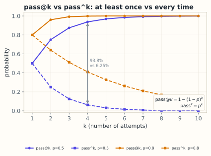

# 14.1 评测的数学：分数、误差与可比性

> **本节位置**：模块 14 · 模型评测 ｜ **前置**：[11.11 logits 与采样](../11-大模型专题/11-logits与采样.md)、[13.1 推理的数学](../13-推理服务/01-推理的数学.md) ｜ **预计**：45 分钟
>
> **一句话**：发布表上的每个分数都是**用有限道题、在某套脚手架、某个采样温度下估出来的一个数**；不懂它的误差，就会把噪声当能力。

## 0. 场景引入

你打开三张 2026 年的模型卡（数字为教学示例、未独立核验，见 [M14 口径说明](README.md)）：

- Qwen3.8-27B：Terminal-Bench 2.1（Terminus）**73.0**，SWE-bench Pro **61.7**；
- LFM3-1.7B：Terminal-Bench 2.1（OpenCode）**12.92**，SWE-bench Verified（OpenCode）**43.40**；
- DeepSeek-V4.1-Flash-1017：Terminal-Bench 4.0 **42.3**，DeepSWE v1.1 **77.0**。

三张表放在一起，你立刻会问四个问题：

1. 73.0 和 12.92 都是“Terminal-Bench 2.1”，为什么能差 60 分？——因为**模型不同，脚手架也不同**。
2. 61.7（SWE-bench Pro）和 43.40（SWE-bench Verified）能直接比吗？——不能，**题目集不同**。
3. 42.3 是 Terminal-Bench **4.0**，73.0 是 **2.1**，版本能混着看吗？——不能，**4.0 删了饱和题、改了资源预算**。
4. 如果两个模型是 71.2 和 69.8，媒体说“领先 1.4 分”，这 1.4 分是真的吗？——要看他用了多少题、开了什么采样。

**这一节不教你看哪个榜，先教你判断“一个分数能不能承载结论”。**

## 1. 直觉

把 benchmark 想成一次体检，而不是一次判决。

- **题目集**是抽血化验的指标项。抽 500 道题，就像只测 500 个指标里的 500 个；它不等于“全部能力”。
- **harness（脚手架）**是采血的手法：同一个指标，扎哪根血管、用哪种管、放多久，数值会变。
- **grader（判分器）**是化验仪器：仪器有系统偏差，换一台，正常值范围就变了。
- **采样温度**是病人当天的状态：睡没睡好、有没有喝咖啡，都会让指标上下浮动。

所以一个分数更像“某天、某台仪器、某套手法下的一次测量”，而不是“这个模型的能力真值”。

这个类比在哪里失效：体检指标有公认的参考区间，benchmark 没有；体检不会因为你多测几次就“过拟合”，模型会——同一套题被反复训练，分数会虚高。**评测不是测量一个固定物体，而是在和一个会适应考试的考生打交道。**

## 2. 定义

### 2.1 一个 benchmark 的五件套

| 组件 | 回答什么 | 例子 |
| --- | --- | --- |
| 任务集（tasks） | 考什么、多少题、难度分布 | SWE-bench Verified 的 500 个 issue |
| 环境（environment） | 在哪里做、能不能上网、有没有工具 | Docker 容器、浏览器、模拟数据库 |
| 脚手架（harness / scaffold） | 谁来做、能做多少步、怎么提交 | OpenCode、Claude Code、Codex CLI、Terminus、mini-SWE-agent |
| 判分器（grader） | 怎么算对 | 单元测试、最终状态检查、LLM judge、rubric |
| 报告口径（protocol） | 报哪个数、几次平均、什么采样 | pass@1、avg@3、pass^4、temperature=1.0 |

**发布表里通常只写第 1 项和第 5 项，把第 2–4 项塞进脚注。** 脚注不是装饰，它决定了这个数能不能复现。

### 2.2 常见指标

| 指标 | 定义 | 回答的问题 | 典型场景 |
| --- | --- | --- | --- |
| accuracy / resolve rate | 做对题数 ÷ 总题数 | 一次作答的正确率 | 知识、[SWE-bench](#ref-jimenez-2024) |
| pass@1 | 采样 1 次就对的概率 | 用户一次调用的成功率 | 代码、Agent |
| pass@k | k 次采样里至少 1 次对的概率 | 多试几次能不能做出来 | 代码生成 |
| pass^k | k 次采样**全部**对的概率 | 能不能稳定复现 | τ-bench、APEX |
| avg@n | n 次采样的平均分 | 降低单次方差 | QwenSWEBench 的 avg@3 |
| win rate | 与基线比“更好”的比例 | 相对偏好 | Arena-Hard、AlpacaEval |
| Elo / Bradley–Terry | 由两两胜负拟合出的能力分 | 相对强弱 | LMArena |

### 2.3 三种不确定度

1. **抽样误差**：只考了 500 题，不是无限题。题越少，分数越“抖”。
2. **执行方差**：温度、随机种子、工具超时、容器资源。Agent 任务尤其大。
3. **协议方差**：换 harness、换 judge、换 prompt 模板。它常常比前两项加起来还大。

> **一句话**：误差棒不是“模型不稳定”，而是“你没有测够，或者没有测同一件事”。

## 3. 为什么这样定义

如果只报一个点估计，读者会被迫做两件错事：

- 把 0.3 分的差距当能力差距；
- 把不同版本、不同 harness 的分放进同一张表排名。

统计学给了一个更诚实的表达：**估计值 ± 不确定度**。这也是为什么严肃的评测报告会写“500 题、3 次平均、95% CI ±4.0”，而不是只写“71.2”。

但仅有误差棒还不够。benchmark 的题目不是从“能力总体”里随机抽的，而是人挑的、有偏的；模型也不是固定分布，温度一换就变。**所以误差棒是下限，不是全部。**

## 4. 性质与推导

### 4.1 二项分布的标准误

把每道题看成一次伯努利试验，答对概率为 $p$。测 $n$ 题，正确数 $X\sim\mathrm{Binomial}(n,p)$，正确率的方差与标准误是：

$$
\operatorname{Var}(\hat p)=\frac{p(1-p)}{n},\qquad
\operatorname{SE}(\hat p)=\sqrt{\frac{p(1-p)}{n}}.
$$

95% 置信区间近似为 $\hat p\pm 1.96\,\mathrm{SE}$（[Miller](#ref-miller-2024) 系统讨论了这一口径）。这个式子说的是：**题目越多，误差越小，但只按 $1/\sqrt{n}$ 变慢。**

| $n$ | $p=0.5$ 时 SE | 95% CI 半宽 | $p=0.9$ 时 SE | 95% CI 半宽 |
| ---: | ---: | ---: | ---: | ---: |
| 100 | 5.0 pp | ±9.8 pp | 3.0 pp | ±5.9 pp |
| 500 | 2.24 pp | ±4.4 pp | 1.34 pp | ±2.6 pp |
| 2,000 | 1.12 pp | ±2.2 pp | 0.67 pp | ±1.3 pp |

要把半宽压到 ±2 pp（$p=0.5$），需要 $n\approx(1.96/0.02)^2\times0.25\approx2{,}401$ 题。**这就是为什么 500 题的榜，前几名差 1–2 分基本没有区分度。**

### 4.2 两个模型的差距显著吗

两个独立样本的比例差，标准误为：

$$
\operatorname{SE}(\hat p_A-\hat p_B)
=\sqrt{\frac{p_A(1-p_A)}{n_A}+\frac{p_B(1-p_B)}{n_B}}.
$$

若各 500 题、$p\approx0.7$，则 $\mathrm{SE}\approx\sqrt{2\times0.21/500}\approx2.9$ pp，95% CI 约 ±5.7 pp。**71.2 与 69.8 的 1.4 分差距，落在噪声里。**

### 4.3 pass@k：多试几次能不能做出来

从 $n$ 个样本里有 $c$ 个正确（[Chen 等](#ref-chen-2021) 的无偏估计），任取 $k$ 个，至少一个正确的无偏估计是：

$$
\widehat{\mathrm{pass@}k}=1-\frac{\binom{n-c}{k}}{\binom{n}{k}}.
$$

它衡量“采样多次”的上限，不是“一次就好”的体验。**产品里用户通常只调用一次，所以 pass@1 更接近体验；pass@k 更接近“模型有没有这个能力”。**

> 两条线从同一点出发，却朝相反方向走：k 越大，pass@k 越接近 1，pass^k 越接近 0。**“能做对”与“能稳定做对”是两种能力。**

### 4.4 pass^k：能不能稳定复现

$$
\widehat{\mathrm{pass}^k}=\frac{\binom{c}{k}}{\binom{n}{k}}.
$$

它衡量 $k$ 次全部成功的概率。$n=8,c=4$ 时，pass@1 是 50%，但 pass^2 只有 $\binom{4}{2}/\binom{8}{2}=6/28\approx21.4\%$。**“能做对”与“每次都做对”是两件事**，Agent 场景尤其如此。

### 4.5 Elo 与 Bradley–Terry

两两胜负模型假设（[Chatbot Arena](#ref-chiang-2024) 采用同类拟合）：

$$
P(A\text{ 胜 }B)=\frac{1}{1+10^{-(R_A-R_B)/400}}.
$$

400 分差对应约 10:1 的胜率（约 90.9%）。它只给出**相对**强弱，且依赖对手池：同一模型在不同池子里，分数会漂。

## 5. 例子

### 5.1 手算：500 题、350 对

$\hat p=0.70$，$\mathrm{SE}=\sqrt{0.7\times0.3/500}=0.0205$，95% CI 为 $[0.66,0.74]$。写进报告应写“70.0 ± 4.0”，而不是“70.0”。

### 5.2 手算：pass@4

$n=8$ 个样本，$c=2$ 个正确：

$$
\widehat{\mathrm{pass@}4}=1-\frac{\binom{6}{4}}{\binom{8}{4}}
=1-\frac{15}{70}=78.6\%.
$$

同一次实验的 pass@1 是 $2/8=25\%$。**从 25% 到 78.6%，模型没变，变的只是“允许试几次”。**

### 5.3 场景：同一模型，两个 harness

某模型在 Terminal-Bench 2.1 上，用 Codex CLI 是 77.3，用 Terminus 2 是 54.8。差 22.5 分，远超 89 道题的抽样误差。**这时该问的不是“模型到底多少分”，而是“我的产品用哪个 harness”。**

### 5.4 场景闭环：把评测当实验设计

- 输入：模型权重、harness、题集、采样参数、预算。
- 计算：每题跑 $n$ 次，记录成功/失败、耗时、token、成本。
- 输出：$\hat p$、CI、pass@1、pass^k、成本/成功任务。
- 失败判据：CI 重叠且成本更高 → 不换模型；CI 不重叠但成本翻倍 → 看业务价值。

## 6. 常见误区

1. **“95% CI 表示真值有 95% 概率落在区间内。”** 频率派区间不是这个意思；它表示“重复抽样时，95% 的区间会盖住真值”。对读者更实用的说法是：“这个分数的不确定度大约是 ±4 分。”
2. **“71.2 > 69.8，所以 A 更强。”** 500 题、$p\approx0.7$ 时，1.4 分在噪声内。至少要看 CI，或者看同题集上的配对比较。
3. **“pass@8 有 90%，说明模型很强。”** pass@8 只说明“多试几次能做出来”；如果产品只调用一次，该看 pass@1。
4. **“都叫 Terminal-Bench，分数可以放一起。”** 2.1 与 4.0 的题集、资源预算、超时都变了；官方甚至用语义化版本明确“x 变必须重跑”。
5. **“LLM judge 给的分是客观的。”** judge 有位置偏差、长度偏差、自我偏好；同一个答案换 judge 可能差 5–10 分。

## 7. 概念网络

- 前置：[11.11 采样](../11-大模型专题/11-logits与采样.md) 决定“一次作答”的随机性；[13.1 推理的数学](../13-推理服务/01-推理的数学.md) 决定“跑一次要多少钱”。
- 本节 → [14.2 知识与推理](02-知识与推理.md)：知识题的误差主要来自题集与污染。
- 本节 → [14.3 代码与软件工程](03-代码与软件工程.md)：代码题的误差主要来自 harness 与测试。
- 本节 → [14.4 Agent 与工具](04-Agent与工具.md)：Agent 题的误差主要来自环境与长程方差。
- 本节 → [14.7 读表与选型](07-读表与选型.md)：把误差写进选型报告。

## 8. 通往大模型

读任何一张大模型发布表（[Biderman 等](#ref-biderman-2024) 给过一份复现清单），先做这五件事，再谈“谁更强”：

1. **找 $n$**：题集多少题？是全部还是子集？子集是不是“难例”？
2. **找 harness**：表头或脚注写的是 OpenCode、Claude Code、Codex CLI、Terminus 还是 mini-SWE-agent？换 harness 的分数不能直接比。
3. **找采样**：temperature、top_p、max_tokens、turn 上限、超时；Agent 任务还要看“允许几次 trial”。
4. **找 grader**：单元测试、最终状态、LLM judge 还是 rubric？judge 是哪个模型、什么版本？
5. **找版本**：2.1 还是 4.0？Verified 还是 Pro？V1 还是 V2？

一个可检验的结论：**在 500 题、$p\approx0.7$ 的设置下，两个模型差 2 分以内，不要写“显著领先”；差 5 分以上，才值得进一步看任务级胜负。** 这条结论可以直接写进你的选型报告，也可以用来反驳“榜单营销”。

## 9. 练习

1. **概念题**：benchmark 的五件套分别是什么？为什么“同题集、不同 harness”仍然不可比？
2. **计算题**：400 题、正确 320 题，求 $\hat p$ 与 95% CI 半宽；若要把半宽压到 ±2 pp，至少需要多少题（按 $p=0.8$ 估）？
3. **计算题**：$n=10,c=3$，求 pass@1、pass@5、pass^5。
4. **开放题**：你要向老板证明“新模型在客服工单分类上更好”。写出你的实验设计：题集、重复次数、指标、控制变量、失败判据。

## 10. 一页速记

- 分数 = 估计值；误差 = 抽样 + 执行 + 协议。
- $\mathrm{SE}=\sqrt{p(1-p)/n}$；500 题约 ±4 pp，2,000 题约 ±2 pp。
- pass@k 是“多试几次”的上限；pass^k 是“每次都稳”的可靠性。
- 同 benchmark 不同 harness / 不同版本，分数不可直接比。
- 读表先看脚注：$n$、harness、采样、grader、版本。

## 11. 参考文献与致谢

这一页的统计口径来自评测方法学与几个基准的原始设计；正文中的公式与读表规则都可以在下面找到出处。

- **Miller（2024）**：*Adding Error Bars to Evals: A Statistical Approach to Language Model Evaluations*。系统讨论评测分数的置信区间、配对比较与功效分析。[arXiv:2411.00640](https://arxiv.org/abs/2411.00640)
- **Chen 等（2021）**：*Evaluating Large Language Models Trained on Code*。pass@k 无偏估计与 HumanEval 的原始出处。[arXiv:2107.03374](https://arxiv.org/abs/2107.03374)
- **Jimenez 等（2024）**：*SWE-bench: Can Language Models Resolve Real-World GitHub Issues?*。把“真实 issue + 测试”变成可执行评测的范式。[arXiv:2310.06770](https://arxiv.org/abs/2310.06770)
- **Chiang 等（2024）**：*Chatbot Arena: An Open Platform for Evaluating LLMs by Human Preference*。Elo / Bradley–Terry 与人类偏好评测的代表作。[arXiv:2403.04132](https://arxiv.org/abs/2403.04132)
- **Biderman 等（2024）**：*Lessons from the Trenches on Reproducible Evaluation of Language Models*。为什么“同榜不同分”是常态，以及复现需要记录什么。[arXiv:2405.14782](https://arxiv.org/abs/2405.14782)

---

下一篇 → [14.2 知识与推理：从 MMLU 到 HLE](02-知识与推理.md)
